# Adapter values before provisioning

Issue #2718 adds an explicit `provision.prepare` capability and `prepare` phase
to the existing isolated runtime adapter. It authorizes no deployment or tenant
operation. Private content and adapter implementations remain with their owners.

## Contract and enforcement model

The independent SDK declares the phase, required file/parameter inputs, and a
bounded list of provisioning concerns. A preparation-only adapter may declare no
guest bindings. An adapter with guests retains the existing readiness requirement.
Empty new fields are omitted: old manifest, pin, request and result identities
must remain byte-identical. An older worker rejects the new opt-in contract.

The request includes the admitted plan's digest, not an unbounded plan or cloud
credentials. The adapter owns its interpretation of declared file inputs. Its
response proposes bounded scalar replacements, each naming a resource address,
concern and existing payload JSON pointer. It cannot return executable guest
actions in this phase, replace a plan, add paths, change resource identities or
rewrite dictionary keys. Duplicate or overlapping replacements are refused.

Core preserves the original plan and stores the approved mapping beside it.
Only a process-local copy is supplied to the realization driver. Both resource
and operation payloads must agree before replacement; dependency and operation
metadata stay intact. Reporting and completion evidence use original plan
identities. Bound guest OS/count facts cannot change underneath guest planning.

| Boundary | Executable invariant |
| --- | --- |
| SDK manifest/input/result | Closed Pydantic models, explicit capability and declared concerns, digest/phase correlation, unique bounded scalar replacements, no guest actions during preparation. |
| Original plan | Existing address and pointer, scalar leaf, matching operation/resource payload, original plan digest and immutable metadata. Unknown or ambiguous authority grants nothing. |
| RAES authority | Each edit is covered by its declared concern. All overlapping authority remains effective. Exact/closed values cannot change. Existing public bounded-domain, legacy structure and current recursive-constraint evaluators enforce the original constraints. Only conformant results are accepted. |
| Worker output | Fernet encryption before stdout; ciphertext remains within the existing 1 MiB output limit. A missing/wrong invocation key fails closed without printing a response. |
| Controller commit | Original operation, range generation, deadline and cancellation are rechecked. Accepted preparation and planned invocation are committed under the range mutex together. No provider mutation precedes acceptance. |
| Lifetime custody | The existing range plugin binding retains one write-once preparation snapshot. Its encrypted result is also carried by the existing read-only invocation projection. SQL guards prohibit replacing accepted preparation. |
| Consumer | Reconstruct the original invocation from source operation, pin, plan and range identities before decrypting/using the mapping. The provisioner remains RAES-free; the application authenticates its semantic approval with the existing field-encryption primitive. |
| Cleanup | New destroy inputs snapshot the exact retained preparation. Absence observed under the cancellation/range mutex proves that no preparation-dependent realization was admitted; teardown can report the original plan absent without guessing mapped cloud names. |

Limits reuse the existing request/file/output budgets: 64 KiB request, 16 files
and 512 KiB aggregate file material, 512 KiB clear preparation response and at
most 4096 scalar edits. Ciphertext fits the existing 1 MiB bounded log reader.
The full retained result must also fit the existing 256 KiB operation envelope
with its original input. Core validates that future cleanup envelope before
acceptance; an otherwise valid larger response fails before any provider effect.
Prepared cleanup reuses the immutable source input, avoiding changed registry
projections. Unprepared cleanup needs only its original plan, pin and absence
proof, with no image or guest-material selection.
Unknown, unresolved, unsupported or budget-exhausted constraint relations fail.
No constraint is inferred from a placeholder's spelling or a missing field.

## Data flow and trust boundaries

```mermaid
flowchart LR
    A[Authorized administrator] -->|explicit capability and input binding| P[Pinned adapter]
    R[Admitted original RAES plan] -->|digest and immutable operation| C[Core controller]
    F[CMS retained file input] -->|original read proof and bounded bytes| W[Isolated worker]
    P --> W
    C -->|invocation input and derived output key| W
    W -->|bounded encrypted proposed values| C
    R --> V[Original constraint validation]
    C --> V
    V -->|accepted encrypted snapshot| B[Existing range binding and invocation projection]
    B -->|exact source identity and sealed result| D[Provisioner]
    R --> D
    D -->|process-local effective payloads| E[Existing realization driver]
    D -->|original plan identities| O[Existing operation results]
    B -->|same mapping or pre-effect absence proof| X[Existing destroy operation]
```

File material and adapter output are untrusted. Core validates the entire
proposed selection before accepting any value or dispatching a realization.
Executable code stays inside the installed, isolated worker. The adapter gets
no CMS client, storage locator, platform/database credential or provider API.
Network denial, gVisor, non-root identity, read-only files and resource ceilings
continue to apply. Core never branches on a private scenario identity.

## Confidential output and durable transport

Use the repository's existing `cryptography` Fernet implementation. Core derives
one invocation key with HKDF-SHA256 from its existing field-encryption key and
a fixed protocol label plus invocation UUID. The derived key cannot decrypt
application fields or another invocation. It is delivered as the sensitive
`BIGRAE_PLUGIN_RESULT_SECRET` key of the existing Job-owned invocation Secret;
it never appears literally in the Pod spec or request JSON. The application
key is never supplied to the adapter.

The worker removes the key from its environment before importing adapter code,
suppresses incidental plugin output as today, then encrypts the bounded response
before stdout. Core decrypts, validates the SDK response and original RAES
constraints, then re-encrypts the accepted response with the existing `enc:v1:`
field-encryption primitive for storage. The provisioner already has the matching
field-decryption transport. No new service, key store or cloud grant is added.

Admission permits exactly one existing input key and, optionally, this one
result key from the same invocation Secret. Extra keys, literal values, mixed
input aliases and unrelated Secrets are denied. Other worker profiles and
existing guest-only requests remain unchanged.

The accepted snapshot binds the original pin, plan, source operation and input
digests. Disable/rebinding, file replacement and retries cannot substitute a
new mapping. A destroy operation uses that retained snapshot, not a fresh
adapter invocation or mutable registry selection. The application records an
unprepared snapshot only while holding the same range lock that prevents late
controller acceptance after cancellation. Without planned acceptance, the
provisioner cannot have crossed its first-effect boundary.

## Verification and delivery

Use synthetic SDK/worker tests, original-authority fixtures and real first-party
queue/commit/operation transport tests. Exercise exact and nested constraints,
unknown closure, malformed pointers, duplicates, oversized values, ciphertext
tampering, replay, original reporting, retry and cancellation/cleanup races.
Check that plaintext is absent from worker stdout and durable JSON. Mutation
checks must detect bypassing exact-value admission and output encryption.

Evaluate the rendered admission policy against actual worker manifests and
the real local API-server test. Run relevant frontend, platform/provisioner
checks and the required architecture guard. Full suites run in CI. No tenant,
deployment or private repository is needed for implementation evidence.
