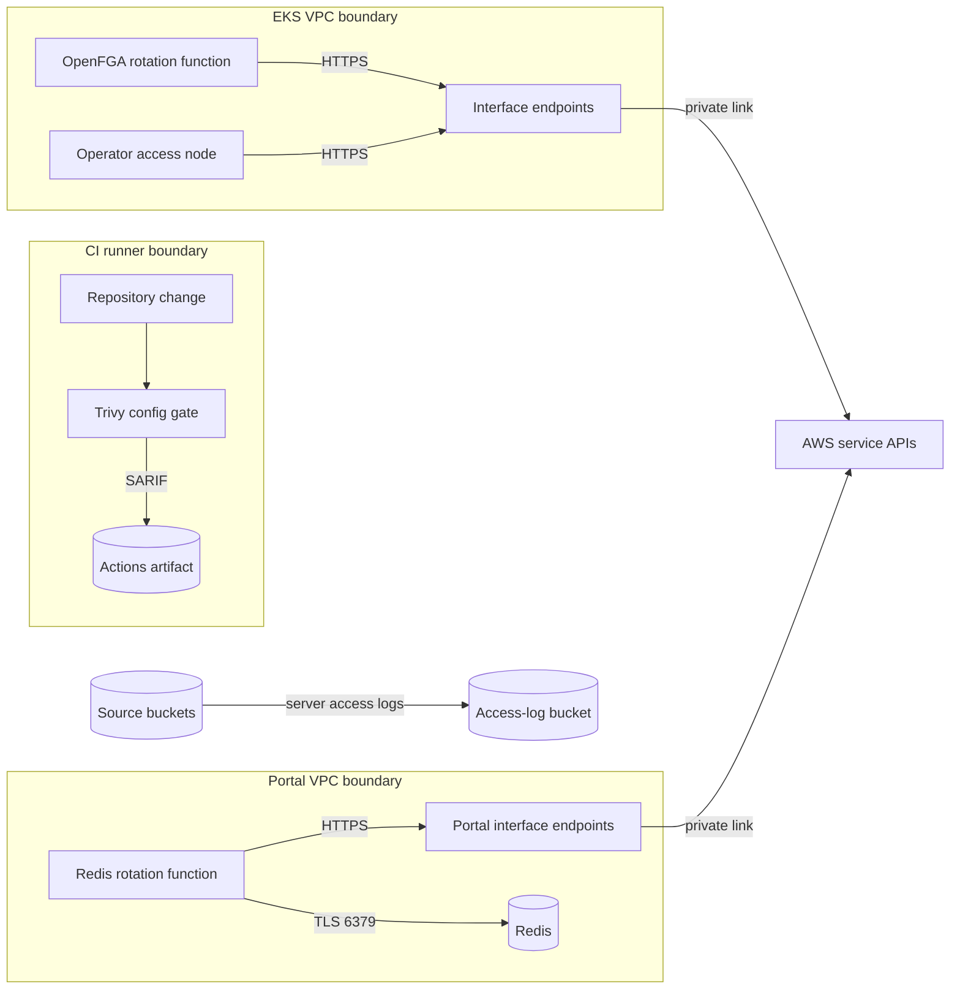

# Blocking Trivy configuration scan: design (#2566)

Status: implementation design. Date: 2026-11-25.

This design records the decisions for issue #2566. The
[preflight note](./blocking-trivy-config-preflight-2566.md) holds the boundary
analysis. ADR-003, ADR-004, ADR-008, ADR-017, and ADR-020 supply the
architecture. The work adds no new ADR.

The change also does the management-egress part of issue #2563. The
self-hosted GitHub runners stay unchanged. Issue #2573 owns a deploy path that
does not need them.

## Architecture

### Scan gate

The `security-trivy-config` job in `.github/workflows/_quality.yml` replaces
`security-trivy-advisory`. It scans the same four roots: `shifter/engine`,
`shifter/shifter_platform`, `shifter/packer`, and `platform/terraform`. It keeps
the checksum-verified Trivy 0.71.2 binary, the hosted runner, and
`contents: read`.

The job uses the status aggregation of the OSV job. Each root runs with
`--exit-code 1`, and a failure sets a status flag. All roots run. The step exits
with the flag. The SARIF upload runs with `if: always()`, so findings stay
available when the job fails.

The job pins the checks bundle by digest with `--checks-bundle-repository`. The
tag `2` moves when Aqua publishes new checks, so an unpinned gate can fail
without a repository change. The checks embedded in the binary are older and
report stale results, for example GCP-0015 on a Cloud SQL instance that sets
`ssl_mode = "ENCRYPTED_ONLY"`. A bundle update is a deliberate digest change.

Absence checks cannot use an inline ignore. The job passes
`.trivyignore-config.yaml` to every root for those checks. The root
`.trivyignore.yaml` stays the exact-release image policy.

### Finding dispositions

Paths are relative to `platform/terraform/` unless stated.

| Rule | Resource | Disposition |
| --- | --- | --- |
| AWS-0104 | `global/dev-box` | Removed. The root is a manually applied workstation for one organization. It is not a product capability. |
| AWS-0104 | `modules/portal/eks` OpenFGA rotation and operator access groups | Fixed. HTTPS egress goes to new interface endpoints in the EKS VPC. |
| AWS-0104 | `modules/portal/redis` rotation group (Checkov CKV_AWS_382) | Fixed. Egress goes to Redis and to the portal interface endpoints. The portal VPC gets an `elasticache` endpoint. |
| AWS-0104 | `global/github-runner` | Exception. The runner must reach GitHub on the public internet. |
| AWS-0104 | `modules/range/vpc/ngfw.tf` dataplane group | False positive. The NGFW security policy filters the forwarded traffic. |
| AWS-0104 | `modules/range/vpc/ngfw.tf` management group | Exception. The firewall management plane must reach the vendor licensing and management services. |
| AWS-0089 | `log-aggregation`, `portal/s3`, `engine-state`, `lambda-code-signing` | Fixed. Each bucket sends S3 server access logs to the access-log bucket of its root. |
| AWS-0089 | `modules/s3-access-logs` bucket | Exception. AWS documents that a destination bucket must not have server access logging. |
| AWS-0090 | `log-aggregation` buckets, `portal/s3` | Fixed. Versioning is on. Lifecycle rules expire noncurrent versions and expired delete markers. |
| AWS-0132 | `log-aggregation` ALB bucket, `modules/s3-access-logs` bucket | Exception. ALB log delivery and S3 server access log delivery support only SSE-S3. |
| AWS-0177 | `modules/portal/rds` in dev | Fixed. Dev sets `db_deletion_protection = true`, and the root variable defaults to `true`. The teardown script already lifts it. |
| AWS-0342 | `global/iam` security and EKS policies, `modules/provisioner-iam` | False positive. The rule flags every `iam:PassRole` allow. Each grant names a role namespace and a target service. |
| GCP-0014 | `gcp/modules/portal/cloud-sql` | Fixed. `log_temp_files = 0` and `log_min_error_statement = panic`. |
| GCP-0033 | `gcp/global/github-runner` | Exception. The runner disk uses Google-managed encryption, as the existing CKV_GCP_38 decision records. |
| GCP-0074 | `gcp/modules/range/vpc` `range_deny_ingress_all` | False positive. The rule is a deny-all rule, not an allow rule. |
| DS-0026 | `shifter/engine/openvpn` | Fixed. The image checks its health listener. |
| DS-0026 | `shifter/engine/provisioner`, `shifter/packer/preparation` | Fixed. `HEALTHCHECK NONE` records that the one-shot images run no service. |
| DS-0026 | `guacamole-rdp` test image | Fixed. The image checks its RDP port. |
| DS-0002 | `guacamole-rdp` test image | Exception. `xrdp-sesman` must run as root to authenticate users and start their sessions. |

The PassRole grants are scoped in this way. The deploy-role security policy
passes `shifter-*` and `<env>-*` roles to named services only. Its RDS
monitoring grant has no service condition, because RDS does not set
`iam:PassedToService`. That grant names only `*-rds-enhanced-monitoring` roles.
The EKS policy passes `shifter-<env>-eks-*` roles to EKS only. The provisioner
passes the range and NGFW instance roles to EC2 only.

### Cloud SQL logging

Cloud SQL logs temporary files by default (`log_temp_files = 0`). The flag is
now explicit. PostgreSQL adds the statement text to every message at or above
`log_min_error_statement`. The default is `error`, and `LOG` ranks above
`error`. Thus temporary-file messages and error messages carried SQL text. That
breaks the #2084 no-SQL-text decision. `panic` removes the statement text.
Error messages still go to the log. Neither flag needs a restart.

### S3 access logs

The new `modules/s3-access-logs` module makes one destination bucket for each
root: portal, range, and EKS. AWS requires the destination in the same account
and Region. The bucket uses SSE-S3, bucket-owner-enforced ownership, versioning,
a public-access block, and a TLS-only policy. The policy lets
`logging.s3.amazonaws.com` put objects under each source prefix. It requires the
source account and the exact source bucket ARN.

Each source module takes the destination name as an input. The source logging
resource depends on the destination policy. The range root keeps its own
destination, so range does not depend on portal state.

### Version retention

The upload bucket expires noncurrent versions after one day. This keeps the
ephemeral-data decision (#109). The log buckets keep noncurrent versions for 30
days. This lets an operator recover a deleted log object. Expired delete
markers are removed in each bucket. The teardown script already deletes all
versions.

### Interface endpoints

The EKS VPC gets interface endpoints for `secretsmanager`, `ssm`,
`ssmmessages`, and `ec2messages`. Private DNS is on. The endpoint group admits
HTTPS from the EKS VPC CIDR, so other VPC clients keep working. The OpenFGA
rotation and operator access groups send AWS API traffic only to the endpoint
group. Their other egress rules stay: the portal database and the EKS API.

## Systems security engineering

| Asset | Threat | Control | Verification |
| --- | --- | --- | --- |
| CI policy posture | A misconfiguration ships because the scan is advisory | Blocking scan over every root; pinned binary and checks | The job fails on a finding in any root and uploads SARIF |
| Gate integrity | An upstream checks update changes the verdict | Checks bundle pinned by digest | The workflow test asserts the digest pin |
| Management credentials and data | A compromised helper sends data to any internet host | Helper egress limited to VPC endpoints, Redis, and the portal database | Trivy and Checkov report no egress finding on these groups |
| Bucket contents | Undetected object access or deletion | S3 server access logs and versioning | Terraform contract tests assert logging, versioning, and lifecycle |
| Access-log destination | Another account or bucket writes into it | Source-account and source-ARN conditions; TLS-only policy | The contract test asserts the policy conditions |
| Database confidentiality | SQL text reaches Cloud Logging | `log_min_error_statement = panic` | The flag test asserts both flags |
| Portal database | Accidental deletion | RDS deletion protection in dev and prod | The tfvars assert true in both environments |
| PassRole boundary | A later grant passes any role to any service | Exact-resource ignore plus a guard that requires resource and service scope on every PassRole allow | The guard test rejects an unscoped grant |

Residual risks:

- The AWS runner and the NGFW management plane keep internet egress.
- S3 access-log delivery is best effort. It is not a complete audit ledger.
- The log destination uses SSE-S3. AWS does not support a customer-managed key
  there.

## Data flow

Trust boundaries: the CI runner, each VPC, and the AWS service plane. Scanner
artifacts carry only first-party source diagnostics.

## Diagrams

The data flow diagram above is the only new diagram. The change adds no new
deployment topology or state model.

## Policy as code

- `quality_ownership.py` removes the Trivy job from the advisory set.
- `_deploy_workflow_plan_scope.py` adds `security-trivy-config` to the
  skip-tests immunity list.
- `check_tf_iam_role_naming` requires a resource scope and a service condition
  on every `iam:PassRole` allow. The RDS monitoring grant is the named
  exception.
- `.checkov.yaml` drops the repository-wide CKV_AWS_382 skip. The runner and
  NGFW groups carry resource skips.
- `.checkov.yaml` also drops the CKV_AWS_18, CKV_AWS_21, CKV_AWS_293, and
  dev-box era public-access skips. No resource needs them now. The log
  destination and the RDS deletion-protection input carry resource skips.
- The Cloud SQL module contract test runs in CI. It asserts both logging
  flags.

## Architecture as code

- New module `modules/s3-access-logs`. The portal, range, and EKS roots
  instantiate it.
- `modules/portal/eks` adds interface endpoints and narrows two groups.
- `modules/portal/vpc` adds the `elasticache` endpoint and exports the endpoint
  group ID. `modules/portal/redis` narrows its rotation group.
- `global/dev-box`, its README, and `scripts/dev-box.sh` are removed.
- `global/iam` gives the deploy role `s3:PutBucketOwnershipControls` and the
  range access-log bucket name. Apply it before the environment roots.
- `scripts/bootstrap/aws_env_destroy.py` empties the ownership-verified EKS
  and range buckets before their destroy. The teardown runbook lists the
  access-log buckets.

## ADR changes

No new ADR is added. ADR-004-R11 in `docs/adr/index.yaml` and
`docs/technical/dev/adr-enforcement.md` describe the Trivy configuration scan as
blocking. `docs/adr/exceptions.yaml` gets one entry for each exception and
false positive in the table above. The CKV_AWS_382 entry and the dev-box era
public-access entry are removed. The CKV_GCP_38 entry also names GCP-0033. A
new entry records the RDS deletion-protection input skip.

`docs/technical/architecture.md` states that the EKS management helpers have
no internet egress.

## Document review

This document uses ASD-STE100 Simplified Technical English. Each sentence states
one fact. Descriptions stay within 25 words. The document describes the system
and its decisions. Implementation tasks stay in the issue plan.
