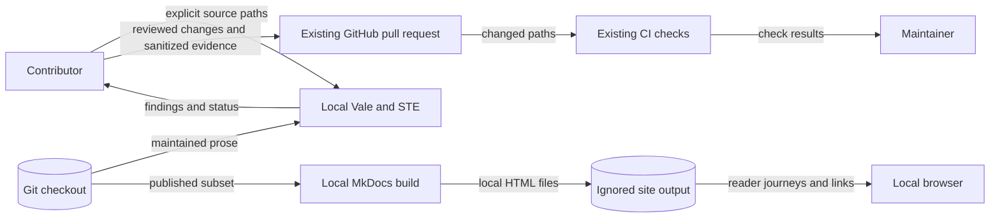

# Contributor documentation design

Diataxis purpose: explanation. Issue #2809 owns this design.
Source baseline: `2da5146f5` on 2026-11-10.
The prerequisite issues #2804 through #2808 are closed.
Their merged deliveries supply the shared tools and section guidance.

This document describes the documentation system. The issue plan holds the tasks.

## Reader routes and authority

Keep the existing page locations and useful heading anchors.
Use landing pages to route readers to a task, exact reference, or explanation.
Do not introduce another registry, classifier, skill, publisher, or service.

Contribution, setup, review, release, support, and qualification procedures are how-to guides.
The command matrix is reference. Quality rationale and engineering principles are explanation.
Mixed pages can retain separately named reference and explanation sections.
Historical UAT records need a current introduction and a safe route to supported procedures.
Preserve their original examples and findings as reference, rather than presenting them as current commands.

`CONTRIBUTING.md` owns authoring setup and links to the released documentation skill.
Other agent files link to that guidance. They must not duplicate the style guide.
`AGENTS.md`, accepted ADRs, and `.ground-control.yaml` supply current repository rules.
Legacy Spec Kit records do not override those rules.
Retain template fields and markers that the existing shell scripts consume.

Review template prose at its source before describing generated output as maintained.

`docs/dev/testing.md` owns exact verification commands and CI ownership.
The local contribution route selects targeted tests. CI owns full suites and coverage gates.
The root Makefile remains the command implementation.
Documentation cannot authorize cloud operations, publication, or a protected-branch merge.
Preserve the user's feature-PR merge decision and the separately invoked release procedure.

`SECURITY.md` owns vulnerability-reporting channels.
Support pages route sensitive reports there and ordinary defects to the canonical issue tracker.
Read the repository's private-reporting setting before describing channel availability.
Do not invent response deadlines, certification, or supported-version commitments.

## Repository patterns and boundaries

| Existing owner | Application |
| --- | --- |
| `.ground-control.yaml`, ADR-069 | Canonical repository identity and repository-specific tooling boundary |
| `CONTRIBUTING.md`, `tools/install-vale.sh`, `.vale.ini` | Shared skill, verified tool setup, explicit paths, and narrow preserved spans |
| `.ste-required.txt`, `Makefile`, `vale.yml` | Enroll fully rewritten pages; keep full migration reports in CI |
| `mkdocs.yml`, `docs.yml`, `docs/requirements.txt` | Existing local build and publication boundary |
| `docs/adr/documentation-coverage.yaml` | Existing feature discoverability and source pairing, where applicable |
| `.github/quality-path-filters.yaml`, `scripts/quality_ownership/` | Existing quality ownership; no new routing system |
| `docs/adr/index.yaml`, `docs/adr/exceptions.yaml` | Existing rule authority and time-limited exceptions |
| `docs/architecture/documentation-tool-adoption-2804.md` | Shared-tool trust model and final inventory boundary |
| `Makefile`, package configuration, `_quality.yml`, `deploy.yml` | Supported test lanes, CI posture, and full-suite ownership |
| `pr-title-lint.yml`, `release-please.yml`, release configuration | Branch, title, version, changelog, and release behavior |
| UAT CLI parsers, config loaders, result models, and sanitizers | Target, credential, transport, report, and exit-status contracts |

No runtime module, API, database, environment variable, package dependency, or executable policy changes.
No new logging, authentication, retry, validation, or error helper is needed.
The native tool diagnostics remain the verification output.
No new ADR or policy exception is needed because the rules remain unchanged.
Update the existing enforcement reference when maintained agent guidance changes.
The workflow YAML and quality ownership contract remain the executable architecture model.

Policy descriptions in `.shifter.yaml` and `mcp/ops/policy.js` are maintained source prose.
Correct their comments against the current wrapper without changing configuration values or JavaScript statements.
Preserve the #777 preflight body as historical evidence; add a current note that routes readers to the implemented contract.

## Systems security

Assets include source text, contribution records, participant credentials, operational evidence, and accepted policy.
The checkout, verification processes, GitHub, and deployed tenants are separate trust boundaries.

| Threat and boundary | Control | Verification |
| --- | --- | --- |
| Sensitive data enters a public issue | Require synthetic reproduction; route private reports through the security policy | Inspect support links and read back private-reporting availability |
| A qualification example mutates a tenant | Put operator authority and prerequisites before the command | Compare instructions with harness safety checks; run no live qualification |
| Legacy guidance weakens current controls | State applicability at direct links; preserve merge and test boundaries | Compare agent guidance, scripts, Makefile, hooks, and workflows |
| Generated output diverges from its source | Review maintained generator descriptions and preserve machine fields | Inspect existing consumers and generated-source ownership |
| A writing change alters normative meaning | Preserve commands, identifiers, obligations, quantities, and conditions | Review meaning separately from Vale and STE results |
| A checker sends prose to another service | Keep the shared dictionary and remote analyzer disabled | Use the established local wrapper and configuration |
| A build is mistaken for permission to publish | Keep local builds separate from the existing Pages deployment | Inspect the unchanged workflow permissions and conditions |

Source review cannot qualify a live range, prove legal compliance, or reproduce an unrecorded historical environment.
Keep these limits explicit. Preserve exact evidence, vendor notices, legal text, and generated release history.
Future source changes can invalidate prose. Existing source pairing and reviewed PRs remain the maintenance controls.

### Cross-cutting passage

| Layer | Required satisfaction |
| --- | --- |
| Authentication and authorization | Local checks use no application or cloud identity. Pull-request jobs retain `contents: read`. Pages keeps separate write authority and a non-PR condition. |
| Secret handling | Keep prose in local processes and existing runners. Retain gitleaks and private-key checks. Use synthetic examples and sanitized evidence. |
| Configuration shapes | Do not add contributor settings to `bigrae.yaml` or runtime env manifests. Use existing Make targets, package options, and validated CLI fields. |
| Parser and policy gates | Markdown passes through Vale, STE, and MkDocs. Guardrail files retain ADR guard, safe workflow parsing, actionlint, and quality ownership. |
| Host and shell inputs | Quote repository-relative paths and keep NUL-delimited Git selection. Never evaluate a path or document value as shell code. |
| OS-level exposure | Keep passwords, tokens, cookies, signed URLs, and private keys out of process arguments. Preserve mode-0600 files, existing environment seams, and redacted reports. |
| Errors and diagnostics | Preserve native findings, stderr, and nonzero exits. Do not hide setup or parser failures with report mode or blanket success handling. |
| API error envelopes | This work changes no API envelope. Contributor pages link to the existing API reference and shared error contracts. |
| Logging and persistence | Add no telemetry, audit event, database, baseline, score, or report schema. Git and the delivery PR remain the evidence records. |
| Publication | MkDocs exclusion is not a confidentiality control. Review sensitive data before commit. Only the existing main-branch job can publish. |

## Data flows

Text alternative: local tools read checkout files and return findings.
MkDocs writes local HTML for browser review.
Only reviewed changes and sanitized evidence reach the existing GitHub repository.
CI reports results to the maintainer. This flow does not deploy or publish a site.

The release service supplies tools through the existing verified installer, as described in the #2804 design.
No prose is sent to that service.

## Coverage and verification

Reconcile Git's tracked files in the delivery PR, including new pages added by preceding issues.
Use issue #2770's specific family assignments before assigning remaining material to #2809.
Distinguish maintained instructions, exact contracts, generated outputs, and historical evidence within mixed families.
Do not exclude a maintained page because it is hidden, off-site, or not Markdown.
Do not create a second permanent migration inventory.

Check current claims against the recorded source revision.
Check historical applicability against the introducing revision when available.
State when historical results or live behavior remain unverified.
Retain exact fixtures and machine-valued text files under their existing consumers.

Correct false traceability claims when the linked source does not implement the recorded behavior.
Use DOCUMENTS for a missing-behavior record. Preserve normative statements and requirement status.
This source audit does not claim delivery of a retained vendor-template obligation.

Run Vale and the three configured STE checks on explicit changed paths.
Use existing targeted documentation-consumer tests, the strict MkDocs build, and the required ADR guard.
Inspect rendered headings, links, diagram alternatives, and keyboard routes.
Repeat the first-use, recovery, interface, architecture, and contribution journeys after integration.
Do not run full local suites, corpus checks, or cloud operations to verify prose.
There is no changed executable behavior for mutation testing.

Existing negative writing samples test checker enforcement; they do not prove complete STE conformance.

## Extension seams and gotchas

The next rewritten Markdown page extends `.ste-required.txt`.
The next major feature extends the existing coverage manifest and its indexes.
The next source-bound handbook association extends the existing `drift_sources` field.
The next component keeps its README beside the component and links it from the nearest owner page.
The next CLI wording change starts at the parser or generator source.
Tool upgrades use the existing version and digest pins.

The current support pages disagree on repository identity, product name, contact details, and private-report availability.
Resolve those facts from canonical owners and link to one policy.
Do not copy one stale page into another.

The MkDocs configuration reports several link and anchor failures as informational.
A strict build does not prove route or anchor integrity.
The coverage manifest cannot prove hidden-guidance or whole-corpus completion.
The rewritten-page list cannot cover HTML, templates, CLI help, or source docstrings.

UAT guidance must preserve target acknowledgment, production refusal, file modes, secure transport, and report redaction.
Replace concrete deployment identities with synthetic examples.
Top-level UAT artifacts have no current consumer outside path ownership.
Preserve them only with a stated fixture or history reason and a useful route.

Hidden guidance can change merge authority, secret handling, or release behavior.
Treat it as policy or executable configuration.
Resolve conflicts through current repository authority rather than duplicated prose.

## Non-goals and anti-patterns

This issue changes no runtime behavior, authorization, API, configuration, error envelope, logging, persistence, deployment, or release policy.
It does not activate a requirement or prove a live environment.
It does not authorize a custom tool, skill, registry, classifier, content score, or dictionary pipeline.
It does not authorize external text processing, new hosting, live UAT, cloud operations, publication, or protected-branch merges.
It does not authorize broad linter exclusions, a second command matrix, or a duplicate support policy.
It does not move a published page without redirect and anchor verification.

It does not rewrite legal, vendor, generated, fixture, or historical content for style.

## References and document review

| Source | Version or section | Design use |
| --- | --- | --- |
| [Diataxis compass](https://diataxis.fr/compass/) | Current, reader needs | Separate tasks, facts, and reasons |
| [Diataxis application](https://diataxis.fr/how-to-use-diataxis/) | Current, small improvements | Preserve routes; avoid a directory migration |
| [Official STE source](https://www.asd-ste100.org/about.html) | Writing rules, vocabulary, technical names and verbs | Review meaning and consistent terminology |
| [MkDocs configuration](https://www.mkdocs.org/user-guide/configuration/) | MkDocs 1.6, validation and excluded documents | Preserve publication scope and inspect informational link findings |

The official STE page was read directly after the browser retrieval returned HTTP 403.
No specification or dictionary was copied into the repository.
Review procedural sentences for the 20-word limit and descriptions for the 25-word limit.
Review paragraph length, consistent technical names, meaning, and each document's purpose separately.
Automated checks supplement this review. They do not certify full STE or accessibility conformance.
