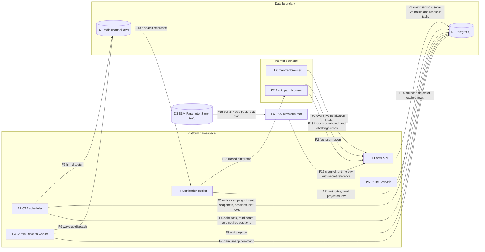
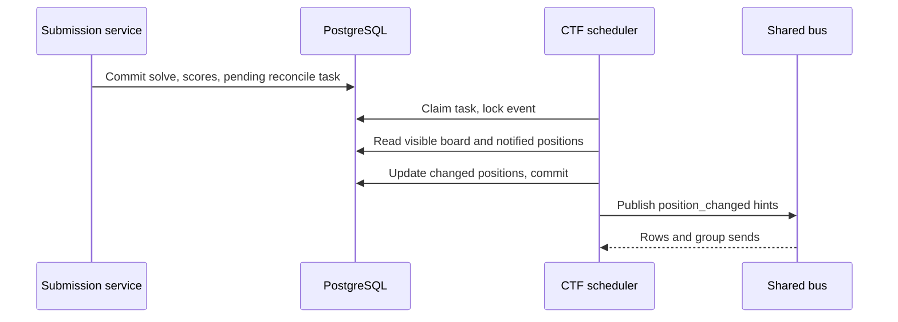
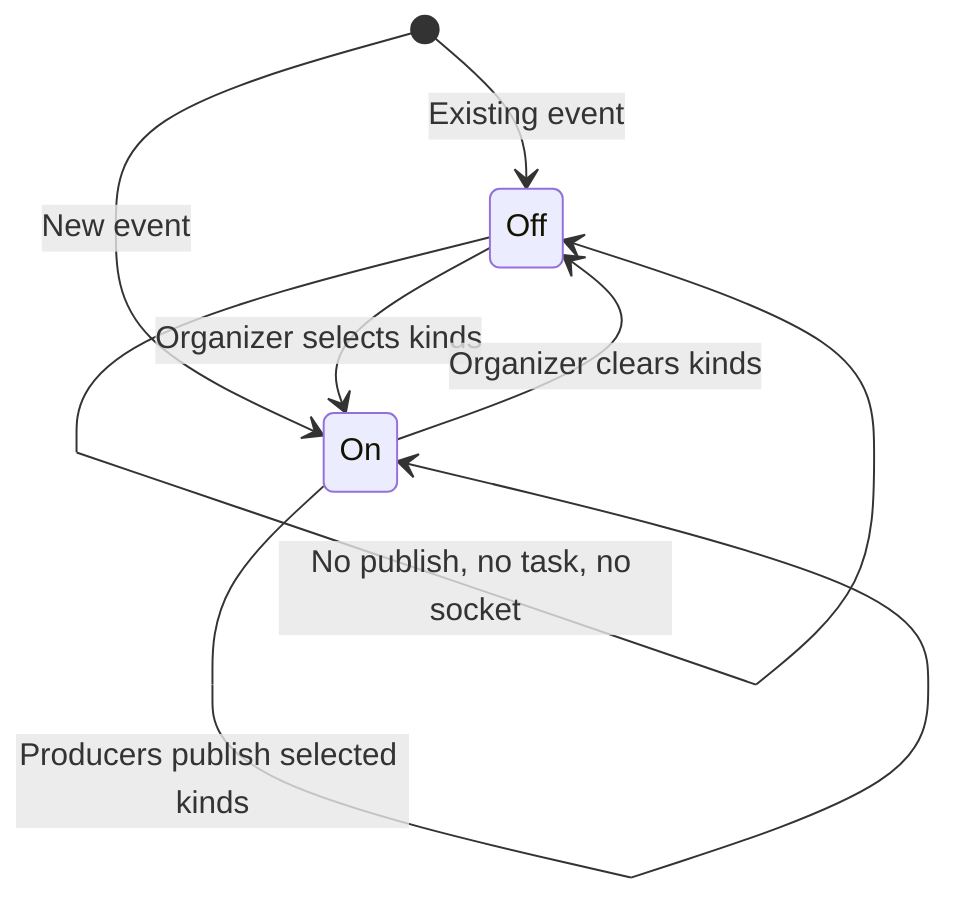

# CTF live notifications design (#665, ADR-072)

Status: implementation design. Date: 2026-10-31.

This design records the decisions for issue #665 and requirement CTF-802.
[ADR-072](../adr/072-live-ctf-notifications-per-event.md) records the binding
decisions. ADR-051-R6 and the
[preflight](ctf-realtime-notifications-preflight-665.md) constrain the design.
Application paths are relative to `shifter/shifter_platform/`.

## Context

| Area | State before this change | Defect |
| --- | --- | --- |
| Challenge release | `release_challenge` changed visibility only. | No notice. |
| Position change | No message existed. | No notice. |
| First blood, range ready | `publish_event_notification` used the event UUID as replay identity. The projection changed the payload to `refresh`. It also wrote rows for organizers, and no organizer view reads the socket. | No toast. Later notices for one recipient collapsed onto one row. Organizer rows were never read. |
| Deployment | `WEBSOCKET_NOTIFICATIONS_ENABLED` defaulted to false. No renderer set it. | Live notifications were off in every deployment. |
| AWS channel layer | The portal stack published its Redis posture to SSM. The EKS root did not read it. | Each AWS process ran its own in-memory channel layer, so cross-pod WebSocket push did not work. |
| Retention | `prune_notifications` existed. Nothing scheduled it. It deleted all rows in one statement. | Expired rows stayed. |
| Configuration | No event setting selected live notifications. | An event could not turn the cost on or off. |

## Decision summary

1. Each event selects a closed list of live notification kinds. An empty list
   does no work.
2. Supported deployments set the capability flag to true.
3. Challenge release and first blood become durable in-app ledger notices.
4. A position change becomes a content-free socket hint from a coalesced
   scheduler reconcile.
5. Range ready becomes a content-free socket hint with an occurrence identity.
6. A Helm CronJob runs a bounded prune.

## Architecture

### Components

| Component | Responsibility | Interface |
| --- | --- | --- |
| `ctf/enums.py` `LiveNotificationKind` | The closed kind set. | Enum values |
| `CTFEvent.live_notifications` | The kinds that the event selects. | Organizer event API, participant current-event API |
| `ctf/services/notification/live.py` | Decides if a kind is active. Inserts live-notice and reconcile tasks. Stages notices. Reconciles positions. | `live_kind_enabled()`, `request_live_notice()`, `request_position_reconcile()`, `run_live_notice_task()`, `run_position_reconcile_task()` |
| `ctf/services/notification/realtime.py` | Projects socket payloads. Publishes one hint for each occurrence. | `publish_live_hint()`, `publish_communication_wakeup()` |
| `ctf/services/notification/ledger.py` | Stages a trusted notice on the communication ledger. | `stage_notice(channels=...)` |
| `ctf/services/communication/adapters/inapp.py` | Publishes a message wake-up when the event selects `messages`. | `ChannelAdapter.deliver()` |
| Score owners (`submission.py`, `award.py`, `team.py`, `participant/moderation.py`, `event/_update.py`) | Signal that positions can have changed, in the change transaction. | Call `request_position_reconcile()` |
| `run_ctf_scheduler` | Runs `LIVE_NOTICE` and `RECONCILE_POSITIONS` tasks. | `TASK_HANDLERS` |
| `shared/notifications.py` | Persists and fans out hints. Prunes expired rows in bounded batches. | `publish_notification()`, `prune_expired_notifications()` |
| `CtfWorkspaceLayout.tsx` | Opens the socket only when the event selects a kind. Shows fixed-text toasts. | Shared WebSocket bus |
| `frontend/src/lib/reconnectingSocket.ts` | Bounded reconnect with capped exponential backoff and jitter, shared with the range-status socket. | `openReconnectingSocket()` |
| `notification-prune-cronjob.yaml` | Runs `prune_notifications` on a schedule. | Kubernetes CronJob |
| `scripts/gcp/verify_running_image_ids.py` | Verifies a running prune pod at its exact release image. Ignores a finished prune pod. | Post-rollout image evidence |
| `platform/terraform/modules/portal/eks/portal_channels.tf` | Reads the portal Redis posture from SSM Parameter Store. | `channel_runtime_env` output, merged into the EKS root `runtime_env` |
| `scripts/bootstrap/aws_eks.py` | Copies the portal Redis AUTH token into the EKS-owned `redis` secret container. Sets the AWS capability flag. | `_populate_eks_workload_secrets()`, `render_aws_values()` |

### Enablement

`live_kind_enabled(event, kind)` is true only when the capability flag is true
and the event lists the kind. Each producer checks it before it does work.
The participant current-event response returns the effective list. The list is
empty when the capability is off. The SPA opens no socket for an empty list.

The `messages` kind controls live wake-ups for all inbox items. Inbox
availability does not depend on it. When the event does not select `messages`,
the in-app adapter accepts the command with reason `live_disabled` and
publishes nothing.

### Challenge release and first blood

A challenge is released when it changes from hidden to not hidden while the
event is active or paused. The scheduler release and a challenge update can
cause this change. A running event does not accept a new challenge. First blood is the first correct
submission for a challenge. The submission service detects it under the
challenge row lock.

The source transaction inserts one `LIVE_NOTICE` task with the notice kind and
the challenge ID. The insert takes no event lock. The task commits with the
source change, so a crash cannot lose the notice. First blood inserts no task
while the scoreboard is hidden or frozen.

The task handler locks the event and checks the kind again. For first blood,
it also checks that the scoreboard is neither hidden nor frozen. It holds the
lock while it calls `stage_notice`, so a scoreboard change cannot occur between
the check and the notice. `stage_notice` runs with the `in_app`
channel and the event audience. The campaign identity derives from the event,
the notice kind, and the challenge, so a retry or a second release collapses
onto the first notice. A refused admission raises, so the task retries with its
existing backoff.

| Kind | Subject | Body |
| --- | --- | --- |
| `challenge_released` | New challenge available | A new challenge is available. Open the challenges page to see it. |
| `first_blood` | First blood | A challenge has its first solve. Open the scoreboard for details. |

### Position reconcile

These changes call `request_position_reconcile(event_id)` in their transaction:
a correct submission, an award grant or revoke, a team membership change, a
participant moderation action, and a scoreboard or kind setting change. It
updates the pending `RECONCILE_POSITIONS` row for the event. The update locks the
row until the caller commits. The scheduler claims with `skip_locked`, so it
cannot run that reconcile before the change commits. When no pending row
matches, because none exists or the scheduler already claimed it, a new pending
task is inserted. A race can insert two tasks. The second reconcile finds no
change. The leaderboard rebuild command does not request a reconcile, because a
rebuild does not change ranks.

The handler runs in one transaction:

1. Lock the event row. This serializes reconciles for the event.
2. Stop when the kind is off, the event is not active or paused, or the
   scoreboard is hidden or frozen.
3. Read the canonical board once: the team board in team mode, else the
   individual board. The board uses competition ranking.
4. Compare each entry's rank with its stored `notified_position`.
5. Write the changed positions with one bulk update.
6. Commit.

After the commit, the handler publishes one `position_changed` hint to each changed
entry with a score above zero. A team hint goes to each viewing member with an
account. The occurrence identity derives from the event, the entry, the new
position, and the task ID.

An entry with no stored position gets its position without a hint. A rebuild
that does not change ranks changes nothing. When an organizer removes a freeze
or shows a hidden board, the next reconcile reports the changes against the
newly visible board.

### Socket projection

`_reference_payload` returns one of these shapes. It runs before storage and
again before each send and replay.

| Kind | Payload |
| --- | --- |
| Message wake-up | `{"kind": "communication", "snapshot_id", "intent_id"}` |
| Position change | `{"kind": "position_changed"}` |
| Range ready | `{"kind": "range_ready"}` |
| Other | `{"kind": "refresh"}` |

The SPA drops any other frame. It shows fixed text and links to the scoreboard,
the range page, or the inbox.

### Deployment

`scripts/gcp/render_runtime_env.py` emits `WEBSOCKET_NOTIFICATIONS_ENABLED=true`.
GCP always has the Memorystore channel layer.

On AWS, the portal stack owns ElastiCache and writes its posture to SSM
Parameter Store (ADR-018). The EKS module reads `channel-layer-backend` and,
when it is `redis`, the endpoint, the TLS flag, and the CA mode (ADR-044-R6). It
emits `CHANNEL_LAYER_BACKEND`, `REDIS_HOST`, `REDIS_PORT`, `REDIS_TLS`,
`REDIS_CA_MODE`, and `REDIS_SECRET_ID` into the runtime env. `REDIS_SECRET_ID`
names the EKS-owned `redis` secret container. Before Helm, the deploy tool copies
the portal AUTH token into that container through a 0600 temporary file. The
deploy tool refuses a `REDIS_SECRET_ID` that names any other secret.
`entrypoint.sh` hydrates the token into `REDIS_PASSWORD`. `scripts/bootstrap/aws_eks.py`
emits `WEBSOCKET_NOTIFICATIONS_ENABLED=true` only when the runtime env names
`REDIS_HOST`. The runtime inventories, the published bundle contract, and the
environment manifest list these keys. The CronJob runs hourly with
`concurrencyPolicy: Forbid`, a starting deadline, an active deadline, and short
history limits. It uses the workers service account, the database login helper,
and the restricted security context. The Cloud SQL proxy runs as a native
sidecar, which does not block Job completion. The prune deletes at most a fixed
number of batches in each run, so a CronJob that runs twice is safe.

The GCP rollout lists every pod in the platform namespace, finished pods
included. The running-image check treats `notification-prune` as an optional
scheduled release workload. A running prune pod must run the exact release
image. A finished prune pod runs no container, so the check ignores it. A
finished pod of any other workload stays in the check.

## Systems security engineering

| Asset | Threat | Control | Verification |
| --- | --- | --- | --- |
| Hidden challenge names | A broadcast names a challenge that prerequisites hide | Fixed notice text with no challenge or participant name | Tests inspect the campaign subject and body |
| Frozen or hidden standings | A notice reveals a solve or a rank change | No first-blood task while hidden or frozen; no reconcile while hidden or frozen | Tests with hidden and frozen boards |
| Notice content | Content in a socket frame or replay row | Closed projection before storage, send, and replay; SPA classifier drops other frames | Tests inspect stored payloads and frames |
| Topic access | A user subscribes to another event | Existing `_can_subscribe` and `authorize_event_projection` on subscription, send, and replay | Existing authorization tests |
| Database and bus capacity | Fan-out cost for events that do not use the feature | Per-event kinds; zero work for an empty list; coalesced reconcile | Tests prove no task and no row for an empty list |
| Database storage | Unbounded growth of notification rows | Hourly bounded prune; retention bound | Prune command tests; chart render |
| Redis AUTH token | Disclosure through argv, logs, ConfigMap, or Terraform outputs | Secret value flows only Secrets Manager to temp file to Secrets Manager; the runtime env carries only the ARN; the copy target must be the EKS-owned container | Deploy tool tests inspect argv and the target; module tests check the output |
| Cross-pod delivery | A publish from one pod does not reach a socket on another | Shared Redis channel layer on GCP and on AWS when the portal runs Redis; capability off otherwise | Renderer tests; module tests for both postures |
| Organizer input | An unknown kind or a large list | Closed choice list, unique values, serializer and model validation | API tests |
| Socket client | A reconnect storm | Bounded exponential backoff with jitter; no reconnect on authorization close codes | SPA tests |

Trust boundaries:

1. The browser reaches the portal over HTTPS and WSS through the existing
   origin, session, and account middleware.
2. Portal, scheduler, worker, and CronJob pods reach PostgreSQL through the
   database proxy, and reach Redis over the private network. On AWS, EKS pods
   reach ElastiCache over the portal VPC peering with TLS and AUTH.
3. The deploy tool reads SSM parameters and Secrets Manager with the operator's
   AWS credentials.

Residual risks:

- A crash after the reconcile commit and before the publish loses those hints.
- Socket replay is bounded and expires. An offline participant can miss a
  position hint.
- A participant with two tabs can see the same hint twice.
- An AWS environment whose portal stack uses in-memory channels has no live
  notifications.

## Data flow

## Diagrams

### Position reconcile sequence

### Event enablement states

## Policy as code

No new adr_guard check is needed. These gates apply:

- import-linter keeps `shared` free of CTF imports.
- The API contract drift gate checks the additive event fields.
- The SPA type gate checks the regenerated `schema.d.ts`.
- `helm template`, kube-linter, and kubeconform check the CronJob.
- Tests prove the closed kinds, the closed projection, and the zero-work path.

## Architecture as code

| Artifact | Change |
| --- | --- |
| `ctf/migrations` | `live_notifications` on the event (existing rows get an empty list); `notified_position` on participant and team; two task types |
| `openapi/v1.json` | Additive event fields |
| `platform/charts/shifter` | `notification-prune-cronjob.yaml`, values, schema, and the frozen GCP render hash |
| `config/env-manifest.json` | The capability flag and its bounds |
| `platform/terraform/modules/portal/eks` and the EKS roots | `portal_channels.tf` reads the portal Redis posture; `channel_runtime_env` merges into `runtime_env`; module tests cover both postures |
| Runtime inventories, renderers, and the published bundle contract | The capability flag for GCP and AWS |
| `scripts/gcp/verify_running_image_ids.py` | Scheduled workload map for the prune CronJob |

## ADR changes

| ADR | Change |
| --- | --- |
| ADR-072 (new) | Per-event live notifications, deployment capability, and CronJob prune |
| ADR-051 | Evidence points at this design |
| ADR-044-R6 | Lists the portal Redis channel-layer posture among the SSM-sourced cross-stack values |

## Document review

The review checked STE sentence length, one word for one meaning, and that each
statement matches the design. Architecture text describes the system. ADR-072
holds the decisions. The issue plan holds the tasks.
