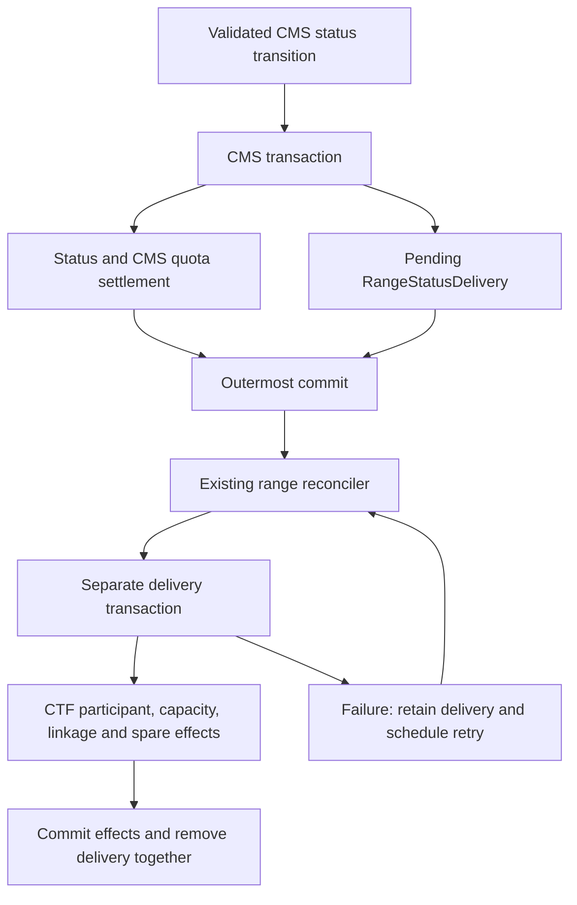
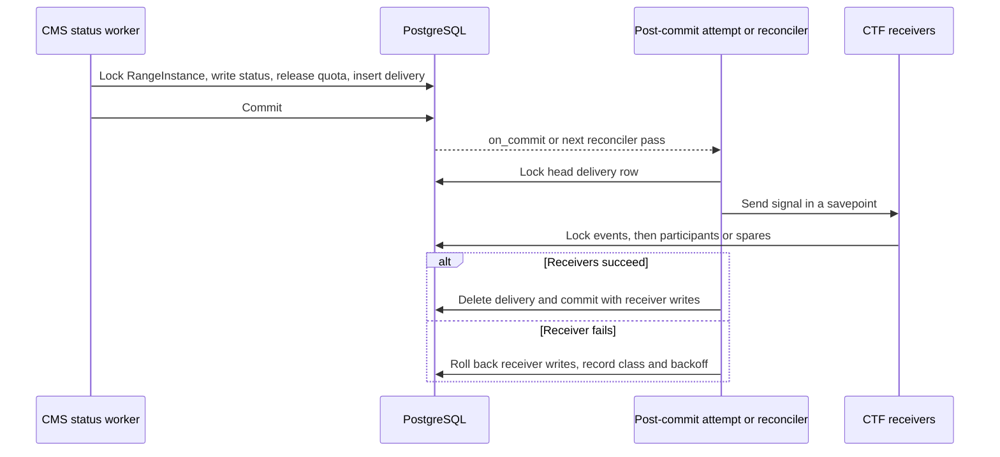
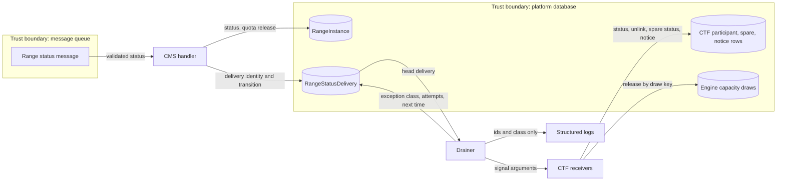

# CTF range-status commit boundary

Architecture preflight for issue #2577. Baseline: `3b30e45f2`, reviewed on
2026-11-24. The supplied issue is the delivery contract; no formal requirement
is attached. This explanation constrains the design. It does not establish
implementation or deployment readiness.

## Decision and existing behavior

Reuse `cms.RangeStatusDelivery` and the existing range reconciler. Commit the
CMS status, CMS quota settlement, and pending delivery together. Execute CTF
receivers only after that transaction's outermost commit, in a separate
transaction. A savepoint inside the CMS transaction does not provide this
boundary.

The checkout already contains migration `cms/0067_range_status_delivery`,
ordered retries, sanitized failure records, and reconciler integration.
However, `cms.handlers.ctf_bridge.notify_ctf_range_status` still calls the
drainer synchronously inside `apply_range_status`. Existing tests establish
savepoint recovery, not the required separation of commits.

The pending row is the durable obligation. The reconciler can recover it after
a crash between commit and delivery. An optional `on_commit` attempt is only
an accelerator; it cannot replace worker recovery. No accelerator is necessary
for correctness. If present, its errors must not escape into the completed CMS
handler or expose receiver diagnostics through Django callback logging.

CMS quota release remains inside the source transaction. Failure to persist
that transaction, including its delivery row, must propagate to the existing
worker retry. Independence from CTF does not mean committing without a durable
handoff, nor isolation from a shared PostgreSQL outage.

If recording retry metadata also fails, the committed delivery must remain
recoverable. Report that failure without exposing the original receiver's
exception through a chained traceback. Retry metadata is not acknowledgment.

## Delivery invariants

- Keep both CTF receivers in one delivery transaction. Participant status,
  capacity settlement, verified unlinking, spare status, and durable notice
  declarations either commit together or remain retryable together.
- Delete the delivery only with successful receiver writes. Preserve rollback
  on a later receiver failure. Do not use `send_robust` to turn partial failure
  into successful delivery.
- Keep status order per CMS range-instance identity, including transitions
  already superseded in CMS. Do not replace queued transitions with a latest
  status read: that can discard a required cleanup effect.
- A failed head delivery blocks later transitions for that range only. Keep
  bounded batches and backoff; a failing range must not monopolize the pass.
  `skip_locked` must not let a later transition overtake a locked head.
- Preserve the scalar source identity. A cascading foreign key would destroy
  pending work when CMS prunes its projection. A missing source row is not
  proof that delivery completed.
- Serialize consumers through the existing ordered delivery rows. Do not hold
  a CMS projection lock while executing CTF receivers: CTF lock waits could
  otherwise stall later CMS status writes despite separate transactions.
  Preserve CTF event-before-participant locking, with events ordered by primary
  key. Check the complete graph against launch, recovery, cancellation, spare
  consumption, and capacity locks. Keep provider and email I/O outside locks.
- Do not infer external delivery exactly once from database atomicity. Actual
  email delivery belongs to the scoped communication ledger. Browser hints
  remain advisory and occur after the CTF delivery commit.

## Cleanup, assignment, and replay hazards

`RangeInstance.pk` identifies the CMS projection. It is different from the
Engine range ID, public range UUID, request UUID, operation ID, and resource
generation. Keep these identities distinct at each existing service boundary.

`cleanup_verified` is captured from trusted Engine evidence, not from an
incoming message flag. `DESTROYED`, `FAILED`, timeout, deletion, and DLQ do not
prove provider absence. Preserve ADR-063-R4/R5 and the existing
`engine.services` cleanup-verification queries. Keep provider inventory,
credential locators, and diagnostic payloads out of the delivery record.

Logical workspace concurrency quota and physical event capacity are different
ledgers. Preserve their existing release conditions. Release the capacity draw
before dropping the participant link, and propagate settlement failure.
Use `ctf.bridges.cms_release_range_capacity`, through the public CMS facade,
to reach Engine's idempotent `release_range_capacity`. The optional,
best-effort capacity helpers are unsuitable unless strict failure propagation
is selected. A zero release count can legitimately mean an already-settled or
absent draw; it does not justify inventing a second capacity ledger.

Delayed delivery increases assignment races. Recheck the affected assignment
under its owning locks before changing it. An old destroy must never clear a
replacement link or release its draw. Participant draw keys are reused across
launches; spare draw keys use the existing `_spare_draw_key` namespace. Reuse
`CTFRangeLaunch`, `CTFRangeRecovery`, and their request bindings where an old
obligation needs durable ownership.

An empty current-participant query must
not conceal an unsettled old obligation after repointing or soft deletion.
The current receiver selects participants by their present range pointer.
Moving execution after commit does not itself close this ownership gap.
Do not broaden this issue into a replacement recovery workflow.

Consumed spares belong to the participant projection. Preserve the spare
receiver's `consumed_by__isnull=True` boundary and synchronize with spare
claims. Replayed pool status must not make a consumed spare reusable. Review
soft-deleted participant/event handling explicitly: filtered managers are not
evidence that cleanup or settlement has completed.

Cleanup evidence can change without a new status value. The native terminal
applier records inventory before its status event, but later cleanup retries
can produce newer evidence. `apply_range_status` ignores an unchanged status,
and stale-status reconciliation excludes terminal rows. Therefore a captured
false flag cannot be assumed to become true through ordinary status replay.
Verify late-evidence settlement through the existing cleanup/reconciler seams;
retain an owned obligation if evidence is insufficient. Do not fabricate a
status transition or silently declare the release complete.

Participant status reads also refresh the cached status. They are neither
delivery acknowledgments nor capacity/unlink recovery. A delayed `ready`
delivery can follow a newer status read. Preserve transition ordering and
eventual convergence without allowing a status read to settle the outbox.
Reuse `notify_range_ready` and the scoped ledger occurrence identity. Reads,
retries, and resume-to-ready transitions must not duplicate notices or revive
notices for an obsolete assignment.

## Cross-cutting boundaries

Paths below are relative to `shifter/shifter_platform/` unless stated otherwise.

| Layer | Canonical incumbent and required treatment |
| --- | --- |
| Message shape and source validation | `shared.messages.envelope.parse_sns_message`, `shared.messages.payloads.RangeStatusUpdatedPayload`, and `cms.handlers.range_events` own parsing, event-type selection, `ResourceStatus` validation, and owner checks. TypedDicts alone validate nothing. Keep these gates before durable enqueue; add no parallel wire schema. |
| Principal and tenant authority | `_event_owns_instance` and `_principal_event_owns_instance` use the existing verified Engine projection and tenancy scope. `ctf/api/operation_policy.py` classifies the signal as a trusted CMS effect with event binding. Retry settles committed system state; it must not invent a request actor, retain a bearer token, or bypass assignment/event ownership. New operator recovery, if separately required, needs existing live authorization and audit. |
| Domain model validation | `CTFBaseModel.save` runs `full_clean`; participant saves also enforce principal immutability. Spare validation binds teams to their event. Preserve these validators. A validation failure retains the delivery; bulk updates must not accidentally bypass policy or invariant checks. |
| Persistence and transactions | `cms/models/range_status_delivery.py`, migration `0067`, `cms/handlers/ctf_bridge.py`, and `cms/management/commands/reconcile_range_events.py` already own the obligation and retries. Reuse them; no generic repository, inbox, task framework, or second outbox. The current drainer locks the CMS source row; that consumer lock conflicts with independent status writes. Include transaction-exit failures in recovery reasoning. |
| Startup binding | `config/settings.py` installs `ctf.apps.CtfConfig`; its `ready` method registers the real receivers. Preserve that setup in the reconciler runtime. An empty signal receiver list is not proof that CTF effects ran. |
| Dependency boundaries | ADR-001, repository-root `.importlinter`, and `scripts/check_layer_imports/layer_imports.yaml` prohibit CMS importing CTF and CTF importing Engine internals. CMS emits its signal; CTF owns receiver behavior and calls `ctf.bridges` through `cms.services`. Shared contracts stay neutral. |
| Secrets, logs, and errors | Reuse `shared.log_sanitize` and `config.logging.ECSFormatter`. Persist bounded exception class, attempts, next-attempt time, and identifiers. Never log exception text, `repr`, traceback, participant details, provider payloads, or secrets for receiver failures. Sanitizing text does not remove confidential content. No new exception hierarchy or public error shape; existing API failures use `ctf.exceptions`, `shared.errors`, and `shared.api.errors`. |
| Settings and environment shapes | Reuse `RANGE_RECONCILE_BATCH_SIZE`, `RANGE_RECONCILE_STALE_SECONDS`, and the command's interval/batch arguments. The stale cutoff must not suppress pending terminal deliveries. No new setting is required. Preserve `config._runtime_env` admission and `_product_env` alias handling. Any justified setting uses existing parsers and `_env_manifest.py`/`env-manifest.json`. Deployment changes pass `installation.schema.RootConfig`, `installation.loader`, the selected backend's validators, and `installation.runtime_inventory`. |
| Worker identity and database duties | The existing reconciler uses the workers identity, database configuration, and application SQL duty. Reuse `shared.gcp_native_identity.database_duties`, `shared.aws_database_duties`, and the configured database backend. Do not grant provisioner access to CTF tables, run as schema owner, or introduce ad hoc SQL credentials. |
| Host and deployment | Repository-root `platform/charts/shifter/templates/worker-reconciler-deployment.yaml`, `_helpers.tpl`, `values.yaml`, `values.schema.json`, network policies, and `cloud-sql-network.yaml` already describe the runtime. Preserve restricted security contexts, token-mount posture, private database access, resources, and `/tmp/worker-reconciler-heartbeat`. Command arguments contain only non-secret controls; no token in argv, shell interpolation, local spool, or new network destination. |
| Operator visibility | Retained retry rows, sanitized error logs, `ctf_delivered`, heartbeat health, and repository-root `docs/runbooks/rb006-worker-errors.md` are the existing surfaces. Distinguish a live worker from a stuck backlog; repeated failures and oldest pending age need operator visibility. Do not delete poison deliveries or claim the source queue's DLQ covers local CTF failures. |

The Helm command uses a 60-second polling interval. Pass duration and retry
backoff can add latency. The local
`docker-compose.yml` does not currently start `reconcile_range_events`.
After removing inline delivery, local operation also needs the existing
command running. A source-only change cannot assume this duty is present in
every runtime. Keep activation and restart behavior reviewable; reuse the same
command rather than creating another worker implementation.

Allow for the resulting convergence delay in callers and tests. A committed
CMS status can temporarily precede participant unlinking or capacity return.
Status polling must not be required to finish that work.

The extensibility seam is the existing status-signal contract and delivery
transaction, with bounded drainer parameters. Another database projection can
join that boundary without new scheduling infrastructure. A future external
effect must use its existing durable domain workflow; it cannot perform
irreversible I/O in a retried receiver. Do not prebuild a receiver registry,
per-effect status matrix, arbitrary JSON payload, or generic routing field.

## Evidence needed before delivery

Extend the incumbent CMS delivery/handler/reconciler tests and CTF delivery,
capacity, spare, recovery, and notice tests. Prove observable database effects
through real receivers; ADR-019 forbids adding internal-service patch debt.

Transaction tests must distinguish an inner savepoint from the outer commit.
Verify that CTF has no effects before commit, outer rollback leaves no delivery,
and a committed status survives receiver failure and worker death. Recovery
must work after restart without a status read or callback. Include a later
receiver failure after earlier writes, database failure during settlement,
source pruning, cross-range progress, and safe diagnostic output.

Use PostgreSQL tests for concurrent drainers, head ordering, source pruning,
assignment changes, and event/participant lock interactions. SQLite cannot
prove row locking or commit visibility. Reuse
`tests/ctf/test_participant_notices_postgres.py`. Cover stale reads, consumed
spares, replacement draws, and late cleanup evidence. Mutation checks should
detect removed commit boundaries, cleanup gates, retry retention, and atomic
acknowledgment. This preflight does not execute or add runtime tests.

Repository checks remain the ADR guard, layer checks, Ruff, and targeted
behavioral tests. Chart changes additionally require Helm rendering,
kube-linter, and strict kubeconform; workflow changes require actionlint.
Documentation uses the explicit-path checks in `CONTRIBUTING.md`. No guard
exception or weaker CI gate is justified.

## Selected design

The design keeps the delivery row, the drainer, and the reconciler.
It changes four boundaries.

1. `notify_ctf_range_status` writes the delivery row in the CMS transaction.
   It registers one `transaction.on_commit` attempt for that range.
   Django discards the attempt when the source transaction rolls back.
2. The post-commit attempt catches every `Exception`.
   It logs the exception class only, so no receiver text or traceback escapes.
   The row stays for the reconciler.
3. The drainer locks only the head delivery row of the range.
   It does not lock `RangeInstance`, so CMS status writes do not wait on CTF.
   A second drainer waits on the same head row and cannot overtake it.
4. Each receiver locks its CTF events in primary-key order first.
   Then it locks the matched participant or unconsumed spare rows.
   PostgreSQL re-checks the range pointer after the lock wait.
   A repointed participant or a consumed spare therefore drops out of the match.

The drainer records retry metadata after the receiver `except` block closes.
A metadata failure then cannot chain the receiver exception.
The reconciler pass summary reports the pending count, the retrying count, and the oldest pending age.
Operators can see a stuck backlog when the worker is healthy.

Django [`on_commit`](https://docs.djangoproject.com/en/6.0/topics/db/transactions/)
runs callbacks after the outermost commit and discards them after a rollback.
The [transactional outbox](https://microservices.io/patterns/data/transactional-outbox.html)
pattern supplies the durable row, the relay, and idempotent consumers.

### Sequence

### Data flow

### Security engineering

| Asset | Threat | Control | Verification |
| --- | --- | --- | --- |
| CMS status and quota | A CTF failure or lock wait blocks or rolls back the CMS write. | Receivers run after commit and hold no CMS row lock. | A test proves no receiver effect before commit and a committed status after receiver failure. |
| Capacity draw and participant link | A late destroy clears a replacement link or releases its draw. | Receivers lock events, then rows, and re-check the range pointer. | A PostgreSQL test repoints a participant during delivery. |
| Ordered obligation | A later transition overtakes a failed head. | The drainer locks the head row and skips ranges with an earlier row. | Existing ordering tests. |
| Receiver diagnostics | Exception text exposes private data in logs. | Logs and rows hold the exception class and identifiers only. | Tests assert that synthetic private text is absent from logs. |
| Backlog visibility | Failures stay hidden while the worker is healthy. | The pass summary reports pending, retrying, and oldest age. | A reconciler test asserts the summary fields. |

The design adds no actor, credential, network path, or setting.
Residual risk: when no reconciler runs, such as in local Docker Compose, a failed attempt waits until the reconciler runs.
Late cleanup evidence stays with the existing CTF recovery checks.

## Non-goals

No implementation plan, application code, new broker, Celery dependency,
generic event bus, public retry API, additional service, or deployment is part
of this preflight. Do not change range lifecycle enums, quota policy, provider
cleanup authority, capacity admission policy, communication transport, or
advisory WebSocket guarantees. Historical lost effects are not automatically
recovered by a new commit boundary; any backfill needs evidence and its owning
service. Pending delivery retention must not become unbounded diagnostic or
private-content storage.
