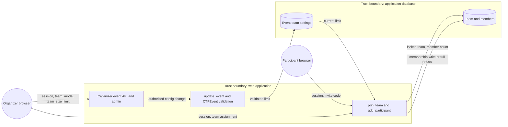

# Event team size configuration (#648)

Issue-scoped architecture preflight, 2026-11-02. Issue #648 is the acceptance
contract. It implements requirement CTF-505. This change does not alter the
requirement status or traceability. This note is guidance, not an
implementation plan or evidence of delivered behavior.
Existing service, API, persistence and testing boundaries suffice; no new ADR
or enforcement exception is needed.

## Contract and ownership

Keep `CTFEvent.team_size_limit` as the nullable integer event setting. Positive
values cap membership, including `1`; `0` and `null` mean unlimited. Omission
on creation uses the existing null default. Omission on partial update leaves
the stored value unchanged; explicit null clears the cap. Preserve both zero
and null as accepted stored representations: normalization adds no necessary
behavior and could make unchanged updates fail the post-start structural guard.
Unlimited does not mean zero members, disable team mode, or bypass event-wide
`max_participants`, registration, eligibility, or authorization checks.

`CTFEvent` field validators and `_validate_team_settings` own persisted numeric
and cross-field invariants. Remove the business bounds of 2 and 10 and the
team-mode requirement for a finite value. A negative value remains invalid;
the numeric lower boundary is zero because zero is the unlimited sentinel,
while the smallest finite cap is one. Retain the existing solo-mode restriction
on a positive team limit. `CTFTeam.is_full` already implements zero/null as
unlimited and `member_count >= limit`; reuse it rather than introducing a new
capacity helper or copying comparisons into views.

“No hard-coded upper limit” removes a business ceiling, not the finite range
of the database integer representation. Retain the existing field type and
framework/backend range validation; do not replace it with a float, text,
arbitrary-precision schema, negative sentinel, or a giant application constant.
Out-of-representation input must produce a controlled validation error before
SQL, including direct service callers. Do not promise mathematical infinity
for a finite cap or silently clamp an excessive value. The zero/null sentinel
expresses unlimited membership without requiring a large finite number.

## Cross-cutting boundaries

Paths below are relative to `shifter/shifter_platform/` unless marked otherwise.

| Layer | Canonical incumbent and required behavior |
| --- | --- |
| Browser and credentials | `frontend/src/api/client.ts`, `config/_drf_settings.py`, shared API-token authentication and credential resolution retain same-origin calls, CSRF, invalid-bearer rejection and request correlation. This setting needs no new credential, scope or exemption. |
| Event authority | `ctf.api._base.CTF_ORGANIZER_PERMISSIONS`, organizer `_base._resolve_owned_event`, and `ctf.services.event._update` retain exact `CONFIG` / `event.manage_config` authority and immutable tenant placement. Creation continues through `create_event_for_credential` and `resolve_event_placement`. A writable field is not permission to configure another event. Preserve native principal and compatibility entrypoints rather than adding an endpoint or policy branch. |
| Input parsing and shapes | Organizer event views use `ModelSelectionJSONParser` with bounded, duplicate-key-rejecting JSON, plus their existing form parsers. `EventWriteSerializer` uses `ClosedSerializer`, optional nullable `IntegerField`, and partial-update semantics. Keep unknown-field rejection and existing coercion rules. Do not add a second DTO, parser or Pydantic model for one scalar. Transport constraints, if declared, must agree with model validation, not become an independent business policy. |
| Model and database | `ctf.models._base.CTFBaseModel.save` invokes `full_clean`; `CTFEvent` validates the cap and mode; `CTFParticipant.clean` enforces same-event membership and team mode. `SoftDeleteManager` defines active rows. Preserve these and framework integer-range checks; `clean()` alone does not run field validators. Do not use bulk/update writes or skip validation to make previously invalid limits save. |
| Migration state and admin | Additive Django migration state must reflect altered field validators/help text; do not rewrite `ctf/migrations/0001_initial.py`. Existing values need no rewrite. `ctf.admin._event` uses the model field through Django admin: its validation/help must match the API. A validator-only alteration may change migration state without changing SQL column type. |
| Mutation and membership | `_EVENT_MUTABLE_FIELDS`, `_reject_team_config_changes_after_start`, and `update_event` remain the allowlist, lifecycle gate, and locked update boundary. `ctf.services.team.join_team` and `ctf.services.participant.lifecycle.add_participant` already lock the team and consult `is_full` inside a transaction before membership writes. `participant.accounts.provision_participant_seat` explicitly delegates capacity locks to its caller; do not move admission into account creation or bypass it. |
| Errors | Event views already catch Django `ValidationError`, `CTFValidationError`, and update `CTFStateError` through `_raise_invalid_event`. Team joins use `CTFStateError` mapped to 409 by `ctf_error_response`; organizer assignments use `CTFValidationError(code="CTF_TEAM_FULL")`, with organizer API validation mapped to a safe 400. Preserve each adapter's contract and `shared.api.errors` envelope; do not unify status codes, expose exception strings/SQL, or add an exception hierarchy. |
| Audit and logs | Retain organizer `_audit_admin_mutation` transaction coupling and participant `admin_external_audit` handling. Use existing module loggers, `shared.log_sanitize.safe_log_value`, sanitized model-validation field names, and request IDs. Do not log request bodies, participant emails/passwords, invite codes or credentials to diagnose capacity. No new metric, audit ledger or notification workflow is needed. |
| API projections | `EventDetailSerializer`, participant/organizer team serializers and `ctf.api.projections.participant_team` already publish nullable integer limits. Keep zero/null lossless. Organizer `ParticipantListView.post` currently does not forward a team ID; service assignment support is not proof of a public assignment endpoint. Do not expand that API incidentally. |
| Frontend | Reuse `EventFormPage`, `eventFormState`, generated API types, and the existing error client. The form currently has `min={1}`, which blocks explicit zero; blank already becomes null. Explain zero/blank as unlimited. `intOrNull` also converts malformed/non-finite input to null: prevent invalid input from silently enabling unlimited teams, without rewriting unrelated form parsing. Preserve valid zero and integral values; retain native/server validation for fractions. Clearing/hiding a positive value when switching to solo must respect the existing solo-mode invariant. `TeamPage` already hides the suffix for both unlimited representations. |
| Published contract | ADR-040: runtime serializers are authoritative; generate `openapi/v1.json` through `manage.py api_contract` and TypeScript through frontend `npm run gen:api` when runtime schema changes. Do not hand-edit either generated artifact or add a parallel interface. Existing artifacts describe nullable integers, not the obsolete 2–10 restriction. |
| Environment, host and infrastructure | This is stored event data, not deployment configuration. `config/_product_env.py`, `_env_manifest.py`, `env-manifest.json`, Helm, Terraform, subprocesses and workers need no change. No new env binding, secret reference, OS argument, temporary file, external upload or service belongs in this flow. Keep tokens and invite codes out of argv, URLs and diagnostics. |

## Data flow

The flow adds no process, store, external entity, or trust boundary.
Protected assets are tenant event settings, membership integrity and participant
accounts. Unauthorized configuration and concurrent capacity overflow are the
relevant threats. No new process, transport, trust boundary or shared schema is
introduced. CTF teams are competition groups, not customer organizations,
workspaces, authorization groups, cohorts or infrastructure capacity units.

## Concurrency and lifecycle gotchas

Keep capacity checks and writes inside the same team-lock transaction. Test
join/join, assignment/assignment and mixed join/assignment against one final
seat, including a cap of one. An unlocked count or a cached member count cannot
replace the current guard. Existing `members.count()` defines occupancy; do not
substitute ranked/eligible members, exclude banned members, or count captaincy
separately. Capacity refusal must leave no membership or provisioned account.

Team settings remain editable in DRAFT and REGISTRATION and frozen afterward;
unchanged submitted values remain allowed. Shrinking a cap can leave an existing
team at or above the cap: `>=` must refuse further additions, without expelling
members or introducing a new shrink policy. Concurrent configuration edits and
membership admission are a separate serialization concern: `update_event`
locks the event; joins lock the team; assignment locks event then team. A team
lock alone does not freeze event configuration. Read current event limits at
the capacity decision and do not claim existing locks prove a strict global
invariant across cap reductions. Any stronger guarantee needs an explicit lock
order compatible with scoring and other membership services, not an incidental
team-then-event lock that opposes organizer assignment's event-then-team order.

## Verification and implementation boundaries

Reuse real model/service/API coverage in `tests/ctf/test_models.py`,
`test_team_api.py`, `test_participant_moderation_api.py`, and existing organizer
event API tests; reuse frontend `EventFormPage.test.tsx` and `TeamPage.test.tsx`.
Cover omitted/null/zero, finite one, a finite value above ten, negative,
fractional/malformed and backend-overflow input; create versus partial-update
semantics; solo-mode validation; finite/unlimited joins and organizer service
assignments; at/over-cap refusal; unauthorized/cross-event access; lifecycle
freezing; and safe error envelopes. Replace the old model test that requires a
team-mode limit. Do not perpetuate its obsolete expectation.

ADR-019 requires behavior through real owned code; older mocked member-count
tests do not justify new first-party mocks. Reuse the real PostgreSQL,
independent-connection and `django_db(transaction=True)` pattern from
`tests/ctf/test_services/test_submission_concurrency.py`; SQLite cannot prove
row locking. Targeted mutation evidence must catch restoring the old bounds,
treating zero/null as full, replacing `>=` with `>`, and bypassing either
membership guard. Full suites belong in CI.

Repository incumbents remain root `.ground-control.yaml`, `.gc/plan-rules.md`,
`.importlinter`, `scripts/check_layer_imports/layer_imports.yaml`, ADR
registry/exceptions, `.github/quality-path-filters.yaml`, `_quality.yml` and
pre-commit rules. Implementation needs targeted checks, full ADR guard, Python
Ruff/format checks, import checks when imports change, migration consistency,
and generated-contract drift checks when applicable. No enforcement weakening,
new dependency, generic capacity framework, range provisioning redesign,
mid-event edit feature, team reassignment API, scoring/captaincy rewrite,
historical membership repair, requirement update or deployment is in scope.

The extensibility seam is already the event's nullable cap and `is_full`:
future events select different values without changing a constant or workflow.
A future separately specified live-edit policy belongs at the existing locked
event-update and membership boundaries, not in frontend state or a new global
configuration system.
