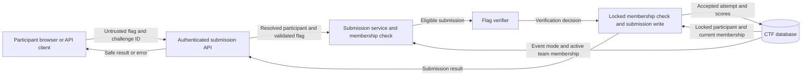

# Team membership before flag submission (#644 / CTF-501)

> **Issue-scoped preflight, 2026-11-02.** This records design constraints, not
> implementation or deployment evidence. The [current handbook](../technical/architecture.md),
> accepted ADRs, and current source retain their authority.

The supplied issue #644 and [CTF-501](../requirements/CTF-501/requirement.md)
require a participant to join or create a team before submitting flags when
their event has `team_mode` enabled. Solo submissions remain permitted.
Existing ADR-001 service boundaries, ADR-019 testing rules, and ADR-066's
separation of participation, identity, customer membership, and policy suffice;
this correction needs no new ADR, schema, policy engine, or workflow.

## Decision and scope

Keep the rule in `ctf.services.participant.queries.assert_participant_can_compete`,
with an explicit keyword-only `require_team=False` option. Submission opts in
at **both** existing calls: `submit_flag` before `verify_and_score`, and
`_record_submission_locked` against the freshly locked participant before receipt
consumption, attempt insertion, activity updates, or scoring. Only the service
chooses this option; no request body, event setting, or public submission
argument may disable it. Existing registration, status, and observer checks
remain unconditional and retain their precedence.

The option means require membership **when the participant's event uses teams**,
not require a team in solo mode. Its inputs are persisted event/team facts,
never a supplied team ID, captain flag, invite code, UI state, or token scope.
Use `CTFParticipant.team_id` as the membership relation. Null refuses immediately;
a non-null reference must resolve to a same-event, non-deleted `CTFTeam` through
the existing `CTFTeam.objects` manager. Do not count a cached related object or
`all_objects` lookup as live membership. This is an action precondition, not a
new team-assignment validator: `CTFParticipant.clean()` already owns same-event
assignment and solo-mode restrictions; `ctf.services.team` owns joining,
capacity, captaincy, and membership writes.

Use the existing `CTFStateError` for missing membership, with authored text such
as “Join or create a team before submitting flags.” Keep details limited to
safe identifiers. `SubmitFlagView._submit` already catches this class and maps
it through `_raise_bad_request` to the established generic 400 response.
Do not change this endpoint to the team endpoints' generic
`ctf_error_response` mapping, which maps state errors to 409, or return a 200
“incorrect flag” result for a refused action. A new exception subclass or public
error schema is unnecessary.

The option is the extensibility seam: a separately specified future action can
opt in without changing team bootstrap or global eligibility. For #644, team
create/join/leave, hints, ratings, browsing, downloads, registration, and ranking
predicates retain their current behavior. In particular, do not add membership
to `eligible_participant_q`, `viewing_participant_q`, `ranked_participant_q`,
`HasCTFParticipant`, or challenge availability. Those have broader consumers;
an unconditional compete check would prevent creating or joining a first team.

## Cross-cutting layers and incumbents

Paths below are relative to `shifter/shifter_platform/` unless stated otherwise.

| Layer | Incumbents and required boundary |
| --- | --- |
| Authentication and browser security | `config/_drf_settings.py`, `shared.api_tokens.authentication.ApiTokenAuthentication`, DRF `SessionAuthentication`, `frontend/src/api/client.ts`: retain invalid-bearer fail-closed behavior, active credential resolution, session CSRF, same-origin calls, and request correlation. No credential or CSRF exemption is needed. |
| Admission and resource resolution | `ctf.api._base.CTF_PARTICIPANT_PERMISSIONS`, `_PLAY_WRITE`, `ctf.api.organizer._base._resolve_challenge_participant`: retain credential/scope gates and resolve the caller's participant in the target challenge's event. A participant in another event or a platform administrator is no substitute. Direct service callers must encounter the same new action precondition. |
| Application policy versus competition facts | `ctf.api.operation_policy.API_OPERATION_POLICY` declares submission as `event.participate`; ADR-066, `ctf.services.unified_authorization`, and `principal_participation` own credential/policy integration. The inspected submission path uses the actor/participant resolver above; the inventory entry alone is not evidence of an additional live OpenFGA call. Preserve existing admission; do not invent a team grant, broaden service-principal submission support, or claim this fix completes policy integration. CTF teams are not customer accounts, workspaces, cohorts, auth groups, or receipt subjects. |
| Transport and service validation | `SubmitFlagRequestSerializer` retains the write-only, 4096-character flag shape, view trimming/blank rejection, and existing DRF parsers. `_validate_submitted_flag` also bounds direct service input. `assert_challenge_available_for_participant` retains event match, active window, visibility, release, and prerequisites. No parallel DTO, serializer validator for membership, parser, or copied status list. |
| Persistence | `CTFParticipant`, `CTFTeam`, `CTFBaseModel.save/full_clean`, `SoftDeleteManager`, and `CTFSubmission.clean` retain their existing integrity checks. Nullable membership remains valid while joining or after leaving. Do not require a team in participant model validation or a migration/DB constraint, which would obstruct onboarding and historical-row maintenance. |
| Verification and secrets | `verify_and_score`, `verify_flag`, `SubmissionDecision`, and receipt revalidation/consumption remain unchanged. Initial refusal precedes static/regex/programmatic/HTTP verification, including external I/O. A commit-time refusal persists neither submitted material nor receipt consumption. Keep flags, receipts, validator configuration, credentials, and invite codes out of exceptions, logs, metrics labels, and responses. |
| Errors and observability | `CTFStateError` → `SubmitFlagView._submit` → `_CtfApiError` → `shared.api.errors.api_error_response` preserves `{error: {code, message, request_id?}}` and safe authored text. Module loggers and `shared.log_sanitize.safe_log_value` suffice; do not serialize `str(exc)`, raw details, models, or request bodies. No new audit ledger or denial metric is required. Verification logs before locking are verification outcomes, not evidence of a committed solve. |
| Effects and scoring | `_record_submission_locked`, `_maintain_scores`, `ctf.services.scoring`, `submission_gates`, `_request_live_work`, and `_emit_solve_events` remain the single workflow. Refusal creates no attempt, cooldown history, score update, first-blood/live work, or solve webhook. Preserve the partial correct-submission uniqueness constraint, dynamic scoring, and signed-receipt redaction/replay contract. |
| Configuration and OS/runtime | `CTFEvent.team_mode`, its model validation, and `_reject_team_config_changes_after_start` are the only configuration needed. No env binding, feature flag, secret, command, subprocess, temporary flag file, worker, cloud API, Terraform, or Helm change. Existing `config/_product_env.py`, `_env_manifest.py`, and `env-manifest.json` remain untouched; never carry submissions or tokens in process argv, environment, URLs, or diagnostics. |
| Repository conventions | Root `.ground-control.yaml`, `.gc/plan-rules.md`, `.importlinter`, `scripts/check_layer_imports/layer_imports.yaml`, ADR registry/exceptions, `.pre-commit-config.yaml`, and `.github/workflows/_quality.yml` remain authoritative. Keep this inside CTF services using existing shared primitives; no Engine/Mission Control internals, retired imports, enforcement exception, dependency, or private scenario detail. |

## Concurrency and integrity gotchas

Verification deliberately runs outside the transaction. A participant can leave,
be removed, or have their team disbanded during that work. Rechecking the original
Python object is ineffective: use the participant reloaded by
`select_for_update`. A membership removal committed before that lock must refuse;
one serialized after the submission may take effect afterward. There is no new
requirement to pin the same team throughout verification or move submissions from
participant ownership to team ownership. Use the locked membership for the
existing scoring path. Soft deletion does not null a foreign key; the active-team
lookup above prevents an already deleted team from satisfying the precondition.
It does not by itself serialize a concurrent team soft deletion; do not claim
atomic team-lifecycle integrity from an `exists()` check.

Do not move network verification under locks or add a nullable `team` join to the
locked participant query: PostgreSQL can reject `FOR UPDATE` on the nullable
side of an outer join. Preserve existing lock order and prove any changed locking
against the real membership services. There is existing opposing order to account
for: submission holds participant then challenge and may lock team through score
maintenance; join/leave/disband hold team before participant writes. A new team
lock can worsen that risk. A lock-order or concurrent soft-delete redesign is not
part of this acceptance criterion; any required expansion needs an explicit,
bounded design rather than an untested claim or silent rewrite.

## Required implementation evidence and boundaries

Reuse `tests/ctf/test_services/test_submission.py`, `test_team_api.py`,
`test_participant_moderation_api.py`, `test_submit_flag_rate_limit_api.py`,
`test_drf_api_token_access.py`, `_api_flow_helpers.call_json`, and
`test_receipt_submission.py`. Evidence must distinguish team-mode refusal from
allowed solo and valid-member submissions, for correct and incorrect flags;
initial refusal must perform no verifier I/O and leave no submission/effects.
Show team creation/joining and existing status/observer, hints, ratings, and read
behavior survive; prove event scoping and the current API error envelope.

Use the real PostgreSQL pattern in
`tests/ctf/test_services/test_submission_concurrency.py` for membership withdrawal
during verification and final refusal without receipt/effect persistence. SQLite
cannot prove row locking. New tests follow ADR-019: use real domain services and
flags, controlling only external verifier/network boundaries, not patches of
`assert_participant_can_compete` or other first-party functions merely because
older tests contain them. Targeted mutation evidence should catch removing either
submission opt-in or the team-mode condition; full suites belong in CI.

Implementation validation retains the repository-wide ADR guard, targeted tests,
Python Ruff checks/formatting, and import checks for changed imports. No test,
model, API, frontend, scoring, lifecycle, requirement-status, deployment, or
workflow implementation is performed by this preflight. Do not auto-create or
auto-assign teams, repair historic scores/submissions, add a UI-only gate, change
team size/toggle rules, or conflate this action restriction with general event
access. A frontend hint may reuse existing event/team projections and error
handling later; server enforcement is the acceptance boundary.

## Design: data flow and verification

The submission service owns the membership decision.
The optional `require_team` parameter defaults to false.
Only flag submission enables this parameter.
The existing ORM query is the executable membership model:
`CTFTeam.objects.filter(pk=participant.team_id, event_id=participant.event_id).exists()`.
The default manager excludes deleted teams.
No database schema or architecture enforcement rule changes.
ADR-001 and ADR-019 remain applicable without amendment.
Deployment diagrams and infrastructure policy need no change because no process or transport changes.

The API separates untrusted input from authenticated participant identity.
The verifier can perform external work outside database locks.
The commit boundary reads current membership before any persistent submission effect.
The protected assets are flag material, attempt history, and scores.
The threat is submission without valid event team membership.
The two service checks reject this action before verification and before commit.
The existing error mapper prevents flag material from entering the response.
Concurrent team deletion after the final lookup remains governed by existing lifecycle behavior.
This change introduces no new team lock or lock order.

Behavioral tests cover missing, deleted, and foreign-event teams.
Allowed solo and team-member paths use real static flags.
An external extension verifier callback removes membership before commit to test the second check.
Targeted mutation checks remove each opt-in and weaken the team-mode condition.
Existing team API tests protect creation and joining.

## References

- [Django 6.0 QuerySet API](https://docs.djangoproject.com/en/6.0/ref/models/querysets/): `select_for_update`, `exists`, and `select_related` sections.
  These define the existing lock and membership query behavior.
- [Django 6.0 transactions](https://docs.djangoproject.com/en/6.0/topics/db/transactions/): controlling transactions explicitly.
  This defines rollback when the final membership check fails.
- [ASD-STE100 Issue 9](https://www.asd-ste100.org/assets/files/ASD-STE100_ISSUE9.pdf): sections 4 through 6.
  These guide short sentences and consistent technical names in this design.
