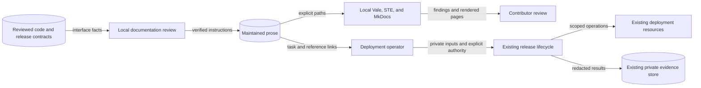

# Deployment documentation design

This explanation defines the documentation boundary for issue #2806.
It applies to source revision `5954ab13763deaba52a257d4ed8bde5bb1402ea6`.
The [preflight](deployment-operations-documentation-preflight-2806.md) records the existing interfaces and constraints.

## Reader routes and ownership

The [installation guide](../getting-started/install-gcp.md) remains the operator entry.
The [GCP handbook](../technical/handbook/gcp-github-less-deployment.md) supplies detailed lifecycle tasks.
Runbooks diagnose failures and route changes through those procedures.

Infrastructure pages describe resource ownership and exact configuration.
Contributor bootstrap and image-build instructions state their separate prerequisites and support limits.
Mixed pages keep task steps separate from reference tables and infrastructure reasons.
Existing URLs and useful heading identifiers remain stable.

The removed first-run page does not become a second installation procedure.
The implementation checks its incoming links and routes readers to the maintained guide.
AWS source support does not establish a published AWS installer.
GDC validation does not establish live-fire containment.
Proposed model-access operations remain proposed.

## Source and release boundaries

The CLI parser, closed installation models, lifecycle modules, Terraform, and Helm define current behavior.
Existing renderers and generated contracts retain their ownership.
No schema, default, executable infrastructure, or workflow changes are required.
The rewrite reuses Vale, doc-tools, MkDocs, runbook tests, and `.ste-required.txt`.
It adds no analyzer, service, dictionary, or parallel inventory.

Published release v4.1.1 resolves to `c04d53db89c522d7437f3f0b508379bb96eaa58b`.
It has no deployer Dockerfile or `gcp-install` interface.
Instructions for that interface therefore require a later verified release.
Contributor test publications remain distinct from tagged production releases.
The delivery PR records the inspected revisions, command checks, corrections, and evidence limits.

## Authority and data flows

The diagram separates local authoring from cloud operations.
Reviewers compare code and release contracts with prose, then check rendered pages.
Operators supply private inputs to the existing lifecycle after obtaining authority.
Only that lifecycle changes cloud resources and records deployment evidence.
Documentation checks do not execute example operations or establish live qualification.

Private inputs, credentials, state, and operational evidence stay outside public documentation and review metadata.
Commands retain private files, stdin secret transport, exact identities, release provenance, and deployment locks.
These controls prevent credential disclosure, cross-deployment changes, and concurrent mutation.
Source and parser checks verify the described boundaries; live IAM and recovery remain unverified by this rewrite.
Atomic Helm recovery does not reverse database, identity, policy, or infrastructure changes.
Teardown instructions identify retained resources and continuing costs.

## Existing enforcement and document review

ADRs 008, 011, 022, 037, 038, 042, 069, and 070 continue to apply.
No architectural decision, exception, policy engine, or executable architecture model changes.
Existing schemas, chart policy, Terraform ownership, and runbook tests remain the enforcement points.
The existing tool-boundary DFD also remains valid.
No runtime deployment or state diagram changes because the runtime does not change.

Purpose review follows [Diataxis how-to guidance](https://diataxis.fr/how-to-guides/) and [reference guidance](https://diataxis.fr/reference/).
Meaning review follows the [official STE guidance](https://www.asd-ste100.org/about.html), including project technical names.
Instructions retain conditions, obligations, quantities, commands, and identifiers.
Short sentences and paragraphs support that review; automated checks alone do not establish conformance.
Rendered review checks heading order, descriptive links, and diagram text alternatives.
Navigation and publication authority remain unchanged.
