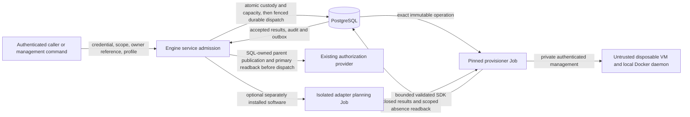
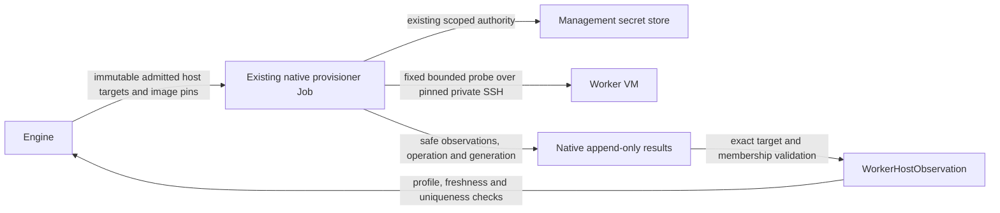
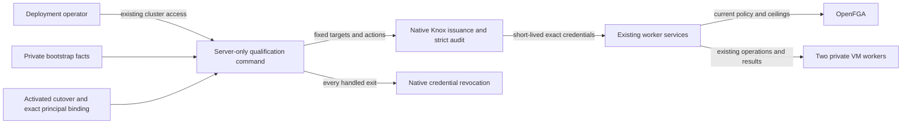

# Disposable trial worker boundary (#2741)

Architecture preflight, refreshed 2026-11-04. The supplied issue title, body and
acceptance criteria are the delivery contract. This note constrains the
forthcoming design; it is not an implementation plan or evidence of implemented
or qualified workers.
There is no new implementation prerequisite.

## Ownership and reuse

Engine owns a generic create/inspect/destroy service for independently owned,
single-use VM workers. Each worker is backed by the existing native range
lifecycle: one VM, one Docker daemon, at most one trial over its entire lifetime.
Experiment ownership is an opaque, immutable caller reference, not a new
experiment orchestrator or permission grant. A future dispatcher consumes the
public `engine.services` facade; it cannot write Engine models. Inspection returns
bounded native lifecycle, qualification, hold and recovery facts, not credentials
or raw guest/provider output.
Native experiment/trial custody UUIDs are distinct from upstream scientific
study/entry/run identities, which may be strings. The caller retains that join;
do not coerce upstream identities into UUIDs or add a scientific journal to Engine.

Use the existing RAES realization path for the outer host. The apparatus profile
is configuration beside the serialized host plan; it is not the inner experiment
SDL, a scenario snapshot, a pack identity or an adapter installation. Only
`shared.raes` imports RAES. Keep the existing plan representation, native
`ResourceStatus`, operation envelopes, results and provider cleanup. Worker
custody/hold metadata may be native Engine data; do not duplicate range/provider
state or create another repository framework.

Apply ADR-001/025/027/030/031/032/039/043/045/047/056/063/066 and the
current [architecture handbook](../technical/architecture.md). The dependency
model remains `.importlinter` and `scripts/check_layer_imports/layer_imports.yaml`.
No new ADR or general workflow abstraction is needed. The current tree already
contains worker contracts; they are reuse anchors, not delivery or qualification
evidence. Preserve the following boundaries:

- `shared.disposable_workers.WorkerHostProfile` / `WorkerPolicy` and Engine's
  `_disposable_workers`, `_worker_qualification`, `_worker_retirement` and native
  worker models own this feature. Use explicit account scope (with resolved
  optional organization/workspace ancestry). Installation-owned creation remains
  warm-specific in `_principal_range_create` / `_range_authority_history` and is
  unsupported for workers; do not fabricate warm generations or customer IDs.
- The native public range field is named `cms_range_uuid`, but does not require a
  CMS record. Reuse `worker_credential_scope` and `config.credential_scope`'s
  ambiguity refusal alongside normal CMS resolution. `_worker_relationships`
  publishes the SQL-owned parent through the existing relationship port, retains
  its store/model and requires primary readback before dispatch. SQL and OpenFGA
  are not one transaction: unresolved publication must retain recoverable custody
  and capacity without launching. No fake event, policy grant or Engine CMS import.
- `RuntimeApparatusPin`, `parse_runtime_pin` and SDK `RuntimeInput` already
  distinguish apparatus identity (`bigrae.runtime-plugin/v2`) from pack identity.
  Build on `_worker_software` and the existing invocation machinery; do not add a
  third pin/bootstrap protocol or put an apparatus digest in `pack_digest`.
  Preserve old protocol bytes and deny unsupported producer/consumer versions.
  Apparatus pins cannot select image overrides, model authority or pack files;
  organization-owned installations require matching resolved organization scope.
  Missing ancestry grants no cross-tenant software access.
- `CapacityReservation.release_on_absence` and `engine.worker_retention` already
  extend the native ledger and destructive fence. Complete their integration
  across readers and lifecycle entry points; do not duplicate either in experiments.

## Apparatus and backend contract

Select the provider through `installation.registry`/backend bundles, and the
range backend through `shared.range_instantiation_policy.RANGE_BACKENDS` and
persisted `Range.range_backend`. GCE is the intended first qualified worker path
when the deployment selects GCP/GCE. A deployment selecting another backend gets
an explicit unsupported-worker-capability refusal before reservations or effects;
the service must not switch clouds, fall back to GDC/Pods or require a second
cloud for acceptance. Normal hostile trial workloads retain live-fire
containment; a synthetic smoke probe does not authorize a weaker backend.
Destroy/recovery use the persisted backend, placement and resource generation,
even after deployment selection changes.

Pin the admitted apparatus inputs for the worker lifetime: exact substrate image
and provenance, runtime/bootstrap version or digest, resources, backend/capability,
containment and approved egress, plus an optional exact installed software
binding. Validate positive bounded CPU/memory/disk and operational limits. Reuse
`shared.runtime_plugin_binding.RuntimeTargetImageProfile`, existing provider
profile validators (`provisioner/config/_gce_profile.py`), image/artifact bindings
and bootstrap contracts for the fields they actually own. A worker profile is
only the missing apparatus policy; do not copy image grammars or topology models.
Image aliases, mutable tags or later registry edits must not alter admitted work.

An exact GCE image **name** can be deleted and recreated. A caller-supplied
`provenance_digest` alone authenticates no substrate. Reuse the trusted image
preparation/artifact binding and provider numeric image-ID checks in
`shared.raes.artifact_binding`, provisioner `raes_gce_image` and
`raes_substrate_observation` before credential installation and against the actual
boot disk. The current worker candidate projection in `engine.operation_inputs`
already carries `profile.image_id` through `operation_input_candidates` and
`raes_gce_image._profile` into these checks. Preserve this path; do not introduce
another image registry or trust a name. The existing source observation requires
the pinned image in the admitted range project; do not silently claim arbitrary
cross-project image support or broaden cloud access to satisfy a profile.
Keep image verification independent of an SDL artifact requirement; do not
fabricate an artifact declaration to obtain a provider check.

`preconfigured-machine-host` requires participant container/readiness fields. It
is not a generic Docker-host shortcut: do not invent a participant container to
satisfy it. Use an applicable host bootstrap and a synthetic guest probe. Separate
host reachability, Docker availability and optional software qualification from
experiment readiness and scientific success. Provision/Job acceptance is not
qualification. Observe distinct provider VM identities and distinct Docker
daemon IDs, not just different IPs or container IDs. Fresh hosts must not inherit
cloned Docker state/identity, management host keys or trial data. Rebooting,
restarting a daemon or changing an experiment reference never makes a used VM
eligible for another trial.

The extension seam is the immutable apparatus profile plus the existing backend
capability/realizer boundary: another approved image, resource shape or installed
software version changes configuration, not scenario-name branches. A later
backend adds qualified capability at that boundary, not a second provisioner or
provider switches in the worker service. Retain original profile/adapter pins for
cleanup after disable, retirement or configuration change.
If later callers select among approved profiles, an explicit selection resolves
to that same immutable binding; aggregate ceilings remain shared across profiles.
This delivery needs no new profile catalog or scheduling framework.

### Host observations stay inside the provisioner credential boundary

The portal's dynamic-secret IAM grant intentionally permits participant
credentials only. Host-management keys remain provisioner-only. Engine must
never fetch such a key to qualify a worker, and this feature must not widen the
portal grant or create another cloud identity.

Reuse the immutable `management_targets` capability already derived from an
Engine-owned worker row. In the existing native GCE creation operation, after
host setup and optional approved apparatus installation, the provisioner runs
one fixed, bounded probe over host-key-pinned private SSH. It uses its existing
management-secret authority. No arbitrary probe script or experiment SDL is
accepted through this capability.

The private terminal-result sidecar carries only the observed Docker version,
one-daemon count, provider VM, machine and daemon fingerprints, and a UTC
observation time, keyed by the exact admitted member. Keys, key references and host-access material
do not cross back into Engine for this purpose. Ordinary ranges request no host
observations and retain their existing behavior.

Provider identity comes from authenticated GCE readback of the numeric VM ID
in its admitted project and zone, through `raes_substrate_observation`. The
participant member's `instance_id` remains its reusable name. Hashing that name
cannot establish immutable VM identity; do not trust a guest-supplied cloud ID.
Guest machine/daemon fingerprints prove the synthetic check only, not attestation
of an uncompromised host or a completed trial.

Engine accepts the sidecar only for its immutable requested targets and the
accepted operation, generation and realized membership. Store it as
`WorkerHostObservation`, separate from participant output. Qualification checks
the retained profile, current READY generation, unexpired worker deadline and an
observation at most 15 minutes old (with five seconds of clock skew), then
retains the existing global machine/daemon uniqueness constraints. Qualification
does not open SSH or read a host-management secret in the portal.
An inspection's qualification fact must retain its generation/profile/freshness
meaning; a historical nonempty JSON value is not current qualification.

Both the append-only result writer and inbox parser pass through
`shared.operation_result_payloads._parse_raes_ready`, whose closed keys
accept credential-free `worker_observations` and bounded legacy
`management_access`. Keep the shared validator,
provisioner projection and Engine applier consistent, including duplicate,
unsolicited, missing, stale and cross-generation observations. Probe failure
after VM creation retains native failure/cleanup custody and capacity; it cannot
become successful qualification or evidence of resource absence.

The active portal-side management-reference model and probe path are removed. A
forward migration requires retirement of existing workers before clearing the
old duplicate reference projection and renaming it to the observation model.
Historical operation results remain immutable and retain bounded legacy
decoding; new results never emit the legacy management-reference sidecar.

Reuse the existing bounded, pinned SSH transport in a neutral shared module,
with explicit runtime dependencies in each consumer. The Engine participant
probe retains its existing service entry point. Never import Engine internals
into the provisioner or add a second provisioner, Job type or public listener.
`shared.guest_probe` owns the extracted asyncssh transport; Engine's
`_range_escape` entry point retains its participant membership service. The
provisioner's `GuestSSHExecutor._invoke_ssh` buffers ordinary command output
without that bound. Preserve bounds on both guest streams and total execution,
host-key verification and fixed-command/stdin separation. The provisioner image
installs hashed `requirements.lock` / `requirements-gcp.lock`, not the portal's
dependencies; an extracted transport must be present in the standalone runtime
and locks without importing Django or RAES tooling.

## Admission, holds and recovery invariants

Reuse `shared.capacity` catalog/demand/verdicts, provider inventory ports and
Engine `CapacityAssessment`, `CapacityReservation`, `CapacityDraw` services.
An opaque reservation scope does not require a CTF event. `_warm_pool_admission`
is an incumbent for PostgreSQL serialization of absent-row and aggregate
count-and-reserve races; reuse that pattern without adopting pool semantics.
An in-process semaphore or Redis counter is not deployment-wide admission.

Provisioning concurrency, total live workers and physical capacity are distinct
bounds. Reserve all applicable limits atomically before dispatch; prevent
different experiments or profiles from independently spending the same global
ceiling. Demand must reflect the actual pinned VM size and shared-resource costs.
Same identity/same intent is an idempotent replay; changed owner, scope, profile or
intent conflicts before effects. Multi-metric refusal rolls back partial draws.
Provider observations happen outside SQL locks, with freshness/margin checks and
a final serialized reservation check. Missing, stale, advisory or indeterminate
capacity is not proof of safe worker admission; do not inherit the event API's
permissive no-budget behavior as a worker bypass.

Keep the admitted profile separate from current policy. An unchanged caller
retry recovers the original worker/input even after policy or backend selection
changes; it cannot silently rebind to today's profile. Reauthorize any remaining
dispatch under current policy. Changed explicit caller intent conflicts. Reuse
the database-guard conventions in Engine migrations `0099` / `0116` for retained
worker/request/scope/profile custody and a trial reference that can be set once.
Service checks and `on_delete=PROTECT` alone do not prevent queryset/bulk rewrites
or deletion of the custody row that enforces single use.

Admission and deferred dispatch must share the existing lock order: resolved
ancestry, worker-policy mutex, then native range and worker rows. Native subnet
allocation also takes a range-table lock. Reversing this order deadlocks parallel
startup; an absent-row lock does not serialize first admission. Preserve the
launcher's existing target-lock/submission fence against concurrent cancellation.

Count provisioning, failed, held, retiring and cleanup-unknown workers against
the live bound while resources may remain. An expired launcher lease does not
prove its provisioner has stopped creating resources. Reuse native interruption,
dispatch suppression and actual Job quiescence checks before freeing a provision
slot or starting destructive cleanup; late results cannot resurrect retired work.
No capacity is released by a destroy request, range status, timeout or empty local
instance list. Require accepted absence evidence for the exact admitted resource
generation. `_cleanup_verification.is_range_generation_cleanup_verified_absent`
is the incumbent, with its current native identity/authority prerequisites intact.
Retain reconstructible provider ownership even if a crash precedes the first
result: use existing deterministic request/generation identities and scoped
inventory/readback. Delete only generation-owned resources, never shared network,
NAT, access infrastructure or another worker's disks/secrets.

**Capacity gotcha:** preserve `release_on_absence` in budget expiry, explicit
reservation release and `_capacity_plan_persistence._committed_reservation`, as
well as the worker check in draw release. Outstanding worker draws must remain
visible to other range admissions beyond their original window, across holds and
recovery. Validate the budget's partition/backend and per-metric unit costs
against actual pinned resources; a large enough amount in a different partition
is not capacity for this worker. Policy reductions stop new admission without
evicting existing workers. No far-future timestamp, second ledger or direct smoke
SQL reservation inserts; preserve ordinary event semantics.

Persist hold custody against the exact worker generation, including caller owner,
bounded reason code, timestamps and recovery/review deadline. Acquisition and
release require current native authority; a request's caller reference alone
cannot clear another caller's hold. Fence concurrent holds and destroy admission
under the same durable locks. A hold acquired after destruction is irrevocably
admitted cannot promise preservation: return a conflict. Multiple active holders
must not be cleared by one unrelated caller.

Automatic expiry, reconciliation, cleanup retries, tenant/account removal and
operator commands must all respect holds at the **native destructive boundary**,
not merely in a worker listing or scheduler query. Holds must also prevent
evidence-destroying reset/reimage/disk deletion. Cancellation can suppress further
execution without silently destroying held evidence. Revalidate the hold fence
before destructive dispatch; already-admitted work has explicit conflict
semantics. Do not copy a Mission Control lease deadline onto held workers and
allow `_range_lease.expire_due_ranges` to bypass this policy.

Bound retries, per-pass work and backoff, with a persisted next action/deadline and
operator-visible recovery-required state when automatic recovery is exhausted.
The deployed `cms.management.commands.reconcile_range_events` already invokes
the public `reconcile_disposable_workers` service in its isolated bounded pass.
Preserve that wiring and heartbeat/failure behavior; smoke polling alone is not
the production recovery mechanism and requires no new scheduler.
Hold review expiry or a dead evidence collector escalates to that state; it does
not silently authorize deletion. Keep containment and count retained resources.
The authorized operator path explicitly releases/overrides the exact hold with
strict audit and resumes the same provider-owned cleanup. Unknown provider state
retains its owner, capacity, pins, input/results and residual evidence; pruning or
cascade deletion cannot erase the only recovery link. Reuse `_range_cleanup_retry`
and native cleanup verification, not warm retirement's no-runtime shortcut or an
unbounded new retry loop. Bounded recovery means bounded automatic work and known
custody, not pretending unresolved resources have ceased to exist.

The [archive intake boundary](experiments-trial-archive-intake-boundary-2740.md)
defines the downstream distinction: a collection receipt may let its caller
release an evidence hold; it proves neither trial success nor provider absence.
This issue exposes holds without implementing intake, collection or dispatch and
without making their completion a prerequisite.

## Cross-cutting gates and canonical incumbents

Paths below are relative to `shifter/shifter_platform`, except explicitly
qualified provisioner, installation, script and chart paths.

| Layer / incumbent | Required behavior |
| --- | --- |
| Authentication, scope and policy: `shared.credentials`, `shared.identity_scope`, `shared.authorization` catalog/model/inventory, public `workspaces.services`, `config.credential_scope`; Engine `_principal_range_create`, `_range_authority`, `_launch_authority` | Authenticate actual proof and enforce current registered action, SQL-owned target/ancestry and original credential ceiling for direct services and CLI alike. Cover create, inspect, retire, hold/release and operator recovery. Persist experiment ownership separately from principal ownership, execution identity and resource scope. Reauthorize dispatch/retry and fence local credential/custody under locks; provider/policy failure denies rather than grants. Keep explicit bounded system cleanup derived from an admitted generation, never a missing-actor fallback. Reuse applicable range actions; no experiment role/token/policy engine. |
| Profile/config shapes: `shared.disposable_workers`, Engine `WorkerPolicyRecord`; `shifter/installation/{schema,registry,settings_gcp,settings_aws,bundle_gcp,bundle_aws,runtime_inventory*}.py`; `config._cloud`, `_runtime_env`, `_product_env`, `_env_manifest`, `config/env-manifest.json`; `scripts/gcp/render_runtime_env.py`, `scripts/bootstrap/aws_eks.py`; Helm `values.schema.json` and runtime templates | Revalidate operator-published policy on write and retained profile on use through the existing closed models; do not mirror database policy into new env settings. Root settings is a mapping validated by the selected bundle. Any necessary new deployment setting must pass that model, runtime inventory, env manifest and deployed projection together, including aliases/conflicts and forwarded roles. Use bounded JSON ingress. No local env parser, worker provider selector or unknown-key fallback. Keep caller requests separate from operator maxima. |
| Host plan and wire validation: `shared.raes.runtime_target`, `operation_input` and binding parsers; `shared.range_management`; `shared.operation_envelope`, `operation_results`, `operation_result_payloads`; provisioner `raes_plan_contract`, `raes_plan*`, config loaders and `range_backend_resolution` | Reuse RAES validation/capability assessment for the outer host and the standalone reader for serialized input. Preserve closed keys, finite JSON, UUIDs, producer/transport compatibility and digest/size bounds (outer envelope currently 262144 bytes). Validate the complete provision and future cleanup envelopes before effects, including optional accepted preparation. Management targets must be admitted explicitly; apply their closed private result projection only for matching operation/generation/membership, separately from participant outputs. Both producer and consumer must accept every sidecar. No inner SDL, new public status enum or duplicate semantic validator. |
| Durable execution and persistence: `engine.launch_intents`, `operation_inputs`, `models._operation_io`; `services._operation_apply*`, `_principal_lifecycle`, `_principal_cancellation`; provisioner `provisioner_db_operation_input` and result writer | Commit custody, capacity and strict audit atomically; after confirmed authority publication, commit immutable input, launch intent and dispatch audit atomically under the retirement fence. Retain a recoverable dispatch obligation between them. Preserve operation/request/generation/authority/input-digest and deterministic Job fences, append-only results, inbox deduplication and outbox delivery. Keep inventory, policy publication, planning and guest I/O outside admission locks; preserve the incumbent launcher submission/cancellation lock boundary. Provisioner uses existing input/result grants, never direct domain-table writes. Cancellation requires incumbent interruption and task-absence evidence. |
| Optional executable software: `shifter/shifter_adapter_sdk/{runtime,worker,guest}.py`; Engine `_runtime_plugins`, `_runtime_plugin_authority`, `_runtime_plugin_operations`; `shared.runtime_plugin_binding`, `shared.cloud.runtime_plugins`; provisioner `runtime_plugin_execution` | Separate administrator installation from apparatus binding and pack content. Pin supported protocol, manifest, image digest, exact target/actions and invocation identity; validate bounded SDK output before execution. Keep the existing networkless planning Job without database/cloud credentials, host mounts or service-account token. The VM worker, plugin planning worker and artifact-preparation worker are different concepts. No portal/provisioner import of plugin code, guest-selected image authority, `pip install` in core or new generic job runner. Generic worker qualification requires no optional software. |
| Cloud/network/guest containment: range-cell/provider adapters, `shared.range_instantiation_policy`, `shifter/installation/range_egress.py`, existing Terraform range firewall/NAT and Helm NetworkPolicies/Job admission | Keep private NICs and management ingress separate from participant access; open no Docker TCP API/public listener. Docker access is root-equivalent and remains scoped management access to that VM's local socket. Enforce approved egress, DNS, metadata/cloud-identity restrictions and cross-worker isolation at the provider/host boundary; Docker bridge NAT must not bypass them. No shared Docker socket/data disk, privileged control-plane Pod or broad control-plane/secret IAM on a guest. Bootstrap downloads require approved pinned sources and egress; profile booleans do not authorize arbitrary internet access. Preserve non-root/read-only/seccomp/capability limits and pinned namespace/service account/image/command of control-plane Jobs. |
| Secrets and OS exposure: `engine.secrets`, provider secret stores and management credential/host-key bindings; provisioner `executors.guest_ssh_executor`, `runtime_plugin_execution`; `shared.cloud.sensitive_env`, Kubernetes `_secrets` / `_job_manifest`; `shared.api_tokens.cli` | Resolve management material only for the exact authorized generation over private access with trusted host-key verification. Never broker management identity as participant credentials. Use owner-only temporary files with cleanup and fixed argv; no credentials, signed URLs, config bodies or secret-bearing scripts in argv. Base64 encoding is not secrecy; runtime secrets use the separate stdin/data channel. Sensitive Job env uses Secret references; `_REF`/`_URL` names do not prove harmless values. The server-only smoke authenticates management-issued in-process proof through `credential_from_proof`; external CLI proof, if accepted, uses `credential_from_file`'s bounded no-follow regular `0600` transport. No token flag or username impersonation. |
| Exceptions, public envelopes and observability: existing `EngineError`, shared validation/envelope/result errors, provider `CloudError`, `executors.base`; provisioner `raes_range_contract._classify_failure`; `shared.errors`, `shared.api.errors`, `shared.audit`, `shared.log_sanitize`, provisioner `log_redact` and logging config | Reuse existing failure classifications and retry dispositions, not another worker exception hierarchy. Surface fixed authored errors with correlation IDs; `safe_user_message`, truncation and `safe_log_value` are not confidential-data redaction. Do not stringify SDK/Pydantic/provider/guest errors into range errors, results, API details, CLI output or logs. Record safe operation/worker IDs, transitions, durations, refusal categories, hold/recovery age and residual categories; strict audit covers admission, ownership, holds, overrides and retirement. No prompts, commands, secret references/values, private scenario data, raw inventories or unbounded metric labels. Audit is not a work queue. Any HTTP exposure uses existing auth/session-CSRF/scopes, sanitized envelope and ADR-040 schema generation; a new HTTP/UI surface is not required here. |

## Verification and implementation boundaries

Use existing behavior/boundary-test conventions (ADR-019), not first-party
internal mocks. Relevant incumbents include `tests/engine/test_capacity_admit.py`,
`test_cleanup_verification.py`, `test_native_launch_cancellation_postgres.py`,
`services/test_warm_reservation_postgres.py`,
`services/test_native_warm_retirement_postgres.py`, operation-applier tests and
provisioner `tests/test_runtime_plugin_execution.py` / `test_guest_ssh_executor.py`.
Reuse the PostgreSQL lane for real contention; SQLite or a semaphore cannot prove
atomic global admission. Target partial provider creation, crash after mutation
before result append, lost dispatch/response, cancellation/late-result races,
failed/unknown teardown, configuration drift, replay conflicts, hold/destroy races,
hold expiry/escalation, quota exhaustion and cross-tenant/credential revocation.
Include bulk custody/trial rewrites, recreated image names, wrong-partition
budgets, parallel creation versus deferred dispatch and command death after only
one worker is admitted. Mutation checks should detect removal of capacity, hold,
image-identity and absence fences. Architecture-guard success alone proves none
of these runtime properties.

The management smoke is a server-only Engine command, following the
recorded-administrator pattern of `initialize_installation_catalog`, not the
older user-based range smoke. It requires the private bootstrap facts and an
activated cutover whose recorded administrator matches that exact provider
tuple. Management owns issuance and revocation. No identity, membership, policy
grant, service admission, browser session, or cloud IAM binding is created.

The fixed qualification workflow issues native Knox credentials for four exact
targets: installation configuration, the chosen launch parent, and two fresh
worker UUIDs generated by the command. Action lists are fixed by target role.
The credentials live for at most 35 minutes, stay inside the process, and are
revoked on every handled exit. Partial issuance rolls back or revokes earlier
issues.
The ordinary personal-token eligibility check remains mandatory. The command
checks current installation policy and parent launch permission before effects;
Engine checks exact leaf policy, membership and ceilings on every operation.
Neither bootstrap facts nor workload IAM is an application grant.
The catalog initializer's credential and permissions stay unchanged.

Parent proof authorizes creation; a fresh worker UUID is not yet a resolvable
credential target. Authenticate/use leaf proof only after native custody and
parent publication exist, without weakening `resolve_credential_scope` or token
eligibility to make issuance work. `initialize_installation_catalog` and
`management.personal_credentials` supply the composition and Knox lifecycle
patterns; their content-only issuer is not a general worker issuer.

Process death cannot run `finally`: expiry bounds abandoned proof, while durable
worker custody and the existing explicit system-cleanup origin must retain the
retirement obligation after proof revocation/expiry. Revocation failure is a
failed smoke with bounded output, never reported success. Shared owns the existing
closed bootstrap-facts contract; `config.identity_cutover` retains compatible
imports. The shared private-file reader uses bounded descriptor-based,
owner/mode/regular-file checks and refuses symlinks. Both facts loaders and the
credential-file transport reuse it, without another JSON or provider-identity
parser. Map failures to authored `CommandError` messages and
suppress confidential cause chains, including Django's `--traceback` path.

The command uses an approved host policy and existing enforcing capacity
reservations. It must refuse unavailable budgets, and must not create SQL
reservation rows directly. Profile and capacity setup are separate from the
two-worker run. A bounded recovery mode can retire only explicitly named native
workers through the same credential and policy checks.

Create two independent workers through
bounded parallel startup, verify private management and separate VM/daemon
identities with synthetic probes, and retire only this smoke's owned generations.
Use deadlines and guaranteed cleanup/recovery recording even when the second
create or a probe fails. Success requires scoped provider absence for both;
leaked/unknown resources are a failed smoke with retained recovery custody.

Live execution requires an already approved deployment and the existing
`.claude/skills/gcp-tenant-operate/SKILL.md`, linked handbook/RB023 procedure;
release publication uses `.claude/skills/gcp-release/SKILL.md`. This preflight
authorizes no cloud effects, new hosting, uploads or external processing. Keep
live evidence and deployment inputs in their approved owning location and public
records synthetic. Unit tests, a compatibility probe and a command implementation
do not establish live qualification.

The supporting references are Django 6.0 custom management commands,
django-rest-knox's expiry and revocation contracts, and OWASP's authorization
guidance to deny by default and check every operation, including server-side
operations. The implementation reuses the installed Knox library; it introduces
no token format, credential broker, new cloud identity, or reusable API key.

Whole-repository checks include `.ground-control.yaml`, `.gc/plan-rules.md`, ADR
registry/exceptions, `.importlinter`, layer-import allowlists, operation grants and
DB constraints, root/bundle settings, env inventories/renderers, Helm schemas and
admission/NetworkPolicies, Terraform containment/IAM, Packer/bootstrap provenance,
package locks and `.github/workflows/_quality.yml` / quality path filters. Reuse
the current Makefile/CI lanes; do not add a parallel workflow or weaken gates.
Architecture changes require `python3 scripts/adr_guard/adr_guard.py --all --level ci`;
implementation runs the affected targeted tests and stack-native checks in
`AGENTS.md`. Feature delivery also needs the existing user/technical documentation
coverage contract; this design note does not claim that delivery is complete.

Non-goals: trial dispatch, inner SDL execution, capture/archive intake or scientific
accounting; warm pools, reuse/reset of compromised workers, autoscaling, whole
scenario snapshots, another provisioner, a legacy experiments app/flag/queue,
new public listeners, obligatory experiment runtime, or a second cloud acceptance
target. Do not copy private pack content, scripts, identities, operational details
or evidence into core or public metadata, and never branch on those identities.
