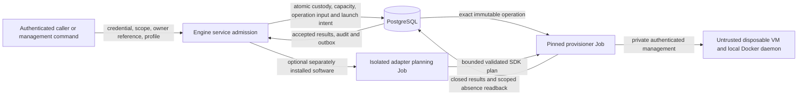

# Disposable trial worker boundary (#2741)

Architecture preflight, 2026-11-03. The supplied issue title, body and acceptance
criteria are the delivery contract. This note constrains the forthcoming design;
it is not an implementation plan or evidence of implemented or qualified workers.
There is no new implementation prerequisite.

## Ownership and reuse

Engine owns a generic create/inspect/destroy service for independently owned,
single-use VM workers. Each worker is backed by the existing native range
lifecycle: one VM, one Docker daemon, at most one trial over its entire lifetime.
Experiment ownership is an opaque, immutable caller reference, not a new
experiment orchestrator or permission grant. A future dispatcher consumes the
public `engine.services` facade; it cannot write Engine models. Inspection returns
bounded native lifecycle, qualification, hold and recovery facts, not credentials
or raw guest/provider output.

Use the existing RAES realization path for the outer host. The apparatus profile
is configuration beside the serialized host plan; it is not the inner experiment
SDL, a scenario snapshot, a pack identity or an adapter installation. Only
`shared.raes` imports RAES. Keep the existing plan representation, native
`ResourceStatus`, operation envelopes, results and provider cleanup. Worker
custody/hold metadata may be native Engine data; do not duplicate range/provider
state or create another repository framework.

Apply ADR-001/025/027/030/031/032/039/043/045/047/056/063/066 and the
current [architecture handbook](../technical/architecture.md). The dependency
model remains `.importlinter` and `scripts/check_layer_imports/layer_imports.yaml`.
No new ADR or general workflow abstraction is needed. These are issue-specific
applications of existing boundaries, with the following **real gaps**, not
permission to bypass them:

- `_principal_range_create`, `_range_authority_history` and installation launch
  authority currently specialize installation-owned creation to
  `WarmRangeGeneration`/`warm_pool`. Do not fabricate warm generations or claim
  workers into a pool. Use explicit customer scope and a real principal; if
  installation-owned workers are supported, separate their admitted custody from
  the warm-specific branch through the existing native authority seam. Missing
  customer IDs never imply installation scope.
- Native public range identity is currently named `cms_range_uuid`.
  `config.credential_scope` resolves `range` targets through
  `cms.services.range_credential_scope`. Engine-only workers must have genuine
  durable identity and SQL-owned scope resolution through the composition root,
  including policy inventory and ancestry, without fake CMS/event records or an
  Engine import of CMS. Do not treat a generated UUID or constructed admission
  dataclass as authority. Preserve existing range resolution and lock order.
- `RuntimePluginPin` inherits pack scope, and `_runtime_plugin_bindings` selects
  executable versions through exact pack bindings. Optional worker software needs
  an explicit administrator-authorized apparatus binding using the installed SDK
  and invocation machinery. SDK `RuntimeInput.pack_digest` is mandatory today:
  do not relabel an apparatus digest as a pack digest or omit it behind an
  unvalidated dict. Any necessary contract extension belongs in that SDK and its
  existing version-negotiation/consumer checks; no parallel bootstrap protocol.
- Existing event capacity windows and range leases do not supply worker
  capacity-until-absence or evidence-retirement holds. Narrowly extend their
  owning contracts where required; do not copy their workflows into experiments.

## Apparatus and backend contract

Select the provider through `installation.registry`/backend bundles, and the
range backend through `shared.range_instantiation_policy.RANGE_BACKENDS` and
persisted `Range.range_backend`. GCE is the intended first qualified worker path
when the deployment selects GCP/GCE. A deployment selecting another backend gets
an explicit unsupported-worker-capability refusal before reservations or effects;
the service must not switch clouds, fall back to GDC/Pods or require a second
cloud for acceptance. Normal hostile trial workloads retain live-fire
containment; a synthetic smoke probe does not authorize a weaker backend.
Destroy/recovery use the persisted backend, placement and resource generation,
even after deployment selection changes.

Pin the admitted apparatus inputs for the worker lifetime: exact substrate image
and provenance, runtime/bootstrap version or digest, resources, backend/capability,
containment and approved egress, plus an optional exact installed software
binding. Validate positive bounded CPU/memory/disk and operational limits. Reuse
`shared.runtime_plugin_binding.RuntimeTargetImageProfile`, existing provider
profile validators (`provisioner/config/_gce_profile.py`), image/artifact bindings
and bootstrap contracts for the fields they actually own. A worker profile is
only the missing apparatus policy; do not copy image grammars or topology models.
Image aliases, mutable tags or later registry edits must not alter admitted work.

`preconfigured-machine-host` requires participant container/readiness fields. It
is not a generic Docker-host shortcut: do not invent a participant container to
satisfy it. Use an applicable host bootstrap and a synthetic guest probe. Separate
host reachability, Docker availability and optional software qualification from
experiment readiness and scientific success. Provision/Job acceptance is not
qualification. Observe distinct provider VM identities and distinct Docker
daemon IDs, not just different IPs or container IDs. Fresh hosts must not inherit
cloned Docker state/identity, management host keys or trial data. Rebooting,
restarting a daemon or changing an experiment reference never makes a used VM
eligible for another trial.

The extension seam is the immutable apparatus profile plus the existing backend
capability/realizer boundary: another approved image, resource shape or installed
software version changes configuration, not scenario-name branches. A later
backend adds qualified capability at that boundary, not a second provisioner or
provider switches in the worker service. Retain original profile/adapter pins for
cleanup after disable, retirement or configuration change.

## Admission, holds and recovery invariants

Reuse `shared.capacity` catalog/demand/verdicts, provider inventory ports and
Engine `CapacityAssessment`, `CapacityReservation`, `CapacityDraw` services.
An opaque reservation scope does not require a CTF event. `_warm_pool_admission`
is an incumbent for PostgreSQL serialization of absent-row and aggregate
count-and-reserve races; reuse that pattern without adopting pool semantics.
An in-process semaphore or Redis counter is not deployment-wide admission.

Provisioning concurrency, total live workers and physical capacity are distinct
bounds. Reserve all applicable limits atomically before dispatch; prevent
different experiments or profiles from independently spending the same global
ceiling. Demand must reflect the actual pinned VM size and shared-resource costs.
Same identity/same intent is an idempotent replay; changed owner, scope, profile or
intent conflicts before effects. Multi-metric refusal rolls back partial draws.
Provider observations happen outside SQL locks, with freshness/margin checks and
a final serialized reservation check. Missing, stale, advisory or indeterminate
capacity is not proof of safe worker admission; do not inherit the event API's
permissive no-budget behavior as a worker bypass.

Count provisioning, failed, held, retiring and cleanup-unknown workers against
the live bound while resources may remain. An expired launcher lease does not
prove its provisioner has stopped creating resources. Reuse native interruption,
dispatch suppression and actual Job quiescence checks before freeing a provision
slot or starting destructive cleanup; late results cannot resurrect retired work.
No capacity is released by a destroy request, range status, timeout or empty local
instance list. Require accepted absence evidence for the exact admitted resource
generation. `_cleanup_verification.is_range_generation_cleanup_verified_absent`
is the incumbent, with its current native identity/authority prerequisites intact.
Retain reconstructible provider ownership even if a crash precedes the first
result: use existing deterministic request/generation identities and scoped
inventory/readback. Delete only generation-owned resources, never shared network,
NAT, access infrastructure or another worker's disks/secrets.

**Capacity gotcha:** `_capacity_admit.reconcile_capacity_budgets` releases expired
budgets and draws; `_capacity_plan_persistence._committed_reservation` counts
overlapping windows only. Worker reservations must remain effective until verified
absence, including across holds and recovery. A worker-only release check cannot
fix expiry or omission in these shared readers. Extend lifetime/ownership
semantics in the existing ledger rather than using a far-future timestamp or a
second counter that other range admissions cannot see. Preserve event semantics.

Persist hold custody against the exact worker generation, including caller owner,
bounded reason code, timestamps and recovery/review deadline. Acquisition and
release require current native authority; a request's caller reference alone
cannot clear another caller's hold. Fence concurrent holds and destroy admission
under the same durable locks. A hold acquired after destruction is irrevocably
admitted cannot promise preservation: return a conflict. Multiple active holders
must not be cleared by one unrelated caller.

Automatic expiry, reconciliation, cleanup retries, tenant/account removal and
operator commands must all respect holds at the **native destructive boundary**,
not merely in a worker listing or scheduler query. Holds must also prevent
evidence-destroying reset/reimage/disk deletion. Cancellation can suppress further
execution without silently destroying held evidence. Revalidate the hold fence
before destructive dispatch; already-admitted work has explicit conflict
semantics. Do not copy a Mission Control lease deadline onto held workers and
allow `_range_lease.expire_due_ranges` to bypass this policy.

Bound retries, per-pass work and backoff, with a persisted next action/deadline and
operator-visible recovery-required state when automatic recovery is exhausted.
Hold review expiry or a dead evidence collector escalates to that state; it does
not silently authorize deletion. Keep containment and count retained resources.
The authorized operator path explicitly releases/overrides the exact hold with
strict audit and resumes the same provider-owned cleanup. Unknown provider state
retains its owner, capacity, pins, input/results and residual evidence; pruning or
cascade deletion cannot erase the only recovery link. Reuse `_range_cleanup_retry`
and native cleanup verification, not warm retirement's no-runtime shortcut or an
unbounded new retry loop. Bounded recovery means bounded automatic work and known
custody, not pretending unresolved resources have ceased to exist.

The [archive intake boundary](experiments-trial-archive-intake-boundary-2740.md)
defines the downstream distinction: a collection receipt may let its caller
release an evidence hold; it proves neither trial success nor provider absence.
This issue exposes holds without implementing intake, collection or dispatch and
without making their completion a prerequisite.

## Cross-cutting gates and canonical incumbents

Paths below are relative to `shifter/shifter_platform`, except explicitly
qualified provisioner, installation, script and chart paths.

| Layer / incumbent | Required behavior |
| --- | --- |
| Authentication, scope and policy: `shared.credentials`, `shared.identity_scope`, `shared.authorization` catalog/model/inventory, public `workspaces.services`, `config.credential_scope`; Engine `_principal_range_create`, `_range_authority`, `_launch_authority` | Authenticate actual proof and enforce current registered action, SQL-owned target/ancestry and original credential ceiling for direct services and CLI alike. Cover create, inspect, retire, hold/release and operator recovery. Persist experiment ownership separately from principal ownership, execution identity and resource scope. Reauthorize dispatch/retry and fence local credential/custody under locks; provider/policy failure denies rather than grants. Keep explicit bounded system cleanup derived from an admitted generation, never a missing-actor fallback. Reuse applicable range actions; no experiment role/token/policy engine. |
| Profile/config shapes: `shifter/installation/{schema,registry,settings_gcp,settings_aws,bundle_gcp,bundle_aws,runtime_inventory*}.py`; `config._cloud`, `_runtime_env`, `_product_env`, `_env_manifest`, `config/env-manifest.json`; `scripts/gcp/render_runtime_env.py`, `scripts/bootstrap/aws_eks.py`; Helm `values.schema.json` and runtime templates | Root settings is a mapping; the selected bundle's closed settings model validates its keys/values. Any necessary profile/limit settings must pass that model, runtime inventory, env manifest and deployed projection together, including aliases/conflicts and forwarded process roles. Use bounded JSON ingress where JSON is accepted. No local env parser, worker provider selector, unknown-key fallback or committed renderer-owned values. Separate operator-configured maxima from caller requests. |
| Host plan and wire validation: `shared.raes.runtime_target`, `operation_input` and binding parsers; `shared.operation_envelope`, `operation_results`, `operation_result_payloads`; provisioner `raes_plan_contract`, `raes_plan*`, config loaders and `range_backend_resolution` | Use existing RAES validation/capability assessment for the outer host and the standalone reader for untrusted serialized input. Preserve closed keys, finite JSON, UUIDs, exact producer/transport compatibility, digest and size bounds (outer envelope currently 262144 bytes). Carry only necessary immutable profile/binding facts beside the plan. A new sidecar must pass both producer and consumer parsers; do not invent an inner SDL, public status enum or duplicate semantic validator. |
| Durable execution and persistence: `engine.launch_intents`, `operation_inputs`, `models._operation_io`; `services._operation_apply*`, `_principal_lifecycle`, `_principal_cancellation`; provisioner `provisioner_db_operation_input` and result writer | Commit custody, capacity, immutable input, launch intent and strict audit together. Preserve exact operation/request/generation/authority/input-digest and deterministic Job fences, append-only result steps, inbox deduplication and outbox delivery. Do not call the provider while holding SQL locks. Provisioner reads exact immutable inputs and appends results through existing grants; no new direct domain-table writes or business-state owner. Cancellation uses incumbent interruption and task-absence evidence. |
| Optional executable software: `shifter/shifter_adapter_sdk/{runtime,worker,guest}.py`; Engine `_runtime_plugins`, `_runtime_plugin_authority`, `_runtime_plugin_operations`; `shared.runtime_plugin_binding`, `shared.cloud.runtime_plugins`; provisioner `runtime_plugin_execution` | Separate administrator installation from apparatus binding and pack content. Pin supported protocol, manifest, image digest, exact target/actions and invocation identity; validate bounded SDK output before execution. Keep the existing networkless planning Job without database/cloud credentials, host mounts or service-account token. The VM worker, plugin planning worker and artifact-preparation worker are different concepts. No portal/provisioner import of plugin code, guest-selected image authority, `pip install` in core or new generic job runner. Generic worker qualification requires no optional software. |
| Cloud/network/guest containment: range-cell/provider adapters, `shared.range_instantiation_policy`, `shifter/installation/range_egress.py`, existing Terraform range firewall/NAT and Helm NetworkPolicies/Job admission | Keep private NICs and management ingress separate from participant access; open no Docker TCP API/public listener. Docker access is root-equivalent and remains scoped management access to that VM's local socket. Enforce approved egress, DNS, metadata/cloud-identity restrictions and cross-worker isolation at the provider/host boundary; Docker bridge NAT must not bypass them. No shared Docker socket/data disk, privileged control-plane Pod or broad control-plane/secret IAM on a guest. Bootstrap downloads require approved pinned sources and egress; profile booleans do not authorize arbitrary internet access. Preserve non-root/read-only/seccomp/capability limits and pinned namespace/service account/image/command of control-plane Jobs. |
| Secrets and OS exposure: `engine.secrets`, provider secret stores and management credential/host-key bindings; provisioner `executors.guest_ssh_executor`, `runtime_plugin_execution`; `shared.cloud.sensitive_env`, Kubernetes `_secrets` / `_job_manifest`; `shared.api_tokens.cli.credential_from_file` | Resolve management material only for the exact authorized generation over private access with trusted host-key verification. Never broker the reserved management identity as participant credentials. Use owner-only temporary files with cleanup and fixed argv; no credentials, signed URLs, config bodies or guest scripts with embedded secrets in argv. The SSH executor can base64-encode scripts into argv: encoding is not secrecy; runtime secrets belong in the separate stdin/data channel. Sensitive Job env uses Secret references; names ending `_REF`/`_URL` are not automatically proof their values are harmless. CLI proof uses the incumbent bounded no-follow regular `0600` file, not a token flag or username impersonation. |
| Exceptions, public envelopes and observability: existing `EngineError`, shared validation/envelope/result errors, provider `CloudError`, `executors.base`; provisioner `raes_range_contract._classify_failure`; `shared.errors`, `shared.api.errors`, `shared.audit`, `shared.log_sanitize`, provisioner `log_redact` and logging config | Reuse existing failure classifications and retry dispositions, not another worker exception hierarchy. Surface fixed authored errors with correlation IDs; `safe_user_message`, truncation and `safe_log_value` are not confidential-data redaction. Do not stringify SDK/Pydantic/provider/guest errors into range errors, results, API details, CLI output or logs. Record safe operation/worker IDs, transitions, durations, refusal categories, hold/recovery age and residual categories; strict audit covers admission, ownership, holds, overrides and retirement. No prompts, commands, secret references/values, private scenario data, raw inventories or unbounded metric labels. Audit is not a work queue. Any HTTP exposure uses existing auth/session-CSRF/scopes, sanitized envelope and ADR-040 schema generation; a new HTTP/UI surface is not required here. |

## Verification and implementation boundaries

Use existing behavior/boundary-test conventions (ADR-019), not first-party
internal mocks. Relevant incumbents include `tests/engine/test_capacity_admit.py`,
`test_cleanup_verification.py`, `test_native_launch_cancellation_postgres.py`,
`services/test_warm_reservation_postgres.py`,
`services/test_native_warm_retirement_postgres.py`, operation-applier tests and
provisioner `tests/test_runtime_plugin_execution.py` / `test_guest_ssh_executor.py`.
Reuse the PostgreSQL lane for real contention; SQLite or a semaphore cannot prove
atomic global admission. Target partial provider creation, crash after mutation
before result append, lost dispatch/response, cancellation/late-result races,
failed/unknown teardown, configuration drift, replay conflicts, hold/destroy races,
hold expiry/escalation, quota exhaustion and cross-tenant/credential revocation.
Mutation checks should detect removal of capacity, hold and absence fences.

The management smoke is a thin adapter to the same authorized service, following
the credential-file/service composition of `cms/management/commands/register_pack.py`,
not its raw exception-string forwarding. Create two independent workers through
bounded parallel startup, verify private management and separate VM/daemon
identities with synthetic probes, and retire only this smoke's owned generations.
Use deadlines and guaranteed cleanup/recovery recording even when the second
create or a probe fails. Success requires scoped provider absence for both;
leaked/unknown resources are a failed smoke with retained recovery custody.

Live execution requires an already approved deployment and the existing
`.claude/skills/gcp-tenant-operate/SKILL.md`, linked handbook/RB023 procedure;
release publication uses `.claude/skills/gcp-release/SKILL.md`. This preflight
authorizes no cloud effects, new hosting, uploads or external processing. Keep
live evidence and deployment inputs in their approved owning location and public
records synthetic. Unit tests, a compatibility probe and a command implementation
do not establish live qualification.

Whole-repository checks include `.ground-control.yaml`, `.gc/plan-rules.md`, ADR
registry/exceptions, `.importlinter`, layer-import allowlists, operation grants and
DB constraints, root/bundle settings, env inventories/renderers, Helm schemas and
admission/NetworkPolicies, Terraform containment/IAM, Packer/bootstrap provenance,
package locks and `.github/workflows/_quality.yml` / quality path filters. Reuse
the current Makefile/CI lanes; do not add a parallel workflow or weaken gates.
Architecture changes require `python3 scripts/adr_guard/adr_guard.py --all --level ci`;
implementation runs the affected targeted tests and stack-native checks in
`AGENTS.md`. Feature delivery also needs the existing user/technical documentation
coverage contract; this design note does not claim that delivery is complete.

Non-goals: trial dispatch, inner SDL execution, capture/archive intake or scientific
accounting; warm pools, reuse/reset of compromised workers, autoscaling, whole
scenario snapshots, another provisioner, a legacy experiments app/flag/queue,
new public listeners, obligatory experiment runtime, or a second cloud acceptance
target. Do not copy private pack content, scripts, identities, operational details
or evidence into core or public metadata, and never branch on those identities.
