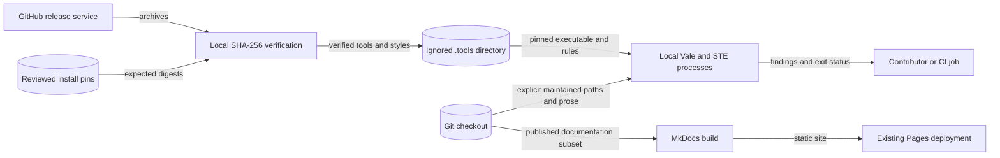

# Shared documentation tool boundary (#2804)

Architecture guidance, updated 2026-11-08. Inspected BigRAE revision:
`1b512f3978e8c3fa514e6ad1fc100cc398fe988e`.
[Issue #2804](https://github.com/OpenRAE/bigrae/issues/2804) is the delivery
contract. No formal requirement is attached. This note records design
constraints, not an implementation plan or proof of delivery.

## Decision and package boundary

Consume the released `OpenRAE/doc-tools` package. Keep BigRAE's existing Vale,
MkDocs, Makefile, and agent entrypoints. Apply ADR-002, ADR-003, ADR-004,
ADR-022, ADR-037, ADR-038, ADR-042, ADR-055, and ADR-069. No new runtime
abstraction, ADR, or exception is needed for this boundary.

[Release v0.1.0](https://github.com/OpenRAE/doc-tools/releases/tag/v0.1.0)
is available. Its tag resolves to
`97866fad14d7fbb0d6752788ebdc5ae4f235573a`.
The [release API](https://api.github.com/repos/OpenRAE/doc-tools/releases/tags/v0.1.0)
lists SHA-256 digests for `doc-tools-0.1.0.tar.gz` and `DocTools.zip`.
Its [reference](https://github.com/OpenRAE/doc-tools/blob/97866fad14d7fbb0d6752788ebdc5ae4f235573a/docs/reference.md)
and [installation guide](https://github.com/OpenRAE/doc-tools/blob/97866fad14d7fbb0d6752788ebdc5ae4f235573a/docs/how-to-install.md)
match the wrapper, installer, and configuration inspected at that revision.
The preflight verified metadata and source.
The implementation also verified the downloaded archive bytes.

The release is not immutable: record reviewed digests in the existing install
entrypoints and verify downloads before use. Do not resolve trust from a
checksum fetched beside an archive during each run. Recheck these interfaces
if implementation selects another release.

The package owns `tools/ste-lint.sh`, `tools/install-ste.sh`, `.ste.yml`,
`vale/DocTools/`, and `skills/documentation/`. Install them through the
documented archive, Vale package, and agent installation mechanisms. Do not
copy their implementation into BigRAE. Necessary download and invocation
commands belong in existing entrypoints, not a new installer framework.

## Existing behavior that constrains adoption

- `.vale.ini` pins Google v0.7.1 and selects error-level findings. It excludes
  architecture, internal notes, and other off-site prose. Those exclusions
  cannot define the maintained corpus. `Google.Contractions` suggests the
  opposite of STE-4.2; disable it explicitly, including in interactive runs.
  Retain Google errors and check selected DocTools rules for overlap.
- `tools/install-vale.sh` verifies the Vale 3.9.1 Linux x64 archive before
  extraction. `vale.yml` repeats that installer and its pins. Reuse the
  existing installation boundary rather than extending both copies.
- `make policy` accepts any Vale on PATH, does not sync missing styles, and
  selects only committed changes against `origin/dev`. It cannot prove that
  staged, unstaged, or untracked prose passed. Keep a targeted path invocation
  available and document its actual behavior. Clean setup must not depend on
  cached styles, a personal skill, or an incompatible global binary.
- `vale.yml` uses newline-delimited filenames. Its trigger omits the installer
  and Makefile. New package/configuration inputs must reach their checks even
  when no Markdown file changes. Test GitHub path-filter behavior for hidden
  and nested paths; do not infer coverage from a glob's appearance. Its
  `mapfile` process substitution can hide a failed `git diff`; `make policy`'s
  pipeline can also hide a Git failure. NUL delimiters alone do not fix this.
- `CLAUDE.md` points to the absent `.claude/skills/doc-writing.md`. Replace
  that stale route with the shared skill's supported installation/discovery
  path. Do not add a replacement local skill. Installing skill files alone
  does not prove that both supported agent clients discover and use them.
- `mkdocs.yml` intentionally keeps internal documents off the public site.
  Its custom Python YAML tags are build configuration. Link validation has
  several `info` settings, so `mkdocs build --strict` alone does not prove
  that links, anchors, or redirects work.

## Canonical owners and cross-cutting checks

| Layer | Incumbent and required boundary |
| --- | --- |
| Package and tool integrity | Keep reviewed release versions and SHA-256 pins. Verify the package archive before extraction/execution and retain the package's nested ste-cli verification. Preserve Vale's archive check. A versioned Google or DocTools URL is not checksum verification: account for style downloads before Vale loads them. Use existing tools and stock download/checksum commands. No download-and-execute pipeline. |
| Installation and host behavior | Reuse `tools/install-vale.sh`, the package installer, and ignored `.tools/` directories. Use HTTPS and private temporary files with cleanup. Do not extract or execute a failed download. Keep supported OS/architecture requirements explicit: upstream STE supports more platforms than BigRAE's current automatic Vale installer. A cache does not establish clean-install integrity. |
| Configuration and validation | The package's `.ste.yml` and ste-cli parser own STE rules; `.vale.ini` and Vale own style rules. Keep `dictionary: false` and `analyzer: false`. The wrapper selects its package-root configuration; a BigRAE `.ste.yml` does not override it. Keep `.ground-control.yaml` schema version 1 and its canonical repository identity; no extra configuration keys or parallel schema. Agent installation must preserve existing `.claude/settings.json` permissions and hooks, rather than replace the file. |
| Workflow shape and policy | Reuse `scripts/adr_guard/_guard/_workflow_model.py` and its safe YAML loading for workflow tests. `actionlint` validates Actions syntax and shell use; ADR-037's existing action-pinning check validates credential-bearing workflows, including `docs.yml` through its deploy job. Keep those checks and the existing fast pre-commit boundary. MkDocs' Python YAML tags belong to its existing builder, not a new general-purpose YAML loader. |
| Git and shell inputs | Pass explicit paths as quoted arguments, with NUL-delimited Git output when constructing lists. Preserve filenames with spaces and handle leading hyphens with supported operand syntax. Missing files, failed Git/base resolution, and unsupported inputs must fail. Omit deleted files, check rename destinations, and keep an empty selection distinct from an accidental corpus scan. Never evaluate a filename, config value, or PR field as shell code. |
| Authentication and CI privilege | Extend `vale.yml` and `docs.yml` within their existing GitHub-hosted PR jobs and `contents: read` boundary. No cloud credentials, protected deployment environment, or `pull_request_target` execution for prose checks. Keep action SHA pins and ADR-037 checks. Preserve the existing Pages artifact/deployment conditions and its separate publishing permissions. Prose coverage grants no publication authority. |
| Secrets, privacy, and diagnostics | Check text locally; do not enable remote analyzers or upload source text. No application secrets, secret-file access, tokens in argv, or shell tracing of credentials. Preserve gitleaks/private-key checks and ADR-004 cloud-identifier checks. Use synthetic failure samples. PR records and CI output must not repeat private scenario or operational material. |
| Errors and observability | Preserve the tools' native findings and nonzero exits. The STE wrapper uses status 1 for findings, installation failure, and checksum mismatch; status alone cannot distinguish them. Use supported reporting options for legacy findings, without swallowing execution/configuration failures through blanket `continue-on-error` or `|| true`. Record tool/config versions, source revision, paths, checks, results, and corrections in the delivery PR. No new error hierarchy, report schema, telemetry, or audit store. |
| Quality routing and policy | `.github/quality-path-filters.yaml`, `scripts/quality_ownership/contract.py`, and `classify_paths.py` already own fail-closed path ownership. Enroll any new tracked inputs through that contract; do not create another classifier. `deploy.yml` and `_quality.yml` preserve independent architecture/security routing. Guardrail changes require matching ADR/enforcement documentation under ADR-002. Policy waivers use `docs/adr/exceptions.yaml` with an owner and expiry. |
| Coverage and source truth | `docs/adr/documentation-coverage.yaml` and `_documentation_drift.py` own feature discoverability and source-to-handbook pairing. They are not the prose migration inventory: their public-page checks deliberately reject hidden/deprecated targets. Preserve that schema and its base/current comparison. Verify current claims against current source, historical claims against their source revision, and state absent or unverified behavior explicitly. |
| Rendering and access | `mkdocs.yml`, `docs/requirements.txt`, and `docs.yml` remain the only site build. Retain excluded publication paths and custom rendering behavior. Preserve page URLs and useful heading links; test any required redirects. Review headings, link descriptions, and Mermaid text alternatives. Reuse ADR-055's frontend accessibility estate for affected navigation, including keyboard checks. A prose pass is not an accessibility result. |

Application authentication, DTOs, controllers, service/repository layers,
database persistence, runtime env bindings, and API error envelopes are outside
this change. Do not import application internals or extend
`shifter/shifter_platform/config/env-manifest.json` to configure a contributor
tool. PR evidence and the existing checked-in
configuration are sufficient records.

## Migration scope and the extension seam

Use the package's selected checks: STE-4.2 for contractions, STE-5.1 for
sentence length, and STE-6.6 for paragraph length. Its config has report-mode
`fail_over: -1`; its explicit-path wrapper overrides this with
`--no-baseline --fail-over 0`. Loading the config alone does not create a
blocking check. The wrapper resolves paths from the caller's working
directory and installs ste-cli below the extracted package root.

Reuse the LilRAE approach: report the maintained corpus in CI and use a plain
`.ste-required.txt` list for content that must pass during migration. Retain
the existing blocking Google error checks. Local writing checks use explicit
changed paths; CI owns the full report and the required-content gate. Empty
required lists, stale entries, omitted rewritten pages, and scanner failures
must not become successful evidence. Do not introduce scores, a finding
baseline, a content classifier, or a second documentation inventory.

The extension seam is the reviewed package version/digests, install location,
existing tool options, and consumer-owned required-path list. Add the next
rewritten section through that list, without changing upstream rules or CI
selection logic. Keep Vale release URLs and agent release references aligned
with the selected package. Upgrade/rollback follows the package procedure;
do not create a pin generator or dependency manager.

Reconcile the tracked file set with the five rewrite issues under #2770 in the
delivery PR. Assign each maintained family, page, and mixed section to an issue
and owner, using the existing tracked inventory. The initial checkout contained no #2770 migration inventory or `.ste-required.txt`. Reconcile that gap from Git
in the delivery PR rather than inventing a new registry. The feature coverage
manifest alone cannot establish completeness.

Use native GitHub blocking relations and read them back for all five issues;
prose links do not create dependencies. This preflight changes no issues.

Scope includes root guidance; `.claude/`, `.gc/`, `.github/`, and `.specify/`
prose; published and off-site `docs/` families; nested package, infrastructure,
SDK, MCP, script, fixture, and UAT documents. Include maintained generator
inputs such as `.specify/templates/` and `scripts/update-coverage-readme.py`.
Distinguish prose from machine-valued `.txt` files and executable templates;
do not send arbitrary configuration or program text to a Markdown checker.
Keep generated values exact and edit maintained generator wording at source.

Human-maintained descriptions in structured records, such as ADR registry
decisions, also need purpose and meaning review. Use supported upstream input
options where applicable; do not invent a prose-extraction tool to claim
automated coverage. Preserve the registries' schemas and existing validators.

Preserve legal text, vendor notices, quotations, changelogs, historical
evidence, and generated records through narrow, reasoned exclusions. A mixed
document's maintained explanation still needs an owner. Neither a whole
architecture directory nor every hidden file is an acceptable exclusion.
Keep structured requirement metadata, traceability, obligations, and literal
commands intact. Lint suggestions do not authorize semantic changes.

ADR-038-R3 requires verbatim relocations. Keep any necessary move distinct
from prose edits; a split or rewrite does not silently waive that rule.

## Evidence limits and non-goals

The implementation must demonstrate clean setup, altered-download rejection,
and failing/corrected samples through its actual local and CI entrypoints.
Use all three selected STE rules in negative evidence. Pilot a user guide,
technical reference, and maintained off-site document. Review Diataxis purpose
and STE meaning separately from automated findings. Three rules do not prove
full ASD-STE100 conformance.

Reuse the upstream behavioral tests and BigRAE's existing
`scripts/adr_guard/tests/` workflow/Makefile parity patterns for consumer checks.
Exercise hidden/nested/space-containing paths, deletion/rename, missing base,
configuration-only changes, empty selection, and failure propagation. Mutated
selection and checksum inputs must fail the relevant targeted checks. Run
`actionlint` for changed workflows and the required
`python3 scripts/adr_guard/adr_guard.py --all --level ci`. Keep full suites and
corpus scans in CI; keep pre-commit fast.

This issue enables the later rewrites and rewrites its maintained guidance and
pilots. It does not require a single-PR rewrite of the legacy corpus. It does not authorize additional custom tools or skills, a second style guide, or dictionary copying.
It does not authorize new hosting, external text processing, a site-generator migration, unrelated runtime changes, or publication. A proposed custom tool or skill requires user
approval before it enters the design.

## Data flows and controls

The release service and checkout are separate trust boundaries.
Reviewed digests prevent altered downloads from reaching extraction or execution.
The existing installer owns download verification for Vale and the shared package.
It also verifies Google and DocTools style archives before Vale loads them.
The upstream installer verifies the nested STE executable.

The text stays in the local process or the existing GitHub runner.
No process sends prose to the release service.
Quoted arguments and NUL-delimited Git paths prevent filename interpretation.
The Pages deployment remains a separate job with its existing permissions.

The diagram shows the data stores, processes, external services, and named flows.
Verified release downloads populate the ignored tool cache.
Local checkers read explicit checkout paths and return findings.
MkDocs separately builds the existing published subset for Pages.
No product runtime process, database, deployment identity, or network service changes.
The existing workflow YAML and quality ownership contract remain the executable architecture model.

Altered-download tests verify the release boundary.
Selection tests verify hidden paths, spaces, renames, deletions, and Git failures.
Native nonzero exits stop setup and required-page checks.
Report mode changes only the finding threshold, never configuration or execution failures.
Pinned upstream code remains a supply chain risk that checksum verification cannot remove.

Corpus reports use native summary lines to avoid repeating retained evidence.
Explicit authoring checks retain full findings.

## Reference evidence

| Source | Version and section | Application |
| --- | --- | --- |
| [Package reference](https://github.com/OpenRAE/doc-tools/blob/v0.1.0/docs/reference.md) | v0.1.0, wrapper and configuration | Explicit paths and the three STE checks |
| [Vale packages](https://docs.vale.sh/keys/packages) | Vale 3; local archive support tested with 3.9.1 | Verified local ZIP packages |
| [Git diff](https://git-scm.com/docs/git-diff) | Installed Git, `-z` and diff filters | Filename preservation and deletion filtering |
| [GitHub workflow security](https://docs.github.com/en/actions/reference/security/secure-use) | Current, least privilege and untrusted inputs | Existing read-only PR jobs and action pins |
| [Diataxis application](https://diataxis.fr/how-to-use-diataxis/) | Current, small improvements and reader needs | Purpose review without a directory migration |
| [Official STE guidance](https://www.asd-ste100.org/about.html) | Writing rules and technical names | Meaning and terminology review |

The downloaded v0.1.0 archives match both `SHA256SUMS` and the GitHub asset digests.
Local tests confirmed Vale 3.9.1 can sync both verified style ZIP files.
The document review checks purpose, short sentences, technical terms, and preserved obligations.
Automated style results supplement that review; they do not establish full STE conformance.
