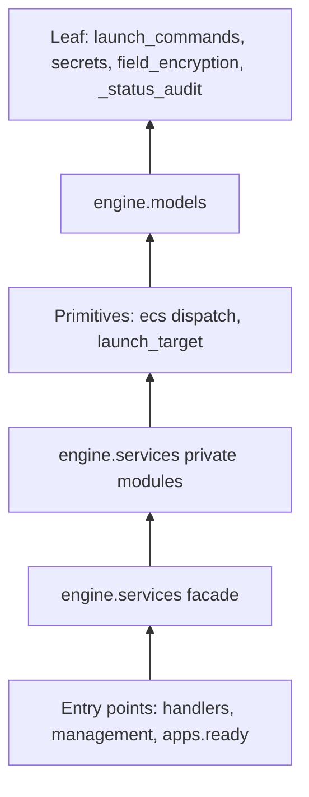

# Engine import structure: design (#2865)

Status: implementation design. Date: 2026-11-24.

This design records the decisions for issue #2865.
It builds on the [preflight guidance](engine-import-preflight-2865.md).
ADR-001 and ADR-004 supply the architecture.
The work adds rule ADR-001-R5 to the ADR registry.

Paths are relative to `shifter/shifter_platform/` unless marked as repository-root paths.

## Decisions

1. All `engine` imports are at module level.
   Ruff rule `PLC0415` enforces this for `engine/**`.
2. The `engine` package has no import cycle.
   Import Linter contracts enforce this in CI.
3. The root package `engine/__init__.py` exports nothing.
   `engine.services` is the public interface (ADR-001).
   The maintainer authorized removal of the root re-exports on 2026-11-24.
   No product code used them.
4. `EngineConfig.ready()` keeps one deferred import.
   Django loads `engine/apps.py` before the model registry.
   The ready hook needs model code, so the import cannot move.
   A file-level `PLC0415` ignore covers `engine/apps.py` only.
   The maintainer authorized this exception on 2026-11-24.
5. Product behavior does not change.
   Function bodies, signatures, transactions, lock order, and log names stay the same.
   Only module locations and import statements change.

## Architecture

The engine is a set of layered modules and packages.
A module imports only modules in lower layers.
Importing a submodule also runs its package `__init__`.
The `engine.services` facade imports every service module.
So the layering must hold at package level, not only at module level.

| Layer | Modules | Contents |
| --- | --- | --- |
| Leaf | `engine._range_state`, `engine._status_audit`, `engine.field_encryption`, `engine.secrets`, `engine.launch_commands` | Pure values, parsers, mappings, and secret access |
| Models | `engine.models` | Django models and choices |
| Primitives | `engine.ecs`, `engine.launch_target`, `engine.warm_activation_authz` | Provider task dispatch and model-level checks |
| Services | `engine.services` private modules | Authority, launch admission, launch enqueue, and domain operations, layered inside the package |
| Facade | `engine.services` | Public service names |
| Entry points | `engine.handlers`, `engine.management`, `engine.apps` | Event handlers, worker commands, and startup registration |

The arrows show the import direction.

Inside `engine.services`, the launch pipeline has this order from bottom to top.

| Order | Modules | Role |
| --- | --- | --- |
| 1 | `_runtime_binding_digest`, `_range_creation_origin`, `_launch_authority_binding`, `_launch_interrupt` | Authority digests, creation origin, binding checks, interrupt requests |
| 2 | Per-operation validators, `_launch_generation`, `_launch_payload_authority`, `_launch_intents_failure` | Checks that a persisted intent is current and authorized |
| 3 | `_launch_outbox` | Claims, launches, and settles one intent |
| 4 | `_launch_intents` | Persists a durable intent; local mode launches it through `_launch_outbox` |
| 5 | `_launch_starts`, lifecycle modules, `_launch_interrupt_convergence` | Domain operations that enqueue launches |

### Cycle removal method

A function-level dependency graph of the 70-module cycle showed one real call cycle.
Local-mode enqueue called the outbox command class, and that class also ran the full drain loop.
All other module cycles came from functions in the wrong module.

The change uses these methods only:

- Move a function or value to the lowest module that its callers and its own dependencies permit.
- Split a module along its dependency direction when it holds both low and high functions.
- Keep the old module as the owner of its high functions and its existing name.

The change does not add registries, lazy proxies, dynamic imports, or dependency containers.

### Module changes

| Change | Reason |
| --- | --- |
| `launch_intents`, `launch_intents_failure`, `launch_interrupt`, `launch_payload_authority`, `operation_inputs`, and `retry_binding` move into `engine.services` as private modules | They call service modules, and service modules call them; a top-level module would form a package cycle through the facade |
| New `engine.launch_commands` holds the command parser and payload codec, including the VPN and worker-trial parsers | Dispatch and services reconstruct commands; the parsers have no service dependency |
| New `_launch_generation` holds the generation and input-match checks from `_launch_intents` | The launcher and the payload authority need them below enqueue |
| New `_launch_outbox` holds the claim, launch, and result steps from the outbox command | Local-mode enqueue launches one intent; the command keeps its loop and calls these steps |
| `_launch_interrupt` keeps interrupt requests; new `_launch_interrupt_convergence` holds the convergence worker | Services record interrupts; the worker enqueues destroys |
| `engine.ecs` keeps provider dispatch; new `_launch_starts` holds the `start_*` functions | The starters enqueue launches; dispatch runs below enqueue |
| `engine.handlers._audit` moves to `engine._status_audit` | Service appliers and handlers both use it; importing a handler module runs the handler facade |
| Service modules stop importing the `engine.services` facade | A facade back-edge is a cycle; the late-bound facade lookups had no test or caller that needed them |
| Small leaves split from larger modules: `_worker_custody`, `_worker_qualification_evidence`, `_failed_cleanup_retry`, `_gcp_project_authority`, `_prepared_range_lifecycle`, `_vpn_destinations`, `_vpn_profile_authority`, `_vpn_errors` | Each holds the low functions or values that other modules need |
| `RaesRealizedAccessError`, `RaesImageMappingError`, `RaesRangeRef`, and `PreparedRaesRangeCreation` move to lower modules | Each keeps one class identity; the old module re-exports it |

Moved modules keep their previous logger names.
Log routing and dashboards do not change.

### Test patch targets

Tests patch a name where the code under test looks it up.
This follows the `unittest.mock` "Where to patch" rule.
When an import moves to module level, the consumer module owns the patched name.
Tests that patched the facade or the defining module change to the consumer module.

## Systems security engineering

The change moves code between modules.
It does not change a trust boundary, a data store, an external entity, or a control.

| Asset | Threat | Control | Verification |
| --- | --- | --- | --- |
| Launch authorization | A moved check stops running before dispatch | The launcher calls the same payload authorization, generation check, input match, and credential check in the same order | Launch outbox and launch intent tests pass; the launch cancellation tests run in the CI PostgreSQL lane |
| Interrupt fail-closed behavior | A split changes lease fencing or the deadline | Convergence functions move unchanged with their constants | Existing interrupt tests pass |
| Secrets and credentials | Import-time code reads a secret or builds a provider client | Module-level code stays declarations only; no new import-time call | Review of moved module bodies; Django startup check |
| Startup availability | A model import runs before the registry is ready | The root package exports nothing; `apps.py` keeps its deferred import | Fresh-process `manage.py check` and the clean-checkout startup test pass |
| Error identity | A duplicated exception escapes a handler | One class for each moved exception, with a re-export | Existing operation-apply, image registry, and VPN tests pass |

Residual risk: a test that patched a moved name can pass without effect.
The targeted test runs exercise each changed patch target.
CI runs the full suite.

## Data flows

No data flow changes.
Processes, stores, external entities, and named flows stay the same.
The launch, interrupt, and outbox flows keep their order and transactions.
The existing launch and outbox designs remain the data flow references.

## Policy and architecture as code

| File | Change |
| --- | --- |
| `pyproject.toml` | Select `PLC0415`; ignore it outside `engine/**` and in `engine/apps.py` |
| Repository-root `.importlinter` | Add an `acyclic_siblings` contract for `engine` and `forbidden` contracts for facade back-edges |
| Repository-root `docs/adr/index.yaml` | Add rule ADR-001-R5 |
| Repository-root `docs/adr/exceptions.yaml` | Record the `engine/apps.py` exception |
| Repository-root `docs/technical/dev/adr-enforcement.md` | Describe the new checks |

The migration directory stays outside Ruff scope by the existing global exclude.
The one migration import moves to module level without a new check.

## References

- [Ruff PLC0415](https://docs.astral.sh/ruff/rules/import-outside-top-level/)
- [Ruff per-file ignores](https://docs.astral.sh/ruff/settings/)
- [Import Linter contract types](https://import-linter.readthedocs.io/en/v2.11/contract_types/)
- [Django applications](https://docs.djangoproject.com/en/6.0/ref/applications/)
- [unittest.mock](https://docs.python.org/3/library/unittest.mock.html)
- [PEP 8 imports](https://peps.python.org/pep-0008/)
- [Acyclic dependencies principle](https://en.wikipedia.org/wiki/Acyclic_dependencies_principle)
