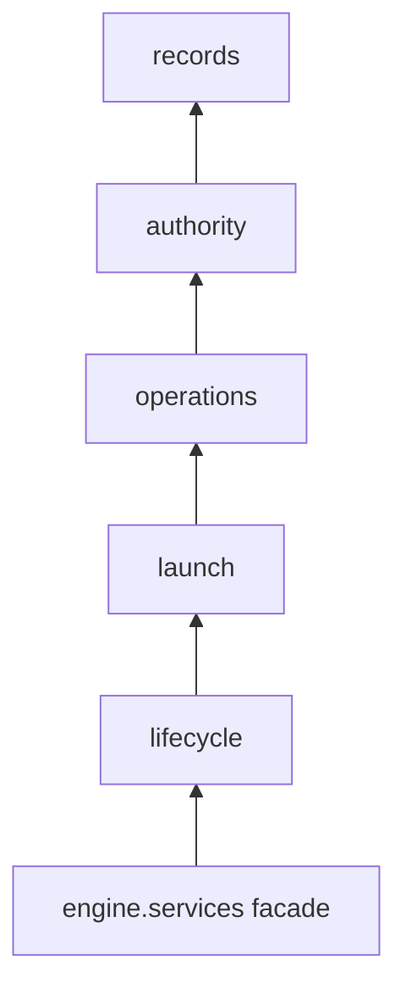

# Engine import structure: design (#2865)

Status: implementation design. Date: 2026-11-28.

This design records the decisions for issue #2865.
It builds on the [preflight guidance](engine-import-preflight-2865.md) and the [service package preflight (#2863)](engine-service-packages-preflight-2863.md).
ADR-001 and ADR-004 supply the architecture.
The work adds rule ADR-001-R5 to the ADR registry.

Paths are relative to `shifter/shifter_platform/` unless marked as repository-root paths.

## Decisions

1. All `engine` imports are at module level.
   Ruff rule `PLC0415` enforces this for `engine/**`.
2. The `engine` packages form layers, and the package graph has no cycle.
   The layer model in repository-root `scripts/check_layer_imports/layer_imports.yaml` states the layers.
   `check_layer_imports.py` and Import Linter enforce the model in CI.
3. Packages group modules by dependency direction first and by domain second.
   A domain that has code both below and above the launch kernel has two packages, for example `_range` and `_range_lifecycle`.
   The maintainer approved this regrouping of the #2863 packages on 2026-11-26.
4. The root package `engine/__init__.py` exports nothing.
   `engine.services` is the public interface (ADR-001).
   The maintainer authorized removal of the root re-exports on 2026-11-24.
   No product code used them.
5. Each `engine.services` subpackage `__init__.py` exports nothing.
   Engine code imports the owning leaf module, as #2863 requires.
   The `engine.services` facade imports leaf modules directly.
6. `EngineConfig.ready()` keeps one deferred import.
   Django loads `engine/apps.py` before the model registry.
   The ready hook needs model code, so the import cannot move.
   A file-level `PLC0415` ignore covers `engine/apps.py` only.
   The maintainer authorized this exception on 2026-11-24.
7. Product behavior does not change.
   Function bodies, signatures, transactions, and lock order stay the same.
   Only module locations and import statements change.

## Architecture

The engine is a set of layered packages.
A package imports only packages in its own layer or a lower layer.
Importing a submodule also runs its package `__init__`.
The `engine.services` facade imports every service module.
So the layering must hold at package level, not only at module level.

### `engine` layers

| Layer | Members | Contents |
| --- | --- | --- |
| leaf | `_range_state`, `_status_audit`, `field_encryption`, `launch_commands`, `secrets`, `ssh` | Pure values, parsers, mappings, and secret access |
| models | `models` | Django models and choices |
| primitives | `ecs`, `interpreter`, `launch_target`, `warm_activation_authz`, `worker_retention` | Provider task dispatch and model-level checks |
| services | `services` | Service implementation and the public facade |
| entry_points | `admin`, `apps`, `handlers`, `management`, `migrations` | Admin, startup, event handlers, worker commands, and migrations |

### `engine.services` layers

| Layer | Members | Contents |
| --- | --- | --- |
| records | `_capacity`, `_common`, `_device_authority`, `_identity_cutover`, `_inventory_scope`, `_launch_interrupt`, `_operation_admission`, `_public_api`, `_queries`, `_subnet_coordination`, `operation_policy` | Records, queries, and helpers with no other service dependency |
| authority | `_authorization_inventory`, `_launch_authority`, `_range` | Range authority projections, binding digests, and launch authority |
| operations | `_cleanup`, `_feature_artifacts`, `_gcp_project`, `_preparation`, `_principal`, `_raes`, `_runtime_plugin`, `_runtime_plugin_operations`, `_vpn`, `_worker` | Per-resource operation contracts that the launch kernel validates and authorizes |
| launch | `_launch` | Operation inputs, admission checks, dispatch failure, outbox, intents, starters, and interrupt convergence |
| lifecycle | `_ngfw`, `_operation_apply`, `_principal_lifecycle`, `_raes_range`, `_range_lifecycle`, `_terminal`, `_warm_pool`, `_worker_lifecycle` | Orchestration that enqueues launches, and authoritative result application |

The arrows show the import direction between `engine.services` layers.

Inside `_launch`, the modules have this order from bottom to top.

| Order | Modules | Role |
| --- | --- | --- |
| 1 | `operation_inputs`, `generation`, `payload_authority`, `dispatch_failure` | Immutable inputs and the checks that a persisted intent is current and authorized |
| 2 | `outbox` | Claims, launches, and settles one intent |
| 3 | `intents` | Persists a durable intent; local mode launches it through `outbox` |
| 4 | `starts`, `interrupt_convergence` | Starters that enqueue launches and the interrupt worker |

### Cycle removal method

A function-level dependency graph of the 70-module cycle showed one real call cycle.
Local-mode enqueue called the outbox command class, and that class also ran the full drain loop.
All other module cycles came from functions in the wrong module.

The change uses these methods only:

- Move a function or value to the lowest module that its callers and its own dependencies permit.
- Split a module along its dependency direction when it holds both low and high functions.
- Group modules into layer packages so that the package graph follows the module graph.

The change does not add registries, lazy proxies, dynamic imports, or dependency containers.

### Module changes

| Change | Reason |
| --- | --- |
| The launch pipeline moves into `engine.services._launch` | It calls service modules, and service modules call it; a top-level module would form a package cycle through the facade |
| New `engine.launch_commands` holds the command parser and payload codec, including the VPN and worker-trial parsers | Dispatch and services reconstruct commands; the parsers have no service dependency |
| `_launch.generation` holds the generation and input-match checks | The launcher and the payload authority need them below enqueue |
| `_launch.outbox` holds the claim, launch, and result steps from the outbox command | Local-mode enqueue launches one intent; the command keeps its loop and calls these steps |
| `_launch_interrupt` keeps interrupt requests; `_launch.interrupt_convergence` holds the convergence worker | Services record interrupts; the worker enqueues destroys |
| `engine.ecs` keeps provider dispatch; `_launch.starts` holds the `start_*` functions | The starters enqueue launches; dispatch runs below enqueue |
| `engine.handlers._audit` moves to `engine._status_audit` | Service appliers and handlers both use it; importing a handler module runs the handler facade |
| `_operation_apply.admission` moves to `_operation_admission` | Domain result handlers below the applier use it |
| `_range`, `_principal`, `_worker`, `_raes`, and `_runtime_plugin` split into a lower package and a lifecycle or operations package | Each held both authority or contract code and orchestration code |
| Small leaves split from larger modules, for example `_worker.custody`, `_range.binding_digest`, and `_vpn.profile_authority` | Each holds the low functions or values that other modules need |
| `RaesRealizedAccessError`, `RaesImageMappingError`, `RaesRangeRef`, and `PreparedRaesRangeCreation` move to lower modules | Each keeps one class identity; the old module re-exports it |

Modules that left their original package keep their logger name where a consumer depends on it.
`_launch.starts` logs as `engine.ecs`, `_launch.interrupt_convergence` as `engine.launch_interrupt`, and `_launch.outbox` as the outbox command.
Other service modules log under their module path, as #2863 decided; the `engine` logger configuration captures them.

### Test patch targets

Tests patch a name where the code under test looks it up.
This follows the `unittest.mock` "Where to patch" rule.
When an import moves to module level, the consumer module owns the patched name.
Tests that patched the facade or the defining module change to the consumer module.

## Systems security engineering

The change moves code between modules.
It does not change a trust boundary, a data store, an external entity, or a control.

| Asset | Threat | Control | Verification |
| --- | --- | --- | --- |
| Launch authorization | A moved check stops running before dispatch | The launcher calls the same payload authorization, generation check, input match, and credential check in the same order | Launch outbox and launch intent tests pass; the launch cancellation tests run in the CI PostgreSQL lane |
| Interrupt fail-closed behavior | A split changes lease fencing or the deadline | Convergence functions move unchanged with their constants | Existing interrupt tests pass |
| Secrets and credentials | Import-time code reads a secret or builds a provider client | Module-level code stays declarations only; no new import-time call | Review of moved module bodies; Django startup check |
| Startup availability | A model import runs before the registry is ready | The root package and subpackage initializers export nothing; `apps.py` keeps its deferred import | Fresh-process `manage.py check` and the clean-checkout startup test pass |
| Error identity | A duplicated exception escapes a handler | One class for each moved exception, with a re-export | Existing operation-apply, image registry, and VPN tests pass |
| Architecture drift | A later change imports upward and recreates a cycle | The layer model fails closed for an upward import, a container import, and an unclassified child | `check_layer_imports.py` tests and a seeded upward import fail the check |

Residual risk: a test that patched a moved name can pass without effect.
The targeted test runs exercise each changed patch target.
CI runs the full suite.

## Data flows

No data flow changes.
Processes, stores, external entities, and named flows stay the same.
The launch, interrupt, and outbox flows keep their order and transactions.
The existing launch and outbox designs remain the data flow references.

## Policy and architecture as code

| File | Change |
| --- | --- |
| `pyproject.toml` | Select `PLC0415`; ignore it outside `engine/**` and in `engine/apps.py` |
| Repository-root `scripts/check_layer_imports/layer_imports.yaml` | Add `internal_layers` for `engine` and `engine.services` |
| Repository-root `scripts/check_layer_imports/_internal_layers.py` | Enforce the internal layers through `check_layer_imports.py` |
| Repository-root `.importlinter` | Add an `acyclic_siblings` contract for `engine` and `forbidden` contracts for the `models`, `ecs`, and `handlers` facades |
| Repository-root `docs/adr/index.yaml` | Add rule ADR-001-R5 |
| Repository-root `docs/adr/exceptions.yaml` | Record the `engine/apps.py` exception |
| Repository-root `docs/technical/dev/adr-enforcement.md` | Describe the new checks |

The migration directory stays outside Ruff scope by the existing global exclude.
The one migration import moves to module level without a new check.

## References

- [Ruff PLC0415](https://docs.astral.sh/ruff/rules/import-outside-top-level/)
- [Ruff per-file ignores](https://docs.astral.sh/ruff/settings/)
- [Import Linter contract types](https://import-linter.readthedocs.io/en/v2.11/contract_types/)
- [Django applications](https://docs.djangoproject.com/en/6.0/ref/applications/)
- [Python import system](https://docs.python.org/3/reference/import.html)
- [unittest.mock](https://docs.python.org/3/library/unittest.mock.html)
- [PEP 8 imports](https://peps.python.org/pep-0008/)
- [Acyclic dependencies principle](https://en.wikipedia.org/wiki/Acyclic_dependencies_principle)
