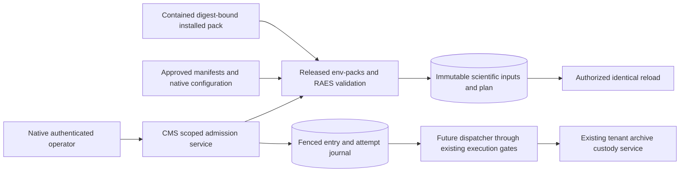

# Pack experiment admission and immutable batch inputs (#2742)

Architecture preflight, 2026-11-03. This is replacement-design guidance under
ADR-027, not an implementation plan or a claim that admission exists. The supplied
issue contract is sufficient to start: no remote executor, new upstream
single-entry API or consumer model catalog is a delivery prerequisite.

## Ownership and released contracts

CMS owns tenant experiment admission, retained scientific inputs and the minimal
per-entry operational journal. Expose operations through `cms.services`; the
management command is a thin authenticated adapter, following `register_pack`.
Use the existing CMS app and migrations, never `cms.experiments`, its deleted
tables, routes, queues, flags or payloads. Workspaces owns tenancy and quotas;
Engine owns native infrastructure and model allocation. Cross-domain access uses
public services and scalar identities, not foreign model imports or a new
repository/controller framework. Only `shared.raes` interprets RAES contracts.

The repository pins and installed package metadata inspected for this preflight
agree on `raes==10.6.0` and `raes-env-packs==7.2.2`. Canonical dependency owners
are the platform `pyproject.toml` and `uv.lock`; retain the exact dependency tuple
alongside each admission, including relevant installed participant/backend
manifest versions and configuration digests. A dependency version, pack content
digest, SDL family digest, plan digest and execution-attempt identity are
different facts. Do not substitute one for another.

Use these released public APIs behind the existing owning adapters:

- `raes_env_packs.load_pack_experiments` returns `PackExperiment` values from
  the pack validator's single static validation pass. Select an experiment by
  explicit authored identity/version; reject missing or ambiguous selection.
  An empty experiment set is not a successful executable batch. Reuse CMS's
  `scenarios.pack_validation` digest/foreign-input adapter and contained pack
  acquisition; use no private env-packs helpers or directory-name heuristics.
- `PackExperiment.compilation_request` joins the admitted family, experiment,
  task and capture specifications to **trusted** apparatus manifests,
  participant manifests/configuration validators, realization envelope,
  execution authority and `TrialCompilationLimitsModel` supplied by their owners.
  `raes_processor.trial_compiler.compile_admitted_trial_plan` owns factor
  expansion, selection, binding, seeds/draws, conditions, repetitions, allocation
  and deterministic plan/entry/run identities. Diagnostics mean atomic refusal,
  not a partially admitted experiment.
- `raes_contracts.contracts.admitted_trial_plan_ingress` supplies bounded parsing
  and full sealed-plan reconstruction. Use that ingress on retained plan bytes;
  `raes_processor.trial_scheduler.plan_batch_schedule` supplies upstream order
  and the embedded isolation ceiling. No local canonicalizer, digest sealer,
  factor enumerator, scientific DTO or scheduler interpretation is needed.
- The released pure `instantiate_admitted_trial_entry` and public RAES canonical
  SDL APIs supply selected hydrated scenarios and their identities without
  realization. Preserve their results; never rewrite YAML or implement selection
  locally. Do not call dispatch, runtime execution or provisioning to obtain them.

The ordinary range loader's exactly-one-direct-SDL rule is not an experiment
selector. The experiment loader already resolves the authored family reference.
Its consumer validation currently denies SDL imports; do not widen that policy
or fetch dependencies to make a pack pass. Static pack validity is not trial
admission, backend conformance, live capacity or permission to execute.

Inner SDL remains portable and unchanged when VM transport changes. Backend and
participant manifests, supported tools/configuration schemas and administrator
approved apparatus configuration stay with their existing owners. Model/prompt
alternatives are upstream scientific treatments or participant configuration,
not new provider credentials or a Shifter model catalog. Retaining a synthetic
manifest does not advertise live participant execution support. The Shifter
backend's provisioning-only support must remain truthful.

Supplying a manifest/configuration file is not evidence of administrator approval.
When the command admits caller-supplied apparatus context, require installation
`manage_content` authority as well as the owning organization's authority, following
archive destination configuration. A later tenant operation may consume an
already approved exact binding; it cannot approve its own replacement. Invoke
only trusted installed owner validators, never import a hook named by pack data
or resolve configuration by executing participant code.

## Durable inputs and operational facts

Retain original authored documents and exact admitted plan bytes, plus the
upstream canonical family/selected scenario forms and participant configurations
needed for replay. Retain task, captures, authoring/study references, conditions,
repetitions, stochastic controls and resolved allocation, not just their names
or a path into a mutable installation. Pin all referenced apparatus/manifest
bytes or an existing immutable, retrievable version and digest. A digest alone
does not retain its input. Reject missing or changed referenced content.

Use the existing database for bounded retained admission inputs; no new storage
service or automatic upload is required. Separate immutable input columns/rows
from mutable claim/attempt metadata. Operational projections are indexes into
the authoritative upstream plan, not editable scientific copies. Publish the
complete experiment and all indexed entries atomically after validation; readers
must never receive an incomplete executable batch. Bound total retained bytes,
including hydrated scenarios, as well as the plan and individual documents.

Enforce unique tenant-bound plan, entry, run and attempt identities with database
constraints and validate their joins against the retained full plan. Preserve
upstream string identities; do not require them to be native UUIDs. A product
experiment row identifier is not the scientific experiment reference: archive
intake expects the plan's study reference, or authoring-input reference if there
is no study. Reuse that convention and `TrialArchiveIdentity` for future collection.
Likewise a native request/operation UUID is not a scientific run identifier.

Identical authorized admission/reload converges on the retained plan and runs;
changed bytes under an existing identity conflict. Reload validates retained
bytes and references without reloading a current pack, recompiling, resampling
or allocating identities. Scheduling order, claim retries and worker count cannot
change allocation or scientific inputs. An intentional scientific change requires
a separately admitted upstream identity, never an update in place.

Model `save()` protection alone is insufficient: queryset/bulk updates bypass it.
Reuse the database immutability-guard convention in Engine migrations
`0099_preparation_workload_guards.py` and `0116_launch_workload_guards.py`, with
targeted PostgreSQL/SQLite coverage. Keep immutable data unavailable to generic
admin updates. `Range.range_config`, `OperationInput`, `RaesOperationRecord`,
`RunDescriptor`, pack provenance, security audit and archive receipts each have
other purposes; none is the experiment's scientific input store.

Document the following public service semantics, without implementing dispatch:

| Operation | Required boundary |
| --- | --- |
| Admit / reload | Current native tenant authority; validate and atomically retain a complete batch, or return its exact existing inputs. Output only plan identity/digest, expected trial count and limits. Reload does not grant perpetual execution authority. |
| Claim an entry | Short database transaction, parent batch/capacity serialization and entry lock or conditional update; unique active claim, opaque fencing token and explicit recovery policy. Enforce aggregate concurrent claims across processes. Return the original entry/run and current attempt identity. |
| Record worker identity | Compare the current claim token, attempt and tenant/plan/entry/run binding. Bind an opaque identity once; identical replay succeeds, a different identity conflicts. A worker reference is not a command or credential. |
| Observe an attempt | Authorized bounded read and fenced, idempotent status observations. Late/stale or conflicting updates cannot overwrite a newer claim. Worker acceptance, scientific outcome and cleanup remain separate. |
| Record collection | Join the same attempt and scientific identity to an existing verified `TrialArchiveReceipt` through the custody service. No fabricated receipt or duplicate artifact collector. Collection does not assert trial success or safe resource reuse. |

Reuse the short-transaction claim/lease/fence pattern of
`ctf.services.communication.delivery` and
`engine/management/commands/drain_provisioner_launch_outbox.py`; these are
references, not cross-domain imports or a new generic workflow engine. Do no
network, compiler or worker I/O under claim locks. Persist a claim before external
dispatch; fence every later mutation with its token. A database claim does not
prove exactly-once external execution. Lease expiry alone cannot authorize a
second worker when the original worker may still run. Preserve uncertain launch
and cleanup state for reconciliation. A single-attempt service may keep uncertain
claims for explicit reconciliation rather than introduce automatic leases/retries.
If retry is exposed, attempts retain the same admitted run and separate attempt
identities/history, subject to upstream retry/cleanup policy; a reload or transient
claim renewal is not a scientific repetition.

## Cross-cutting gates and extension seams

Paths below are relative to `shifter/shifter_platform` unless qualified.

| Layer / canonical incumbent | Admission obligation and seam |
| --- | --- |
| CLI authentication and OS exposure: `shared.api_tokens.cli.credential_from_file`, `CredentialContext`, native bearer authentication | Use actual proof from the existing bounded, owner-only regular-file reader (0600, no symlink). No token in argv, environment overrides, history, output or persisted inputs; no username/staff/credential-reference impersonation. Scientific content enters through contained installed files, not shell interpolation. No subprocess, VM creation or paid-model call is needed. |
| Authorization, tenant ownership and revocation: `shared.authorization`, `ResourceScope`, `workspaces.services`, CMS `_content_authority`, `_tenant_pack_authority`, registration custody/fences | Authorize before discovering tenant rows or reading inputs; validate installed pack ownership/visibility and exact account/organization/workspace ancestry through their owners. Bind tenant ownership from authenticated policy, never pack declarations. Reauthorize and fence local credential/ancestry at commit and on later operations. Admission does not mint a transferable launch capability. |
| Pack and file ingress: CMS `scenarios.pack_validation`, `shared.raes.package_loader`, `object_source`, env-packs `PackValidationLimits` | Verify exact installed pack bytes/digest and associated-artifact inventory; use contained roots, private bounded staging and existing object-version checks if applicable. Reject traversal, links, special files and malformed/oversized metadata. Validate and retain the same immutable snapshot to prevent a read/retain race; do not bless changed content by calculating a fresh advertised digest. No arbitrary URL fetch or executable adapter installation. |
| Scientific parsing and semantics: `shared.raes.json_ingress`, released pack/SDL/trial/participant validators and admitted-plan ingress | Parser-level duplicate-member/non-finite rejection, byte/depth/node bounds, closed version/profile selection and full-plan digest/join validation precede entry use. Participant configuration is validated by the selected implementation's published validator. Fail unsupported required capture, treatment, tool, manifest and apparatus combinations; do not omit them or duplicate their validators. |
| Secret and data destination policy: `shared.schemas._raes_validation`, existing audit secret-field rules, `_trial_archives`, `TrialArchiveDestination`, `shared.cloud.ObjectStorage` | Reject credential material using existing rules before retaining scientific values; do not redact inputs and then call them identical. Pin approved tenant destination and explicit retention under existing installation plus organization authority; no caller/pack-selected bucket, endpoint or fallback. Recheck destination authorization/policy before future transfer. Keep database inputs and later archive retention explicit and independent of pack removal or sidecar expiry. Secret references remain references, never resolved values. |
| Concurrency, containment and capacity: upstream `plan_batch_schedule`, `shared.capacity`, public `engine.services` capacity/model admission, `workspaces.services` quota operations, `_range_backend_admission` | Validate positive integral requested concurrency against trusted configurable ceiling (200), entry count and upstream isolation ceiling; reject an unsupported request visibly. No embedded proof means ceiling one. Do not manufacture/reseal a proof. State requested, configured and admitted bounds separately. Live effective concurrency can be lower and needs existing native/provider/model quota and resource-lease admission at dispatch. PLAT-201 best-effort capacity is not a reservation or isolation proof; required-model refusal remains fail closed. Admission need not reserve infrastructure or call a model. |
| Config and environment shapes: `config._raes_settings`, `_product_env`, `_env_manifest` / `env-manifest.json`; repository `shifter/installation/{schema,registry,render,runtime_inventory*}.py`, provider renderers and parity tests | Put the trusted concurrency ceiling and bounded compilation/storage policy at the existing native configuration seam, independent of scientific identity. A CLI request cannot raise that ceiling. If adding an environment binding, reconcile its typed schema, manifest generation, deployment rendering/runtime inventory and tests; do not add an unvalidated `getenv` override or accept portable manifests as native env configuration. No new credential setting is needed. |
| Exceptions, public output and audit: `CMSError`, existing pack/RAES errors, `shared.errors`, `shared.api.errors`, `shared.log_sanitize`, `shared.audit`, `config.logging.ECSFormatter` | Translate expected upstream failures at the owning adapter to stable bounded authored classifications and safe `CommandError`; preserve errors as refusal, never partial success. No parallel exception hierarchy. Raw parser/Pydantic errors, cause chains, paths, prompts/configuration bodies and secrets must not reach output/logs/audit. Sanitization/truncation is not confidentiality. Use opaque correlation IDs, finite status/count fields and strict audit for durable mutations; no per-entry metric labels or scientific bodies in audit. Future HTTP callers use the shared envelope, not a new response format. |
| Later worker/native execution: `engine.launch_intents`, immutable operation inputs, `shared.cloud.sensitive_env`, Kubernetes `_job_manifest`, provider config and range/model policy | No worker is launched in this issue. Preserve these gates for later dispatch: canonical identifier-only structured argv, exact executing workload/authority/generation, per-Job Secret references, hardened workloads and native containment/provider quota checks. A saved plan, a transport choice or a synthetic participant manifest bypasses none of them. |

The extension seam is the existing supplied apparatus/participant manifests,
configuration validators and native policy parameters. A future VM transport or
participant version replaces that supplied context, not the canonical SDL or
scientific schema. Changes affecting science require new admission; changing a
non-binding operational ceiling cannot change plan bytes. Later dispatch consumes
the immutable handoff and fenced service operations. It must not re-enumerate,
reseed or allocate new runs to suit placement.

## Bounds, verification and documentation obligations

This release is bounded admission, not unbounded factorial execution. Inspected
compiler defaults are 10,000 coordinates, 10,000 values per point, 10,000 product
outputs, 256 bindings and 256 draws per entry, and 32 MiB canonical plan bytes.
Contract limits also include 128 selection policies, 64 policy references,
1,024 selection outcomes and an 8 MiB expanded-treatment budget. Pack defaults
include 1 MiB metadata documents, 8 MiB SDL, 1,024 members and YAML depth 64.
These are separate bounds, not a supported-size promise or permission to raise
upstream limits. Document actual effective native and upstream limits, including
total hydrated/retained bytes and temporary-disk/memory budgets. Refuse oversized
requests before unbounded work. Never silently truncate, sample instead of a full
factorial, reduce repetitions, rewrite inputs or split the study. The compiler's
coordinate traversal parameter is not released owner-supported study partitioning.
The inspected compiler does not attach an isolation proof to its normal output;
that output therefore admits serial execution even when the native ceiling is 200.
Do not mutate the sealed plan to make a higher requested concurrency pass.

Reuse installed-package synthetic pack fixtures from `tests/cms/test_pack_validation.py`,
the installed-contract checks in `tests/shared/raes/test_plan_provisioner_parity.py`,
and tenant/archive service fixtures. Prove model/prompt alternatives affect the
selected scenario or validated participant configuration, not labels alone, and
that repeated trials retain upstream identities/allocation. Prove byte-exact
reload after source change/removal, tamper/version/unsupported-combination refusal,
unauthorized and cross-tenant denial, destination/retention refusal, bounded input
rejection and no VM/model/dispatch side effects. Exercise duplicate admission,
duplicate claims, aggregate claim limits, stale tokens, conflicting worker reports
and rollback on real PostgreSQL using the repository's `postgres` transaction-test
convention; SQLite is not proof of row-lock exclusion. Targeted negative mutations
of digest/tenant/claim predicates must be caught. Reordered scheduling and changed
worker count must leave all identities, selections, seeds and allocation unchanged.

Implementation documentation must include a user guide for authenticated admission,
destination prerequisites, output, reload, supported tuple and refusal/size limits;
and technical documentation of replacement ownership, immutable custody and the
claim/worker/observe/collect service contract, retry uncertainty and retention.
Add both to `docs/adr/documentation-coverage.yaml`, their `index.md` pages and the
current architecture handbook in the same feature PR. This preflight is not that
user documentation. Preserve the ADR-027 removal tests.

The executable architecture model remains ADR-001/024/027/031/032/034/043/066,
`.importlinter` and `scripts/check_layer_imports/layer_imports.yaml`; new persistence
invariants need native database constraints/guards and targeted tests, not a second
architecture language. Run the mandatory full ADR guard for architecture changes,
targeted tests and relevant Ruff/import checks; CI owns full test suites. Reuse
existing quality workflows and path filters. No new workflow or permission scope
is assumed merely because the feature is named experiments.

The pack edge crosses untrusted content; native authority/configuration is separate.
SQL publication crosses the durable handoff boundary. Future workers cross a
process boundary and must revalidate exact inputs and current execution authority.

Non-goals: remote execution, a worker pool, cloud provisioning or model calls,
new upstream APIs, a model catalog, executable adapter installation, public UI/API,
new storage/hosting, automatic archive transfer, scoring/analysis, study partitioning,
and revival of any legacy experiments workflow. Claim and observation persistence
must be usable now; do not leave it as dispatcher-dependent stubs or add execution
as a prerequisite to finishing this admission feature.
