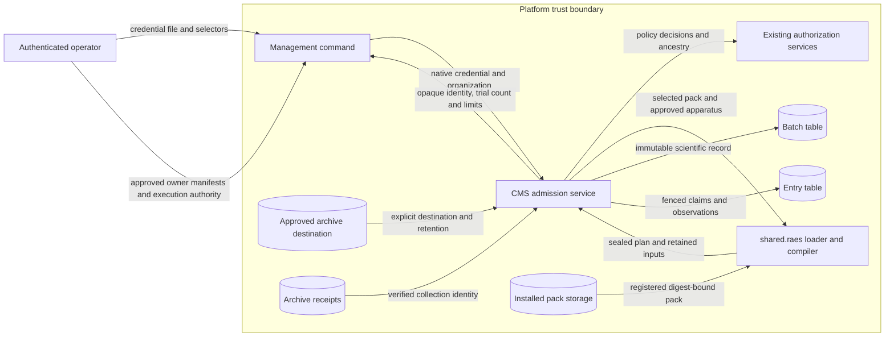

# Pack experiment admission

## Boundary

CMS admits experiments through a new service facade and an authenticated management command.
The retired `cms.experiments` application remains absent.
RAES owns scientific contracts, variation selection, trial compilation, participant configuration, and run identities.
The `shared.raes` boundary contains all RAES imports.
Env-packs owns installed experiment loading and pack validation.

Admission needs installation `manage_content` authority because the caller supplies approved apparatus configuration.
It also needs the owning organization's `manage_content` authority.
Scientific-input reads and token-based observations need organization `read_content` authority.
Recovery by batch and entry needs organization `manage_content` authority because it returns an operational token.
Every mutation checks current credential state and SQL ancestry inside its transaction.
Only an organization-owned installed pack can supply an experiment.
The registered digest must match the staged pack.

## Retained inputs

One immutable batch row contains the sealed plan and the exact experiment input documents.
It also contains the expanded family, hydrated entry snapshots, participant configurations, capture specifications, and approved apparatus documents.
The dependency tuple and resource limits form part of this retained record.
Referenced local protocol artifacts retain their verified original bytes through the released env-packs artifact resolver.
Selected prompt and control-context assets must bind exact inventory descriptors and bytes through that resolver.
Unavailable, changed, or externally located selected content prevents admission.
Portable asset pins remain the released RAES contract; admission creates no runtime disclosure or publication record.
Original documents and referenced artifacts each have a separate 16 MiB aggregate bound.
A digest covers the complete record.
Database triggers prevent updates to scientific records and entry identities.
Unique constraints protect tenant plan identities and preallocated entry and run identities.
An identical admission returns the existing batch.
A changed operational admission under the same tenant plan identity conflicts.
Reload reads retained inputs without consulting the pack or allocating runs.

Operational entry rows contain claim tokens, worker references, observations, and collection references.
A transaction locks the batch before checking its active claim count.
It then claims one pending entry with a conditional update.
The claim token fences later worker and observation writes.
Claims do not expire automatically because a lost acknowledgment can leave a live worker.
This slice permits one attempt per entry and leaves uncertain attempts claimed for operator reconciliation.
An authorized lookup by batch and entry recovers the existing attempt token after a lost response without allocating another attempt or authorizing redispatch.
Collection verifies a committed archive receipt against the retained plan, entry, run, and attempt identities.
Collection does not declare scientific success or authorize resource reuse.
An authorized cleanup observation must validate against the retained RAES cleanup plan before it releases claim capacity.
Failed or uncertain cleanup leaves capacity occupied.

## Data flow

The command creates no VM, model request, storage destination, queue task, or executable adapter.
Pack SDL describes the inner environment and does not change with VM transport.
Backend and participant manifests remain owner-supplied contracts.
The SDL-owned control-context validator checks prompt selections without executing participant code.
Unknown owner hooks and unsupported combinations fail closed.

## Security and failure behavior

| Threat | Boundary and control | Verification |
| --- | --- | --- |
| Foreign tenant input | Filter pack, batch, and receipt by SQL organization ownership | Cross-tenant service tests |
| Revoked proof during admission | Recheck local proof and ancestry before commit | Credential revocation test |
| Changed scientific input | Registered pack digest, complete retained digest, database immutability triggers | Tamper and reload tests |
| Duplicate dispatch | Batch row lock, pending-state compare, unique claim token | PostgreSQL concurrent-claim test |
| Capacity escalation | Validate positive concurrency against configured ceiling and RAES admitted parallelism ceiling | Boundary tests |
| Secret retention or error disclosure | Existing credential rejection checks; fixed public errors and opaque audit fields | Credential and error tests |
| Forged collection | Join committed receipt with retained scientific identities and attempt token | Receipt mismatch tests |

Database administrators remain trusted.
Retained experiment documents can contain sensitive research content and need the database's existing access and backup controls.
Provider capacity and quotas require fresh admission by a future dispatcher.
A requested ceiling of 200 supplies no provider permission.

## Limits and compatibility

The initial tuple is Python 3.14, Django 6.0, RAES 10.6.0, and raes-env-packs 7.2.2.
The compiler defaults bound coordinates, product outputs, and domain values at 10000 each.
The sealed plan limit is 32 MiB.
Admission also bounds the complete retained record at 64 MiB.
The configured concurrency ceiling defaults to 200.
The closed native apparatus authority document configures this ceiling under installation authority.
The CLI concurrency request cannot raise that document's approved ceiling.
This slice adds no environment binding or deployment configuration.
The SDL `trial_parallelism` value sets the admitted parallelism ceiling. A plan without it has a serial ceiling.
Large factorial requests fail at their owner limits.
Admission never reduces, partitions, or rewrites a study.
Future owner-supported partitioning requires a new reviewed dependency tuple.
Remote dispatch and scientific analysis remain separate features.

## References

- [RAES 10.6.0](https://pypi.org/project/raes/10.6.0/): installed trial compiler, scheduler, and realization APIs.
- [Env-packs 7.2.2](https://pypi.org/project/raes-env-packs/7.2.2/): installed `load_pack_experiments` and `PackExperiment.compilation_request` APIs.
- [Django 6.0 querysets](https://docs.djangoproject.com/en/6.0/ref/models/querysets/): `select_for_update` and conditional `update`.
- [Django 6.0 transactions](https://docs.djangoproject.com/en/6.0/topics/db/transactions/): short `atomic` transactions and rollback.
- [ASD-STE100 Issue 9](https://www.asd-ste100.org/assets/files/ASD-STE100_ISSUE9.pdf): writing rules, sections 4 through 6.

The design reuses ADR-027, ADR-031, ADR-034, and the existing tenant archive custody boundary.
No deployment, network, IAM, or public HTTP contract changes are needed for admission-only behavior.
