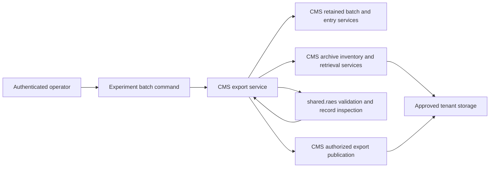

# Retained experiment result exports

CMS organizes the retained admitted allocation and original trial archives.
It publishes a manifest and CSV/JSON indexes through the existing approved
tenant archive destination. Original archives remain unchanged.
This feature performs no execution, statistical analysis or scoring.

## Ownership and flow

`cms.services.export_experiment_batch` composes the existing owners.
Admission owns retained plan integrity and operational assignments.
Archive custody owns tenant-filtered inventory, verified retrieval, destination
configuration and publication. Only `shared.raes` interprets portable records,
using the released RAES models and existing archive validator.
No new application, database model, cloud adapter or external dependency is needed.
The existing import rules enforce these owners (ADR-001 and ADR-031).

## Derived records

The manifest identifies the batch, admitted plan, source receipts, archive
digests and contents. It separates collection completeness from capture gaps
and scientific outcomes, and lists missing or incomplete records.
The index includes every expected entry, with separate run versions and attempts
where present. Condition, block and replicate identities come from the original
plan coordinate. Selected configurations come from admission; observed facts,
timings, usage disclosures and replacement lineage come from retained records.
Each fact retains references to its source receipt and original member.
Unknown values remain null in JSON and empty in CSV. Nested CSV values use JSON.
Assignment alone does not establish a start or scientific outcome.
Repeated archive deliveries remain custody observations, not extra trials.
Replacement plans retain their root and parent identities without changing
the original allocation or allocating replacements.

## Authorization, bounds and publication

Current native tenant authority precedes discovery and each archive read.
Publication requires tenant content-management authority and uses only the
currently configured destination. No caller-selected bucket or export path
is accepted. Recheck authority and destination configuration before writes.
Errors and audit events contain identifiers and fixed dispositions, not records.
Archives are staged privately through verified retrieval and parsed without
executing content or extracting filesystem members.

Sorting and canonical JSON make repeated aggregation deterministic. Output
paths bind batch identity, content digest and an opaque publication identifier. Indexes are written before the
manifest; a successful command returns references only after verification.
Later arrivals create a new content identity. Original retained objects are
never modified. The export refuses more than 10000 expected entries, 10000
archive inventory observations or 128 MiB of derived output. Existing per-archive
validation bounds also apply. These limits do not authorize silent truncation.
Each derived file uses the existing `TrialArchiveTransfer` journal with an
explicit export-kind marker, publication identity, file digest and pinned expiry.
Archive inventory excludes these derived files. The existing settled-write
fence and `purge_trial_archives` delete only their exactly owned objects after
expiry. A failed or concurrent publication owns separate keys. Only a completely
verified publication can be reused. No new retention model or bucket lifecycle
assumption is needed. Archive receipt expiry still controls original reads.

The synthetic command tests cover mixed outcomes, absent and corrupt collections,
capture gaps, repeated and out-of-order arrival, duplicate delivery, identities,
authorization and explicit size refusal. CI owns full repository checks.
