# GCE guest hardware profiles

Administrators select guest hardware through the existing runtime image profile.
The portable RAES plan does not grant boot-policy or provider authority.

## Contracts

`RuntimeTargetImageProfile` accepts three additional GCP image choices.
`nic_type` is empty, `GVNIC`, or `VIRTIO_NET`.
`disk_interface` is empty, `NVME`, or `SCSI`.
`enable_secure_boot` is a strict boolean and defaults to `true`.

Empty interface choices preserve provider defaults.
AWS rejects non-default GCP choices.
Machine images reject these overrides because their captured settings own that configuration.

The provisioner copies these values into `GCERangeImageProfile`.
The GCE renderer applies them to the network interface, boot disk, and Shielded VM configuration.
vTPM and integrity monitoring remain enabled.
An administrator can select unsigned-module research workloads with Secure Boot disabled on their selected guest.
This choice does not change cluster nodes or other ranges.

A disposable worker host profile uses the same image profile fields.
Its operation input carries the non-default choices to the same renderer and readback.
Worker qualification records the realized settings, as described in [disposable workers](../technical/shifter_platform/disposable-workers.md).

Existing profile fingerprints omit the new fields when they retain their defaults.
A non-default choice changes the profile fingerprint and the retained operation identity.
Readback must compare the selected settings before reusing an existing guest.

## Data and trust boundaries

```mermaid
flowchart LR
    Admin[Authorized tenant administrator] -->|Exact image and hardware choices| Binding[Runtime binding validation]
    Binding -->|Validated immutable snapshot| Store[(Range operation input)]
    Store -->|Pinned provider profile| Resolver[GCE image resolver]
    Resolver -->|Network disk and boot settings| Renderer[Compute resource renderer]
    Renderer -->|Instance request| GCE[Compute Engine]
    GCE -->|Observed instance configuration| Verify[Existing guest reconciliation]
```

The administrator boundary controls privileged image settings.
The existing authorization and operation snapshots remain the enforcement points.
Strict types prevent ambiguous boot choices.
Provider validation rejects choices that another backend would ignore.
No registry credentials, tenant coordinates, or private scenario content enter this document.

## References and verification

- [Google ARM compute](https://docs.cloud.google.com/compute/docs/instances/arm-on-compute): C4A and T2A guest requirements, current documentation.
- [Google virtual NIC](https://docs.cloud.google.com/compute/docs/networking/using-gvnic): ARM guest networking, current documentation.
- [Shielded VM options](https://docs.cloud.google.com/compute/shielded-vm/docs/modifying-shielded-vm): module signing and Secure Boot, current documentation.
- [General-purpose machines](https://docs.cloud.google.com/compute/docs/general-purpose-machines): machine and disk compatibility, current documentation.

Targeted tests cover strict validation, snapshot round trips, request rendering, reconciliation, and fingerprint compatibility.
Existing architecture boundaries and authorization policies remain applicable.
This extends the existing image-profile contract; it creates no new service, policy exception, or credential path.
