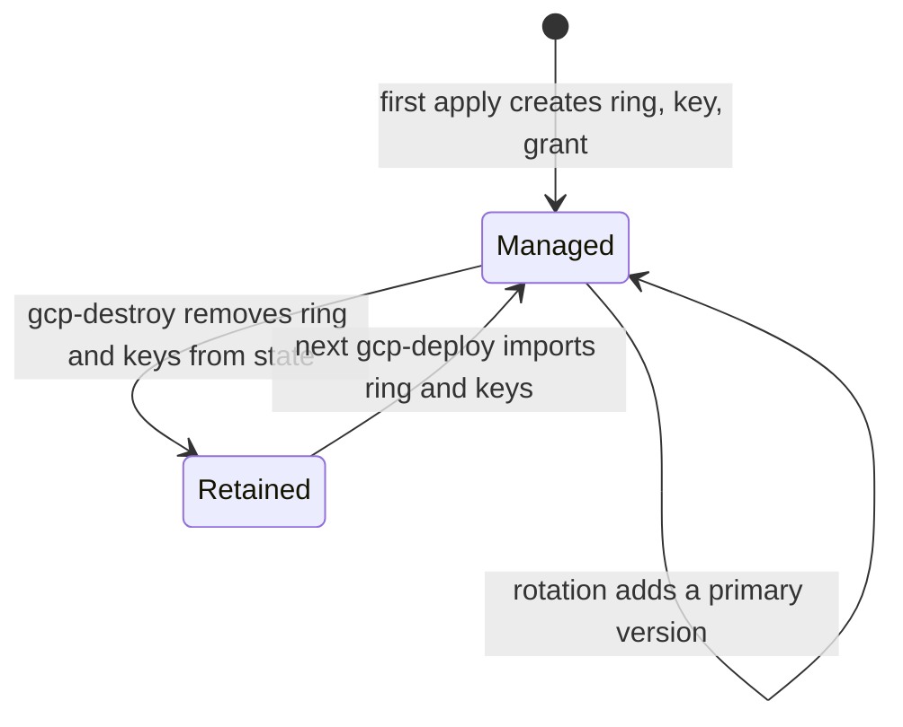
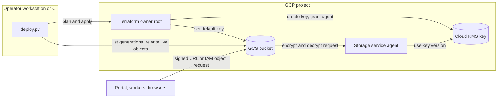

# GCS CMEK design (#2564)

Status: design. Date: 2026-11-02.

Issue #2564 is the contract. This design supersedes the Google-managed
encryption decision of ADR-008-R5 for the Terraform-owned GCS buckets. The
[#962 record](gcp-gcs-cmek-preflight.md) stays as history.

## Scope

Paths are relative to `platform/terraform/gcp/`.

| Owner root | Module | Buckets | Key ring |
| --- | --- | --- | --- |
| `environments/platform` | `modules/portal/gcs` | `assets`, `audit_logs` | `<name_prefix>-gcs` |
| `global/cicd-oidc` | `modules/cicd-oidc-identity` | `release_evidence`, `deployment_config` | `<name_prefix>-foundation-gcs` |
| `global/cicd-oidc` (build projects) | `modules/image-export-storage` | `staging`, `daisy_export_scratch` | `<name_prefix>-image-export-gcs` |
| Operator root | `modules/raes-package-storage` | `packages` | `<bucket_name>` with dots changed to hyphens |

`image-export-storage` replaces the removed `packer-build-infra` module (#2668).

These items are out of scope:

- The Terraform state bucket. Bootstrap creates it before Terraform runs, so a
  Terraform-owned key can not protect it.
- The run-owned image-import transfer buckets in `gcp_base_images.py`.
- AWS S3 CMEK (AWS-0132).
- An input for an externally owned key. The issue does not ask for it.

## Architecture

### Key module

The new module `modules/gcs-cmek` owns the key contract for one owner and one
location. All four bucket modules use it. It contains these resources:

- `google_kms_key_ring.this` in the bucket location.
- `google_kms_crypto_key.keys`, one key for each bucket role. Each key is
  `ENCRYPT_DECRYPT`, rotates every 90 days (`7776000s`), and has
  `prevent_destroy`.
- `google_kms_crypto_key_iam_member.storage_agent`, one
  `roles/cloudkms.cryptoKeyEncrypterDecrypter` grant on each key.
- `data.google_storage_project_service_account.this`. It gets, and creates when
  necessary, the Storage service agent of the bucket project.

The `key_ids` output depends on the grants. Each bucket sets
`encryption.default_kms_key_name` from `key_ids`. Thus Terraform grants the key
before a bucket uses it. The key ring location is the lowercase bucket
location. Regions, multi-regions, and predefined dual-regions have KMS
locations with the same name.

The module follows the Artifact Registry key pattern in
`modules/portal/artifact-registry`. Each owner has its own key ring, and each
bucket role has its own key. No key is shared with another service.

### Key lifecycle

KMS can not delete a key ring. Terraform `prevent_destroy` blocks a plan that
deletes a key. `gcp-destroy` removes the exact platform key ring and key
addresses from state before `terraform destroy`. The next `gcp-deploy` finds
the ring with `gcloud kms keyrings describe`, sets `adopt_storage_kms`, and
the import blocks in `environments/platform/imports.tf` adopt the ring and keys.
The Artifact Registry key uses the same path with `adopt_artifact_registry_kms`. A
`gcp-destroy` rerun after an interrupted teardown uses the same adoption in its
settings apply, because a surviving bucket still refers to its key.

Foundation keys stay in the foundation state. A platform teardown does not
touch them. The foundation does not use a platform key.

A new Storage service agent grant can take time to reach the bucket update
that sets the default key. `gcp-deploy` retries the apply on an IAM
propagation error. `gcp-foundation` makes and checks a new saved plan before
each retry.

### Object migration

A bucket default key applies only to new writes. Thus each owner root runs a
migration after its Terraform apply:

| Entry point | Identity | Buckets |
| --- | --- | --- |
| `deploy.py gcp-deploy`, infrastructure stage | Deploy identity | `assets`, `audit_logs` |
| `deploy.py gcp-foundation` | Operator credentials | `release_evidence`, `deployment_config`, image-export buckets |
| `deploy.py gcp-cmek-migrate` | Operator credentials | The `packages` bucket, or another bucket that an operator root owns |

All three use one helper, `scripts/bootstrap/gcp_storage_cmek.py`. For each
bucket and key, the helper does these steps:

1. Read the bucket. Stop if its default key is not the expected key.
2. List all live and noncurrent generations, and count soft-deleted objects.
3. Rewrite each live object that does not use the expected key. The rewrite
   uses the source generation and `--if-generation-match` with that generation.
4. List the live objects again. Stop if a live object still does not use the
   expected key, except for the residuals below.
5. Print counts only. Object names stay private, and the command log shows a
   placeholder in place of each object name.

The helper does not rewrite these objects. It reports them as residuals:

| Residual | Reason | End |
| --- | --- | --- |
| Noncurrent versions | A rewrite of a noncurrent version makes a new live version. | Bucket lifecycle rule or an operator delete. `assets` and `deployment_config` have no noncurrent expiry. |
| Soft-deleted objects | They are not readable objects. | Soft-delete retention. |
| Live objects in a bucket with a locked retention policy | A rewrite adds a generation to immutable evidence. | Lifecycle delete after 365 days. |
| Live objects with `*`, `?`, `[`, or `]` in the name | `gcloud storage` reads these characters as wildcards. | Operator action. |

The maintainer chose this boundary on 2026-11-02: report and keep noncurrent
versions, and migrate inside the deploy path.

The migration is idempotent. A deploy that finds no Google-managed live object
rewrites nothing. A concurrent writer is safe: its new object uses the bucket
default key, and the generation precondition stops a rewrite that would
replace it.

## Data flows

Trust boundaries:

- Operator to GCP: impersonation or ambient purpose identity (ADR-070).
- Application to GCS: bucket IAM and signed URLs. Callers need no KMS role.
- GCS to KMS: only the Storage service agent of the bucket project uses the key.

## Security

| Asset | Threat | Control | Verification |
| --- | --- | --- | --- |
| Bucket data at rest | Access to data without the tenant's key control | Bucket default key on every owned bucket | Terraform tests; Trivy GCP-0066 passes without an exception |
| Key availability | A lifecycle identity destroys or disables a key version | Deploy and destroy get custom KMS roles without `cryptoKeyVersions.destroy`, `cryptoKeyVersions.update`, or `cryptoKeys.delete` | Terraform test of the role permissions |
| Key availability | A Terraform plan deletes a key | `prevent_destroy`; destroy removes exact addresses from state | Bootstrap tests |
| Existing objects | Old data stays Google-managed | Migration after each apply; verification of live objects | Bootstrap tests |
| Concurrent writes | A rewrite replaces a newer object with older bytes | `--if-generation-match` with the listed generation | Bootstrap tests |
| Release evidence | A migration changes immutable evidence | No rewrite in a bucket with a locked retention policy | Bootstrap tests |
| Object names | Names leak into logs | The migration prints counts only | Bootstrap tests |

Residual risks:

- The deploy and destroy identities keep `roles/resourcemanager.projectIamAdmin`.
  They can grant themselves a KMS role again. #2227 tracks the least-privilege
  redesign of those roles.
- The custom KMS roles keep `cryptoKeys.setIamPolicy`. A lifecycle identity can
  remove a Storage agent grant. This stops writes and reads but does not
  destroy data.
- Noncurrent versions in `assets` and `deployment_config` stay Google-managed
  until an operator deletes them.

## Decisions and references

- ADR-008-R5 records the decision.
- [Cloud Storage CMEK](https://docs.cloud.google.com/storage/docs/encryption/customer-managed-keys),
  section "Restrictions": the key ring is in the bucket location.
- [Use CMEK](https://docs.cloud.google.com/storage/docs/encryption/using-customer-managed-keys),
  sections "Use default encryption keys" and "Identify the key used to encrypt
  an object": a default key changes only new writes; `kms_key` names the key
  version of an object.
- [Object Versioning](https://docs.cloud.google.com/storage/docs/object-versioning),
  section "Introduction": a new write makes the old live version
  noncurrent.
- [Bucket Lock](https://docs.cloud.google.com/storage/docs/bucket-lock),
  section "Overview": retained objects can not be deleted or replaced.
- [`gcloud storage objects update`](https://docs.cloud.google.com/sdk/gcloud/reference/storage/objects/update),
  flags `--encryption-key` and `--if-generation-match`.
- [`google_storage_project_service_account`](https://registry.terraform.io/providers/hashicorp/google/latest/docs/data-sources/storage_project_service_account):
  use the data source, not a built email address.
- [Cloud KMS roles](https://docs.cloud.google.com/kms/docs/reference/permissions-and-roles),
  section `roles/cloudkms.admin`: the source of the custom role permissions.
