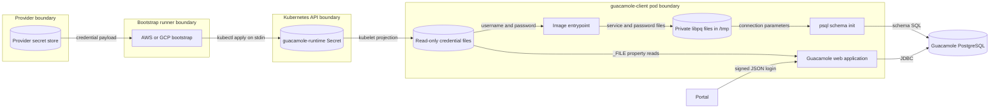

# Guacamole credential files: design (#2565)

Status: implementation design. Date: 2026-11-24.

This design records the decisions for issue #2565.
It builds on the [preflight note](./guacamole-secret-files-preflight-2565.md).
ADR-004-R11, ADR-006, ADR-007, ADR-037, ADR-044, and ADR-070 supply the architecture.
The work adds no new ADR.

## Architecture

The `guacamole-client` Deployment reads three keys from the `guacamole-runtime` Secret:
`POSTGRESQL_USER`, `POSTGRESQL_PASSWORD`, and `JSON_SECRET_KEY`.
Before this change, the keys arrived as environment variables through `envFrom`.

After this change, the chart projects the three keys as read-only files.
The mount path is `/run/secrets/guacamole-runtime`, outside every writable home.

| Secret key | File | Guacamole property | Pointer variable |
| --- | --- | --- | --- |
| `POSTGRESQL_USER` | `postgresql-username` | `postgresql-username` | `POSTGRESQL_USERNAME_FILE` |
| `POSTGRESQL_PASSWORD` | `postgresql-password` | `postgresql-password` | `POSTGRESQL_PASSWORD_FILE` |
| `JSON_SECRET_KEY` | `json-secret-key` | `json-secret-key` | `JSON_SECRET_KEY_FILE` |

The Guacamole web application reads each property from the file that its pointer variable names.
The upstream `enable-file-environment-properties` feature supplies this behavior.
The custom image sets `ENABLE_FILE_ENVIRONMENT_PROPERTIES=true`, so the contract does not depend on a base-image default.
The pointer variables carry paths only.

The issue proposed a generated `guacamole.properties` file, because GUACAMOLE-2119 broke `_FILE` variables in the 1.6.0 release.
The pinned base digest is a later rebuild, and its native `_FILE` support works.
A test on the exact digest proved this fact on 2026-11-24.
A correct password file gave a PostgreSQL login.
A wrong password file gave `password authentication failed`.
The native feature needs no generated credential file and no Java properties serializer.

Non-secret `POSTGRESQL_*` variables stay in the environment.
They activate the upstream PostgreSQL extension and JDBC driver links, as before.
`JSON_ENABLED=true` activates the JSON extension, as before.

The image entrypoint initializes the schema before Guacamole starts.
It reads the username and password files and writes two private libpq files in a `0700` directory under `/tmp`:

- A connection service file names the host, port, database, user, and password file.
- A password file holds one exact-match line with escaped `:` and `\` characters.

`psql` receives only `PGSERVICEFILE` and `PGSERVICE` in its environment.
The entrypoint deletes the directory after schema work and on every failure exit.

The entrypoint fails closed with a fixed message for these conditions:

- A credential file is missing, unreadable, empty, larger than 4096 bytes, or contains a control character.
- A legacy credential variable is set: `POSTGRESQL_USER`, `POSTGRESQL_USERNAME`, `POSTGRESQL_PASSWORD`, `JSON_SECRET_KEY`, `PGUSER`, or `PGPASSWORD`.
  Guacamole gives environment values priority over `_FILE` values, so a legacy variable would silently override the file.

The pod sets `fsGroup` to the Guacamole group, 10001, with `fsGroupChangePolicy: OnRootMismatch`.
The Secret volume uses mode `0440`.
Without `fsGroup`, the projected files are owned by root and UID 10001 cannot read them.

The chart and the image ship together through the existing release.
An old image cannot read the new chart contract, and the new image rejects the old chart contract.

Secret rotation needs a pod restart, as before.

## Systems security engineering

| Asset | Threat | Control | Verification |
| --- | --- | --- | --- |
| Database password | Exposure through the pod-spec environment, `/proc/<pid>/environ`, or a child process | File projection; path-only pointer variables; legacy variables rejected | Checkov CKV_K8S_35 passes unskipped; the entrypoint test inspects the child environment |
| Database password | Exposure through argv during schema initialization | Values go to files through shell builtins; `psql` gets a service name only | Entrypoint review; the entrypoint test passes with password authentication |
| JSON signing key | Exposure through the environment | Same file projection and pointer contract | Checkov CKV_K8S_35; the native integration test signs in through JSON authentication |
| Projected Secret files | Read access by another container or a write by the client | Mount only in `guacamole-client`; `readOnly: true`; mode `0440`; group 10001 | Chart contract test |
| libpq files | Read access by another user, or a file left after startup | `0700` directory; deletion on success and failure | Entrypoint test checks that no file remains |
| Malformed credentials | Parser injection in the libpq files | Control characters rejected; `:` and `\` escaped | Entrypoint test uses a password with `:` and `\` |

Trust boundaries:

- The bootstrap runner writes the Secret through the Kubernetes API, as before.
- Kubelet projects the Secret into the pod filesystem.
- The client container reads the files.
- The database authenticates the client over the existing proxy or network path.

Residual risk: the Java process keeps the plaintext credentials in memory, as before.

## Data flow

## Diagrams

The data flow diagram above is the only new diagram.
The component and deployment structure of the chart does not change.

## Policy as code

- The `checkov.io/skip1: CKV_K8S_35` annotation leaves the Deployment.
- The matching ADR-004-R11 entry leaves `docs/adr/exceptions.yaml`.
- The blocking Kubernetes Checkov job, kube-linter, and kubeconform stay unchanged.
- kube-linter `env-var-secret` matches every variable name that contains the word `secret`.
  It flags `JSON_SECRET_KEY_FILE`, which holds only a file path.
  Guacamole fixes that name, so the finding is a verified false positive.
  An `ignore-check.kube-linter.io/env-var-secret` annotation and an ADR-004-R5 entry in `docs/adr/exceptions.yaml` record the reason.

## Architecture as code

- `platform/charts/shifter/templates/guacamole-client-deployment.yaml` adds the pod `fsGroup`, the Secret volume, its mount, and the pointer variables.
  It removes `envFrom`.
- `shifter/engine/guacamole/Dockerfile` sets `ENABLE_FILE_ENVIRONMENT_PROPERTIES=true`.
- `shifter/engine/guacamole/entrypoint.sh` reads the files and uses the libpq service and password files.
- The bootstrap producers keep the three Secret keys without change.

## ADR changes

No ADR changes.
The removal of the CKV_K8S_35 entry follows the existing ADR-004-R11 process.
The kube-linter false-positive entry follows the existing ADR-004-R5 process.
The [architecture handbook](../technical/architecture.md) states the file delivery.

## Document review

This document uses ASD-STE100 Simplified Technical English.
Each sentence states one fact.
The document describes the system and its decisions.
Implementation tasks stay in the issue plan.
