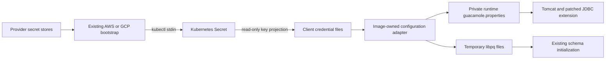

# Guacamole credential files: architecture preflight (#2565)

Status: pre-implementation explanation. Baseline: `3b30e45f2`, inspected 2026-11-24.
The supplied issue #2565 is the contract; no formal requirement is attached.
This note defines boundaries and evidence obligations, not an implementation plan.
It applies ADR-004-R11, ADR-006, ADR-007, ADR-037, ADR-044 and ADR-070 without adding an ADR.

## Correction after preflight

A test on the exact pinned digest showed that native `_FILE` support works.
The digest is a rebuild that is later than the GUACAMOLE-2119 regression.
The [design note](./guacamole-secret-files-design-2565.md) uses native `_FILE` pointer variables.
It replaces this note's guidance on generated properties, custom extension links, and Java properties encoding.

## Decision and ownership

Keep the provider secret stores, existing bootstrap hydration, and existing Secret keys.
The chart remains the only Kubernetes renderer for AWS and GCP.
The custom Guacamole image owns conversion from credential files to native application configuration.
Neither Helm nor the portal should perform that conversion.

Project `POSTGRESQL_USER`, `POSTGRESQL_PASSWORD`, and `JSON_SECRET_KEY` from `guacamole-runtime` into a read-only directory outside the generated `GUACAMOLE_HOME`.
Use explicit key projection, a required Secret, and mounts limited to the client container.
Keep `guacamoleRuntimeSecret.name` as the chart's existing selection parameter.
Do not rename producer keys or add credential values to chart values, runtime ConfigMaps, Helm history, or image layers.

**The JSON signing key must also leave the client environment.**
Moving only the database keys leaves a Secret environment reference and cannot satisfy the unexcepted scanner criterion.
[Checkov's rule](https://github.com/bridgecrewio/checkov/blob/main/checkov/kubernetes/checks/resource/k8s/Secrets.py) checks both `envFrom.secretRef` and `env.valueFrom.secretKeyRef`.
Confirm this behavior with the repository's pinned scanner during implementation.
Preserve the portal's separate `GUACAMOLE_JSON_AUTH_SECRET` hydration and the equality of the signing keys.

The bootstrap runner, Kubernetes API, client filesystem, and database are separate trust boundaries.
File delivery limits transport exposure; the application still reads plaintext credentials into memory.
Generated files remain sensitive even though they are ephemeral.

## Image startup boundary

Build on `shifter/engine/guacamole/{Dockerfile,entrypoint.sh,authority-entrypoint.sh}`.
Apache 1.6.0 [sources ordered startup scripts](https://github.com/apache/guacamole-client/blob/1.6.0/guacamole-docker/bin/entrypoint.sh).
Its [home-generation hook](https://github.com/apache/guacamole-client/blob/1.6.0/guacamole-docker/entrypoint.d/100-generate-guacamole-home.sh) creates a temporary home under `/tmp`.
The incoming `GUACAMOLE_HOME` is a template, not necessarily the final runtime path.
Do not write credentials before home generation and assume that they survive.

Prefer a narrow image-owned startup hook over replacing Apache's Tomcat launcher or copying its complete entrypoint.
Generate credential properties after the actual runtime home exists and before Java starts.
Link the PostgreSQL authentication extension **and its JDBC driver** from the existing patched image paths.
Preserve `authority-entrypoint.sh` and JSON extension loading.
Fail if required patched artifacts are missing; do not download replacements during startup.

Apache's [feature hook](https://github.com/apache/guacamole-client/blob/1.6.0/guacamole-docker/entrypoint.d/700-configure-features.sh) activates extensions from environment-variable prefixes.
Non-secret `POSTGRESQL_*` settings can still activate that hook after the credentials leave the environment.
Give the custom hook sole ownership of PostgreSQL links; prevent duplicate links and competing credential writers.
Keep non-secret controls working, including auto-created accounts, maximum connections, guacd endpoints, and the API idle timeout.
Do not disable all environment properties: existing deployment controls still depend on them.

The Secret key `POSTGRESQL_USER` maps to the native property `postgresql-username`, not `postgresql-user`.
Apache's [legacy-variable hook](https://github.com/apache/guacamole-client/blob/1.6.0/guacamole-docker/entrypoint.d/010-migrate-legacy-variables.sh) currently supplies that alias for environment delivery.
File delivery must make the mapping explicitly without exporting either alias.
The JSON property is `json-secret-key`; the password property is `postgresql-password`.
Reject legacy credential environment inputs; do not retain an environment fallback or re-export file contents.

These upstream sources establish design seams, not proof about the rebuilt digest.
Inspect hook order, feature links, property precedence, Tomcat startup, and available tools in the exact Dockerfile-pinned image.
Preserve the existing patched WAR, JSON/JDBC archives, JDBC driver, and authority-extension build.
Avoid globally changing shell options in a sourced hook or breaking final `exec` and signal delivery.

## Cross-cutting gates and canonical owners

| Layer | Canonical incumbent and required outcome |
| --- | --- |
| Secret creation and transport | `scripts/bootstrap/gcp_control_plane.py` and `scripts/bootstrap/aws_eks.py` keep their existing three-key payload. AWS uses `bootstrap_core.run_cmd_secret_stdin`; GCP captures output and reports fixed failures. No new secret fetcher, operator secret file, or Kubernetes reader permission is needed. |
| Installation and environment shapes | `shifter/installation/{schema,runtime_inventory_aws,runtime_inventory_gcp}.py`, `scripts/gcp/render_runtime_env.py`, chart `values.schema.json`, and `templates/configmap-runtime.yaml` remain authoritative. Host, port, and database remain non-secret deployment inputs. Image-local file pointers do not belong in portal or provisioner environment inventories. |
| Kubernetes identity and filesystem | Chart `_helpers.tpl`, `security.guacamole`, and `guacamole-client-deployment.yaml` own hardening. Preserve UID/GID 10001, `RuntimeDefault`, dropped capabilities, no escalation, read-only root, bounded scratch, and disabled service-account automount. Positive-UID schema validation alone does not prove file readability. |
| Mount permissions | Root-owned mode `0400` projections are unreadable by UID 10001. Use a compatible narrow group-readable projection and workload-scoped `fsGroup` when needed, derived from `security.guacamole.runAsGroup`. Verify actual projected targets and generated-file modes. Do not change the global pod helper or use privileged ownership repair. |
| Cloud database connection | Existing Cloud SQL proxy helpers and `tests/test_cloud_sql_proxy.py` preserve loopback password authentication for Guacamole. Do not enable proxy IAM database authentication for this client. AWS keeps its provisioned database role and existing network/TLS configuration; do not replace either path with a generic connection URL. |
| Native parsers | Java properties, libpq password files, and any libpq service file have distinct grammars. Encode values for each actual parser. Existing Terraform password generators permit punctuation; do not rotate or narrow passwords to avoid correct serialization. |
| Process exposure | Neither `POSTGRESQL_USER`, `POSTGRESQL_USERNAME`, `POSTGRESQL_PASSWORD`, `PGUSER`, `PGPASSWORD`, nor the JSON signing key may carry credentials into client children. Environment pointers such as `PGPASSFILE` carry paths only. No credentials in argv, connection URLs, Java options, tracing, or external-tool arguments. |
| Authentication and authority | `mission_control/{guacamole,guacamole_bootstrap,guacamole_authority}.py` and the Java authority extension remain the authentication/session owners. Preserve signed JSON login, supplementary PostgreSQL persistence, renewal, revocation, and dependency-outage termination. Database login credentials are not participant guest credentials or gateway workload identity. |
| Errors and observability | Shell startup uses fixed stage-specific diagnostics and nonzero exits. Bootstrap retains its existing redaction and failure boundaries. Portal failures keep existing `shared/errors.py` classification and API envelopes. `safe_user_message` and `shared/log_sanitize.safe_log_value` format text; they do not remove credentials. |
| Policy and release | `_quality.yml`, `.github/quality-path-filters.yaml`, ADR guards, and existing release provenance/image scans remain authoritative. Checkov, kube-linter, kubeconform, ShellCheck, Docker checks and image scans address different risks. A clean manifest scan cannot prove runtime secrecy or working remote access. |

The Cloud SQL sidecar keeps UID/GID 65532 and receives no credential mount.
Filesystem changes must preserve that sidecar's startup and existing workload identity.
The provisioner's `shared/cloud/sensitive_env.py` and Kubernetes Secret helpers solve another workload's environment-delivery problem.
Do not import them into this image or broaden their policy as a substitute for file delivery.
No DTO, application model, exception hierarchy, or secret-management framework is needed.

## File and parser invariants

Require readable, nonempty, bounded credential files before database work or Java startup.
Handle Kubernetes projected symlinks; rejecting every symlink would reject normal Secret volumes.
Treat contents as data, never as shell source or an `eval` expression.
Define accepted encoding and newline behavior explicitly.
Reject unsupported control bytes without printing them; do not silently trim passwords or lose trailing newlines through command substitution.

Use correct [Java properties encoding](https://docs.oracle.com/en/java/javase/17/docs/api/java.base/java/util/Properties.html).
Protect backslashes, leading whitespace, control characters, and property-line boundaries from interpretation or injection.
Keep credential serialization local to this image, shared by its startup consumers where applicable.
Do not build a repository-wide configuration serializer or duplicate general application validation.
Native parser round trips must establish value preservation.

Use a generated [libpq password file](https://www.postgresql.org/docs/16/libpq-pgpass.html) for every startup `psql` call.
Escape colons and backslashes in its fields, and prefer exact connection matches over wildcards.
The file must be owned by the runtime user with mode `0600`; libpq ignores group-readable password files.
The mounted raw password is not itself a valid libpq password file.
A native [libpq service file](https://www.postgresql.org/docs/16/libpq-pgservice.html) can supply the username without `PGUSER` or credential-bearing argv.
Keep password material in the password file, with only service names and paths in the child environment.

Create private runtime directories and files without a permissive creation window.
Use shell builtins or file input for sensitive values; arguments to external `sed`, `awk`, or helper processes are still process arguments.
Remove temporary libpq files on failure and after schema work, before handing off to Tomcat.
Keep generated application properties private for Java's lifetime, outside persistent storage, logs, artifacts, and the image build context.
Do not delete source projections, print the generated configuration, or enable shell tracing around secrets.

## Persistence, rollout, and extensibility

Keep schema initialization in the existing image wrapper, using the same credential snapshot as JDBC configuration.
Preserve `initdb.sh`, pipeline failure propagation, `ON_ERROR_STOP`, and removal of the seeded `guacadmin` account on every startup.
Distinguish an authenticated successful absence check from connection failure, permission denial, and partially initialized schema.
Use bounded, noninteractive database calls; a failed query must not automatically mean that initialization is safe.
Do not add role creation here: AWS's `provision_guacamole_database` command and GCP Terraform already own database and role provisioning.

The chart's single-client setting preserves token affinity; it does not exclude overlapping pods during a rolling update.
Account for concurrent startup and interrupted initialization without adding another migration runner or ignoring SQL errors.
Keep readiness, liveness, drain behavior, and existing session cleanup semantics.
An HTTP login page alone does not establish JDBC, JSON login, or remote-access health.

Use one image-local credential-directory parameter, with a fixed chart default outside writable home directories.
This is the seam for disposable tests or another mount provider; retain fixed key names and one native-property mapping.
Do not add arbitrary key/property maps, another chart schema, or per-cloud entrypoints.
Preserve existing host, port, database, Secret-name, and connection-limit parameters.

Treat generated configuration as a startup snapshot.
Kubernetes [Secret projection refresh](https://kubernetes.io/docs/concepts/configuration/secret/#using-secrets-as-files-from-a-pod) does not imply JDBC or generated-file reload.
Avoid `subPath`; bind a consistent projected generation when reading multiple keys.
`shifter.runtimeConfigChecksum` does not include out-of-band Secret contents.
Rotation therefore requires an explicit restart through existing deployment operations, without putting credential hashes into Helm inputs.

Publish the image and chart together through existing release packaging; an old image with the new chart cannot read the new contract.
Rollback must pair compatible image/chart versions and disclose any return to the old environment exposure.

## Required evidence and limits

Reuse these verification owners rather than adding a parallel workflow:

- `platform/charts/shifter/tests/test_chart_contract.py`: rendered Secret projections, hardening, retained controls, and deliberately updated GCP render hashes.
- `platform/charts/shifter/tests/test_cloud_sql_proxy.py`: native password path and sidecar boundary.
- `scripts/bootstrap/tests/{test_gcp_control_plane,test_aws_eks,test_bootstrap_core}.py`: unchanged producer keys and secret-safe transport.
- `shifter/engine/guacamole/test-entrypoint.sh`: SQL failure stops startup and default administrator removal remains idempotent.
- `tests/integration/test_guacamole_native_{termination,rdp}.py` under `shifter/shifter_platform`: built-image JSON/JDBC login and real SSH/SFTP/RDP authority behavior.

The shell fixture currently uses `postgres:16`, trust authentication, and environment credentials.
It cannot establish file-password correctness or pinned Guacamole startup by itself.
Native authority fixtures also currently inject database credentials through environment variables.
Adapt their built-image path to the file contract; do not add a production fallback to keep old fixtures passing.
Include password-authenticated fresh/existing database cases and real parser tests with punctuation, whitespace, backslashes, and invalid files.
Negative or mutation probes must catch renewed environment export, missing driver links, ignored SQL errors, and malformed property serialization.

Inspect process environments and argv during initialization and after Tomcat starts, using synthetic canaries without dumping their contents.
Check success and failure logs, generated-file access, cleanup, signal behavior, and UID 10001 with a read-only root filesystem.
The native fixtures currently lack the chart's full security posture; their existing success is insufficient for filesystem compatibility.
Missing Docker access or skipped opt-in tests must remain an explicit evidence gap.

Render defaults plus all four AWS/GCP environment profiles through the existing blocking Checkov job.
Require CKV_K8S_35 to report an unskipped pass, then remove its annotation and only its matching ADR-004-R11 exception.
Keep unrelated scanner exceptions and blocking policy intact.
Run the repository-mandated ADR guard and applicable chart, shell, image and workflow checks.
Do not replace these with a new scanner wrapper or a full local test suite.

Implementation must update `docs/technical/platform_infrastructure/guacamole.md` to replace its current environment-delivery description.
Chart changes also require handbook review under `docs/adr/documentation-coverage.yaml` and ADR-022-R2.
No exception is removed and no runtime acceptance is claimed by this preflight.
Docker daemon access was denied during inspection; exact-image startup and remote access were not exercised.

## Non-goals and prohibited shortcuts

No upstream image upgrade, authentication redesign, secret rotation service, CSI driver, additional controller, database schema migration, or replica increase is required.
Do not change participant credentials, portal secret hydration, authority leases, cloud IAM grants, or private scenario assets.
Do not use file-to-environment wrappers, `PGPASSWORD`, password URLs, baked secrets, or a new scanner exception.
Do not replace patched libraries, weaken filesystem/admission policy, or duplicate provider provisioning and workflow logic.
