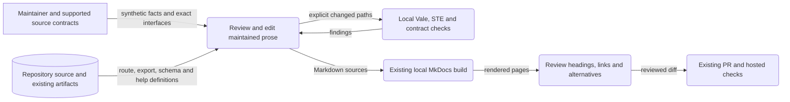

# Interface documentation design

This explanation defines the documentation boundary for issue #2807.
The [preflight](https://github.com/OpenRAE/bigrae/blob/dev/docs/architecture/interface-documentation-preflight-2807.md) records the source assessment.
The baseline revision is `5954ab13763deaba52a257d4ed8bde5bb1402ea6`.
Issue #2804 completed through PR #2854 before this work started.

## Sources and reader purposes

Reference pages describe supported fields, permissions, limits, errors, and versions.
How-to sections give prerequisites, actions, checks, and recovery.
Explanation pages describe ownership, trust boundaries, and evidence limits.
Existing page paths and useful heading anchors remain stable.
The reference index links the exact interface sources and their maintained documentation.
FAQ and support prose retain their separate owners.

The mounted Django routes, serializers, service facades, CLI parsers, and SDK exports define coverage.
OpenAPI is one consumer of those sources; it does not define the complete inventory.
The existing contract command and MkDocs build remain the only generators.
The delivery PR records source paths, revision, checks, and corrected differences by documentation family.

The native account routes supersede the documented legacy role and staff checks.
Historical migration facts remain historical facts.
The independent SDK replaces removed internal verification imports in integration examples.
RAES authoring, backend admission, observed effects, and live qualification remain separate claims.
Issues #2055 and #2241 retain communication-authoring expansion and SDK release decisions.
This work selects no registry or release mechanism.

## Preservation decisions

Pack inventories bind the four `docs/concepts.md` files to exact bytes.
Those files and their provenance ledgers remain unchanged.
The collection README supplies maintained explanations of the public examples.

Fixtures, legal notices, and literal command output remain unchanged.
Current source descriptions are inspected with their generator and test consumers.
Stale API descriptions require a bounded generator-source correction.
Regenerate OpenAPI and TypeScript through the existing commands.
Compare contracts without description text to verify unchanged executable shapes.
All other generated output remains unchanged.

The SDK distribution declares version `0.2.0`; its Python export incorrectly reports `0.1.0`.
Correct that export and test both public namespaces against distribution metadata.
This explicit repair replaces the preflight's proposed runtime-fix exclusion for this one defect.
It changes no protocol, dependency, publication, or supported capability.

## Data flows and controls

Text alternative: maintainers compare prose with repository contracts, check explicit files, and inspect the local build before PR publication.
The local checkout, approved GitHub repository, and existing publication workflow are separate boundaries.
No new hosting or external text processor receives source content.

| Threat | Control | Verification |
| --- | --- | --- |
| False integration guidance bypasses authority | Read mounted controllers and native policy services | Route resolution and focused authority tests |
| Private content or credentials enter examples | Use synthetic identities and existing safe error shapes | Review diff, existing secret checks, and receipt tests |
| Prose changes invalidate pack identities | Preserve inventoried bytes and exact evidence | Compare pack and fixture trees with the baseline |
| An obsolete SDK version misidentifies a build | Match the export to distribution metadata | Regression test and installed-wheel checks |
| Style edits change technical meaning | Review conditions, obligations, quantities, and identifiers | Source comparison separately from automated writing checks |

Unverified live behavior remains explicitly unverified.
Tests and schema acceptance do not establish deployment or scientific success.
The existing runtime DFDs remain in [identity and lifecycle contracts](../technical/shifter_platform/identity-lifecycle-contracts.md).
No deployment, state, or runtime DFD changes because the runtime boundaries remain the same.

## Enforcement and references

Existing `.importlinter`, layer rules, ADR guards, and contract tests retain the architecture model.
Existing Vale, STE, and `.ste-required.txt` enforce the documentation migration.
No policy, CI permission, hook, architecture rule, or exception changes.
ADRs 001, 022, 024, 031, 032, 034, 038, 040, 055, and 066 still apply.
No new architecture decision is needed.

| Reference | Version or section | Application |
| --- | --- | --- |
| [Diataxis reference](https://diataxis.fr/reference/) | Current reference guidance | Structure facts around supported interfaces |
| [Diataxis how-to guides](https://diataxis.fr/how-to-guides/) | Current task guidance | Separate procedures from protocol facts |
| [Official STE guidance](https://www.asd-ste100.org/about.html) | Writing rules and technical names | Preserve meaning and use consistent technical terms |
| [MkDocs authoring](https://www.mkdocs.org/user-guide/writing-your-docs/) | MkDocs 1.6 file layout and links | Keep page URLs and inspect rendered anchors |

Review sentence length, paragraph topics, terminology, and reader purpose separately.
The configured three STE checks do not establish complete STE conformance.
