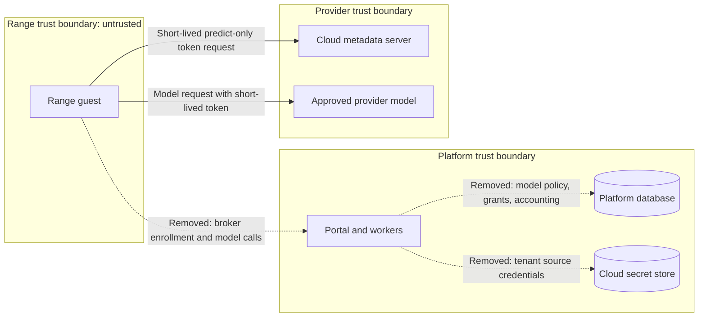

# Bespoke model broker removal (#2909)

Architecture explanation, 2026-11-11. Inspected revision: `ac1d64cc0`.
[Issue #2909](https://github.com/OpenRAE/bigrae/issues/2909) is the delivery contract.
No formal requirement is in scope.
This note records the removal boundary. It is not delivery evidence.

## Decision

[ADR-068](../../adr/068-model-access-broker-parked.md) parks the broker, and its #2909 amendment selects removal.
The maintainer selected the whole broker subsystem on 2026-11-11.
The subsystem is every component that exists only to feed or operate the broker.
[ADR-064](../../adr/064-default-range-model-access.md) keyless-direct access stays the only guest model path.

The maintainer also selected these dispositions:

- Requirement PLAT-202 becomes `DEPRECATED`. Its record stays.
- The broker-only authorization actions are removed. Stored records keep their immutable values, and readers drop the retired values.

## Removed components

Platform paths start at `shifter/shifter_platform/`.

| Surface | Removed components |
| --- | --- |
| Broker runtime | `model_broker/`, `engine/model_access_control/`, and the provider, egress, and credential code that only they use. |
| Policy and accounting | `shared/model_access/` contracts, catalog, allocation, budget accounting, sharing, and source management. Engine `_model_*` and `_sharing*` services. |
| Persistence | Engine model allocation, budget, credential, source, and sharing tables. CMS `ScenarioModelNeeds`. Model-source fields on CMS ranges, Engine ranges, and CTF events. Management `ModelAccessGroupEligibility`. |
| Range and event integration | Model admission, preparation, warm-pool, CTF cohort, and pack `model-needs.json` hooks in CMS, CTF, workspaces, and management. |
| Interfaces | Model-access and model-source API routes, settings, token scopes, OpenAPI entries, and frontend pages and cards. |
| Authorization vocabulary | `installation`, `account`, `organization`, and `workspace` `manage_model_sources`, and `workspace.publish_model_access`. Workspace operation `publish_model_access`. |
| Guest delivery | `shifter/engine/provisioner/model_enrollment.py`, `gcp_range_cell_model_broker.py`, broker firewall rules, and EC2 broker routes. The adapter SDK `model_access` helper. |
| Installation | `settings.model_access`, `settings.model_broker`, and `settings.model_broker_runtime`. Broker projections, runtime inventory keys, published model-access schemas, and the `canonical_model_access` package. |
| Deployment | Helm broker, control, and provider-egress templates and values. GCP and AWS broker Terraform. Bootstrap and `scripts/gcp/` broker overlay, probe, and rollout code. |
| Enforcement | The `.importlinter` broker contract, broker IAM scope tests, and ADR evidence paths to deleted files. |

## Retained components

| Component | Disposition |
| --- | --- |
| Google control assertion check | `verify_google_control_assertion` moves to `shared/control_identity.py`. VPN and Guacamole control endpoints keep their checks. |
| RFC 1918 constants and private listener check | Move to `shared/network.py`. EC2 transports, host-key checks, and the CTF egress proxy keep them. |
| Bounded AWS session | Moves to `shared/aws_session.py`. The EC2 runtime keeps it. |
| Strict JSON objects | Callers use the existing `shared.raes.parse_bounded_json_object`. It rejects duplicate members, non-finite numbers, excess size, and excess depth. |
| Keyless-direct guest identity | GCE plans always attach the configured predict-only identity. The broker VIP selector goes. |
| Recorded credential reference | `CredentialReference` moves to `shared/operation_authority.py`. Pending CTF event initialization keeps using it. |
| Adapter manifest `model_bindings` | The published SDK field stays so that installed manifests stay valid. It must be empty. |
| Audit vocabulary | Model-access audit actions and entity types stay so that stored audit records stay readable. No code writes them. |
| History | Applied migrations, frozen `backend-bundle-contract.v<N>.json` snapshots, Terraform `moved` blocks, superseded ADRs, and dated preflights stay. |

## Data flows

The broker is disabled on every tenant, so no live data flow stops.
The diagram shows the retained guest model flow and the removed flows.

## Systems security engineering

The removal deletes these assets: broker listeners, the private control listener, guest enrollment tokens, and tenant source credentials.
It also deletes provider egress, broker identities, and their IAM grants.
No new listener, identity, secret, port, or outbound flow is added.

| Threat | Control | Verification |
| --- | --- | --- |
| A moved control check accepts a bad assertion. | Move the function unchanged with its fail-closed error. | Existing VPN and Guacamole control tests. |
| A moved private listener check accepts a public address. | Move the RFC 1918 test unchanged. | Unit test rejects a public and a special-use address. |
| A replacement JSON parser accepts an ambiguous object. | Use the pinned RAES parser with a depth limit of 32. | Parser tests reject duplicate members and non-finite numbers. |
| Recorded operation authority stops loading after the catalog change. A range destroy then fails closed. | `credential_reference_from_record` drops only the five retired actions and their scopes. This can only narrow a credential. | Test rebuilds a record with retired values, and a test rejects any other unknown value. |
| A token or service admission keeps a retired scope. | Data migration revokes the token or disables the admission. Database triggers forbid scope edits. | Migration test for both credential kinds. |
| The authorization journal replays a retired action. | Data migration deletes journal rows for retired actions. | Migration test. |
| A pending CTF event initialization fails after the change. | Data migration removes `model_sources` and retired values from the pending intent. | Migration transform test. |
| A Terraform apply destroys shared resources. | Delete only resources gated on broker enablement. Keep `moved` blocks. | Terraform validation. Gated resources have zero instances on every tenant. |

Residual risks:

- OpenFGA keeps tuples for removed relations. No code enumerates tuples back into actions; `read_changes` only counts changes. The next deploy publishes the release model without those relations, so checks never evaluate them.
- An operation that is in flight during the upgrade can fail closed. Its stored replay digest still includes the retired values or the removed model launch fields. The operator retries it as a new launch.

## Persistence and identity migration

Django forward migrations drop the removed tables and fields.
The historical migration graph stays replayable.
Tenant source-credential creation needed broker IAM, so no stored tenant source credential exists.

Recorded operation authority, API token scopes, and service admission scopes are immutable by database triggers.
This change does not weaken those triggers. `shared/retired_authorization.py` names the retired values, and these steps use them:

- `credential_reference_from_record` drops retired actions and scopes when it rebuilds a recorded credential.
- A data migration revokes each active API token that holds a retired scope.
- A data migration disables each active service admission that holds a retired scope.
- A data migration deletes `AuthorizationOperation` rows for retired actions.
- A data migration cleans pending `CTFEvent.initialization_intent` values.

## Configuration

The installer schema stays closed.
A configuration that still sets a removed setting fails validation with the existing unknown-field error.
Retired runtime environment keys leave the manifests, renderers, and admission allowlists together.
The backend-bundle contract moves to version 2, because the settings schema loses properties. The version-1 snapshot stays frozen.

## Policy and architecture as code

- `.importlinter` loses the broker isolation contract and the `model_broker` root package.
- The ADR registry keeps ADR-059, ADR-060, ADR-061, and ADR-067 as superseded records. Evidence paths to deleted files go.
- ADR-068 records the removal. ADR-064-R2 records that the broker exclusion no longer applies.
- `docs/adr/documentation-coverage.yaml`, `platform/terraform/validation-inventory.yaml`, and `docs/adr/exceptions.yaml` lose deleted paths.
- The OpenFGA model is generated from the action catalog. No hand edit is needed.
- `openapi/v1.retirements.json` records the retired paths, response fields, and enum values under ADR-068 and #2909. The retirement projection accepts exact enum values and rejects their reintroduction.
- The GCP IAM scope checker loses its broker matrix and its model-source secret allowance, so that grant now fails the checker.

## Non-goals

This change installs no replacement gateway and changes no guest model path.
It applies no tenant deployment and destroys no cloud credential outside a deploy.
