# Named file assets and adapter inputs

Issue #2719. This design extends the existing CMS upload and isolated runtime
plugin boundaries. It does not authorize deployment or live qualification.

## Contract

An authorized user can upload, list, replace and retire a named, opaque file.
An installed adapter declares required file input names in its SDK manifest.
An administrator binds those names to file assets. Launch refuses missing,
retired, unauthorized or changed inputs before dispatch.

Replacement retains a stable logical file UUID while creating a new immutable
version. New launches resolve the active version. Queued and existing ranges
keep the exact version they admitted; replacement cannot substitute its bytes.

Use the existing content scope, principal authority, storage abstraction, signed
upload admission, quota lock, conditional installation, audit and cleanup paths.
General files do not use the installer extension or operating-system registry.
No content is executed, interpreted, unpacked or served inline by the portal.

## Native models and invariants

The enforcement model is the existing Django constraints and custody triggers,
the public SDK's closed Pydantic models, and the rendered worker admission policy.
Extend those incumbents; do not add an independent schema or policy vocabulary.

| Boundary | Invariant and owning check |
| --- | --- |
| CMS file asset | Concrete `FileAsset` subclass retains native owner, actual customer scope, soft deletion, exact installed object identity, size and SHA-256. Active names are unique within their existing owner/scope boundary. |
| Upload admission | Extend the incumbent upload ledger with an immutable asset discriminator and installed file reference. Both caller and original proof are reauthorized and fenced. File and installer endpoints cannot finalize each other's tokens. |
| Immutable installation | Verify authoritative size, read bounded bytes against the captured storage identity, hash those bytes, and conditionally copy that exact version to the server-owned destination. Never use ETag as SHA-256. |
| Replacement | Bind the admitted replacement to the exact previous asset and generation. Retire the previous version and install the new version in one transaction under the existing scope budget lock. A stale replacement cannot overwrite a newer one. |
| Retention | CMS owns file-use records referencing its own `RangeInstance`. A retired version remains available only to already-admitted operations until their range is destroyed. Cleanup cannot remove an active use. Retained versions continue to count against quota. |
| Adapter declaration | `PluginManifest.required_files` names inputs; `RuntimeInput.files` carries only digest and size descriptors. Names are unique bounded SDK identifiers. No file bytes, storage locations or credentials enter worker request JSON. |
| Admission pin | CMS resolves and authorizes actual file custody before Engine creation. Engine accepts only the exact declared selection and persists byte-free immutable file bindings beside the existing plugin pin. Engine never imports CMS. |
| Execution | Core reads the pinned installed object with its identity and size bounds, checks SHA-256, then supplies only declared bytes to the invocation's worker. A newer same-name upload cannot substitute for a pinned version. |
| Worker isolation | Mount one immutable, Job-owned file Secret read-only at a fixed path. The worker has no API token, storage credentials, new network access, host mounts or writable input directory. Admission ties the file Secret to this invocation and rejects extra mounts. |
| Compatibility | Empty new SDK fields are omitted from serialization. Existing manifest, pin and invocation digests must remain identical; old retained ranges stay cleanable. New required file inputs need a conforming worker. |

Keep the file transfer bounded to 512 KiB in total, with at most 16 named inputs.
Each file is nonempty and cannot exceed that total. Show the file limit in the
upload UI. This fits the existing worker memory budget and Kubernetes Secret
size limit without adding a download service or worker network access.

## Data flow and authority

```mermaid
flowchart LR
    B[Authenticated browser] -->|native scoped admission| C[CMS upload service]
    B -->|signed bounded PUT| S[Configured staging storage]
    S -->|identity and bounded bytes| C
    C -->|conditional copy| I[Immutable installed object]
    A[Authorized administrator] -->|declared input selection| P[Pack plugin binding]
    P --> L[CMS launch admission]
    I -->|scoped identity and digest| L
    L -->|byte-free pin and retained use| E[Engine operation input]
    E --> H[Host controller]
    I -->|verified pinned bytes| H
    H -->|owned immutable Secret| W[Isolated worker file mount]
    W -->|untrusted plan| V[Existing plan authorization]
```

The browser and file bytes are untrusted. Signed upload capabilities and native
proofs retain separate purposes. File access uses the actual file's content
scope and the existing `read_content`/`manage_content` actions; a pack, adapter
name or range request is not a general file-read grant. Missing authority fails
closed. No broad read role or cross-layer model import is introduced.

CMS creates retained uses in the same launch transaction as its range and the
Engine pin. Failed admission leaves neither a dispatched operation nor an
unbound use. Existing request identity and replay checks bind the selection.
Retirement stops new admission while preserving previously admitted bytes;
cleanup uses retained exact object custody, never a name search or latest row.

The host installs file material after creating its reserved Job, with a Job
owner reference from the outset, following the existing registry Secret
lifecycle. Kubelet retries a missing mount while the host supplies it. An
existing Secret must match the exact invocation, owner, bytes and immutable
flag. An uncertain write never authorizes different material. Terminal Job
cleanup and the existing TTL own the ephemeral Secret's lifetime.

Engine must not import CMS to fetch files. Bind the public CMS file-material
service to a small neutral port in `config.apps.PortalConfig`, following the
existing principal and credential ports. A CMS-owned file-use record retains
the original non-secret credential reference and actual content authority.
The material service reauthorizes that proof, verifies the exact admitted file
and range, reads the pinned storage version, then fences authority and custody
again before returning bounded bytes. Engine's existing operation check binds
the callback to the active request and generation. No credential or storage
locator enters the SDK request. Missing port wiring fails closed for file inputs.

## UI, errors and evidence

Add a file-assets page using the existing Mission Control navigation, scope
selection, upload state and API error components. Add file selectors to adapter
assignment beside existing target and parameter bindings. List metadata only;
do not expose object keys, signed downloads or file content. Replacement and
retirement state their effect on existing ranges in plain language.

Reuse authored bounded `CMSError`/`ValidationError` messages and strict audit.
Audit identifiers and state transitions, not content, private filenames, upload
tokens, signed URLs, storage diagnostics or worker exceptions. Responses cannot
turn a cross-scope identifier into an existence oracle.

Targeted tests must exercise API/UI lifecycle, native scope and proof revocation,
concurrent replacement/quota/cleanup, changed object bytes and digests, required
input refusal before dispatch, exact worker material, replay rejection and old
digest stability. Evaluate the actual rendered admission policy with real
builder manifests, including a wrong Secret and extra/writable mounts. Mutation
checks must detect removal of digest verification and required-input admission.
CI owns full suites; no live tenant or deployment is needed.

ADR-066 governs content ownership and scope. ADR-041 governs external code and
worker isolation; its runtime rule must record this explicit bounded file-input
channel. Update the current external-runtime architecture and handbook in the
same change. Preserve existing import, architecture, chart and security gates.

References: [Kubernetes Secrets](https://kubernetes.io/docs/concepts/configuration/secret/)
for bounded immutable volume delivery and ownership; [Django upload security](https://docs.djangoproject.com/en/5.2/topics/security/#user-uploaded-content)
for treating uploads as untrusted content and enforcing size bounds.
