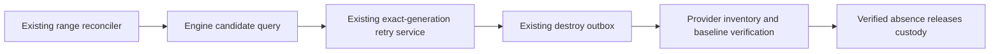

# Automatic cleanup verification retry

An ordinary native range can have status `destroyed` while its latest provider
observation is incomplete. Its project custody must stay held. The existing
retry service already checks the accepted destroy operation, the applied result,
resource generation and retry delay. Warm generations and disposable workers
call that service; ordinary ranges need the same scheduled recovery.

The existing CMS range reconciler calls one declared Engine facade. Engine
selects a bounded batch of destroyed native ranges whose latest observation for
the current destroy is `INCOMPLETE` or `RESIDUALS_FOUND`. Warm generations and
disposable workers keep their existing recovery owners and are excluded.

The selector is not authority to destroy or release a project. The existing
service locks and checks each current generation again, retains immutable input
and results, and applies its existing exponential delay. Concurrent passes
cannot queue a second retry after the first advances the current operation.
A failed observation never becomes an empty inventory or successful cleanup.
The batch writes no new state model, grants no user access and logs no provider
payload. A per-range exception does not stop other candidates or reconciler work.

Validation covers an ordinary native range with an applied incomplete destroy,
the scheduled pass, delay, repeated passes, immutable input, retained generation,
verified/latest and stale evidence, and active or separately managed ranges.
The existing project-release tests retain the requirement for complete evidence
before project custody can be released. No worker, schema or provider change is
required.
