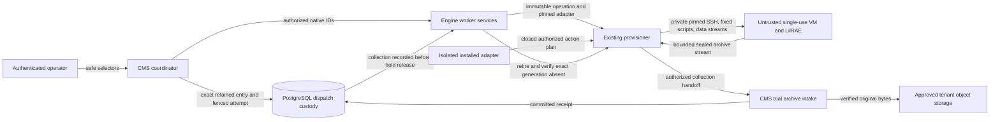

# Admitted trials on disposable workers (#2743)

Architecture preflight, 2026-11-07, against repository revision `4f93d72ea`.
The supplied issue is the delivery contract; no formal requirement is attached.
This note specializes existing boundaries, without implementing dispatch or prescribing an implementation sequence.
It claims no runtime support or live tenant qualification.

## Readiness and ownership

Admission, worker custody, and archive intake exist, but their composition is incomplete.
Two contract gaps must be resolved before parallel execution can be qualified:

- The pinned tuple is RAES **10.7.2** and raes-env-packs **7.2.2** in platform `pyproject.toml`, `uv.lock`, and `shared.raes.experiment_admission`.
  Its compiler does not supply an isolation proof; `plan_batch_schedule` therefore returns a ceiling of one.
  `compile_pack_experiment` and `validate_retained` enforce that ceiling.
  Two VMs alone cannot raise it.
  Parallel acceptance needs an owner-supported admission path producing an authorized, sealed proof and actual non-overlapping resource leases.
  Do not patch retained plans, manufacture proofs, or weaken `_concurrency`.
  If the released owner API cannot supply this, report that dependency gap; serial execution cannot satisfy the two-trial criterion.
- The SDK's closed phases are `prepare`, `validate`, `configure`, `verify`, and `cleanup`.
  They do not provide a trial start/check/stop/export protocol.
  `RuntimeApparatusPin` explicitly forbids files and model bindings.
  `runtime_plugin_requests` and `_runtime_plugin_operations` are provisioning-bound; `runtime_plugin_execution` discards guest output.
  An explicit, compatible trial-control extension must cover these producers, validators, consumers, and standalone images together.
  Existing configure/verify phases must not become hidden long-running trial controls or an archive transport.

Earlier admission design notes record RAES 10.6.0; use the current pinned tuple and supported-dependency gate.
Do not revive historical experiment execution or model-broker guidance.
ADR-068 parks the broker; ADR-064's keyless-direct path remains the supported model path.

CMS owns the batch coordinator through `cms.services` and the existing `experiment_batch` command.
It owns dispatch intent and the join between immutable scientific inputs and native custody.
Engine owns generic worker execution admission, native operation generations, holds, capacity, and retirement through `engine.services`.
The provisioner owns private host management and execution of the pinned adapter's fixed worker scripts.
The isolated installed adapter owns LilRAE-specific commands and output translation.
Pack content cannot authorize executable installation; no pack code runs inside CMS, Engine, or the provisioner process.
RAES owns scientific contracts and SDL semantics behind `shared.raes`.
The archive service owns collection validation, storage, and receipts.

Reuse ADR-001/008/024/025/027/030/031/032/034/039/041/043/045/047/056/063/064/066/068/070.
The executable dependency model remains `.importlinter` and `scripts/check_layer_imports/layer_imports.yaml`.
CMS may call Engine's public facade; Engine must not import CMS models or private services.
No new application, repository framework, queue system, or generic workflow engine is justified.
The existing [admission](experiment-admission-design-2742.md), [worker](disposable-trial-workers-boundary-2741.md), and [archive](trial-archive-custody.md) designs retain their ownership.

The collection arrow is a required handoff, not an existing provisioner-to-CMS API.
The coordinator invokes authorized intake; the provisioner supplies bounded transport without acquiring CMS table access or archive publication authority.

## Custody and recovery invariants

Build on `cms.models.experiment_batches`, `_experiment_batches`, and `_experiment_batch_records`.
Reuse claim/recover, worker binding, observation, collection, and cleanup services.
`ExperimentEntry.token` already is the attempt UUID; one initial attempt per entry is supported.
RAES plan/entry/run identities remain strings, distinct from native batch, worker, request, operation, and generation UUIDs.
Engine's experiment/trial UUIDs are opaque custody references, not replacements for scientific identities.
Retain their explicit join in CMS.

Stage the selected retained `snapshots[plan_entry_id]` through the owning canonical SDL API.
Include the exact retained configurations, referenced artifact bytes, controls, captures, dependency versions, and scientific identities required by the execution contract.
An SDL alone cannot reproduce all admission inputs.
No current-pack reload, recompile, reselection, reseeding, or new run allocation occurs during dispatch or recovery.
The admitted inner SDL and outer worker-host plan have separate identities and purposes.
Validate the actual LilRAE/backend/participant capability tuple; provisioning-only or synthetic manifests cannot advertise unsupported execution or capture.

Persist the attempt's stable worker identity and exact launch intent before external creation or execution.
Use a retained server-owned identity or a deterministic mapping from existing custody; recovery must discover the same worker after a lost response.
Compare complete intent on replay, including scope, owner, inputs, executable pin, and generation.
`create_disposable_worker` already replays the same worker ID and initial intent; it does not prove that a guest trial started exactly once.
Trial controls must preserve host resource-generation and provisioning-observation bindings rather than overwrite them with attempt state.
`_worker_qualification` matches both the resource generation and provisioning operation; rotating a native operation ID can invalidate its evidence.
Do not reuse a completed provision operation as a mutable trial command channel or let trial results restore a retired host's READY state.
Start needs a durable, attempt-bound remote acceptance record that repeated calls inspect instead of starting another process.
A timeout or missing acknowledgement remains uncertain until that exact worker and attempt are inspected.
Database claims, deterministic Job names, and a PID alone do not establish exactly-once guest execution.

Use short SQL transactions and the existing batch lock/conditional claim pattern.
Persist each external-effect intent before I/O; fence its result against current attempt, worker, operation, and generation afterwards.
Keep compilation, SSH, cloud calls, archive transfer, and primary authorization-store readback outside SQL locks.
Respect Engine's ancestry → worker-policy mutex → native range/worker lock order.
Avoid enclosing public services with their own lock protocols or durable archive transactions inside a coordinator transaction.
Extend native database guards alongside any new immutable custody fields and state vocabulary; `save()` checks do not protect bulk updates.

The batch bound includes every claimed entry without verified cleanup, even after a terminal observation.
Enforce the minimum of admitted request/isolation bounds and current worker/global/provider capacity.
Reuse `WorkerPolicy`, `shared.capacity`, capacity reservations/draws, and worker admission; no semaphore or second ledger can replace them.
Provisioning, held, retiring, failed, and cleanup-unknown workers still occupy applicable native limits.
Record effective parallelism and its real lease evidence through released RAES execution-receipt contracts, not a second scheduling schema.
Canonical dispatch order does not constrain completion order.
One entry's collection or teardown failure must remain recoverable without overwriting another entry's progress.

Acquire and retain an evidence hold before the first trial effect.
Holds currently require a READY worker; worker provisioning must finish and qualification must be current before trial start admission.
Serialize hold acquisition with expiry/retirement, and refuse start if preservation cannot be established.
Retain the hold ID and owner so restart does not depend on process memory.
After export, call `intake_trial_archive` with independently derived `experiment_archive_identity`, then `record_experiment_collection` with the committed receipt.
Require an unexpired, matching receipt whose worker copy is disposable before releasing the coordinator's hold and retiring the worker.
The receipt must match the pinned destination, plan/entry digests, run version, and exact attempt.
Do not accept the archive's self-declared identity as the expected identity.

Failed, interrupted, corrupt, unauthorized, or uncertain collection leaves the hold and worker intact and reports **not collected**.
Valid failed or stopped runs can still have committed archives; scientific success is not an intake prerequisite.
A guest export exit code, local tar file, object upload acknowledgement, or receipt UUID alone cannot authorize destruction.
Recover collection-after-commit/response-loss and receipt-binding/hold-release crash windows through the same intake and custody services.
Preserve unrelated holds; one caller cannot clear another caller's evidence custody.
Expired holds escalate through native recovery rather than silently permitting teardown.

Stop is a durable batch intent that suppresses new claims and launches across processes and restarts.
Fence it against queued and active starts; stop the exact admitted remote attempt without destroying its evidence.
Collection and retirement remain separate operations.
Reconcile pending, uncertain, stopped, collecting, and retiring work from stored records; lease expiry cannot authorize another attempt.
Do not put these operational dispositions into scientific outcomes or overload `ResourceStatus`.
Existing `ExperimentEntry.state` is closed; changes must preserve observation, export, migration, and database-guard compatibility.

After collection, retirement uses `_worker_retirement` and `engine.worker_retention`.
Failed teardown retains native custody and capacity until accepted provider absence for the exact resource generation.
Use `_cleanup_verification.is_range_generation_cleanup_verified_absent`; a destroy request or empty local instance list is insufficient.
Keep LilRAE's inner cleanup evidence separate from native VM absence.
An archive collected before retirement cannot prove subsequent VM absence.
Retain that later native evidence through the operational join; do not rewrite or reseal the collected scientific archive.
`record_experiment_cleanup` validates a RAES cleanup receipt but trusts its caller to verify the owner's evidence.
The coordinator must verify every required cleanup obligation before submitting it and freeing the batch slot.
For a failure proven to precede any trial effect, native cleanup can proceed without inventing a sealed run or scientific outcome.
Unknown launch state is not that proof.

## Cross-cutting layers and required reuse

Paths in this table are relative to `shifter/shifter_platform` unless qualified.
These are obligations for the intended design, not assertions that new trial controls already pass these gates.

| Layer and canonical incumbent | Required treatment |
| --- | --- |
| Operator proof and authorization: `shared.api_tokens.cli.credential_from_file`, `CredentialContext`, `shared.authorization`, `ResourceScope`, `workspaces.services`, CMS `_tenant_pack_authority` / `_content_authority` | Extend `experiment_batch` with start/show/stop/collect/reconcile over the same services. Authenticate actual proof through the bounded owner-only, no-follow credential file. Authorize tenant content operations and each native range launch/read/access/manage action independently. Resolve account/organization/workspace ancestry through its owner; organization admission alone is not range authority. Recheck current authority and local credential state before effects/commit. The attempt token and worker reference grant no permission. Retained authority references cannot impersonate an operator or store bearer proof. A changed coordinator principal cannot silently replay another owner's worker creation or release its hold. |
| Scientific and file ingress: `shared.raes.experiment_admission`, `json_ingress`, owner SDL/plan/participant validators, `RuntimeFileBinding`, `shared.runtime_file_inputs` | Validate retained digest, supported tuple, complete plan, joins, and exact file material before dispatch. Preserve duplicate-key/non-finite rejection and byte/depth bounds. Existing runtime file binding names CMS asset versions; it is not automatically a retained-trial file binding, and apparatus v2 currently forbids files. Extend the owner-selected delivery seam explicitly; do not fabricate asset rows or copy a scientific schema into Engine/SDK. Contain local/remote staging, reject traversal/links/special files, use private files, and bound total concurrent disk use. |
| Installed executable and host admission: `_worker_software`, `_runtime_plugin_bindings`, `shared.runtime_plugin_binding`, SDK `runtime.py`, `_runtime_plugin_operations` | Pin administrator-approved installation, manifest, image digest, protocol, and organization. Preserve pack versus apparatus identity and exact target/file/parameter declarations. Unsupported capabilities fail before effects. Extend the closed shared protocol only for necessary generic trial controls; no caller-supplied script path, command, URL, image override, or pack-selected hook. Keep imports in the isolated planning Job. |
| Native transport and persistence: `engine.launch_intents`, `operation_inputs`, `shared.operation_intent`, `operation_envelope`, `shared.raes.operation_input`, `shared.operation_results` / `operation_result_payloads`, result inbox/applier | Existing command/resource/operation sets and input/result shapes are closed. Existing start/stop vocabulary does not authorize worker trial operations. Any extension must agree across canonical argv validation, authority/workload digest, immutable input, DB transport grants, provisioner CLI/reader, accepted result steps, writer/parser/applier, and rolling-version compatibility. Reuse durable launch intents, submission/cancellation fences, exact operation/generation correlation, append-only results, strict audit, and bounded reconciliation. No direct CMS reads from the provisioner, mutable latest-input lookup, or unfenced guest-result callback. |
| Secrets, OS, and remote execution: `shared.cloud.sensitive_env`, Kubernetes `_job_manifest` / `_secrets`, `shared.guest_probe`, provisioner `worker_host_observation`, `executors/guest_ssh_executor` | Portal IAM cannot read management keys. Keep private host-key-pinned SSH and management secrets in the provisioner. Use fixed commands with scientific data on stdin or bounded private file streams; no bearer tokens, credentials, SDL, or prompts in argv, shell interpolation, traces, or process listings. Encoding is not protection. Reuse bounded transport mechanics, with explicit bounds on both guest streams and total time. Ordinary SSH command capture is unbounded; streamed capture also needs a total temporary-disk bound. The quiet plugin executor cannot export archive bytes. Sensitive env uses Secret references, never literal manifests; preserve non-root/read-only/seccomp, isolated planner networking, and per-Job cleanup. Standalone dependencies belong in provisioner requirements/hashed locks and images, not only the portal environment. |
| Containment, provider and model authority: `shared.disposable_workers`, `_worker_qualification`, `_range_backend_admission`, provider `_gce_profile`, `shared.raes.artifact_binding`, `raes_gce_image`, `raes_substrate_observation`; ADR-064/068 | Use the persisted deployment-selected qualified GCE worker, exact numeric image identity, profile/resources, current host observation, private management, approved egress, and global capacity. Different IPs are insufficient: require distinct provider VM/machine/Docker identities. Keep the Docker socket local. Do not reuse/reimage a used worker, fall back to another cloud/backend, broaden networking/IAM, or supply platform/cloud administration credentials to LilRAE. Model/predict authority uses the approved keyless path and existing project quotas; this feature cannot unpark the broker or give apparatus bindings model authority. |
| Collection and retention: `_trial_archives`, `TrialArchiveIdentity`, `TrialArchiveDestination`, shared trial-archive validators, `shared.cloud.ObjectStorage` | Stream original sealed bytes through existing bounded intake, inventory/record/join validation, credential rejection, destination version/checksum readback, and atomic committed receipt. Preserve declared gaps and failed evidence. The worker must not choose a destination or gain overwrite authority over committed archives. No new bucket/service, alternate collector, scientific reserialization, or upload through logs/results. Existing transfer journals handle ambiguous writes; destination/retention changes cannot redirect recovery. Worker/pack deletion and operational sidecar expiry cannot delete central archives. Aggregate collection concurrency must respect staging/storage bounds. |
| Config shapes and deployment: `WorkerPolicyRecord`, `config._raes_settings`, `_product_env`, `_runtime_env`, `_env_manifest` / `env-manifest.json`; repository `shifter/installation/{schema,registry,settings_gcp,settings_aws,bundle_gcp,bundle_aws,runtime_inventory*}.py`, `scripts/gcp/render_runtime_env.py`, `scripts/bootstrap/aws_eks.py`, chart `values.schema.json` / templates | Keep operator policy distinct from immutable scientific inputs and use existing bounded settings/profile seams. No new env switch or service is intrinsically required. If needed, a setting must pass the selected bundle's closed model, aliases/conflict handling, runtime inventories, generated manifest, supported deployment renderers, and actual worker/provisioner role bindings. No service-local `getenv`, duplicate provider selector, unknown-key fallback, or renderer-owned committed value. |
| Errors, audit, observability: `shared.exceptions` (`CMSError`, `ValidationError`), existing cloud/plugin errors, `shared.errors`, `shared.api.errors`, `shared.audit`, `shared.log_sanitize`, `config.logging.ECSFormatter` | Translate at the owning boundary to fixed safe classifications and `CommandError`; future HTTP callers use the existing envelope and closed parsers/serializers. No parallel exception hierarchy. Sanitization/truncation cannot make raw Pydantic, SSH, provider, or exception-cause text confidential. Inspect lower-level log and DLQ paths too. Audit durable intent, stop, hold, collection, and cleanup changes transactionally with strict semantics. Expose attempt/worker/operation correlation, fixed dispositions, counts, durations, uncollected state, and recovery obligations. Never log scientific bodies, scripts, credentials, archive bytes, or use per-trial/high-cardinality metric labels. |

## Extensibility and explicit limits

The extension seam is the pinned adapter capability plus exact admitted trial input and fixed control verb.
A later conforming adapter or LilRAE version changes an approved binding and supported contract version, without scenario-name branches in core.
Timeout, poll/reconcile batch size, transport byte/disk limits, and live worker limits belong to operational policy, not the scientific schema.
Another provider belongs at the existing qualified backend seam; it must retain original cleanup pins.
This issue adds no profile catalog, retry framework, scientific scheduler, or universal remote-command API.
Intentional scientific repetitions remain upstream entries; recovery is the same attempt, not a new repetition or run version.

Non-goals are scientific compilation changes, scoring/analysis, a new UI or HTTP upload API, automatic redispatch, worker reuse, broker work, and new hosting/storage services.
No private pack content, names, scripts, topology, repository locations, or operational evidence belongs in public code, fixtures, docs, or metadata.
The live two-trial acceptance remains required, with evidence kept in the private owning repository.
Follow `.claude/skills/gcp-tenant-operate/SKILL.md` for authorized tenant operations and the linked release procedure when publication is requested.
This preflight authorizes no live deployment, external transfer, or paid trial.

## Evidence required from implementation

Reuse synthetic admission/archive fixtures, `test_experiments_removed.py`, and native worker/plugin/launch tests.
Relevant incumbents include `tests/cms/test_experiment_admission{,_postgres}.py`, `test_trial_archives{,_postgres}.py`, and result-export tests.
Also use `tests/engine/services/test_disposable_worker_concurrency.py`, `test_disposable_workers.py`, `test_prepared_launch_commit_fences.py`, and authorization tests.
Protocol/transport incumbents are SDK contract tests, `tests/shared/test_operation_results*.py`, runtime-file/sensitive-env tests, and provisioner plugin/SSH tests.

Prove duplicate creation and remote start suppression, out-of-order completion with unchanged inputs, aggregate ceilings across coordinators, and stop-versus-launch races.
Exercise restart after every durable/external-effect boundary, lost acknowledgements, stale results, expired qualification, revoked/cross-tenant authority, failed collection, and failed teardown.
Prove collection failure preserves the hold, committed collection survives a lost response, and only verified cleanup releases capacity.
Use real PostgreSQL for lock/exclusion races; SQLite cannot establish them.
Use targeted mutations of identity, authorization, hold, collection-before-retirement, and cleanup predicates.
Run targeted tests locally and full suites through existing CI ownership lanes; no checks are weakened.

Architecture documentation must pass `python3 scripts/adr_guard/adr_guard.py --all --level ci`.
Implementation also runs applicable import/layer, Ruff, protocol, standalone-image, and changed-stack checks specified by `AGENTS.md`.
Deliver operator and technical documentation for supported controls, exact tuple, refusal/recovery behavior, and qualification limits under ADR-022's existing coverage/index convention.
No new ADR is needed: existing service, authority, custody, and transport decisions already govern this composition.
