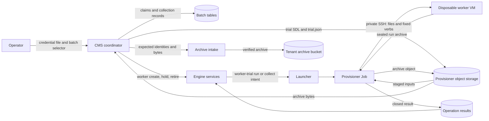

# Parallel trial dispatch design (#2743)

This design implements the [dispatch boundary](parallel-trial-dispatch-boundary-2743.md).
BigRAE runs each admitted trial on its own disposable worker.
An installed apparatus adapter runs the trial on the worker.
BigRAE core contains no scenario-specific code.

## Components

| Component | Owner | Responsibility |
| --- | --- | --- |
| Trial-control contract | Adapter SDK `trial.py` | Fixed command path, verbs, staged inputs, and output models |
| Coordinator | CMS `_experiment_dispatch` | Claims entries, creates workers, stages inputs, collects archives, retires workers |
| Worker trial service | Engine `_worker_trials` | Persists one trial per worker and launches its native operations |
| `worker-trial` operations | Provisioner `worker_trial_ops` | Stages inputs, runs the fixed verbs over management SSH, returns the archive |
| Archive intake | CMS `_trial_archives` | Validates the sealed run and stores it with a receipt |
| Adapter | External distribution | Installs the trial runtime and implements the verbs |

Each worker boots from a pre-built image that holds the trial runtime and its environment pack.
BigRAE stages only the trial SDL and `trial.json`.
The coordinator uses existing services for each step.
`claim_experiment_entry` enforces the batch concurrency.
The admitted plan's parallel limit bounds that concurrency (RAES 11).
`create_disposable_worker` enforces worker capacity and pins the adapter installation.
`acquire_worker_hold` preserves evidence before the trial starts.
`intake_trial_archive` and `record_experiment_collection` record the archive.
`retire_disposable_worker` destroys the VM and verifies provider absence.
`record_experiment_cleanup` releases the batch slot after verified cleanup.

## Native operations

The `worker-trial` resource has two operations.
Both use the existing launch intent, generation fence, result, and interrupt paths.

| Operation | Steps | Never does |
| --- | --- | --- |
| `run` | Stage inputs; start the trial if `status` reports `prepared`; poll `status` until exit; `export`; upload the archive | Start a second trial |
| `collect` | `status`; `export` a sealed trial; upload the archive | Start a trial |

An interrupt request on `run` makes the provisioner call `stop`, then continue to collection.
The provisioner starts the trial with `systemd-run`, so the trial survives a lost management session.
The provisioner reads verb output within the SDK byte bound and parses it with the SDK models.
The provisioner uploads the archive to its own object storage under an operation key.
The operation result carries only the object key, digest, size, status, and exit code.

## Data flow

Trust boundaries separate the operator, the platform, the provisioner, and the worker.
The worker is untrusted.
Its output selects no command, path, or destination.

## Security

| Threat | Control | Verification |
| --- | --- | --- |
| Duplicate trial start | `run` starts only on `prepared` status; one trial row per worker; database uniqueness | Engine and provisioner tests |
| Concurrent staging | The attempt deadline is persisted before upload; staged bytes are deterministic; a different existing object is refused | Coordinator tests |
| Start after stop | A persisted batch stop blocks claims and starts; a start that races a stop is stopped | Coordinator tests |
| Changed trial inputs | `trial.json` digests; the adapter checks them; staged objects carry SHA-256 | SDK and provisioner tests |
| Forged or wrong archive | Intake binds expected plan, entry, run, and attempt identities; worker output is data | Intake tests |
| Evidence loss before collection | Hold before start; retire only after a committed receipt | Coordinator tests |
| Credential exposure | Management keys stay in the provisioner; the worker uses its keyless attached identity (ADR-064) | Existing worker tests |
| Unbounded guest output | SDK output and archive bounds; streaming to a bounded temporary file | Provisioner tests |
| Capacity overrun | Batch claim lock and worker capacity admission | Existing concurrency tests |

## Failure behavior

Each worker is qualified through the existing service immediately before its trial starts.
An overdue `run` is interrupted; its interrupt launches `collect`.
A failed or exhausted operation sets `operation_failed` and keeps the observed trial facts.
`reconcile` launches `collect` for a finished operation without a sealed archive.
`reconcile` never starts a trial.
A failed collection keeps the hold and the worker, and the entry shows **not collected**.
A failed retirement keeps capacity occupied until verified absence.

## LilRAE trial archives

LilRAE seals a trial with `aptl.run-seal/v1` and a `lilrae-trial-record/v1` record.
Intake accepts this seal only when the trial record's run, attempt and trial SDL digest match the expected identity.
The trial SDL digest binds the admitted plan entry. Evidence that names another attempt is refused.
Intake still validates every inventory member and checksum.

## RAES run records from other apparatus

An apparatus that does not use LilRAE seals a `partial` RAES run record with the BigRAE seal (`bigrae.trial-seal/v1`, #2861).
Dispatch stages the admitted plan as `plan.json`, so the record can bind to its entry.
The worker record carries no cleanup claim. BigRAE records cleanup after verified worker absence.

## Limits

One worker runs one trial.
Automatic redispatch and worker reuse are not supported.
The trial must finish before its deadline plus the adapter's drain time.
