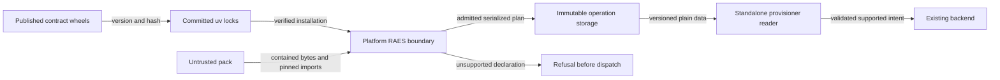

# RAES 10.6 / environment packs 7.2.2 adoption boundary (#2722)

Architecture preflight, 2026-11-02. Design guidance for #2722, not an
implementation plan or a claim that these versions are installed. The issue's
acceptance criteria remain the delivery contract. ADR-024, ADR-031, ADR-032,
ADR-034 and ADR-043 already govern this change; no new abstraction or ADR is
needed. ADR-032's machine-checked `raes-plan-accessor-boundary/v1` remains the
architecture model, enforced by `scripts/adr_guard` and `.importlinter`.

## Decision and scope

Consume the exact published pair `raes==10.6.0` / `raes-env-packs==7.2.2`
together. The [RAES release](https://github.com/OpenRAE/rae/releases/tag/v10.6.0)
adds provider-qualified secret replication policies; the
[environment-pack release](https://github.com/OpenRAE/env-packs/releases/tag/v7.2.2)
restores the RAES 10.6 minimum. Inspect the released public API and package
metadata when migrating calls; do not infer API compatibility from semver or
release-note summaries. This preflight has not executed the new pair.

Portable parsing and semantics remain upstream-owned. Only `shared.raes`
imports the RAES module family. CMS keeps its existing `raes_env_packs` adapter
for pack validation and canonical digest calculation. The provisioner remains
RAES-free and consumes the serialized plan through its existing defensive
reader. A public typed accessor is a semantic/parity oracle, not a substitute
for validation of bytes at a process boundary.

Valid audit-log and secret-replication declarations must reach the existing
capability assessment. Syntactic validity, source integrity, structural
conformance, realizability, authorized launch, and verified completion are
different facts. No parser upgrade authorizes cloud effects. Unsupported
required effects must fail before dispatch; they must not be stripped, treated
as optional, or recorded as successfully realized.

Scope-owned authored audit logs are not `shared.audit` security records, RAES
operation sidecars, or provider audit infrastructure. Provider-qualified secret
policies are portable declarations, not deployment configuration, native
credentials, or authorization to select a cloud. Existing backend-managed SSH,
account, directory and VPN secrets do not establish support for authored Secret
Manager resources. Cloud IAM and Secret Manager realization remain #2716.

## Boundaries that the design must pass

Paths below are relative to `shifter/shifter_platform` unless qualified.
These are incumbents to reuse, not new validation layers to build.

| Layer and canonical incumbent | Required behavior under the upgrade |
| --- | --- |
| Authentication, scope and custody: `shared.credentials`, `shared.authorization`, `cms.services._content_authority`, `_tenant_pack_authority`, `_pack_registration_custody`, `_pack_registration_fences`; launch through `_raes_range_create`, `_scoped_range_launch`, `_raes_dispatch` and public `engine.services` | Preserve native credential ceilings, explicit resource/workspace/organization scope, reference custody, admission and reauthorization fences. Pack declarations and upstream audit scopes cannot grant native authority; staff status is not a substitute. No new upload or execution route. |
| Pack identity and foreign input: `cms.services._content_ingestion`, `cms.scenarios.pack_validation`, `shared.schemas.raes_package_source`, `cms.models.RaesPackageSource` | Delegate schema validation, inventory and canonical content digest to the released env-packs API. Keep reference-only bounded provenance and model validation. A Python dependency lock, a pack content digest and an SDL module lock are different identities. Revalidate bytes before planning; do not regenerate a digest merely to bless changed content. |
| Storage, filesystem and module imports: `shared.raes.object_source`, `package_loader`, `cms.scenarios.realizability`, `_raes_dispatch` | Retain object-version preconditions, private temporary staging, archive entry/size bounds, traversal/link/special-file rejection, contained pack roots and the one direct SDL entry rule. Preserve upstream local-import digest and `raes.lock.json` validation. Registry/network imports remain denied; parser support must not trigger dependency downloads or executable pack installation. |
| Semantic and capability admission: `shared.raes.sdl_validation`, `package_loader`, `realizability`, `pack_conformance`, `runtime_target`, `_runtime_target_envelope`, `composition_envelope`, `domain_topology`, `artifact_planning` | Reuse upstream compile/plan diagnostics and the common `ShifterProvisioner.validate`/interpret path. Assessment and conformance use the existing ports that refuse dispatch. Preserve `INDETERMINATE` versus proven non-realizability and the narrow deferred artifact-code set; never defer IAM/secret/audit capability failures as inventory questions. Launch reruns admission with actual supply. |
| Honest support publication: `shared.raes.manifest`, `realization`, `_runtime_target_envelope`, `completion`; `backend-manifest.json` and `backend-realization-envelope.json` | Preserve provisioning-only support and independent realization evidence. Validate regenerated artifacts through upstream models and existing publication/conformance checks. New upstream fields or enum members cannot imply supported effects. No capability or evidence widening just to make conformance pass. |
| Immutable persistence and transport: `shared.operation_envelope`, `shared.raes.operation_input` and its identity/candidate/binding parsers, `engine.launch_intents`, `engine.services._raes_range`; provisioner `provisioner_db_operation_input` | Keep one persisted plan in `Range.range_config` and one immutable operation input for the exact generation. Preserve exact keys, UUIDs, resource/operation/request equality, canonical digest, finite JSON and size/collection bounds. The outer envelope is bounded to 262144 bytes even when upstream accepts larger constraints. No latest-row lookup, mutable domain-table fallback, new plan store or second DTO. |
| Standalone wire and provider backstops: provisioner `raes_plan`, `raes_plan_contract`, `raes_plan_resources`, `raes_plan_domain`, `raes_plan_values`, existing composition/ACL/service parsers; `raes_gcp_plan`, `raes_ec2_apply`, range-cell config/admission and cloud adapters | Select exact transport/producer compatibility before payload access. Reject malformed present values, unknown resource types, divergent operations, broken authority/envelope identities and dangling references before mutation. Adapt wire checks only to reviewed released shapes; do not copy RAES semantic validators into the reader or bypass provider config, IPv4, network, image, authority and guest gates. |
| Secret bindings, environment and OS exposure: `shared.raes.operation_input`, `artifact_binding`, `content_delivery`, `participant_access`; `engine.launch_intents.validate_provisioner_command` / `command_from_payload`; `shared.cloud.sensitive_env`, `shared.cloud.kubernetes._job_manifest` | Keep sidecars closed, bounded and byte-free. Native secret values, signed URLs and generated commands must not enter the plan, bindings, argv or launch-intent payload. Commands retain canonical identifiers only. Sensitive task environment values use the incumbent Secret-reference path, never literal Pod env values. Keep non-root/read-only/seccomp Job hardening and private temporary-file cleanup. This adoption needs no new runtime environment variable. |
| Configuration and packaging: `config._raes_settings`, `config._env_manifest` / `config/env-manifest.json`, installation schemas/registry, existing task profiles and provider config loaders | Provider qualifiers in SDL cannot become settings, arbitrary env names, plugin bindings or provider overrides. Reuse typed config loaders; do not add a config parser or compatibility switch. If a released API actually requires a new native setting, its existing schema, environment manifest, deployment binding and sensitive-env classification must agree; that is a separately justified need, not an assumed part of the pin bump. |
| Exceptions, public errors and observability: `PackValidationError` / `PackDigestError`, `RaesPackageError`, `CMSError`, shared `ValidationError`, `RaesOperationInputError`, provisioner `RaesPlanError` / `OperationInputError`, `raes_range_contract._classify_failure`; `shared.api.errors`, `shared.errors`, `shared.log_sanitize`, provisioner `log_redact` | Translate changed upstream exceptions at the existing owning adapter. Keep stable codes, bounded safe authored messages and request/operation correlation; no duplicate exception family or broad catch that reports success. Parser exceptions can echo paths, SDL and secrets. Truncation and `safe_log_value` prevent size/log injection, not confidential-data leakage: use class-only failures or safe classifications and fingerprint sensitive identifiers. Never expose raw errors in API details, logs or result diagnostics. |
| Durable results, audit and readiness: `shared.raes.operations`, `shared.schemas.raes_operation`, `shared.audit`; Engine operation input/result inbox/applier, `_operation_apply_raes`, `_raes_evidence` and `shared.raes.completion` | Preserve transactions, idempotency/conflict handling, append-only result ownership, generation fences, reference-only sidecars and strict security audit where already required. Queue acceptance and conformance are not READY. Completion must bind independent observations to the immutable plan, operation, generation and realization/configuration digests. No new repository, audit sink or workflow state machine. |

## Release, cleanup and extension seams

The exact dependency owners are `shifter/shifter_platform/{pyproject.toml,uv.lock}`
and `shifter/packer/{pyproject.toml,uv.lock}`. The preparation image consumes the
Packer lock; the platform image exports its frozen lock and overlays hashed
`requirements-gcp.lock`. Reconcile that overlay if its pinned transitive
dependencies conflict; retain the existing export/compile commands in the
Dockerfiles and hash-checked installation. The standalone provisioner has no
RAES dependency to add. Do not hand-edit generated lock hashes or introduce git
dependencies, alternate indexes, fallback imports, model aliases or local
replacements for released models.

CI currently consumes these project manifests through
`.github/workflows/_quality.yml` and the existing Makefile targets; inspection
found no independent RAES version literal in workflows. Reuse the existing
platform, provisioner and Packer lanes and `.github/quality-path-filters.yaml`,
not a second upgrade workflow. Preserve action pinning and required checks.
Affected build/tooling pins and fixtures must agree with the pair, without
blindly replacing IP addresses, unrelated software versions or historical
records containing the same numbers.

There are three independent version axes: dependency release, serialized plan
transport and native operation envelope. Keep `raes-provisioning-plan-v2` if its
reviewed wire shape is unchanged; a changed envelope shape needs its own version
decision, not an automatic match to RAES 10.6. New realization must accept only
the exact reviewed producer. Installed metadata already supplies the producer
stamp through `shared.raes.contracts.provisioning_plan_producer()`; preserve its
use in warm-pool compatibility so old prepared inventory cannot bypass admission.

Cleanup must still accept persisted `v2 / 10.2.0` plans, in addition to the
existing `v2 / 3.5.0` and isolated `v1 / 2.0.0` cleanup paths. Retain original
bytes, resource addresses and deterministic secret identities. The existing
`raes_plan_contract.prepare_envelope(cleanup_only=...)` is the seam: represent
reviewed cleanup compatibility as explicit exact pairs there, rather than
replacing a single previous-version constant and losing older obligations, or
allowing a semver range. This narrow extension is not a second runtime.

Queued/in-flight 10.2.0 provision/activate work and already-realized ranges are
different upgrade obligations. Drain old realization work and settle its pending
completion results before switching: `shared.raes.completion.load_serialized_plan`
also checks against the installed RAES producer. Do not silently replay old work
as 10.6, broaden new-realization acceptance, or let incompatible workers race one
queue. Cleanup remains possible for retained ranges. A rollback cannot consume
10.6 inputs with a 10.2 worker. Use existing release/worker coordination, not a
new runtime selector.

The future extension seam for provider effects stays the existing typed
capability/realizer-configuration and provider adapter boundary, with independent
evidence. In particular, `shared.raes.realization.create_shifter_realization_envelope`
currently iterates every upstream `RealizationConcern` and labels it realized.
Inspect enum growth and defaults against the release: a new member must not
acquire support automatically. Keep support selections explicit and evidenced
in the incumbent configuration, not in a new mirrored RAES vocabulary. Likewise
preserve scope ownership of audit declarations and provider qualifiers on
policies; do not flatten them into a generic log setting or a region list.

## Evidence and documentation boundaries

Extend existing synthetic fixtures and gates, rather than building a new harness:

- `tests/shared/raes/test_plan_provisioner_parity.py` owns exact release-pair,
  installed-metadata and public-accessor/serialized-reader agreement. Cover both
  project locks; import success alone is insufficient.
- `tests/cms/test_pack_validation.py` owns valid/invalid packs and digest-pinned
  local imports. Retain denied registry/unpinned imports, and exercise missing,
  stale or tampered lock/digest inputs through the upstream validator. Reuse
  registration, object-source and conformance tests for source custody.
- Existing `test_realizability`, `test_runtime_target`, manifest publication,
  backend conformance, package-loader and operation-input tests own the common
  no-dispatch path. Synthetic released audit-log and provider-qualified
  replication declarations must parse and reach assessment, with unsupported
  effects rejected and malformed declarations still invalid. Assert no dispatch
  or provider/secret calls, not only a particular error string.
- Provisioner `test_raes_plan` / `test_raes_plan_contract` and platform parity
  fixtures own malformed-wire rejection and exact cleanup-only compatibility.
  Retain rejection of old producers for provision/activation and original
  cleanup identities. Packer preparation tests cover its separate environment
  and public shared seams.
- Preserve upstream non-vacuous fixture/target conformance and genuine evidence
  requirements. Do not turn a known unsupported qualification into a passing
  claim, remove failing cases, broaden skip/defer lists or mock away the newly
  changed contract. Targeted negative mutations of producer selection, digest
  checks and capability admission should be detected by the relevant tests.

Implementation runs targeted dependency/ingestion/manifest/parity/conformance
checks locally; CI owns full suites. Required architecture validation remains
`python3 scripts/adr_guard/adr_guard.py --all --level ci`, import-linter for
import changes, relevant Ruff checks, and `actionlint` for workflow edits.
Keep guardrail-file changes documented under the existing ADR rules.

In the implementation PR, reconcile ADR-024 (`raes-migration-adr.md`),
ADR-032-R4 in `docs/adr/index.yaml`, `docs/ops/content-ingestion.md` and
`docs/technical/handbook/scenario-contract-transition.md` with the delivered pair
and exact cleanup matrix. The handbook currently says producer 3.5.0 for new
realization despite the code's 10.2.0 gate; correct that stale claim as part of
this reconciliation. Do not prematurely relabel current pins in this preflight
or rewrite dated migration/preflight records as current compatibility evidence.

No cloud IAM/Secret Manager/audit-log realization, new credentials or IAM grants,
schema migration, public API/DTO, scenario-specific branch, executable adapter
installation, pack publication, private pack fixture/evidence, deployment or live
qualification is authorized by #2722. The change adopts consumed contracts and
preserves existing supported effects and fail-closed boundaries.

## Data flow and trust boundaries

The pack-to-platform edge crosses the untrusted-content boundary. Existing
archive limits, upstream validation, source custody and capability checks protect
it. The storage-to-reader edge crosses a process boundary. Exact producer
selection and closed wire checks prevent version confusion and stale replay.
The wheel-to-lock edge crosses the software supply boundary. Exact published
pins and generated hashes protect package identity. These controls are exercised
by ingestion, plan-reader, publication and conformance tests.

The native architecture model and dependency directions stay unchanged.
ADR-032-R4 records the new exact release pair and retained cleanup pairs.
No new service, queue, schema, permission or deployment configuration is needed.
Code checks use synthetic fixtures and non-dispatching ports. Deployment and
live tenant checks require separate explicit user approval.

Reference: [uv locking and syncing](https://docs.astral.sh/uv/concepts/projects/sync/),
sections “Upgrading locked package versions” and “Exporting the lockfile”.
Use selective package upgrades and the existing frozen export path. Keep
unrelated dependencies locked unless the reviewed pair requires a change.

The released associated-artifact validator accepts an `ArtifactParent` protocol.
The preparation-input boundary wraps its admitted SDL parent with the public
`raes.associated_artifacts.ScenarioArtifactParent`. Keep upstream parent, set
identity and byte validation together. An import migration must not replace
those checks with a name comparison or a synthetic descriptor reader.
