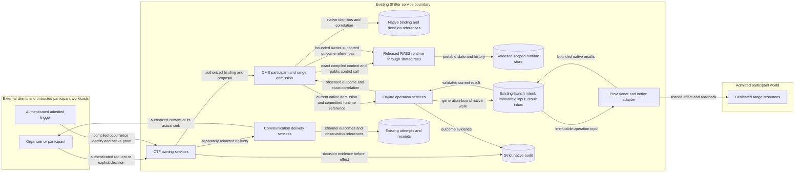

# Participant-control adoption for issue 1968

Status: active implementation design for #1968; no runtime support claim.

Reviewed: 2026-11-03 against checkout `6dcaa6913` and released RAES 10.6.0.

This is the implementation design recorded on [#1968](https://github.com/OpenRAE/bigrae/issues/1968#issuecomment-6591562499).
ADR-058 retains its original selection rationale; this design governs released-contract adoption.

## Purpose and issue context

BigRAE provides self-service agentic cyber ranges for authorized purple, red, and blue exercises.
Participant control must govern meaningful exercise interactions, not only display an approval screen or stop a VM.
The platform must know who may act, what may cross a participant boundary, what actually happened, and what evidence may be disclosed.

An admitted exercise may deliberately expose a participant to hostile data or allow an adversarial action.
Successful control can mean permitting and recording that condition, not suppressing it.
Exercise policy, participant visibility, intervention, and independent platform containment remain separate.
The resulting evidence must support later comparison of exercise usefulness, control effectiveness, cost, and uncertainty.

The delivery chain defines the intended value:

| Work | Responsibility | Consequence for this design |
| --- | --- | --- |
| #1967 and ADR-058 | Independent mechanism selection and realization envelope | Retain the organizational authority, resource, and evidence rationale; check its assumptions against released behavior. |
| #1968 | Realize selected control through authenticated native services | Deliver reusable participant binding and real effect boundaries, not another control-history sidecar. |
| #1969 | Prove conditions, governed effects, strict denials, isolation, and recovery | Design observable positive and negative cases into every claimed mechanism. Approval records alone are insufficient. |
| #2050 | Compile generation-bound scenario communications | Reuse the participant binding and control boundary; do not parse mutable content at delivery. |
| #2054 | Realize external directions and interventions | Join real control outcomes to delivery; displaying intervention text is not intervention success. |
| RAES #1007/#1008 | Evaluate selected evidenced control branches and bound their claims | Preserve exact mechanism, run, effect, and limitation evidence. Conformance alone does not establish resistance to intentional subversion. |

The first core realization must not depend on #2050 or #2054.
Those issues consume the core; reversing that dependency creates a cycle.
This explains the original native lifecycle choice.
It does not make lifecycle the whole platform architecture.

## Approved adoption decision

The maintainer approved this amendment after a deep source assessment of RAES and Hub #3.
The [revised issue plan](https://github.com/OpenRAE/bigrae/issues/1968#issuecomment-6613801679) supersedes the earlier upstream blocker assessment.
RAES owns portable semantics and conformance; BigRAE owns organizational service policy and native realization.
Explicit approval consumes released API-409 supervision, with API-423 at actual ingress and disclosure boundaries.
It does not depend on an automatic API-424 request-review or audit effect.
All native permission, resource, audit, fencing, recovery and evidence obligations remain required.

Build one reusable participant-control integration through existing service owners.
Retain capability restriction, explicit approval, resource control, and mandatory audit as complementary protections.
Do not reduce the platform design to approval alone.
Do not claim these native protections are installed API-424 providers without a compatible released mapping.

The common foundation is a durable binding from a compiled participant and run to exact native resources and authority.
CTF, native lifecycle, later compiled interventions, and authorized evidence views should reuse that binding and the same effect contracts.
Each use case still enters its owning service and retains its own authorization.
The common foundation is not a universal HTTP gateway or a replacement policy engine.

Mechanism selection belongs to an exact installed use case and release-backed profile.
Selected mandatory controls must compose as their released contracts require.
A missing required mechanism or unsupported effect blocks that use case before mutation.
Other independently supported use cases remain available under their own contracts.

## Alternatives and platform value

The comparison uses current code and the issue dependency graph.
It is an engineering assessment, not measured performance or a numerical value score.

| Alternative | Value and limitation | Disposition |
| --- | --- | --- |
| CTF-only approval and pause/resume patch | Useful organizer feature, but repeats identity, correlation, recovery, and evidence work for later interventions. | Reject as the platform architecture. Keep approval as one policy component. |
| Original composition assumed fully supported | Preserves the intended protections, but importable contracts do not establish a compatible profile or executable effects. | Reject unsupported claims. Preserve the useful target behavior and adapt its realization to RAES. |
| Shared binding and service-owned control/effect integration | Reuses existing authority, launch, delivery, and evidence owners across native lifecycle and scenario control. | Recommended. It removes repeated integration work without adding a second runtime or execution ledger. |
| Teaching-influence as the default profile | Relevant to authored hints and experimental treatments; its tokens and retained influence have specific semantics. | Optional exact use case. It is not a substitute identity for lifecycle control. |
| Universal dynamic information-flow control | Valuable only with complete source, derivation, memory, and sink coverage. Shifter does not mediate every guest action or human observation. | Reject as a platform-wide claim. Admit bounded profiles only on instrumented paths. |
| Generic configurable policy/plugin platform | Broad apparent flexibility, but creates another executable selection and policy authority. | Reject. Use fixed server factories and the existing published adapter boundaries. |

## Mechanisms and their roles

These mechanisms answer different questions and are not interchangeable alternatives.
Use all applicable native protections; advertise portable realization only where the exact released contract is satisfied.

| Mechanism | Platform benefit and application | Required evidence and limits |
| --- | --- | --- |
| Capability restriction | Prevent an actor or occurrence from selecting an unauthorized action, participant, audience, or resource. Apply native authority and credential ceilings on every path. | Current native policy plus exact target scope. This does not filter arbitrary commands inside guests. |
| Explicit approval | Permit deliberate supervision of consequential exercise interventions. Bind the decision to the exact proposal, authority, validity, and target. | Released proposal/control admission plus native decision evidence. Authorization, approval, and execution remain separate. |
| Resource control | Bound the affected footprint, operation concurrency, validity, and admitted native resource use. | Exact inventory, grants, native limits, and observed postconditions. Native quotas do not establish RAES causal budgets or model-spend limits. |
| Audit and outcome evidence | Explain permitted, denied, triggered, failed, and indeterminate work across recovery. | Strict intent audit before effects, authoritative native readback, and separately authorized portable projections. Audit is never permission. |
| Information-flow control | Govern disclosure and influence on fully mediated participant channels, where the authored use case needs it. | Exact published profile, complete inputs, memory, derivations, audience, sink, and release authority. Unknown influence is not a clean label. |
| Monitoring | Supply useful assessment or evidence for an admitted rule. | Advisory output cannot acquire a veto or execute a hidden effect. Required monitoring needs its own declared guarantee. |
| Handoff and cancellation | Support future controller transitions and bounded interruption when the released operation and native target exist. | Preserve controller/episode identity and observed outcomes. Runtime cancellation is not GCE pause; handoff grants no native event authority. |
| Runtime shielding | Potential protection for a defined enforceable property. | No present Shifter coverage establishes this guarantee. Do not enable it from a classifier result or a manifest entry. |

Approval requirements must follow the admitted use case.
The original reviewed lifecycle path still requires explicit approval.
This design does not require human approval for every ordinary participant interaction or every platform operation.
It does not activate or extend the parked model broker under ADR-068.
Keyless-direct model access remains outside any claimed tool-monitoring or spend-control boundary.

## Released compatibility and claim discipline

The checkout pins `raes==10.6.0` and `raes-env-packs==7.2.2`.
RAES design examples motivate use cases; they do not register executable profiles.

| Boundary | Observed released behavior | Adoption rule |
| --- | --- | --- |
| API-409 reusable control | Compiled context and a live-cut resolver support proposal, approval, denial, and linked action admission. | Reuse the released path where it represents the selected native action exactly. Do not infer native execution from accepted approval. |
| API-423 crossings | The runtime distinguishes ingress, projection, disclosure, delivery, observation, and retained evidence. | Mediate actual sinks and actions through their public operations. A browser response or sidecar row alone establishes no mechanism. |
| API-424 modular profiles | Bindings require a nonempty profile list. The exact published identities are teaching-influence and the two information-flow profiles. | Resolve a semantically compatible published profile independently of the native Shifter profile identity. No compatibility token or renamed substitute. |
| Governed executable effects | The released dispatcher supports handoff, inject, and a specific execution-cancellation path. | Unsupported review, audit, lifecycle, or other requested combinations remain unsupported. Do not substitute a native callback for a missing owner. |
| Durable runtime | P1 requires scoped durable storage and exclusive runtime ownership. Additional run contexts need distinct scoped stores. | A single platform-wide shared store or a runtime per stateless web request does not satisfy this contract. |
| Native lifecycle | Generic native RAES pause/resume remains closed; the installed participant owner has a separately qualified GCE path. | Require its native admission, immutable inputs, execution, invocation fences, and complete result/readback contracts together. |

A direct installed-binding probe accepted the exact published teaching-profile reference.
It rejected an unrecognized portable profile and an empty profile list.
That proves structural admission only, not realization or conformance.
A Shifter-local profile was never meant to replace a portable profile.
The original mapping assumption is superseded: explicit API-409 review and API-423 crossing admission do not require API-424 scheduled effects.
The profile validator and effect-owner source files are byte-identical in releases 10.2.0 and 10.6.0.

The released API-409 proposal/approval and linked-action path now has a native reservation adapter.
Its installation binds a `human-control-proxy` implementation and `human-supervised` mode to exact compiled actions, controller, observation boundary, targets, run and generation.
Every action requires accepted v2 proposal and approval records, plus a proposal digest covering the complete installed meaning and preallocated action identity.
Native effect metadata retains the exact accepted decision reference. The
worker must recheck the requesting proof and that decision's original human
reviewing proof at admission and provider invocation. Neither proof may be
borrowed from a later request or another approved proposal.
The adapter requires normalized arguments from the published resolver and refuses the SDK's optional unlinked paths.
The released runtime still owns live policy, revocation and cancellation checks; Shifter does not reproduce that fold.
This path selects API-409 supervision and API-423 crossings. The original full modular profile remains unsupported; its missing scheduled effects do not block this use case.
SDK-to-Engine integration tests exercise actual native authorization, strict audit, immutable input and held work for both verbs.
Revoking native authority after portable approval prevents reservation.
The SDK cut grants and resource footprint remain synthetic, so these tests establish neither a CTF product crossing nor an authenticated cloud outcome or conformance.

Normal native audit and human product review do not become portable scheduled effects merely because they share names.
Their use must remain explicit in the claim matrix.
Generic manifest publication remains provisioning-only until evidence justifies a change.
Configured targets may declare only the exact capabilities independently admitted and proved for them.
No alias, subclass bypass, copied validator, generic callback, or fallback may widen the released contracts.

## Components and ownership

| Owner | Responsibility and incumbent |
| --- | --- |
| CTF | Event/participant authority, native proposal and approval policy, compiled communication recipients, and product status. Use `ctf.services`, `CredentialContext`, live `event.manage_ranges`, and `ctf.bridges`. |
| CMS | Durable product-to-compiled-participant/run binding, exact range resolution, capability admission, and routing to the admitted runtime owner. Extend public `cms.services`, not CTF-specific core branches. |
| `shared.raes` | Exact released parsing, public protocol adapters, runtime composition, and bounded portable projections. It performs no product authorization or cloud operation. |
| Released RAES runtime | Portable episode/control/crossing state, selected composition, causal identities, and supported effect claims. Use its durable owner/store contracts. |
| Engine | Resource incarnation, native operation reservation, immutable input, launch, per-call ownership fences, result validation, and authoritative domain application. Reuse existing operation records. |
| Provisioner and adapter | Scoped provider invocation and complete member/access observation through the existing GCE boundary. No CTF ORM access or portable policy interpretation. |
| Communication services | Existing durable fan-out, attempts, receipts, acknowledgement, and channel delivery. Control and delivery keep separate outcomes. |
| Read APIs | Current audience-authorized evidence projections. Existing Mission Control sidecars remain reference projections, not controller state. |

The binding retains identifiers and canonical digests, not a copy of the RAES model or private content.
Engine retains a separate generation-bound compiler-input binding beside the native provisioning plan.
It records the released compiler-input digest, compiler version, resolved participant references, and source scope.
Selected parameter values use the existing encrypted string field and remain native; empty parameters need no secret body.
It stores neither the full scenario nor a second RuntimeModel. Reconstruct the model from the authorized immutable package and retained parameter selection, then verify the input digest.
The same generation retains the original public planner's artifact availability
facts and admitted artifact mechanisms as encrypted private native metadata. A persistent
control owner must reuse those exact facts when registering its plan. It must
not query the current image registry, invent missing provenance, or rerun pack
preparation. Old bindings with required but unretained facts remain unsupported.
Reference metadata is not a principal mapping, live episode, permission, or portable control history.
A replacement generation or changed source scope must refuse the old binding.
New native RAES ranges always receive a resource generation, including provisioning-only launches.
The metadata key includes the physical range, resource generation, compiled plan digest, and native custody digest.
A status projection selects only references and never loads the encrypted parameter field or exposes a secret-derived compiler digest.
Retained ranges without this context remain reference-only; the metadata never upgrades their runtime capability.
It distinguishes native principal, CTF participant, compiled participant, controller, run, episode, resource incarnation, operation generation, and state cut.
Changing a range owner, replacing resources, ending an episode, or changing a package invalidates the affected binding.
CMS obtains installation input through an authorized Engine service. That
service joins the retained compiler input to the current, complete native power
footprint under the Range lock. It requires a ready or paused dedicated GCE
range without an attached firewall lifecycle cascade. This private projection
is installation input, never an HTTP status payload or invocation permission.
Generic compiler-reference reads remain available without a power capability.
A pause operation advancing its native operation UUID does not itself replace the resource incarnation.

The native member projection retains an optional closed `native_power_target` object.
For GCE it contains the realized project, zone, instance name, and bootstrap capability.
These are addressing facts, not a cloud credential or an authorization grant.
An incomplete object is invalid; an older member without it is not power-capable.
Lifecycle input must use this retained target and must not reconstruct it from current deployment defaults.
The initial lifecycle qualification accepts standard persistent GCE guests only; other bootstrap contracts need their own readiness proof.
Power qualification also retains the observed numeric VM identity and each attached disk's numeric identity.
The first footprint admits dedicated zonal persistent disks in the VM's project and zone.
Each disk must name only that VM as its user; shared, regional, or unobserved disks remain unsupported for this profile.
Native power input requires this incarnation record as well as the location.
Recheck those identities before invocation and after provider completion so a reused VM or disk name cannot satisfy readback.
These observations are native evidence, not portable backend state.
Provisioning-only launches can omit failed or unsupported optional power qualification; that omission never grants power capability.
Qualification is bounded to 128 disks per VM, 256 disks per footprint, and a 30-second footprint observation budget.
Each qualification read has at most 10 seconds and disables SDK retries.
Native power mutation requires a durable invocation UUID, passed as the provider request ID.
It disables SDK mutation retries and bounds mutation and outer VM-read requests to 10 seconds.
The existing provider-operation wait and subsequent incarnation readback remain separate stages.

Never infer participant authority from a range owner, team name, credential possession, or participant-invariant access declaration.
CTF initially supplies the product mapping.
Another caller, including Mission Control, needs its own verified mapping before the same core can admit it.
Shared implementation is not automatic support for another caller or backend.

The diagram shows ownership and data flow, not an atomic distributed transaction.
A runtime outcome must use a released owner-supported API; the arrow grants no generic state-write authority.
Credentials and provider-private state remain native.
Secret, participant-content, and evidence-sink policies apply independently.

## Durable ownership and operations

### Native product records

CMS retains an organization-scoped configuration for one exact registered
source digest. It contains the fixed native profile reference and selected
logical addresses. Content-management authority admits this configuration;
it lends no range or controller authority. Its source-structure report is
configuration-specific and does not promote the generic source's conformance
status or assert backend/runtime conformance. Source references remain native
provenance after pack archival. Resolve current source custody before use.
Database guards keep configuration and run identity immutable. Retirement and
invalidation are irreversible. A current run prevents configuration retirement;
run insertion locks and verifies the current configuration and its digest.
`shifter-native-power-supervision/v1` identifies this fixed native integration
and its implementation manifest. It realizes the selected
`shifter-ctf-gce-range-lifecycle` use case; it is not another portable API-424
profile or a claim of support for another product.

A separate binding joins that configuration to the CMS range, native compiler
binding, resource generation, product subject and one SDK run. A command
retains the exact native request, initiating credential reference, requested-cut
digest, idempotency identity and operation correlations. These rows contain no
portable history, controller-state copy or competing execution status. RAES
retains control facts and Engine retains world execution truth. Keep original
requesting proof separate from later approval and transport identities.
Each command retains its original bounded request bytes and the SDK-produced
crossing subject reference before submission. This is an immutable request
record, not an accepted occurrence or controller-state ledger. An exact retry
uses the same bytes and identity. It must not rebuild a request against a newer
cut. The SDK owns acceptance and idempotency. Record its operation correlation
once after submission; recover a lost reply through that same public request.
The CTF subject owner resolves an actual active assignment and evaluates
`event.manage_ranges` before SQL locks. Its fence locks the event and participant
before CMS and Engine. Native preparation checks remote policy before those
locks; its commit fence compares local proof, custody, compiler input and the
complete physical footprint. Neither logical names nor historical ownership
can substitute for this assignment.
This first CTF mapping admits live player assignments within the active or
paused event's scheduled interval. Native range lease expiry is checked during
preparation and again at the commit fence. Pending owner recovery preserves
the existing run and grants no replacement effect authority.

The installed proxy declares `human-supervised` selection. RAES ADR-067 keeps
that mode distinct from general non-human supervision. Native service
principals may propose work and consume an accepted, still-authorized reviewed
action; approval requires a current native human principal with the same
event-management permission. This is accountable human identity, not proof of
physical presence or a two-person rule. Native service identity remains valid
for other admitted operations; human identity supplies no permission fallback.

Configuration changes cannot replace a live binding. Invalidate through the
serialized owner and establish cessation before releasing an unresolved native
grant. A new configuration or run cannot silently rebase an existing request.
The product worker reuses Django authentication, CSRF and native service policy
on its bounded routes. The reference P2 app is an administrative surface with
full-snapshot read authority; it is not a participant-scoped product proxy.

Administrative teardown remains an independent containment action. It may
replace the current power operation only with the native, authorized destroy
operation, under unchanged custody, physical generation and member identity.
The teardown transaction fences every old power reservation. It never marks
an unresolved provider call completed. Original worker completion and exact
provider-request recovery remain available without changing teardown status.

Once the existing teardown owner has accepted exact-generation destruction and
independent scoped inventory confirms absence, the old runtime may close even
if call cessation is unknown. No accepted world remains for that old call to
affect. The old native permission remains unresolved until actual completion
and remains a retained native fact. Native creation allocates a new range
primary key and therefore fresh physical resource names; it never reprovisions
the retired row. Engine's existing protected authority receipts retain that
row. Native power correlations follow the same protected, append-only retention
model; teardown and owner closure erase neither permissions nor portable
history. CMS retires
the source binding only after the same exact-generation cleanup proof; logical
destroyed status alone is insufficient.

The shared native session opens one fixed candidate, restores the original
artifact planning admission, registers the owner-admitted public plan, and
initializes exactly the episode derived from that run. It never provisions
resources or resets an existing episode.
The native binding records a one-way, strictly audited initialization marker
after the released owner has created or reopened its episode. Once marked,
missing episode history fails closed; replacing an empty or lost volume cannot
silently start a new history under that run. A crash before the marker commits
reopens the existing SDK episode before retrying the native marker transaction.

Native command identities select
immutable original requests for submission and exact retry; a later request
does not replace their bytes or initiating proof. The session serializes SDK
mutations with native invocation admission and refuses mutation or shutdown
while an invocation remains unresolved. SDK receipts and operation state are
read from the owning store, never reconstructed from native command rows.

Recovery by native request ID reuses the retained original intent, cut, target
and credential; the caller cannot reconstruct or rebase them. Failed SDK work
and accepted review cancellation durably fence the native action command before
cleanup. A late callback rechecks that fence under the same native range lock,
so it cannot create a reservation after cleanup has observed none. These fences
record native dispatch exclusion only, never portable execution state.
When no native permission was issued, cleanup may restore the exact prior native
range status, including a prior failed status. It cannot manufacture readiness
from the requested verb. Once a permission was issued, cleanup preserves any
uncertain call and uses native failure until fresh reviewed readback or verified
teardown resolves the world. Past effects and SDK history remain recorded.
The fixed native authority adapter resolves each callback through that immutable
command identity. It obtains current product authorization from CMS and returns
the selected compiled authority/scope references to the SDK. For a linked
action, it rechecks the proposal, exact accepted human decision and consuming
command independently. Historical crossing validation uses bounded immutable
native request references and fixed policy declarations; historical facts do
not become current permission. Ingress admits only the fixed native audience,
reference-only marking and selected action meaning. No caller supplies policy
gates, authority references or a crossing verdict.
Within one owner, reuse source qualification only when the independently read
source identity/custody, immutable configuration and original compiler/physical
input exactly match its qualified context. Current credential, product,
permission, lease and native row fences are prepared afresh. This avoids
downloading and recompiling the same immutable source for every proof without
turning qualification into permission or permitting a new configuration.

### Owner lifetime

Keep policy evaluation and portable runtime ownership outside provisioner Jobs and pausable guests.
A web request must not reconstruct an ephemeral runtime and call it durable.
A single shared platform runtime would also impose unsupported ownership and resource-exclusion assumptions.
Use an installation-managed, bounded runtime-owner worker for each admitted ownership partition.
Separate range/run stores and native bindings prevent tenant or participant scope merging.

Use the released LocalControlPlaneStore for a bounded first owner partition, with protected durable local block storage.
The shared native factory reconstructs the exact compiler input before opening a P1 owner.
It uses the published SDK materialization function to install the executable demand graph under closed apparatus defaults.
Public planning retains the full canonical compiler input for realization authority and uses the owner's exact executable context for admission.
The resulting valid composite plan must register through the public owner API; no model-equality check is relaxed.
It keys storage by native binding, resource generation, and run UUIDs, and refuses a provisioning-only target.
The owning worker must supply a fresh target component set for each owner; component sharing cannot evade SDK resource exclusion.
The factory accepts the released crossing-policy resolver and forwards the explicit final-sink selection to the SDK.
It retains required final-sink enforcement by default; a missing required resolver owner fails construction and releases its own store lease.
An explicitly admitted API-423-only installation selects that narrower contract without claiming an IFC mechanism.
Targeted integration tests cover current authority, crossing denial and revoked approval for both native verbs.
This factory is an integration primitive, not a configured product runtime or a native-effect capability claim.

A separate candidate target assembles the fixed native human-supervision
adapter for qualification. Installation selects only compiled participant,
controller, pause/resume action and observation references. The complete native
footprint supplies targets, and the generation must match Engine's authorized
installation input. The candidate records the contracts and ingress features
it actually uses. It keeps candidate evidence separate from conformance proof
and does not widen the generic provisioning manifest. Its implementation is
fixed application code; selections cannot name an executable module, URL or
provider. Unsupported action meanings fail during candidate construction.
The released manifest catalog requires its published baseline control contract
IDs. It does not accept `participant-control-occurrence-v2` as a backend manifest
entry. Keep that catalog check intact. The selected adapter independently
requires and verifies API-409 wire `2.0.0`; baseline manifest IDs do not rename
that history. Public-planner and crossing tests exercise the candidate with
those actual records. No additional manifest ID or general consumer-conformance
claim is inferred. Candidate evidence must resolve independently at the
crossing boundary; a capability declaration cannot register its own proof.

Keep two different native pins. The worker's full installation digest covers
actual application images, namespace, public trust, owner capacity and limits;
an already running process refuses drift in that digest. Source configurations
pin a runtime policy digest covering the fixed policy protocol and SDK budgets,
alongside the exact source, compiled RAES version and native meaning manifest.
Compatible application releases, certificate rotation and owner capacity tuning
can reopen the same persistent episode after a properly attested worker restart.
They cannot alter original request bytes, admitted workload identity or grant
ownership. A changed semantic contract or budget requires explicit configuration
retirement. Missing persisted history still fails closed. This avoids turning
an ordinary platform release into retirement of every supervised range.

The release's verified Helm render selects the optional persistent worker for
rollout and image evidence. Deployment waits for its StatefulSet and restarts it
when refreshing native secrets, just as it does the regular workers. The closed
running-image verifier requires the worker only when selected, binds its main
container to the exact approved portal image and checks its pinned support
containers. Missing, unexpected or stale worker images fail deployment.

Planning precedes physical resource qualification. A bounded compilation may
use the released P0 owner solely to obtain matching control-planning admission
for its original compiled model. This helper exposes no episode, control or
effect operation and closes its own planning owner. It claims no persistent
runtime history. Use fresh components when the qualified native generation
later acquires its P1 owner. Product configuration must select the logical
control mapping before planning; successful planning does not activate it or
supply a native invocation grant. Preserve artifact admission on this path.
The prospective target validates those logical meanings and explicitly refuses
every action invocation. It needs no fabricated VM or generation identity.
The package loader accepts this selection separately from SDL and scenario
parameters. CMS must supply it from trusted installation configuration; the
producer helper alone enables no product route. Its default
continues to plan against the generic provisioning target. The selected path
prepares the same compiled artifact requirements, admitted inventory and final
target capabilities before it opens the planning owner. Both paths retain the
original private compiler context for Engine. An invalid selection is refused
before dispatch; it cannot fall back to generic planning.
The restricted planning facade also registers valid public-planner results
with that same owner before it closes. It exposes no effect or lifecycle API.
The selected path preserves the incumbent participant-invariant guest-access
envelope. Controller status supplies no missing guest permission. Packages with
different participant access sets remain unsupported by that native projection.

The native reservation callback uses the existing launch intent and immutable operation input.
A `HELD` launch delivery state prevents both the launcher worker and the local-dispatch shortcut from starting work before portable admission commits.
An adjacent native correlation row joins that intent to compiler binding, run, participant, controller, episode, proposal and action identities.
It owns no second execution status or portable history.
If portable admission fails or the owning SDK accepts review cancellation,
the serialized owner irreversibly fences the original native command before
checking for a reservation. A late callback must acquire the same native range
lock and recheck that command fence before reserving or releasing work. This
also excludes a callback that had not created its reservation at cleanup time.
Under that lock, a reservation with no issued provider-call permission can
restore the actual captured pre-reservation status, including `failed`, and
clear its operation identity. This is safe after launcher release too: all
provider calls still require an unfenced, one-use native grant. Once any
permission was issued, cleanup preserves uncertain effects, fences later work,
and follows the separate cessation and authoritative recovery path. It does
not overwrite already settled native truth or independent destruction.
Every command and reservation fence commits with strict audit. These private
settlement seams accept no caller-supplied portable verdict or effect request.
Current native range authority, exact compiled footprint, resource generation and strict audit are required even to create held work.
Failure of that audit rolls back the reservation and native state change together.
The callback also captures a native digest of the SDK's public episode and control-history cut before reservation.
Successful portable admission can be correlated only at that same cut, under the original credential and current native generation.
A later accepted cancellation changes the cut and prevents correlation even though the earlier SDK admission remains historically successful.
Receipt correlation is immutable, idempotent and strictly audited; audit failure leaves the operation held and uncorrelated.
The digest is native correlation metadata, not a replacement policy fold or a portable snapshot revision.
Product request coordinates come from the released API-409 episode fold and
the compiler's original pinned policy projection. Read the full current
episode prefix, including rejected attempts. Accepted state revision and
history append position remain separate. A cursor is request preparation,
not authority; runtime admission still evaluates current native grants and
the exact SDK cut. Invalid or unknown history yields no cursor.
The private release service rechecks that correlation, original authority and current native generation under the same Range lock.
It records one strictly audited HELD-to-PENDING transition; an exact retry returns the same operation without another dispatch transition.
The runtime owner must verify successful portable admission and its live control cut before calling this service.
No product endpoint enables this reservation path yet.

The factory accepts the SDK's typed bounded supervision configuration from trusted installation code.
It retains the SDK defaults when none is supplied; scenario and caller input cannot supply execution limits.
Service integration fixtures use explicit finite I/O budgets to separate protocol checks from host fsync latency.
Those fixture budgets establish no production capacity or storage-latency claim.
An optional StatefulSet worker can preserve stable storage identity within the existing Helm package.
SQLite WAL requires same-host access; do not place those stores on a shared network filesystem.
Use one process per owner partition, no reload, bounded active contexts, backpressure, and explicit recovery.
Installation admits a closed native configuration containing the exact platform
and provisioner image digests, namespace, public TLS trust bundle, finite owner
capacity/idle limits and operation budgets. Its canonical native digest joins
each organization/source configuration. It selects this fixed application
integration; no value names executable provider code. The private HTTPS origin
and protected P1 mount path are fixed by the installed service and namespace.
The worker verifies its own Pod image/identity before accepting ownership, and
each grant independently verifies the provisioner Job's installed image.
Image or authority configuration changes require explicit requalification and
new review; they cannot silently reinterpret an existing run. Cessation and
read-only recovery of an older admitted worker remain independently available.
Storage paths and owner routing are installation-derived, never caller or pack inputs.
This is a proposed packaging addition, not permission to deploy or transfer data.

The released PostgreSQL store is not a drop-in namespace in Shifter's existing application database.
It binds one target/run and takes a database-level owner advisory lock.
A database per range adds provisioning, permission, backup, retention, and connection costs.
Do not hide those costs behind a shared-table wrapper or replace the released store with a new Django history implementation.
Keep PostgreSQL as an alternative for installations with explicitly provisioned isolated ledgers.

Stateful storage adds operational work and limits availability during owner recovery.
Before activation, measure expected cohort capacity, restore time, retention, and owner-failure behavior on the deployment's actual storage class.
No multi-worker shared ownership, transparent HA, or distributed exactly-once claim is made.
An uncertain old invocation blocks takeover until native ownership and provider state are resolved.

Keep integration behind public RAES contracts and `shared.raes`.
The announced RAES language cutover is not a reason to build against unreleased APIs or depend on Python internals.
A future released runtime can replace the embedding without changing CTF approval policy or Engine execution truth.
That substitution still requires version negotiation, migration, and qualification.

### Native invocation identity

Authenticate a native Job at the invocation boundary with a short-lived,
pod-bound Kubernetes token for the single native-invocation audience.
Use Kubernetes TokenReview with that explicit audience, then independently read
the live Pod and its owning Job. Match the reviewed service-account identity,
Pod name/UID, Job controller UID and retained launch workload. Reject deleted,
replaced, terminal, foreign or mismatched workloads before issuing any native
grant. Reuse the task runner's existing reserved-Job identity check.
Never accept an unverified token body, task name or workload identity alone.
The token remains secret and is absent from errors, portable state and audit.

This identity check establishes the calling workload only. Current initiating
authority, runtime control cut, resource generation and exclusive invocation
permission remain separate gates. Installation must explicitly provide the
projected token, private transport, audience, TokenReview/read RBAC and endpoint
routing before this path can run. No listener or deployment is enabled by the
identity primitive. Kubernetes documents the reference behavior in
[service-account authentication](https://kubernetes.io/docs/concepts/security/service-accounts/#authenticating-service-account-credentials-in-your-own-code).

### One-use native invocation grants

Engine retains one immutable grant identity per reserved member, beside the
existing participant reservation and launch intent. A grant binds the observed
Pod/Job UIDs, actual running container identity and image digest, exact member incarnation, successful portable admission and current
control cut. It owns only permission for one bounded native call; the operation
input/result owners retain execution truth. Strict audit and grant creation
commit before the grant is returned. A repeated acquisition never grants a
second call, including after a lost reply. Unknown calls retain exclusion.
The provider request UUID is derived from the native operation and exact member
with the standard UUID version 5 algorithm. Both worker and Engine compute it
independently. Possession of this stable identifier grants no permission.
Each acquisition also carries a fresh random attempt UUID, retained with the
grant and required on completion. A lost acquisition response can be closed by
the same verified container only when its fixed helper has not reached the
provider call. A denied later attempt cannot close an earlier attempt's
uncertain call. The durable per-member grant still cannot be acquired again.
A pre-call withdrawal occupies that same one-use member slot even when the
original acquisition has not committed yet. It fences the reservation, so a
late acquisition response cannot leave a grant behind after withdrawal. This
record declares no issued permission or world effect; it cannot satisfy native
success readback. It adds no portable state or alternative execution ledger.

A fresh reviewed repair can find a retained member already in its requested
power state. The fixed helper still consumes current native authority and
requires complete incarnation/state readback, but skips a redundant mutation.
Resume still requires the same authenticated read-only guest qualification.
An issued permission therefore allows at most one provider mutation; it does
not claim that a mutation was necessary or sent. A crash before authenticated
completion still retains uncertainty, and missing provider history cannot clear
it.

The worker acquires its one-use permission after read-only preflight, immediately
before the provider call; provider-library retries remain disabled.
The closed worker boundary compares the returned permission with its immutable
operation UUID, verb, resource generation, member, target and incarnation.
A grant for a different verb cannot authorize the opposite cloud operation.
Only the installed GCE start/stop helper performs the effect. It returns after
provider readback; it does not settle portable state, mark the range ready or
release an uncertain grant. Resume access qualification remains a separate
postcondition before participant delivery.

The private Engine grant primitive authenticates the live workload, rechecks the
original initiating credential and immutable operation input under locks, and
requires the exact native generation, control cut and member incarnation.
Targeted PostgreSQL tests exercise simultaneous requests, generation changes
during authentication, audit rollback and non-reusable consumed grants.
This primitive does not install a runtime listener, worker transport or grant
settlement/recovery path. Those integrations remain required before activation.

The installed worker acknowledges cessation only after the bounded native
helper returns. Engine authenticates that acknowledgement against the same
live Pod and Job UIDs, then strictly audits the one-way grant closure. This
receipt grants no further call permission and makes no range-readiness claim.
An exact duplicate closure is harmless. Recording cessation remains available
after initiating authority is revoked, because it creates no new effect.
Audit failure leaves exclusion in place. The installed immutable worker image
and the existing provisioner admission policy are part of this trust boundary;
arbitrary guest code cannot submit worker completion. A failed or uncertain
provider call does not acknowledge cessation through this success path.
Read-only recovery runs only after native failure, original Job inactivity, or
the installed total Job deadline. Job disappearance is a recovery trigger, never
proof of provider-call cessation. Recovery first fences further grants and marks
native work failed while retaining the open permission. Healthy workers retain
their post-call readback and readiness window.

Read-only recovery requires one completed GCE operation matching the invocation
request UUID, verb, target location and numeric incarnation. The installed
container can issue only one mutating SDK call for that member, with retries
disabled; that operation's completion establishes cessation of that call even
if the container is still performing readback. Recovery atomically fences the
original reservation and operation before closing the grant. Every later member
would need a fresh native grant, which that fence refuses. The native operation
becomes failed and further power work requires a fresh reviewed action. Recovery
never reruns the cloud mutation or treats VM power as guest readiness. Pod
absence alone and missing/expired operations retain exclusion. GCE documents a
minimum completed-operation retention of one hour; an absent list entry cannot
prove that a call never happened. Cloud administrators and a compromised
provisioner image remain outside this fixed integration's trust claim.

The runtime owner serializes grant acquisition with all control mutations.
While an unresolved grant exists, a normal control change cannot invalidate
its cut. Engine also excludes resource-generation and custody replacement
through a database guard on the owning Range row. Those updates share its row
lock with grant admission. Provider readback and native result application
remain available. A grant cannot expire into permission to repeat an unknown
call; reconciliation must establish the provider outcome and the old worker's
cessation before releasing exclusion. Emergency platform action invalidates
the affected realization rather than inventing a portable cancellation result.

## Effect lifecycle and security

Native request admission, portable intent, native reservation, provider invocation, readback, and delivery are distinct durable boundaries.
The native `range pause/resume` result contract distinguishes legacy instance UUIDs from compiled RAES member references.
Native member observations carry their resource generation and a bounded, unique list of member references and observed statuses.
Engine must match that generation and the immutable operation target set before it updates the native member projection.
The legacy UUID result parser retains its existing meaning. These native results are not portable RAES control records.
Preserve the exact logical identity across those boundaries and recovery.
Approval is deliberate authorization for the proposal, not authorization for a changed target or a stale episode.

| Threat or failure | Required enforcement and observable result |
| --- | --- |
| Foreign actor, scope, participant, or range | Current credential and native ancestry checks plus exact compiled binding; opaque refusal with zero prohibited effect. |
| Scenario-selected code, provider, path, URL, or configuration | Closed server factories and published typed adapters; reject unknown inputs before admission. No second executable loader. |
| Missing, stale, denied, conflicting, or weakened selected control | Apply its declared fail behavior before native dispatch or participant disclosure. Optional advice cannot acquire authority. |
| Old approval or conditional API-409 link bypass | Require exact retained proposal, action selection, episode policy, and live cut before invoking the public runtime path. Test absent links explicitly. |
| Revocation after Job launch | Final native invocation fencing with exclusive worker ownership. A pre-launch or result-applier check alone is insufficient. |
| Worker restart or uncertain cloud response | Preserve operation correlation and explicit indeterminate state; read back before any potentially repeated effect. |
| Multi-member or access-path failure | Observe the complete admitted footprint. No whole-range success from one VM state or an accepted task. |
| Audit or history commit failure | No newly claimable consequential work; retain bounded integrity evidence and reconcile the precise crash gap. |
| Partial intervention delivery | Keep control-effect and transport outcomes separate. Retry cannot repeat an applied world effect to repair a message. |
| Secrets, raw content, or hidden decisions at an unauthorized sink | Native credential stores and independently authorized bounded evidence projections; no raw provider exception or participant content in portable records. |

All native entry points affecting an actively controlled resource must enforce the binding or refuse.
An emergency out-of-world operation invalidates the realization rather than fabricating a governed control occurrence.
The shared GCE power boundary must inspect the provider before each start or stop.
Require a nonempty persistent-disk footprint and a provider instance identity.
Reject Local SSDs, instance resource policies, and a managed-instance creator before mutation.
Read back the same instance identity, disks, and admitted terminal power state after the operation.
These observations supplement native invocation authority; they do not replace it.
They detect the reported controller markers and disk attachment sources.
The legacy attachment-source checks do not prove the absence of every external controller or bind disk incarnations.
The qualified native input separately retains VM and disk numeric identities and exclusive zonal attachments.
Its power helper requires an installed per-call authority fence and rechecks these identities before and after invocation.
The authenticated service and worker must still supply that fence; the helper does not establish native authority itself.
If one member fails after another succeeds, retain the successful member observations before the terminal failure.
An empty range must fail before a shared-resource cascade.
Native failure results and logs retain authored text and error classes, not raw provider diagnostics.
The immutable power input references the single original provisioning operation
for the same request, resource generation, range identity, and compiled plan.
Both native admission and the provisioner validate that reference. Neither
selects the latest operation nor consults the current image registry. Resume
uses that original input only to recover the original management-access policy
and run the existing read-only guest OS and composition checks. Existing
management credentials are read from their deterministic Secret Manager
locations; this path cannot create credentials, reinstall accounts, reapply
content, or provision resources. A running VM alone cannot settle a range as
ready. Member observations remain partial if any member fails, and terminal
success requires complete matching observations and closed invocation grants.
Hardened range pause/resume Jobs receive one read-only projected service-account
token at `/var/run/secrets/shifter/native-power/token`, with the fixed audience
`shifter-native-participant-invocation` and a 600-second rotation period.
These power Jobs have a fixed 1,800-second total deadline, including provider
waits and guest qualification. Exhaustion cannot imply success or clear an
unresolved provider call. The native image and protocol pin this operational
limit independently of the SDK's request admission and commit budgets.
General service-account token mounting stays disabled. Admission permits this
exact projection only on those commands, alongside the four existing writable
volumes; other projections, audiences, mounts and credential sources are denied.
The token authenticates a live reserved Pod and Job; it does not itself authorize
an operation or replace current native and portable approval checks.
The installed owner runs as the sole `participant-control-0` StatefulSet Pod.
Startup verifies its live Pod UID, private address, service account, fixed
module arguments, desired image and running container digest before opening
the TLS listener. One protected local file lock excludes a second owner process
for the entire installation; released P1 scoped locks still own each runtime.
The worker has its own URL configuration, with no portal WebSocket, metrics or
unrelated API initialization. It exposes readiness and liveness separately.
Shutdown refuses new registry leases and asks the released owners to drain.
An unresolved native call keeps its durable exclusion even if the process must
exit; process exit or Pod absence cannot establish provider completion.
Deployment is explicitly opt-in through GCP installation settings. Operator
intent names an existing Kubernetes TLS Secret, its public trust CA, storage
class/capacity and finite owner limits. The renderer derives namespace and both
image digests from the actual release and clears stale enablement when disabled.
Only the dedicated worker sets the owner-process flag. It uses a dedicated
Kubernetes service account with TokenReview and namespace-scoped Pod/Job reads;
the existing application worker cloud identity supplies native SQL and package
reads, while cloud power remains with the provisioner. Public ingress routes
only the authenticated participant-control API prefix to the TLS worker.
The private invocation protocol has no public ingress route. Network policies
admit provisioner-to-worker TLS separately from public API and policy/database
access. Admission embeds runtime strings with proper escaping so a public PEM
bundle in JSON cannot disappear from the Job's pinned environment contract.
GCE stop/start preserves admitted persistent resources, not RAM or arbitrary application execution.
Pause does not freeze a human, world clock, external service, or portable memory.

Reuse existing errors, strict audit, authentication, operation contracts, and ADR-025 propagation.
No second runtime, universal policy language, exception hierarchy, message bus, delivery ledger, or conformance verdict is proposed.
Any new binding or operation projection needs typed native contracts and behavioral enforcement tests before activation.
The proposal grants no architecture exception or weaker CI gate.

## Delivery and evidence boundaries

The platform target is the common architecture above, not the smallest independently closable feature.
Delivery can proceed in complete, useful service integrations without advertising unproved mechanisms.

The first independent proof path remains an explicitly governed native CTF/GCE lifecycle intervention.
It exercises capability restriction, exact approval, resource scope, native dispatch, real crossing, readback, and recovery together.
It must exercise the released API-409 and API-423 paths through authenticated native services. Native safeguards retain their service meanings. API-424 scheduled review/audit and a generic modular-profile claim are excluded.

The same binding and effect boundary later serve compiled scenario direction/intervention and participant-specific evidence views.
Those consumers add their own compiler, audience, order, and delivery qualification.
They do not duplicate control execution or become prerequisites for the first core proof.
Published information-flow mechanisms can then be admitted on channels with demonstrated provenance, memory, and sink coverage.
They are not selected solely because their profiles pass schema validation.

| Evidence | What it must establish |
| --- | --- |
| Released conformance | Exact installed contracts, profile, provider/configuration, and bounded runtime behavior. The released checker owns the verdict. |
| Authenticated service tests | Real native authorization and crossing boundaries; positive control plus no-effect denials, stale/revoked bindings, and audit failures. |
| Native adapter/readback tests | Complete member and access postconditions, partial failure, timeout, resource replacement, and invocation fencing. |
| Recovery and concurrency | Durable ownership, exact replay identity, crashed commit boundaries, no blind takeover, and no cross-tenant/range effect. |
| Cohort qualification | Bounded active contexts, queue latency, storage growth, restore behavior, and control availability under representative load. |
| #1969 real-boundary proof | Installed target and actual service/provider outcomes agree with declarations, audit, evidence, and released conformance. |

Issue #1968 still requires its own positive authenticated participant/world crossing.
#1969 extends that proof; it cannot defer the acceptance criterion.
A design document, structural probe, or successful approval record does not satisfy it.
GEN-2005 is ACTIVE because implementation has started. The original composition remains unadvertised until reviewed implementation and proof justify its claims.

## References and source boundaries

- Platform purpose and current ownership: [README](../../README.md), [architecture handbook](../technical/architecture.md), and [engineering principles](../technical/dev/principles.md).
- Selection, implementation, and proof scope: [#1967](https://github.com/OpenRAE/bigrae/issues/1967), [#1968](https://github.com/OpenRAE/bigrae/issues/1968), and [#1969](https://github.com/OpenRAE/bigrae/issues/1969).
- Consuming features: [#2050](https://github.com/OpenRAE/bigrae/issues/2050), [#2054](https://github.com/OpenRAE/bigrae/issues/2054), and [communication boundary](ctf-communications-raes-inject-preflight-2047.md).
- Accepted original selection and claims: [ADR-058 envelope](raes-participant-control-realization-envelope-1967.md) and [GEN-2005](../requirements/GEN-2005/requirement.md).
- RAES accepted program, dependency direction, and example limitations: <https://github.com/OpenRAE/rae/blob/ebb70a34b8e7d1cc8964c443841ae57e12ed1014/docs/research/modular-participant-control/delivery.md> and <https://github.com/OpenRAE/rae/blob/ebb70a34b8e7d1cc8964c443841ae57e12ed1014/docs/research/modular-participant-control/cases.md>.
- RAES 10.6.0, shipped participant-control responsibilities: <https://github.com/OpenRAE/rae/blob/v10.6.0/docs/public/participant-control.md>.
- RAES 10.6.0, public protocol, profiles, and executable-effect limits: <https://github.com/OpenRAE/rae/blob/v10.6.0/docs/explain/reference/modular-participant-control-contracts.md>.
- RAES 10.6.0, run ownership and distinct stores: <https://github.com/OpenRAE/rae/blob/v10.6.0/implementations/python/packages/raes_runtime/runtime_engine.py>.
- RAES 10.6.0, PostgreSQL store scope and owner lock: <https://github.com/OpenRAE/rae/blob/v10.6.0/implementations/python/packages/raes_runtime/control_plane_store_postgresql.py>.
- SQLite WAL, overview and same-host limitation: <https://www.sqlite.org/wal.html>.
- Kubernetes, stable StatefulSet identity and storage: <https://kubernetes.io/docs/concepts/workloads/controllers/statefulset/>.
- GCE stop/start, persistent resources and volatile-state limits: <https://docs.cloud.google.com/compute/docs/instances/stop-start-instance>.
- Model control remains governed by [ADR-068](../adr/068-model-access-broker-parked.md); this work does not activate it.

## Delivered management and deployment surfaces

Organization administrators configure five logical addresses against the exact
source digest. The participant detail page discovers and explicitly activates
the configured mapping, records proposals and human decisions, cancels reviews,
and requests reviewed effects. The API and browser preserve an ambiguous original
request rather than rebuilding it at a newer cut. A retry-by-ID route accepts
only an empty body and reuses the retained bytes, actor proof, and target choice.
Body-free history is bounded and paginated. Native power status is displayed
separately from SDK admission receipts. Responses prohibit caching.

The optional GCP installation projects its fixed TLS worker, retained RWOP
storage, network policy, least-privilege Kubernetes reads, TokenReview and
read-only cloud-operation recovery into the established chart and release path.
Rollout waits and running-image evidence include the enabled StatefulSet and
its support sidecars. No deployment has been performed by this implementation.

Targeted evidence includes the actual authenticated CMS/CTF/Engine and released
SDK crossing, PostgreSQL guards and audit rollback, workload grants and result
application, official carrier validators, synthetic GCE and SSH readback, and
admission checks against a local Kubernetes API server. These are bounded tests,
not a live cloud qualification or a generic consumer-conformance verdict.
Operational and user instructions are linked from the documentation index.

Receipt recovery also covers a crash after the SDK commits but before SQL
correlation. The installed factory retains the released owner's public store
handle. Original request lookup uses its released idempotency query, then checks
actor, authorization scope, target, run and operation kind before asking the
owner for the observed operation. The native immutable command catalog fixes
the original bytes. This query grants no effect: release and invocation still
require their complete live native and SDK fences. No SDK-private field, copied
operation table, history rewrite, or request rebasing is used.

The PostgreSQL test `test_participant_power_pipeline.py` follows one active
generation from authenticated human proposal and approval through the real
launch outbox, Job builder, standalone provisioner CLI, private TLS client,
one-use invocation, Compute power helper, SQL result writer and Engine applier.
It verifies pre-effect audit and the released carrier validators on the same
owner, plus an independently revoked-permission run with zero cloud mutations.
Only external Kubernetes and Compute responses are synthetic. This joined path
provides the local integration evidence; deployed cloud qualification remains
separate.
