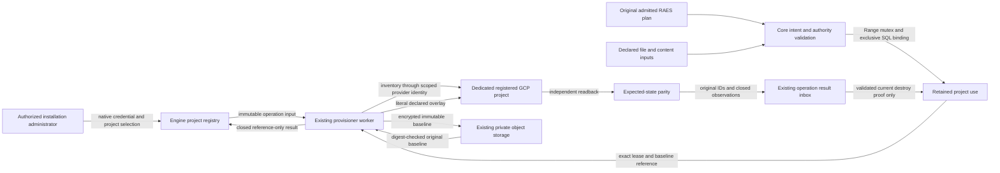

# Registered GCP range projects

Issue #2716 adds operator-managed GCP projects for the cloud IAM and Secret
Manager declarations in the pinned RAES contract. This is a code design; it
claims no tenant deployment or live qualification. Scenario content, adapters,
images and acceptance evidence remain in their owning repositories.

## Ownership and execution

Engine owns project registration, immutable baseline references and exclusive
range bindings. Installation administrators use the existing
`installation.manage_cloud_authority` action. Registration records the original
native credential and assigned organization. The portal queues an operation;
cloud inventory runs in the existing provisioner worker with its own identity.
No cloud IAM credential or permission is added to the portal or adapter worker.
The CMS operation policy and HTTP authorization inventory bind registration,
listing, retry and disable to this installation action. Engine resolves the
registry collection or exact registration; ordinary content authority grants no
project-administration access.

Use the existing `ProvisionerLaunchIntent`, immutable `OperationInput` and
append-only result inbox for `range-project/register`. The registration UUID is
its request correlation; it is not a fabricated range request. Native command,
workload, admission and result contracts explicitly recognize this resource.
The Engine applier alone accepts registration evidence and marks it ready.
A missing, revoked or changed initiating proof cannot authorize registration.

Registration accepts existing dedicated projects. It neither creates projects,
enables services nor grants itself cloud roles. Deployment control, shared VM
infrastructure, image-build and dynamic-secret projects are excluded. Required
APIs and narrowly scoped worker permissions are operator prerequisites.
The registration worker excludes image-owning projects from both legacy image
settings and every entry in the existing validated keyed image-profile map,
including machine images. Invalid profile configuration fails before inventory;
it cannot erase the protected-project set.

The baseline covers the managed surface: project IAM and audit policy, service
accounts and their policies and user-managed key metadata, and Secret Manager
resources, policies and version metadata. Existing secret payloads are not read,
enabled, destroyed or copied. Provider-managed rotating keys are not range
content. Unsupported intent or inventory that cannot be represented safely
fails before range effects. Out-of-band irreversible loss cannot be presented
as a successful restoration.

Baseline artifacts use the existing configured private object storage, encrypted
with the existing application field-encryption key. Their references bind the
registration and capture operation, exact ciphertext digest, size and immutable
object identity, including the original server-configured bucket. A later bucket
configuration change cannot redirect retained cleanup. Transport remains reference-only under the existing operation
budget; the registry is not a raw provider-state projection. The worker checks
identity, byte bounds and digest before decryption. No new store, public hosting,
key service or direct provisioner read of registry tables is introduced.

## Exclusive use and retained authority

A registered project is available only after accepted registration and while
not disabled or held by a range. A retained `GcpRangeProjectUse` binds a project
to the original range/request, a lease UUID and the baseline reference. A SQL
unique constraint over unreleased uses prevents two ranges from sharing it.
Allocation locks project rows in a stable order under the existing Range mutex;
requesting multiple projects is atomic. The admitted range organization must
match the operator-assigned organization. A source document grants no project
management authority outside that boundary.

The binding survives setup failures, cancellation, retirement and actor
revocation. A failed task, missing Job, timeout or terminal range status never
releases it. The Engine accepts release only from the current destroy generation
with exact baseline readback for the original lease. Unknown or residual state
retains the lease and leaves the project unavailable.

Ordinary launches snapshot bindings in the immutable operation input. When an
adapter prepares values, the controller validates the original RAES authority,
resolves the resulting project references, and allocates bindings before its
planned-state commit. Host-native `RuntimePreparation` carries optional binding
references; the public adapter SDK grants no lease or provider authority. Mapping,
bindings and planned state commit under the same Range mutex. The entire future
cleanup envelope is validated before acceptance; a failure rolls the reservation
back through a transaction savepoint even when the invocation records a failure.
Each lease retains the original provisioning operation ID, distinct from its
baseline capture operation. Retry and cleanup consume these retained references,
with no fresh project or image selection. Input projection is read-only; only
admitted launch or preparation acceptance can allocate custody.

An unreleased project also blocks range ownership and scope moves. Preparation
and commit both check that hold under the existing Range mutex. Retiring VPN
access alone cannot retire cloud permissions or authorize a new customer scope.

## Authored intent and provider readback

### MVP execution

Use the existing Terraform binary and Google provider to realize the native
cloud declarations. Generate data-only Terraform JSON in a private temporary
workspace, with locked state in the existing private GCS bucket under the
lease UUID. Never run pack-supplied Terraform or executable hooks. Provider
dependency ordering creates service accounts before their grants and removes
grants before accounts. Existing baseline objects are not imported or replaced.
After teardown restore the recorded project policy using its current etag and
independently compare the complete managed inventory with the baseline. Failed
or uncertain cleanup retains project custody for manual recovery; automatic
recovery orchestration is outside the MVP. The existing field-encryption
primitive protects bounded native Content payloads in retained inputs.
Where a native secret version leaves `payload_content_ref` unspecified, a
preparation response may select its literal UTF-8 payload by the exact native
version reference. Core accepts that only for the installed adapter's declared
platform-application concern, keeps it in the sealed preparation record, and
never changes an explicit Content reference. This needs no additional guest
payload files. Declared Content retains its normal native placement semantics.

Cloud intent is the native node payload's `spec.node.runtime.identity_authorities`
and `platform_applications`. It is not a second set of invented plan resources.
Keep canonical node addresses, native declaration references and every stated
value. The host resolves typed references; it never branches on private names or
normalizes unknown placeholders into provider identities.

The first implementation realizes GCP project scopes, service accounts,
explicit role bindings and conditions, audit-log settings, attached GCE identity
use, and Secret Manager resources with literal version content and replication.
Unsupported authority, policy, identity-use, service or content shapes must
produce a bounded refusal before any VM, network, IAM or secret effect.
Cloud apply runs inside the GCE driver's first-effect boundary, after guest
image, content, access and existing-host preflight and before guest mutations.
An unsupported guest therefore cannot create a partial cloud overlay.
A capability declaration alone is not realization. Explicitly declared native
provider IDs must match; generated provider identities remain in the retained
mapping rather than replacing logical SDL IDs.

Validation keeps separate checks for scope identity, account and policy intent,
version payloads, retained custody and provider observations. Small validation
functions share the same closed contracts and bounded errors; refactoring them
must preserve refusal ordering, transaction boundaries, ASCII provider paths and
all accepted preparation and cleanup identities.
Completion identity bounds are validated separately from observation rows; both
principal and ordinary dispatch pass optional content through the same host
validation boundary.

The worker plan reader requires full cloud admission for nonempty native
identity-authority and platform-application inventories. Capability refusal at
authoring admission alone is insufficient: a retained or directly queued input
must not drop those declarations and report a successful VM-only realization or
teardown. Empty native inventories remain compatible.

Instantiate the scenario once using the public RAES instantiation API before
planning. Lower referenced native Content declarations into a bounded sidecar.
Reuse pack inventory verification
and existing content materialization for source files; preserve inline UTF-8
bytes exactly. Reject unresolved references, unsupported generators and payloads
outside the provider's byte budget before effects. Payloads remain encrypted in
retained transport/storage and never enter public diagnostics.

The provider compares current managed state with the recorded baseline before
applying an overlay. Existing baseline objects cannot be replaced through a
name collision. Management access and baseline policy remain outside the
range-owned overlay. IAM writes use current etags and version 3, retaining audit
settings and conditions. Setup readback compares the complete expected managed
state, including baseline plus declared overlay. Unexpected accounts, grants,
secrets, versions, attachments or values fail parity.

Teardown removes only resources proved to belong to the retained range binding,
restores supported policy changes, and independently reads the managed surface
again. Baseline object identities remain significant; delete/recreate is not
restoration. Unknown or irreversible external drift stays quarantined. A second
setup cycle must use new provider identities and recreate the declared grants
and workload attachments; a reused service-account email is not proof of them.

Extend the native completion contract with bounded actual cloud observations
bound to the original plan, generation, leases and expected-state record. Core
admits these through the public RAES realization/observation contracts. Never
copy requested arrays into a result and call them observed. The provisioner
remains RAES-free. Existing guest-only evidence stays byte-compatible.

## Data flow

## Executable enforcement

| Boundary | Required check |
| --- | --- |
| Operator API and registration worker | Native action, current exact credential, organization ancestry, fixed command/profile and generation fence; no portal cloud I/O. |
| Project inventory | Closed, bounded metadata; immutable encrypted artifact and digest/identity checks; protected deployment projects refused. |
| Allocation | Real PostgreSQL uniqueness and row locks; all-or-nothing multi-project allocation; no foreign organization; retained use cannot be reparented; owner/scope moves blocked while custody remains. |
| Preparation | Original RAES constraint admission, project allocation and planned state atomic under Range mutex; full future cleanup envelope remains executable. |
| Provider preflight | All references, shapes, payloads, identifiers, baseline and supported effect routes checked before the first cloud mutation. |
| Setup | Literal SDK request bodies; scoped resources only; current etags; bounded propagation/readback; no fabricated observations. |
| Cleanup | Exact retained identities, independent baseline parity, current operation proof and release under the domain locks. |
| Compatibility | Native no-dispatch compiler tests, synthetic provider state machines, failure/retry/cancel tests, two complete setup/teardown cycles and deliberate parity mismatches. |

Run targeted tests and native architecture, import, type, migration, chart and
infrastructure checks for the touched subsystems. Full suites run in CI. Test
provider behavior with synthetic clients; live deployment qualification remains
separate and requires explicit user approval.

## Provider references

- [IAM policy version and etag contract](https://docs.cloud.google.com/iam/docs/reference/rest/v1/Policy)
- [Project policy update masks](https://docs.cloud.google.com/resource-manager/reference/rest/v3/projects/setIamPolicy)
- [Recreated service-account identities and attachments](https://docs.cloud.google.com/iam/docs/service-account-overview)
- [Service-account propagation](https://docs.cloud.google.com/iam/docs/service-accounts-create)
- [Irreversible secret-version destruction](https://docs.cloud.google.com/secret-manager/docs/destroy-secret-version)

Exercise credentials remain outside this runtime slice. No SDK key-issuance
capability or guest credential delivery is declared. A scenario-owned credential
issuer may create and revoke exercise keys after setup; teardown still verifies
the original project baseline. Required APIs are enabled before registration and
remain part of project setup, not the range-owned overlay.

A native cloud node with no OS, image, sizing, infrastructure, guest placement,
or substrate constraint is realized through cloud APIs without adding a VM.
Its original node remains in completion coverage and receives configuration-bound
cloud readback. Guest OS/substrate evidence covers actual guest nodes only.
Any authored guest or substrate demand retains the ordinary workload path.
