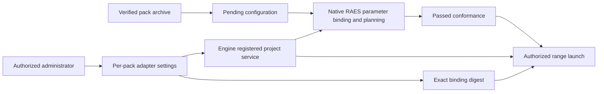

# Registered project inputs for packs

Status: implementation design for issue #2812.

A pack can require `project_id` or `project_number` as native RAES string parameters.
The administrator selects the registered project through the pack adapter's existing `project-id` setting.
Engine supplies the registered project ID and number for that organization.
The archive and its digest do not change when the administrator selects another project.

Upload validates the archive, its identity, and the SDL schema.
Only missing registered-project parameters can defer native planning.
Such an upload records pending conformance and cannot authorize launch.
Other missing required parameters remain errors.

Configuration resolves the selected project in the same organization.
Engine requires a ready registration with its original baseline and verified project number.
CMS runs native conformance with those facts before it saves the binding and passed status.
An unresolved preparation-only adapter has no selectable guest targets.
Adapters that require guests must pass planning before CMS can accept their target selections.

Launch reads the current administrator selection before native planning.
CMS passes only the project parameters declared by the scenario.
Engine checks the selection digest again under the existing range-creation locks.
A changed or removed binding rejects the launch before provider work.
Existing project allocation checks still control exclusive project use.
Cleanup uses the range's retained adapter pin and original project lease.

The shared RAES boundary parses and instantiates scenarios.
CMS owns content authorization, archive verification, and conformance status.
Engine owns registered project facts and adapter binding checks.
No application layer imports another layer's models.
No pack, parameter, or adapter setting grants cloud or installation authority.

Targeted tests cover pending uploads, real configured planning, organization isolation, changed settings, and unchanged archive digests.
Mutation checks must show that missing readiness, organization, or binding-digest checks fail the tests.
