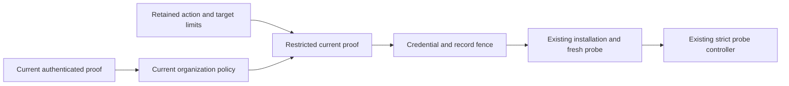

# Runtime adapter authority renewal

An installation retains its initiating proof and admitted permission limits.
After that proof expires, the same principal must authenticate again before an explicit enable or retry.
An expired proof is never authority for the new probe.

The command authenticates the current credential through the existing native boundary.
It checks current organization adapter administration and the installation's original scope.
The initiating principal must remain the same.
The command intersects the current actions and target with the retained limits.
It admits that restricted current proof and checks the original action, owner, and organization again.

Policy checks occur before the SQL transaction.
The locked installation must still carry the inspected credential snapshot.
The existing local credential and scope fence runs before the state change.
The installation's initiating authority stays immutable under its existing SQL guard.
The transaction appends an immutable authority receipt for the new probe identity.
The receipt references the installation and stores only the restricted current reference.
The existing controller revalidates that reference before accepting readiness.
The audit event records safe old and new credential UUIDs.

Executable identity, organization custody, and stale-probe rejection remain authoritative.
A different administrator can reactivate only while the retained proof remains valid; it cannot replace that proof.
Current revocation, denied administration, conflicting targets, or lost original actions prevent renewal.
No bearer secret enters the record, audit event, or worker request.
Receipt updates and deletion are refused by SQL guards.

Tests use real persisted credential records with the existing policy-provider boundary.
They cover expired-session enable and retry, intersected limits, principal substitution, revocation, scope drift, and stale results.
The existing full CI lanes remain the completion authority.
