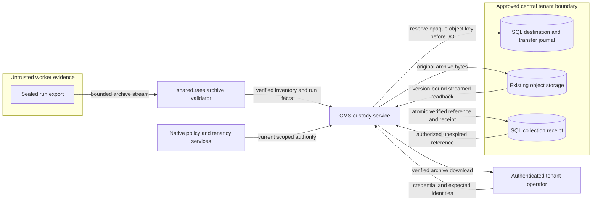

# Trial archive custody

This design implements the boundary in [the intake guidance](experiments-trial-archive-intake-boundary-2740.md).

## Components and contracts

CMS owns organization-scoped destination configuration, transfer journals, and collection receipts.
The existing native content authority protects each operation.
Configuration requires installation content-management authority and organization content-management authority.
Intake and retention require organization content-management authority.
Listing and retrieval require organization content-read authority.
The command authenticates a credential through `credential_from_file`.

`shared.raes` reads one sealed run export.
It uses the producer's `aptl.run-seal/v1` inventory and the installed RAES 10.6.0 contracts.
It accepts no replacement scientific schema.
The archive contains `manifest.json`, `seal.json`, the inventory members, and optionally `checksums.sha256` under one run directory.
The inventory contains the original manifest.
The optional checksum document must describe the exported files exactly.
Regular files and directories are permitted.
Links, special files, ambiguous paths, duplicate members, and undeclared files are rejected.
Tar metadata, file count, compressed bytes, expanded bytes, and retained structured metadata have fixed bounds.
The reader streams large artifacts without filesystem extraction.
JSON documents larger than the record bound are rejected.
JSON traces can contain an object or array through the public bounded parser.
Nested records receive the same ownership and credential checks.
Large traces use bounded JSON chunks, JSON Lines, or other declared artifact streams.
JSON Lines parsing validates each bounded object without retaining the complete trace.
It rejects credential fields and foreign run identities.
It checks declared byte references against the sealed inventory.
Scientific records use the released RAES models and the shared metadata budget.
This rule also applies to scientific records inside JSON Lines containers.
The parser retains each containing line once within that metadata budget.
Inventory media types and scientific record roles select structured validation.
Filename extensions supply a conservative fallback.
An initial bounded scan verifies containment and the inventory.
A second streamed scan validates declared structured formats, including alternate filenames.
Generic structured run, version, and execution-attempt bindings must match retained scientific records.
The checks apply recursively to nested current-run records.
Historical reference objects retain their upstream reference meaning.
Admitted plans use their published validator for other planned entries.
YAML and hydrated SDL use the public RAES fragment loader in literal-key mode.
The loader supplies bounded, safe YAML parsing without resolving imports or executing content.
The same credential and nested ownership checks apply to the parsed data.
The original YAML bytes remain unchanged.

The expected identity contains experiment, plan, entry, run, and execution-attempt identifiers.
It also binds the plan digest, entry digest, and run version.
The experiment identifier selects the plan's study reference, or its authoring-input reference when no study exists.
The archive must contain the admitted plan and its run record.
Released RAES validators join the plan, run, attempt accounting, and cleanup receipts.
The inventory must contain every declared evidence byte reference.
The reader does not fetch URLs or execute retained content.
The original archive remains byte-exact.

## Data flow and trust boundaries

The database stores custody facts, not scientific records.
Each transfer has a fresh opaque object key and a pinned destination policy.
The service reserves that key before upload.
It verifies the stored archive's length and SHA-256 through a version-bound download.
It then rechecks authorization and fences local credential and tenant state.
One SQL transaction publishes the receipt under a unique expected identity.
The uniqueness key includes the run version but excludes admission digests.
Changed admission digests cannot bypass a committed identity's byte conflict.
Concurrent identical deliveries return one receipt.
Different bytes under that identity conflict.
Each losing or interrupted transfer keeps its own recovery record.
No intake call writes another transfer's object.

The executable architecture model is the CMS constraints and the shared archive validator.
The existing layer rules retain CMS ownership and confine RAES imports to `shared.raes`.
ADR-031-R7 governs custody.
No deployment, cloud adapter, environment setting, or worker dispatcher changes are needed.
Configuration is an explicit database record, not an environment fallback.

## Security and failure behavior

| Asset or threat | Boundary and control | Verification |
| --- | --- | --- |
| Restricted prompts and traces | Native read/manage authority precedes SQL discovery and storage access | Denied and foreign-tenant service tests |
| Credentials in evidence | Existing secret-value detection rejects recognizable credential material; structured credential fields are rejected | Synthetic secret and chunk-boundary tests |
| Host files and memory | No extraction; bounded stream and strict path validation | Traversal, links, metadata, truncation, and size tests |
| Mixed or altered records | Released RAES models, joins, closed inventory, SHA-256 | Wrong run, missing chunk, corruption tests |
| Partial upload or lost reply | Journal before storage; immutable unique transfer keys; atomic receipt | Transfer failure, retry, replay, and concurrency tests |
| Revoked permission during upload | Reauthorize and fence before receipt commit | Revocation test |
| Premature deletion | Pinned retention; receipt expiry; explicit tenant-authorized purge | Retention, failed deletion, and tombstone tests |

The producer remains responsible for upstream redaction of opaque binary evidence.
Content scanning cannot prove the absence of all unknown secrets.
Archive bodies and parser errors do not enter logs, audit, or command errors.
Audit records contain opaque transfer identifiers and dispositions.
Collection, evidence coverage, scientific outcome, and resource cleanup remain separate facts.
Missing declared bytes prevent a receipt.
Honest upstream capture loss remains in a successfully collected archive.
Published capture specifications identify required captures.
Absent or empty required capture content adds a coverage gap.
For multiple attempts, accounting references assign evidence to its attempt.
Unassigned evidence cannot satisfy another attempt's capture requirement.
Capture windows and record timestamps preserve the applicable attempt interval.
These time checks also apply to single-attempt archives.
Optional-unavailable records retain their original loss disclosures.

Retention is explicit: keep indefinitely, or expire after a positive number of days.
Policy is pinned when a transfer starts.
Reads stop at expiry, even when physical deletion fails.
Purge affects only recorded, settled objects.
Pending writes remain recovery candidates until their storage outcome is settled.
Finite retention also covers settled duplicate and abandoned transfer objects.
Cleanup marks an expired transfer as `purging` before storage deletion.
That state prevents an active finalizer from publishing a late receipt.
Completed cleanup rows do not consume subsequent cleanup pages.
Receipt tombstones prevent changed bytes from reusing an expired identity.
Storage operators must preserve the retention window through IAM and lifecycle configuration.
Provider versioning can retain deleted versions; the operator owns their approved lifecycle.
This service neither creates storage nor deletes cloud versions outside its recorded custody.

## References and terminology

- [Python 3.14 tarfile](https://docs.python.org/3.14/library/tarfile.html): streaming modes and extraction risks.
- [Django 6.0 transactions](https://docs.djangoproject.com/en/6.0/topics/db/transactions/): short transactions, atomic publication, and row locks.
- [JSON Lines](https://jsonlines.org/): UTF-8 encoding, record separators, and newline rules; this service requires object records.
- [PyYAML documentation](https://pyyaml.org/wiki/PyYAMLDocumentation): safe loading; RAES supplies the existing bounded loader over PyYAML 6.0.3.
- [GCS request preconditions](https://cloud.google.com/storage/docs/request-preconditions): generation-bound reads.
- [Amazon S3](https://docs.aws.amazon.com/AmazonS3/latest/userguide/Welcome.html): object storage and retention responsibility.
- [ASD-STE100 Issue 9](https://www.asd-ste100.org/assets/files/ASD-STE100_ISSUE9.pdf): Part 1 sections 1, 5, 6, and 9.

The prose uses short sentences and consistent technical nouns.
The terminology review uses the official standard, including its technical-name provisions.
