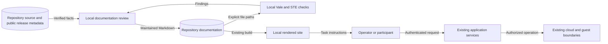

# User guide boundaries

This explanation defines the documentation boundary for issue #2805.
Source revision: `5954ab13763deaba52a257d4ed8bde5bb1402ea6`.
It describes documentation structure, not a deployment qualification.

## Reader routes

Keep the existing MkDocs Material site, automatic navigation, and page URLs.
The documentation home and section indexes route readers by purpose:

| Purpose | Existing destination |
| --- | --- |
| Tutorial | `docs/getting-started/quickstart.md` |
| How-to guide | `docs/features/` and user tasks under `docs/how-to/` |
| Reference | `docs/reference/` and `docs/technical/shifter_platform/` |
| Explanation | `docs/getting-started/concepts.md` and `docs/technical/architecture.md` |

The first-range tutorial starts with an installed, operator-qualified GCP tenant.
It uses the public `smoke-linux` pack, checks visible results, and ends with verified cleanup.
Its source contract does not require an uploaded endpoint agent.
Installation remains an operator task linked from the tutorial.

The catalog guide describes selection, availability, and realizability.
Pack installation stays separate from executable adapter installation and binding.
An accepted pack does not authorize executable code or prove that a range works.

## Source and release boundary

The latest published release checked on 2026-11-09 is `v4.1.1`.
Its source revision is `c04d53db89c522d7437f3f0b508379bb96eaa58b`.
It predates the GCP deployer image.
Current GCP installation instructions must therefore require a later release with verified artifacts.

Do not describe the development branch as a published release.
AWS backend source and contributor deployment instructions do not establish a supported release installation.
No cloud resource is created to validate this prose change.

The current source mounts account and policy administration.
Legacy staff flags, workspace roles, and retained unmounted views do not define current authority.
Guides follow the production router and mounted API composition.
Exact authorization contracts stay in their technical references.
The parked model broker remains unsupported under ADR-068.

## Components and ownership

Reuse the shared documentation package at `v0.1.0`.
The existing installer, Vale rules, STE wrapper, and MkDocs build remain authoritative.
No new tool, service, dictionary copy, generator, or inventory is introduced.
The rewritten-page list records pages that pass the existing writing checks.

| Boundary | Owner and decision |
| --- | --- |
| Reader entry points, first exercise, feature operations, FAQ | #2805 |
| Installation, deployment, provider recovery, NGFW setup | #2806; retain existing page destinations |
| Exact fields, API contracts, scenario authoring, SDK | #2807; link existing technical pages |
| Architecture explanations and historical decisions | #2808; reuse existing explanations |
| Support policy and contributor setup | #2809; preserve existing policies and link them |

Mixed sections stay on their existing page when they help the task.
Long contract or design discussions link to their existing owner-maintained destination.
No page move or redirect is required.
Existing heading links remain when their topic remains useful.

## Data flows and security

Text alternative: local review compares source and release facts with maintained Markdown.
Local tools check and render that Markdown.
Readers follow it through the application's existing authenticated operations.
The documentation build sends no application request and provisions no cloud resource.

The repository-to-public-site boundary permits only public, synthetic examples.
Private pack details, credentials, personal data, and operational evidence stay outside this change.
Credential instructions keep secrets out of URLs, logs, command arguments, and screenshots.
Source inspection checks permission prerequisites before each sensitive task.
Cleanup instructions distinguish requested teardown from verified resource absence.
This prevents an accepted request from being presented as completed destruction.

Tools run locally with the dictionary and remote analyzer disabled.
Publication remains the existing reviewed GitHub workflow.
No preview hosting or external text processing is needed.
Live release availability and provider behavior remain external dependencies.
The guides state those limits rather than infer support from source tests.

## Architecture and policy checks

ADRs 002, 004, 022, 038, 055, 066, 068, and 069 continue to apply.
No runtime interface, deployment model, trust boundary, or architecture rule changes.
The existing ADR registry, coverage manifest, and CI jobs need no new rule or exception.
The existing architecture handbook supplies runtime DFDs and component diagrams.
The diagram above covers the documentation data flow.
Additional deployment or state diagrams would repeat unchanged runtime contracts.

Vale and the three configured STE checks protect writing structure.
MkDocs checks rendering and source links.
Targeted frontend tests check the documented controls and error paths.
Human review checks purpose, meaning, heading order, and the rendered reader route separately.
These checks do not establish full STE vocabulary conformance or live-cloud acceptance.
No production function changes, so mutation testing of runtime code has no changed target.

## Reference evidence

| Source | Version or section | Application |
| --- | --- | --- |
| [Diataxis tutorials](https://diataxis.fr/tutorials/) | Current guidance; visible results and a bounded lesson | First-range tutorial |
| [Diataxis how-to guides](https://diataxis.fr/how-to-guides/) | Current guidance; goal-oriented tasks | Feature and troubleshooting guides |
| [Official STE guidance](https://www.asd-ste100.org/about.html) | Public writing rules and technical names | Meaning, terminology, and sentence review |
| [MkDocs authoring](https://www.mkdocs.org/user-guide/writing-your-docs/) | File layout, automatic navigation, internal links | Preserve page paths and use Markdown links |
| [Published release](https://github.com/OpenRAE/bigrae/releases/tag/v4.1.1) | Release metadata and tagged source | Separate release evidence from current source |

The official STE page was read directly over HTTPS after the browsing service returned HTTP 403.
Its public guidance is not a copy of the full specification or dictionary.
