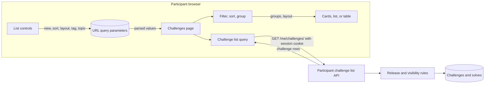

# Challenge list layout (#3012)

Status: accepted design, 2026-11-23. This note applies ADR-029 and ADR-055.
It extends the [list views design](ctf-challenge-list-views-2998.md).
[The preflight note](ctf-challenge-layout-preflight-3012.md) gives the boundaries and invariants.

## Decision

The participant **Challenges** page shows the challenge list as cards, as a list, or as a table.
The participant selects the layout with a **Layout** button group.
The layout changes only the presentation of each group.
It does not change the filter, the sort, the grouping, or the row order.
The URL query parameter `layout` holds the selection, as the other list controls do.
The API, the serializers, and the server authorization do not change.

## Existing coverage

`ChallengesPage.tsx` shows each group as a grid of cards.
`challenge-list.ts` parses the `view`, `sort`, `tag`, and `topic` parameters with closed allowlists.
`ChallengeListControls.tsx` shows the **View** button group and the sort selector.
`components/ui/table.tsx` supplies the shared table elements that other CTF pages use.

## Architecture

| Component | Change |
| --- | --- |
| `features/ctf/challenge-list.ts` | Adds the `layout` allowlist and its parser. `readListView` returns the parsed layout. |
| `features/ctf/ChallengeListControls.tsx` | Adds the **Layout** button group. |
| `features/ctf/ChallengeListLayouts.tsx` | New component. It shows one group of challenges in the selected layout. |
| `features/ctf/ChallengesPage.tsx` | Reads and writes the `layout` parameter. Uses the new component for each group. |
| `e2e/a11y/matrix.ts`, `e2e/a11y/axe.spec.ts` | Adds the list and table layouts to the ADR-055 browser scan. New `list` and `table` readiness kinds find the element by role and accessible name, so the scan waits for the requested layout. |

### Query parameter

| Parameter | Values | Default | Effect |
| --- | --- | --- | --- |
| `layout` | `cards`, `list`, `table` | `cards` | Shows each group as cards, as a list, or as a table. |

An unknown `layout` value gives the default.
The page writes the default value as an absent parameter.
A layout change replaces the current history entry, as the other controls do.

### Layouts

| Layout | Element | Content of each challenge |
| --- | --- | --- |
| Cards | Grid of links | Name, solved badge, points, difficulty |
| List | One list, one row for each challenge | Name, solved badge, points, difficulty |
| Table | One table for each group | Columns: challenge, category, difficulty, points, status |

The page renders only the selected layout.
Each challenge name is a link to the challenge page.
Each link keeps the list query parameters, which include `layout`.
The list and the table have the group heading as their accessible name, or **All challenges** for the single list.

The table has a caption with that name and column headers with `scope="col"`.
The table status column shows **Solved**, **Solved by your team**, or **Not solved**.
A blank difficulty shows a dash in the table.
Long challenge names wrap in the table.
The table container scrolls horizontally on a narrow viewport.

The challenge page **Previous** and **Next** buttons do not change.
The layout does not change the row order, so the sequence stays the same in each layout.

### Failure behavior

| Condition | Outcome |
| --- | --- |
| The URL has an unknown `layout` value | The page uses the card layout. |
| The filters match no challenge | The page shows the existing empty message and keeps the controls. |
| The list read fails | The page shows its existing error state. |

## Systems security engineering

| Asset | Threat | Control | Verification |
| --- | --- | --- | --- |
| Unreleased or locked challenges | A layout shows a challenge that the API did not return | Each layout shows only the rows that `readListView` returns from the API response. | Page tests that use only the returned rows in each layout. |
| Page state | A crafted `layout` value causes an error or injects markup | A closed allowlist with a default fallback. The page does not render the raw value. | Unit test and page test for an unknown value. |
| Browser page | Challenge text injects markup in the table | React escapes text content. The table renders the API fields as text only. | Existing markup-like value test pattern; no new HTML sink. |

Residual risk: the `layout` value appears in browser history and in server access logs.
It is a fixed layout name, not a credential.

## Data flows

Trust boundaries: browser to portal, and portal to database.
The `layout` parameter does not cross the browser boundary.
It carries no principal, tenant, permission, or scoring input.

## Policy and architecture as code

- The API schema, `openapi/v1.json`, and `schema.d.ts` do not change.
- `NON_API_ROUTE_POLICY` does not change, because the page path does not change.
- Import boundaries, deployment configuration, and ADR rules do not change.
- The ADR-055 surface matrix adds two states of the existing challenge list surface.

## References

| Source | Section | Use |
| --- | --- | --- |
| <https://www.w3.org/WAI/ARIA/apg/patterns/button/> | About This Pattern: toggle button | The layout buttons use `aria-pressed` and fixed labels. |
| <https://www.w3.org/WAI/tutorials/tables/one-header/> | Table with header cells in the top row only | The table uses a caption and column headers. |
| <https://developer.mozilla.org/en-US/docs/Web/HTML/Reference/Elements/table> | Accessibility: Captions; Scoping rows and columns | The caption names the group. Headers use `scope="col"`. |
| <https://reactrouter.com/api/hooks/useSearchParams> | `useSearchParams` (v8) | Reads and writes the `layout` parameter. |

## Non-goals

Saved layout preferences, column sort in the table, organizer list changes, and new API fields.
