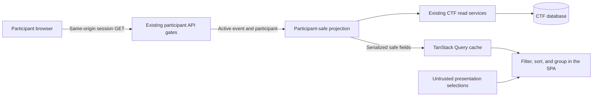

# Participant challenge list: architecture preflight (#2998)

Status: pre-implementation guidance, 2026-11-22, at revision `fb15c90d5b95c367e87840cd53c4315c174a2f32`.
The supplied issue #2998 is the delivery contract. No formal requirement is attached.
This explanation records design constraints, not implementation or deployment evidence.

## Decision and scope

Keep filtering, sorting, and view selection in the participant SPA.
`useCtfChallenges` already reads the complete participant-safe array from `GET /api/v1/ctf/me/challenges/`.
The response supplies every field needed for this issue; no endpoint, database column, or response schema is missing.
Existing tag/topic filters already satisfy part of the acceptance criteria.
Preserve those filters and add participant-selectable ordering and a view separating solved from not-solved challenges.

Retain category grouping as the default view and provide solve-state grouping as another view.
A status filter alone does not provide that grouped view.
The existing cards can serve both views; separate grid/table layouts are unnecessary for acceptance.
The issue does not prescribe the sort menu. A small choice of default and alternate ordering is sufficient.
Name or points can supply an alternate order without requesting additional data.

Existing ADR-001 service boundaries, ADR-028 solve privacy, ADR-029 SPA conventions, ADR-040 API publication, and ADR-055 accessibility cover this change.
ADR-066 governs credential and event authority. No new ADR or enforcement exception is needed.

## Concepts and invariants

| Concept | Owner and meaning |
| --- | --- |
| Available challenges | Server service `get_available_challenges`: same event, live rows, released, not hidden, and prerequisites met for this participant. |
| Personal solve | Server projection `solved`: a correct submission by this participant, independently of awarded points. |
| Team solve | Server projection `team_solved`: a correct submission by a current teammate in this event, only in team mode. It can include the viewer. |
| Displayed solve state | `solved OR team_solved`, matching existing badges and the page total. Preserve the distinct personal/team badge wording. |
| Filter | Narrows already available entries. Existing tag and topic selection combine with AND through `filterByLabels`. |
| Sort | Orders entries inside the selected view's groups; labels must make that scope clear. It never changes authored `order`. |
| View | Changes grouping of the same filtered entries. It does not change event mode, scoring, eligibility, or authority. |

The following predicates are suitable verification oracles; `IDs` returns the set of entry identifiers:

```text
A = entries returned by the participant list endpoint
F = entries after presentation filters
IDs(F) is a subset of IDs(A)
S = {c.id for c in F where c.solved OR c.team_solved}
U = {c.id for c in F where NOT (c.solved OR c.team_solved)}
S intersect U = empty; S union U = IDs(F)
IDs after sorting or regrouping = IDs(F), with each ID appearing exactly once
Header solved count = count of solved OR team_solved over A
```

Use one presentation predicate for solve membership and totals.
Do not derive completion from scores, submission counts, rankings, prerequisites, or another participant's history.
Team completion is not prerequisite satisfaction: the existing availability service checks the viewer's own correct submissions.
Locked challenges can remain readable; not-solved does not mean locked or unavailable.
Preserve the read predicate, which admits disqualified viewers, separately from compete eligibility.

Default ordering retains the existing category comparator, authored challenge order, and name fallback.
Do not expand category-name special cases or interpret authored names as scenario identities.
Alternate comparators need deterministic ties, ending with the challenge ID when other values match.
Never sort the Query cache array in place.

The extension seam belongs in this feature: explicit view and sort selections, with the selected comparator used by grouping.
Do not leave `groupByCategory` silently re-sorting every selection by authored order.
Use small typed choices and ordinary functions; a configurable list framework or registry would add no value.
If difficulty sorting is selected, use the domain order in `ctf.enums.ChallengeDifficulty`, not alphabetical ordering.
Blank or unknown display values need a defined fallback, without another domain validator.

## Data flow and cross-cutting layers

Paths below are relative to `shifter/shifter_platform/` unless stated otherwise.



The server remains the disclosure boundary. Browser controls receive no authority and never broaden the response.
There is no new host process, outbound destination, worker, or persistence boundary.

| Layer and canonical incumbent | Required behavior |
| --- | --- |
| Browser routes and temporary accounts: `frontend/src/features/ctf/routes.ts`, `router.tsx`, `ctf/urls.py`, `shared/spa_host.py`, `config/middleware.py` | Retain the existing participant route and `CTFAccountBoundaryMiddleware`, including live-account and forced-password-change checks. No new route prefix, sidebar, or permission flag is needed. |
| Authentication and participant resolution: `config/_drf_settings.py`, `shared/api_tokens/authentication.py`, `shared/api/principals.py`, `ctf/api/_base.py`, `ctf/api/participant_views.py` | Reuse bearer-first fail-closed authentication, native session references, `CTF_PARTICIPANT_PERMISSIONS`, `CTF_PLAY_READ`, and `_resolve_active_participant`. Preserve exact active-event resolution and viewing eligibility. Filters never accept another participant or event as authority. |
| Native event policy: `ctf/api/operation_policy.py`, `ctf/services/principal_participation.py`, `ctf/services/unified_authorization.py` | Retain the registered `event.participate` action and active-event scope. Any backend expansion must reuse current credentials, exact event scope, credential ceilings, and the owning participation service. Operation inventories describe coverage; current service admission establishes authority. |
| Availability and persistence: `ctf/services/challenge/_challenge_read.py`, `_access.py`, `_prerequisites.py`, `ctf/models/_base.py` | Keep service-owned visibility, release time, prerequisites, read/write distinctions, and soft-delete managers. No new repository, ORM query in presentation, browser visibility policy, preference table, or read-triggered write. |
| Projection and response shape: `ctf/api/projections.py`, `ctf/api/serializers/participant.py` | Reuse `participant_challenge_list`, `_team_solved_challenge_ids`, and `ParticipantChallengeListItemSerializer`. No flags, solutions, validator configuration, raw submissions, member identities, or organizer payloads enter the list. |
| Wire types and parsing: `frontend/src/api/types.ts`, `schema.d.ts`, `shared/api/schema.py`, `shared/api/contract.py` | Use generated `CtfChallengeListItem`; do not create another DTO or runtime response schema. This `APIView` explicitly returns an array, despite global DRF pagination/filter defaults. Those defaults do not automatically filter or paginate it. |
| Transport and cache: `frontend/src/api/client.ts`, `csrf.ts`, `ctf.ts`, `queryClient.ts` | Use `apiFetch`, same-origin cookies, guarded paths, request IDs, AbortSignal, bounded GET retries, and mutation no-retry behavior. Retain `ctfKeys.challenges()` for the server data; local sort/view choices do not change the request or cache key. |
| Presentation input: `ChallengesPage.tsx`, `label-filters.tsx`, `ScenarioListPage.tsx`, `ctf/inbox/InboxPage.tsx` | Reuse `distinctLabels`, `filterByLabels`, and `LabelFilterRow`; the organizer list shares them. Keep new state local to the participant feature. If URL state is chosen, use React Router/URLSearchParams, allowlisted choices, and safe defaults for invalid values. No arbitrary property paths, evaluated expressions, or regular expressions from input. |
| Rendering and browser policy: shared `components/ui/*`, `config/_browser_security.py`, `frontend/vite.config.ts` | Reuse accessible Select/Button/Card controls, semantic sections, focus styles, and React text escaping. No raw HTML, inline event attributes, external scripts, extra dependency, or CSP relaxation. Preserve Django/WhiteNoise's image-time static bundle. |
| Exceptions and observability: `shared/api/errors.py`, `shared/errors.py`, `ctf/exceptions.py`, `frontend/src/api/errors.ts`, `config/logging.py`, `shared/log_sanitize.py` | Keep existing typed errors, safe error envelopes, request correlation, and sanitization. Do not convert failed reads into an empty list or expose raw errors. No new exception hierarchy, filter audit trail, per-click logging, response-body logging, or telemetry service. |
| Configuration, secrets, and OS exposure: `config/env-manifest.json`, repository `.shifter.yaml`, existing deployment renderers | This feature adds no setting, environment binding, secret, CLI input, subprocess, file upload, or infrastructure artifact. Therefore no new config shape or OS argument passes those validators. Keep credentials and private data out of URLs, storage, logs, and process arguments. |

This presentation change makes no new authorization or service-principal support claim.
Adding an API path or participant resolver would require a separate review of the credential and service boundaries.
URL query parameters reach the page host on direct loads and can appear in same-origin referrers or access logs.
Keeping them out of the challenge API request does not make them private browser storage.
Treat free-text URL state as nonsensitive and avoid recording its values in application diagnostics.

## Integration risks and verification obligations

- `invalidatePlay` already refreshes the challenge list after submission and hint mutations. Keep that ownership in `api/ctf.ts`.
- `useTeamMutation` currently invalidates only team and current-event reads. Membership changes can therefore leave `team_solved` stale. Refresh the existing challenge key there when membership changes affect the displayed partition.
- `CtfWorkspaceLayout` already invalidates CTF reads for generic live hints. Recompute derived views when Query data changes; do not persist a copied challenge list.
- Live hints are optional, and this list has no polling interval. Do not promise immediate teammate progress or add another socket, timer, or scoring workflow.
- Derive filter choices from the full authorized response so active controls remain available after filtering. Keep controls usable when no entries match.
- Distinguish loading, load failure, no available challenges, and no filter matches. Preserve the overall solved total; label any additional filtered count explicitly.
- Keep blank-category fallback and original category identity separate from formatted heading text. Equal display labels must not cause lost entries or duplicate keys.
- Local selections need no durable storage. Do not persist participant progress, challenges, or credentials in browser storage. Reset context-specific selections if an active event changes without remounting.

Extend `frontend/src/features/ctf/ChallengesPage.test.tsx` using `renderRoute` and the existing API-boundary mock.
Verify combined tag/topic filtering, selectable order, both views, ties, empty results, personal/team/both/neither solves, and refetched solve transitions.
Assert the partition invariants, unchanged input arrays, stable links, default category order, and continued access to filter controls.
Cover canonical mutation invalidation if the team-cache gap is changed.
Use synthetic fixtures only, including adversarial names rendered as text.

Reuse `tests/ctf/test_participant_api.py` for projection/privacy evidence and `test_challenge_release.py` for availability behavior.
The preflight does not change those services; do not add duplicate tests for unchanged backend rules.
If backend behavior changes, retain their hidden/unreleased, event-isolation, and team-mode checks.

The existing component axe test does not exercise the new controls or every view.
The browser matrix at `frontend/e2e/a11y/matrix.ts` currently has no explicit challenge-list entry.
Cover this page and its new states through that matrix and existing Playwright/CSP support, without a parallel accessibility runner.
Verify keyboard selection, visible labels and focus, selected-state semantics, mobile layout, and meaningful empty groups without color-only cues.
Reuse `e2e/support/actors.ts` and the existing synthetic seed; do not use real participant sessions or upload authenticated traces.

Run targeted component/integration checks locally; CI owns full suites and coverage floors.
Use focused mutation checks for the solve predicate and sort direction/ties when implementation tests exist.
Do not add a mutation framework for this documentation-only preflight.
Preserve the canonical checks in `docs/dev/testing.md` and `.github/workflows/_quality.yml`.
API changes, if separately justified, require `npm run gen:api` and ADR-040 drift/compatibility checks; never hand-edit generated schemas.

At this baseline, the full ADR guard reports four ADR-019 boundary-mock violations in `tests/mission_control/test_guacamole_bootstrap_prune_heartbeat.py`.
That file is unchanged by this preflight. The documentation-scoped guard, Vale, and STE checks pass.

## Non-goals and implementation boundaries

This issue does not change scoring, team attribution, prerequisites, release scheduling, participant eligibility, or organizer administration.
It does not expose another participant's solve history or add search analytics, exports, saved views, or preferences.
Do not broaden private scenario knowledge or add category/scenario-specific behavior.
Avoid a generic list engine, global state store, duplicate fetch client, parallel API, or new validation/exception system.

Client-side transformation depends on the endpoint remaining a complete array.
If list scale later requires pagination, filtering/sorting/group counts must operate on the full authorized collection before pagination.
That future change belongs in the existing API/service contract, with generated types and query keys updated together.
Silently filtering one fetched page cannot satisfy the current list semantics.
