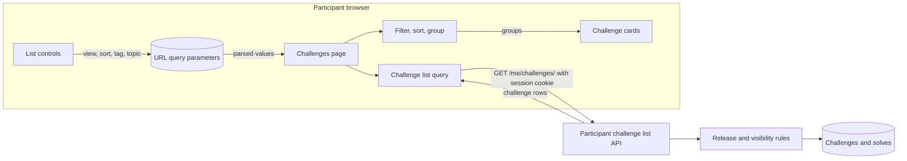

# Challenge list filter, sort, and views (#2998)

Status: accepted design, 2026-11-22. This note applies ADR-013 and ADR-055.
[The preflight note](ctf-challenge-list-preflight-2998.md) gives the boundaries and invariants.

## Decision

The participant **Challenges** page filters, sorts, and groups the challenge list in the browser.
The existing list API already returns each field that these controls use.
The API, the serializers, and the server authorization do not change.
The page keeps its control state in URL query parameters.
Thus the state stays when the participant opens a challenge and goes back.

## Existing coverage

`ChallengesPage.tsx` groups challenges by category and filters by one tag and one topic.
`label-filters.tsx` supplies the tag and topic filter, which the organizer list also uses.
The page has no sort control and no other grouping.
The tag and topic filter state is component state, so it resets after navigation.

## Architecture

| Component | Change |
| --- | --- |
| `features/ctf/challenge-list.ts` | New pure module. It parses the query parameters, sorts, and groups. It does not change its input arrays. |
| `features/ctf/ChallengeListControls.tsx` | New component. It shows the view buttons and the sort selector. |
| `features/ctf/ChallengesPage.tsx` | Reads and writes the query parameters. Applies the module functions. Moves category ordering into the module. |
| `features/ctf/label-filters.tsx` | No change. The page passes the tag and topic values from the URL. |
| `api/ctf.ts` `useTeamMutation` | Also refreshes the challenge list. A team change can change `team_solved`. |
| `e2e/a11y/matrix.ts`, `e2e/a11y/axe.spec.ts` | Adds the challenge list surface to the ADR-055 browser scan. A new exact-text readiness assertion makes the scan wait for the loaded list, because the heading also shows during loading. |

### Query parameters

| Parameter | Values | Default | Effect |
| --- | --- | --- | --- |
| `view` | `category`, `status`, `all` | `category` | Groups by category, by solved state, or shows one list. |
| `sort` | `order`, `name`, `points-asc`, `points-desc`, `difficulty` | `order` | Sorts the challenges in each group. |
| `tag` | Free text | None | Shows challenges with this tag. |
| `topic` | Free text | None | Shows challenges with this topic. |

An unknown `view` or `sort` value gives the default.
The page writes a default value as an absent parameter.
Each control change replaces the current history entry, so the back action leaves the page.

### Views

| View | Groups | Group order |
| --- | --- | --- |
| By category | One group for each category | **Start Here**, then missions in number order, then other categories by name |
| By status | **Not solved** and **Solved** | Not solved first |
| All | One unlabeled list | Not applicable |

A challenge is solved when `solved` or `team_solved` is true.
The header count uses the same rule.
The page omits an empty group.

### Sort keys

| Key | Order | Ties |
| --- | --- | --- |
| `order` | Server `order`, low to high | Name, then ID |
| `name` | Name, by locale | Server `order`, then ID |
| `points-asc` | Points, low to high | Server `order`, name, then ID |
| `points-desc` | Points, high to low | Server `order`, name, then ID |
| `difficulty` | `easy`, `medium`, `hard`, `expert`, then other values | Server `order`, name, then ID |

The sort applies in each group. The selector label states this scope.
The difficulty order comes from `ctf.enums.ChallengeDifficulty`.

### Failure behavior

| Condition | Outcome |
| --- | --- |
| The filters match no challenge | The page shows the "No challenges match this filter" message and keeps the controls. |
| The event has no released challenge | The page shows the "No challenges available yet" message. |
| The URL has an unknown `view` or `sort` value | The page uses the default value. |
| The URL has a `tag` or `topic` value that no listed challenge has | The page ignores the value, so no hidden filter applies. |
| The list read fails | The page shows its existing error state. |

## Systems security engineering

| Asset | Threat | Control | Verification |
| --- | --- | --- | --- |
| Unreleased or locked challenges | A query parameter shows a challenge that the API did not return | The page only filters and reorders the API response. The list API keeps its release and visibility rules. | Existing API tests. Page tests that use only the returned rows. |
| Browser page | A crafted `tag` or `topic` value injects markup | The page compares the values as strings. It does not render them, and it does not build HTML or URLs from them. | Page test with a markup-like tag value. |
| Page state | A crafted `view` or `sort` value causes an error | A closed allowlist with a default fallback. | Unit tests for unknown values. |
| Solve state | A stale cache shows a wrong solved group after a team change | Team mutations refresh the challenge list query. | Hook test for the team mutation. |

Residual risk: the query parameters appear in browser history and in server access logs.
They contain only view names and label values, not credentials.
The list has no polling, so a teammate's solve shows after the next refresh.

## Data flows

Trust boundaries: browser to portal, and portal to database.
The query parameters do not cross the browser boundary.
They carry no principal, tenant, permission, or scoring input.

## Policy and architecture as code

- The API schema, `openapi/v1.json`, and `schema.d.ts` do not change.
- `NON_API_ROUTE_POLICY` does not change, because the page path does not change.
- Import boundaries, deployment configuration, and ADR rules do not change.

## References

| Source | Section | Use |
| --- | --- | --- |
| <https://reactrouter.com/api/hooks/useSearchParams> | `useSearchParams` (v8) | Reads and writes the query parameters. |
| <https://developer.mozilla.org/en-US/docs/Web/JavaScript/Reference/Global_Objects/Array/sort> | Sort stability | Stable sort keeps equal keys in input order. |
| <https://www.w3.org/WAI/ARIA/apg/patterns/button/> | About This Pattern: toggle button | The view buttons use `aria-pressed` and fixed labels. |
| <https://cheatsheetseries.owasp.org/cheatsheets/Input_Validation_Cheat_Sheet.html> | Allowlist validation | Closed sets for `view` and `sort`. |

## Non-goals

Server-side filtering or sorting, name search, saved preferences, organizer list changes, and new API fields.
