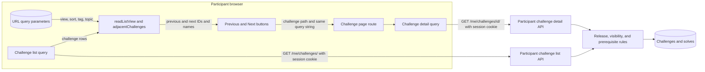

# Challenge previous and next navigation (#2999)

Status: accepted design, 2026-11-23. This note applies ADR-013 and ADR-055.
It replaces the neighbor-source decision in [the preflight note](ctf-challenge-navigation-preflight-2999.md).
The other preflight boundaries stay in effect.

## Decision

The participant challenge page shows a **Previous** button and a **Next** button.
The buttons move through the challenges in the order that the **Challenges** list shows.
The default list order is the chain order: **Start Here**, then missions in number order, then other categories.
In each category, the authored challenge `order` applies.
When the participant selects another view, sort, tag, or topic, the buttons follow that order.

The browser calculates the neighbors from the participant challenge list response.
The API, the serializers, and the server authorization do not change.

## Reason for the browser decision

The preflight note recommends server neighbors in the service order `category`, `order`, `name`.
That order sorts category names as text.
Thus the category "Mission 10" comes before the category "Mission 2." The category "Start Here" comes after the missions.

That order does not agree with the chain order that the list shows.
A copy of the list category rules in Python would give two owners for one rule.
The list module already owns that rule and the participant sort choices.

The preflight note also records an event scope difference.
The list API reads the active event. The detail API reads the event of the requested challenge.
The browser design closes this gap with a membership check.
When the current challenge is not in the list response, both buttons are disabled.
Thus a button never opens a challenge from another event.

## Existing coverage

`challenge-list.ts` parses the list query parameters, sorts, and groups the list.
`ChallengesPage.tsx` holds the list state in the URL query parameters.
`ChallengeDetailPage.tsx` has a breadcrumb link to the list and no sequence navigation.
`useCtfChallenges` reads the list. Submissions and hint unlocks refresh that query.

## Architecture

| Component | Change |
| --- | --- |
| `features/ctf/challenge-list.ts` | Adds `readListView`, which applies the query parameters to the list rows. Adds `adjacentChallenges`, which finds the neighbors of one challenge in the shown order. |
| `features/ctf/ChallengesPage.tsx` | Uses `readListView`. Each challenge card link keeps the list query parameters. |
| `features/ctf/ChallengeDetailPage.tsx` | Adds a labeled navigation region with the two buttons. The breadcrumb link, the prerequisite links, and the buttons keep the list query parameters. The page body has the challenge ID as its React key. |
| `ctf/management/commands/seed_e2e_ctf.py` | Adds two released synthetic challenges with fixed IDs for the browser scan. |
| `e2e/a11y/matrix.ts` | Changes the list surface to a loaded list. Adds the loaded challenge page surface. |

### Neighbor rules

For the shown sequence `A` and the index `i` of the current challenge:

| Condition | Previous | Next |
| --- | --- | --- |
| `0 < i < length(A) - 1` | `A[i - 1]` | `A[i + 1]` |
| `i = 0` | Disabled | `A[1]`, or disabled for one challenge |
| `i = length(A) - 1` | `A[i - 1]` | Disabled |
| The current challenge is not in `A` | Disabled | Disabled |
| The list is loading, or the list read or refresh failed | Disabled | Disabled |

The sequence does not wrap.
The shown sequence is the list groups in their shown order, as one list.

### State reset

React keeps component state when only the route `:id` changes.
The page body therefore has the challenge ID as its key.
A change of challenge resets the flag input, the submission result, the hint dialog, and the mutation state.
A background refresh of the same challenge keeps this state.

### Failure behavior

| Condition | Outcome |
| --- | --- |
| The list read or a list refresh fails, or the list is loading | The buttons show and are disabled. The page ignores cached rows after a failed refresh. The rest of the page works. |
| The URL has a filter that excludes the current challenge | The buttons are disabled. The breadcrumb link opens the filtered list. |
| A solve or an unlock changes the list | The list query refreshes, and the buttons use the new order. |
| The destination is no longer readable | The destination read returns its existing 403 or 404 page. |

## Systems security engineering

| Asset | Threat | Control | Verification |
| --- | --- | --- | --- |
| Unreleased, hidden, or prerequisite-gated challenges | A button discloses a challenge that the participant cannot read | Neighbors come only from the list response. The list API keeps its release, visibility, and prerequisite rules. | Page test: neighbors are only rows from the list response. |
| Event isolation | A button opens a challenge from another event | A missing current challenge disables both buttons. There is no fallback to the first row. | Page test: a challenge that is not in the list has two disabled buttons. |
| Destination authorization | A cached neighbor bypasses a later denial | A button is a link only. The destination detail read applies its existing gates. | Existing detail API tests. |
| Flag input and results | A flag or a result shows on another challenge | The page body has the challenge ID as its key. | Page test: typed flag text does not stay after navigation. |
| Browser page | A crafted query parameter injects markup or changes the link target | The page compares the parameters with allowlists and labels. The link path comes from the challenge ID. The page forwards the query string only. | Unit tests for unknown values. Page test for the link targets. |

Residual risk: the list has no polling, so an organizer change shows after the next list refresh.
In the **By status** view, a solve moves the challenge to the **Solved** group, so the next challenge changes.
The query parameters show in browser history and in server access logs. They contain only view names and label values.

## Data flows

Trust boundaries: browser to portal, and portal to database.
The query parameters do not cross the browser boundary as authority.
They carry no principal, tenant, permission, or scoring input.

## Policy and architecture as code

- The API schema, `openapi/v1.json`, and `schema.d.ts` do not change.
- `NON_API_ROUTE_POLICY` does not change, because the page paths do not change.
- Import boundaries, deployment configuration, and ADR rules do not change.
- `seed_e2e_ctf` releases two synthetic challenges with fixed IDs in the E2E event.
- The ADR-055 matrix scans the loaded list and the loaded page of the first challenge.
- The page scan waits for the name of the next challenge, which shows only in the loaded **Next** link.

## References

| Source | Section | Use |
| --- | --- | --- |
| <https://reactrouter.com/api/components/Link> | `to` (v8) | Link targets with a path and a query string. |
| <https://reactrouter.com/api/hooks/useSearchParams> | `useSearchParams` (v8) | Reads the list query parameters. |
| <https://react.dev/learn/preserving-and-resetting-state> | Resetting state at the same position | The challenge ID key resets the page state. |
| <https://design-system.service.gov.uk/components/pagination/> | Pagination for a sequence of related pages | A labeled navigation region with previous and next links and the neighbor names. |

## Non-goals

Server neighbors, authored `next_challenge` traversal, automatic advance after a solve, keyboard shortcuts, organizer pages, and new API fields.
