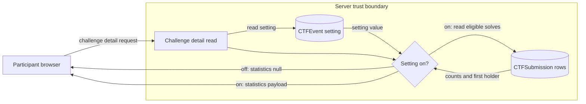

# Challenge statistics visibility

Issue #522 uses the existing participant and organizer challenge detail pages. CTF-013 places organizer administration in Mission Control. CTF-407 defines four statistics and the 30-second refresh bound. This preflight describes the design against revision `ac074ac13`. [Administration](../requirements/CTF-013/requirement.md) · [Challenge statistics](../requirements/CTF-407/requirement.md)
The [earlier preflight](../_deprecated/architecture/ctf-challenge-statistics-preflight-539.md) predates the current API and React pages.

## Event setting and access

Keep one non-null Boolean on `CTFEvent`. Default it to false for existing and new events, preserving the current participant disclosure policy.
Use the organizer event form for creation and editing. Label the control so organizers know it publishes live counts and the first solver's display name.
Scoreboard visibility, freeze, rating visibility, team mode and notification settings govern separate features.

| Boundary | Contract |
| --- | --- |
| Browser to event API | Use `EventFormPage`, `eventFormState`, and same-origin `apiFetch` with CSRF on session writes. Read the saved value through `EventDetailSerializer`. Preserve explicit false and preserve the stored value on partial PUT when omitted. |
| Validation and storage | Keep the UUID routes, `ConfigurationJSONParser`, supported form parsers, and the closed `EventWriteSerializer`. Use its existing Boolean field pattern. Include the field in `_EVENT_MUTABLE_FIELDS` for both writers. Use the ordinary Django migration and `CTFBaseModel.save` validation. |
| Write authority | Creation uses `create_event_for_credential` under the selected parent. Updates require the event write scope for tokens and `event.manage_config`. Preserve `update_event` admission, event row lock, lifecycle checks and the existing atomic mutation audit. Keep Django admin from becoming a second writer. |
| Organizer read | `ChallengeDetailView` resolves the challenge through `_resolve_owned_challenge` and checks `event.manage_challenges`. Preserve the `ctf:event:read` token scope. Show all four metrics for every readable event state, including after the event ends, regardless of the participant setting. |
| Participant read | Use `ParticipantChallengeDetailView`, `CTF_PARTICIPANT_PERMISSIONS` and the `ctf:play:read` token scope. Bind the current credential to the **challenge's event** with `viewing_participant_for_credential`. Retain `assert_challenge_readable_for_participant` before disclosure. Locked challenges allow reads. Hidden, unreleased and prerequisite-gated challenges do not. |

The operation inventory in `ctf/api/operation_policy.py` records the intended action. The read must enforce the credential ceiling and event policy on each refresh. A user with memberships in two events can present a token restricted to one.

Preserve temporary-account restrictions, event isolation and existing error responses. The challenge read gate currently also excludes disqualified viewers, although general viewing admission permits them.
Test this distinction explicitly. Publishing statistics must never grant extra access to hints, solutions, targets or submissions.

## Metric and disclosure contract

Use `ctf.services.scoring.get_challenge_statistics` for both audiences. Its denominator already includes the entire live event roster, including idle invitees.
Return `solve_rate` as a fraction, with zero for an empty roster. Format it once as a percentage in the browser.
`total_attempts` counts persisted attempts, including incorrect submissions. The detail page's existing `attempt_count` belongs to the viewer.

The database permits one live correct submission per participant and challenge through `ctf_unique_correct_submission`.
The current statistics service counts every live correct submission. CTF-609 excludes disqualified solves from statistics and permits reinstatement. Apply that rule to the numerator and first-blood selection while preserving attempt history. [Participant disqualification](../requirements/CTF-609/requirement.md)

Restrict credited solves to the challenge's event and reuse `eligible_participant_q("participant__")` for scoring eligibility. The submission manager alone cannot filter a soft-deleted participant across a join. Keep the full event roster as the denominator.

The current first-blood lookup orders by `submitted_at` alone. Use submission `id` to break ties, as the team-attribution query does.
Select only the fields needed from the earliest qualifying correct submission.
Keep the counts and holder consistent when a submission or moderation change commits during a read.

The organizer difficulty analysis in `_event_analytics.py` uses the *ranked* roster. Its rate answers a different question.
Team attribution, dynamic scoring and first-blood notification delivery each have their own rules.

Share one nested statistics serializer between `ParticipantChallengeDetailSerializer` and `OrganizerChallengeDetailSerializer`.
Gate its construction in `participant_challenge_detail` on the stored event value. Add the same safe shape to the organizer's `_challenge_detail_payload`.
With disclosure off, return a null statistics field and skip the aggregate query. With disclosure on and no solves, return real counts and null first blood.

Publish only the first holder's event display name for attribution. Render it as text. Keep ADR-028 solve histories private and ADR-072 notifications content-limited.
The organizer view returns a payload dictionary directly. Its schema annotation alone cannot filter runtime fields. Never serialize a participant, submission or organizer detail wholesale.

Keep `_CtfApiError`, `api_error_response` and the shared DRF exception handler. Preserve controlled denial, missing-resource and dependency-failure envelopes with request correlation.
A missing challenge or failed policy check cannot become successful zero statistics. Keep flags, credentials, IP addresses, names and request bodies out of diagnostics.
Use existing request metrics and mutation audit. Keep disclosure-sensitive responses out of shared caches.

## Data flow

The diagram shows the participant statistics disclosure. The server trust boundary separates the participant browser from the data stores. The server authorizes each read.

The participant browser is the external entity. The challenge detail read is the process. The `CTFEvent` setting and the `CTFSubmission` rows are the data stores. The read excludes disqualified solves from the counts and the first holder. The organizer read uses the same process and stores, but it skips the setting gate.

## Refresh and compatibility

Use the [15-second scoreboard polling pattern](ctf-scoreboard-refresh-576.md) on mounted detail displays for both audiences.
Keep polling selectable at the query hook. The organizer edit form also calls `useCtfOrganizerChallenge` and does not need a timer.
Each successful read must reflect committed submissions, roster changes and the current visibility setting. An open page must discover both directions of a setting change.

Separate participant and organizer query keys. Refresh on focus and reconnect. Withhold retained data after loss of access or failed revalidation.
Budget the interval **plus** request and rendering time within 30 seconds on a connected, active page.
Measure the complete detail read, including conditional range-target resolution. Keep list cards and challenge editors out of the polling workload.

The extension point is the scoring read for an admitted challenge. A later list display can batch admitted challenge IDs and count the event roster once.
Keep both detail projections on one metric definition. Limit this change to the existing pages, API contracts and CTF data.

The database owns the setting. It requires no entry in `config/_product_env.py`, `_env_manifest.py`, `env-manifest.json`, Helm or Terraform.
The design adds no secret binding, process argument, worker, socket message, scoring write or leaderboard storage.

Regenerate `openapi/v1.json` and `frontend/src/api/schema.d.ts` with `npm run gen:api`. Check v1 compatibility, runtime payloads and older responses with an absent additive field.
Extend the persisted scoring, participant API, organizer challenge-flow, event form and detail-page tests.
Cover reversed settings across two events, absent and invalid inputs, permission denial, moderation, tied timestamps, wrong attempts, and an open page with sockets disabled.
Use the existing scoreboard hook tests for timer, cancellation and outage recovery patterns. Record requirement test links against delivered behavior.

## Repository boundaries

The organizer analytics view checks `EventCapability.SUBMISSIONS`. Its operation inventory declares `event.manage_scoring`. Preserve that endpoint's audience and ranked-player chart outside #522. The CTF-407 organizer display belongs on the challenge detail route.

Keep the event setting independent of first-blood notifications. ADR-072 suppresses those notices when the scoreboard is hidden or frozen. The organizer's statistics switch explicitly publishes the holder on readable challenge details in either board state. Cover that combination in a disclosure test. [ADR-072](../adr/072-live-ctf-notifications-per-event.md)

CTF owns the models, projections and versioned API. The shared SPA serves the CTF pages. The reciprocal Python import restrictions for CTF and Mission Control are in `.importlinter`. The checks in `.github/workflows/_quality.yml` include migration drift, generated API drift, trusted-base compatibility and import boundaries. Run the repository's full ADR guard for platform changes.
