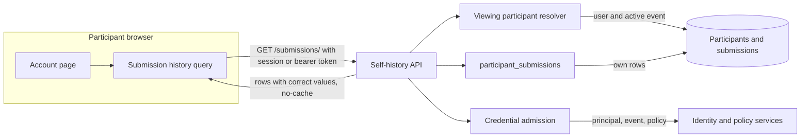

# Participant correct flags (#3002)

Status: accepted design, 2026-11-23. This note applies ADR-028 and ADR-040.
[The preflight note](ctf-correct-submissions-preflight-3002.md) gives the boundaries and invariants.

## Decision

The participant **Account** page shows each flag that the participant submitted correctly.
Each row shows the challenge of that flag.
The existing self-history API, `GET /api/v1/ctf/submissions/`, adds one read-only field, `submitted_flag`.
The field holds the stored submitted value for a correct row on a live challenge, and `null` for other rows.
The page reads that API and shows only the rows that carry a value.

## Existing coverage

`SubmissionListView` already returns the participant's own submissions with the challenge ID, the challenge name, and correctness.
It does not return the submitted value.
`useCtfSubmissions` already reads the API, but no page uses it.
The **Account** page already shows the score and the solve count.

## Architecture

| Component | Change |
| --- | --- |
| `ctf/api/projections.py` | New `participant_submissions` function. It shapes the history rows and sets `submitted_flag` only for a correct row on a live challenge. |
| `ctf/api/serializers/participant.py` | `SubmissionListItemSerializer` adds `submitted_flag`, read-only and nullable. |
| `ctf/api/participant_views.py` | Receives `SubmissionListView` from `ctf/api/organizer/play.py`. The view uses the viewing resolver and the credential admission of the content-image self-read. The response has no-cache headers. |
| `ctf/api/operation_policy.py` | `ctf_submissions_retrieve` changes to `event.participate` on `active_event`, as for the other self-reads. |
| `openapi/v1.json`, `frontend/src/api/schema.d.ts` | Generated again with `npm run gen:api`. |
| `frontend/src/features/ctf/AccountPage.tsx` | New **Correct flags** section. |

### Participant resolution

The view first resolves the participant from the user's active event with the viewing predicate.
It then admits that participant with `viewing_participant_for_credential` for the current credential.
This is the same two-stage admission that the content-image self-read uses.

A disqualified participant can read the history, as on the other self-reads (CTF-609).
A banned or unregistered participant, or a credential without exact participation, gets a 404 response.
An authority outage gets a 503 response and no rows.
The resolver looks up a participant row of the requesting principal only.
Thus the active-event selection cannot give access to the data of another user.

### Response size

The API does not add pagination.
The unique constraint `ctf_unique_correct_submission` permits one live correct row for each challenge.
Thus the number of flag values is not more than the number of challenges in the event.
The incorrect rows carry no value, and their metadata does not change.

### Page behavior

| Condition | Outcome |
| --- | --- |
| The participant has correct flags | One row for each flag: the challenge name as a link to the challenge, and the flag as escaped text |
| The participant has no correct flag | The section shows "No correct flags yet." |
| A signed-receipt challenge | The row shows the stored redaction marker |
| The history read fails | The section shows an error alert; the profile forms stay usable |
| A correct row on a deleted challenge | The row has no value, so the section does not show it |

The rows are newest first, as the API returns them.
A flag submission refreshes the history query through `invalidatePlay`.
The history query keeps no cached data after the page unmounts.
It fetches again each time the tab gets focus.
The section shows no values until that read completes, also when an offline read is paused.

## Systems security engineering

| Asset | Threat | Control | Verification |
| --- | --- | --- | --- |
| Other participants' submitted values | A participant reads the value of another participant or a teammate | The view selects rows by the resolved participant only. It accepts no participant ID. | API test with a teammate's correct submission. |
| Event participation | A credential without current exact participation reads the history | `viewing_participant_for_credential` checks the principal, the event, and live policy. An outage fails closed. | API tests for denial and outage. |
| Incorrect guesses | The response exposes incorrect input | The projection sets `submitted_flag` to `null` for an incorrect row. | API test with an incorrect submission. |
| Authored flags | The response exposes a `CTFFlag` answer | The projection reads only `CTFSubmission.submitted_flag`. | API test with an authored flag that differs from the stored value. |
| Signed receipts | The page shows a receipt credential | The write path stores a redaction marker. The read does not change it. | API test with the marker value. |
| Soft-deleted submissions | A removed solve shows | The default manager excludes soft-deleted rows. | API test with a soft-deleted correct row. |
| Response caches | A shared cache keeps a flag value | The response has no-cache headers. | API test of the `Cache-Control` header. |
| Browser query cache | A later visit shows a flag of an earlier account, for example after an account change in another tab | The history query keeps no data after the page unmounts, and its data is always stale. Each visit shows only a fresh response. | Page test that remounts with one retained query client. |
| Mounted page | An open page shows the flags of an earlier session after a session change in another tab | The query fetches again when the tab gets focus. The section shows no values until the read completes, also when an offline read is paused. | Page tests that send a focus change to a mounted page, online and offline. |
| Deleted challenges | A retained solve on a deleted challenge shows its value | The projection sets `submitted_flag` to `null` when the challenge is soft-deleted. | API test with a deleted challenge. |
| Authority outage | An outage shows as missing participation | The view catches `CredentialUnavailable` before the denial branch and returns 503. | API test that raises `CredentialUnavailable` during admission. |
| Browser page | A flag value injects markup | React renders the value as text. | Page test with a markup-like value. |

Residual risk: a user with access to the unlocked browser session can read the flags that the page shows.

## Data flows

Trust boundaries: browser to portal, portal to identity and policy services, and portal to database.
The change adds no worker, network destination, or store.

## Policy and architecture as code

- `openapi/v1.json` and `schema.d.ts` add the nullable `submitted_flag` field. This change is additive under ADR-040.
- `operation_policy.py` and `tests/contracts/identity_authorization_surfaces.json` record `event.participate` on `active_event`.
- ADR-028 permits this self-disclosure. Scoreboard and organizer drill-down projections stay free of flag values.
- Import boundaries and deployment configuration do not change.

## References

| Source | Section | Use |
| --- | --- | --- |
| <https://www.django-rest-framework.org/api-guide/fields/> | Core arguments: `read_only`, `allow_null` (3.18) | Declares the new response field. |
| <https://tanstack.com/query/latest/docs/framework/react/guides/queries> | Query states (v5) | Pending, error, and success states of the section. |
| <https://api-security.owasp.org/editions/2023/en/0xa1-broken-object-level-authorization/> | How To Prevent | The server selects rows by the resolved participant, not by a client ID. |

## Non-goals

Pagination, teammate flag access, organizer search or export, multi-flag progress, and scoring changes.
