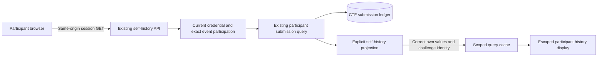

# Correct submitted flags: architecture preflight (#3002)

Status: pre-implementation guidance, 2026-11-23, at revision `5a2d800df09355cdbd1e6acbafe3a1a32e8e04f6`.
The supplied issue #3002 is the delivery contract. No formal requirement is attached.
This explanation defines boundaries and verification obligations. It does not describe implemented behavior or provide an implementation plan.

## Decision and existing coverage

Expose the participant's own correct stored submissions through the existing authenticated self-history boundary.
Show each value with its challenge name and stable challenge ID.
Use `CTFSubmission.submitted_flag`, not the authored answers in `CTFFlag`.
An accepted regex or programmable submission need not equal any authored static answer.

`ctf/api/organizer/play.py::SubmissionListView` already serves `GET /api/v1/ctf/submissions/` with participant permissions.
Its package name does not make this an organizer endpoint.
It returns challenge identity, correctness, points, attempt number, and time, but no submitted value.
`SubmissionListItemSerializer` and `SubmissionListResponseSerializer` describe that published contract.
`frontend/src/api/ctf.ts::useCtfSubmissions` already reads it, but no participant feature consumes the hook at this revision.
`ChallengeDetailPage` only confirms that a personal flag was captured; that message alone does not meet the issue.

Extend the existing self-history projection and serializer additively, rather than creating another history endpoint or schema family.
The `submitted_flag` response field is read-only and populated only for a correct submission owned by the authenticated participant.
Use a documented null value for incorrect rows; never use an empty string to mean redacted or incorrect.
Keep the existing `submissions` and `total` envelope, default selection, and existing metadata semantics.
The participant presentation selects correct records and clearly associates every displayed value with its challenge.

ADR-028 previously prohibited all participant-visible submitted values.
Its amendment permits only this authenticated self-disclosure; scoreboard and organizer drill-down projections remain free of flag values.
ADR-001, ADR-029, ADR-036, ADR-040, ADR-055, and ADR-066 still apply.
No new ADR, exception, feature flag, or event visibility setting is needed.
The older CTF-1404 requirement is deprecated; its original prohibition does not override the supplied issue and this ADR amendment.

## Concepts and invariants

| Concept | Meaning and boundary |
| --- | --- |
| Correct submission | A live `CTFSubmission` with `is_correct=True`. Zero awarded points still means correct. |
| Submitted value | The persisted accepted input. Do not normalize, reconstruct, or verify it again during a read. |
| Authored flag | A `CTFFlag` answer, regex pattern, or validator configuration. None belongs in this response. |
| Personal solve | The viewer's correct record, independently of team membership or current leaderboard eligibility. |
| Team solve | `team_solved` is presentation state. It grants no access to another member's input. |
| Signed receipt | Credential-like proof whose input is deliberately replaced by `[signed receipt redacted]` before persistence. Display the marker honestly. |
| Attempt history | Existing metadata can include incorrect attempts. This issue does not authorize exposing their input values. |
| Challenge identity | Use the recorded challenge relationship and its current name. This issue adds no historical name snapshot. |

The following predicates define the disclosure contract:

```text
P = participant admitted for the current credential and selected event E
H = live submissions returned through get_participant_submissions(P.id)
VisibleValues = {s in H where s.is_correct and s.challenge.event_id == E.id}
Every displayed value equals its stored submitted_flag, including receipt redaction
Every displayed value carries its own challenge_id and challenge_name
No teammate, incorrect, deleted, or other-event row contributes a displayed value
```

The database permits at most one live correct submission per participant/challenge through `ctf_unique_correct_submission`.
A challenge can contain several acceptable flags, but the ledger does not record a separate solve for every authored flag.
Do not turn this issue into multi-flag collection or change solve uniqueness.
Correctness is historical ledger truth; current points, flag edits, scoring decay, and awards do not redefine it.

## Data flow and cross-cutting layers

Paths below are relative to `shifter/shifter_platform/` unless stated otherwise.



Trust boundaries are browser to portal, portal to current identity/policy services, and portal to database.
There is no new worker, network destination, or storage boundary.

| Layer and canonical incumbent | Required behavior |
| --- | --- |
| Browser admission: `frontend/src/router.tsx`, `features/ctf/routes.ts`, `ctf/urls.py`, `shared/spa_host.py`, `config/middleware.py` | Keep the participant workspace and `CTFAccountBoundaryMiddleware`, including live temporary-account and forced-password-change checks. If navigation changes, direct navigation and refresh must resolve the same surface. A served SPA shell grants no data access. |
| Authentication: `config/_drf_settings.py`, `shared/api_tokens/authentication.py`, `shared/api/principals.py`, `ctf/api/_base.py` | Reuse bearer-first fail-closed authentication, current credentials, `CTF_PARTICIPANT_PERMISSIONS`, and `CTF_PLAY_READ`. Preserve session CSRF rules. A scope alone never authorizes another participant's record. |
| Event authority: `ctf/services/principal_participation.py`, `unified_authorization.py`, `shared/credentials.py` | Use `viewing_participant_for_credential` for current proof, exact event, credential ceiling, native policy, registration, and lifecycle. `get_user_role(...).active_ctf_event` selects an event; it does not authorize it. Reject cross-event temporary credentials and provider failures without returning values. Organizer read authority is insufficient for self-history. |
| Viewing versus competing: `ctf/services/participant/queries.py` | Reuse `viewing_participant_q` for reads, including disqualified participants and finished-event review. Banned or unregistered participants remain denied. Do not use the competition window or team eligibility as a history read gate. |
| Persistence: `ctf/models/submission.py`, `models/_base.py`, `services/submission.py` | Reuse `get_participant_submissions`, the default soft-delete manager, existing indexes, and `select_related("challenge")`. Scope both participant and challenge event. Related-object joins do not automatically apply the related model's soft-delete manager. Exclude deleted challenges from participant disclosure. No new repository or read-triggered write. |
| Input and query shapes: DRF serializers, `shared/api/closed_serializer.py`, `ctf/api/organizer/_base.py::_pagination_window` | Add no body to a history GET. If filtering or pagination is used, declare typed, bounded query parameters. Reuse existing parsing conventions; do not copy the helper's legacy unbounded fallback into a new bounded contract. Do not accept a client participant ID as authority. |
| Response contract: `ctf/api/serializers/participant.py`, `shared/api/schema.py`, `shared/api/contract.py` | Use an explicit read-only field in the existing serializer. Never serialize a model wholesale. Update generated `openapi/v1.json` and `frontend/src/api/schema.d.ts` through `npm run gen:api`; use the alias in `api/types.ts`. Preserve ADR-040 compatibility and drift checks. A schema annotation alone does not enforce runtime projection. |
| Policy inventory: `ctf/api/operation_policy.py`, `shared/api/schema.py` | The self-history operation must describe participant `event.participate` authority and the exact selected event. Do not treat a catalog entry or a UI role as runtime admission. Keep organizer submission management distinct. |
| Errors: `ctf/exceptions.py`, `ctf/api/_base.py`, `shared/api/errors.py`, `shared/errors.py` | Reuse existing domain exceptions and authored error mappings. Return the shared envelope with a safe message and request ID. Never return raw exception text, ORM errors, submitted values, or policy-provider details. Authorization outages fail closed. |
| Receipt and secret handling: `services/submission_receipts.py`, `services/submission.py`, `shared/receipt_validation.py` | Preserve the stored receipt marker. Do not inspect current validator type to reconstruct old input, call a verifier on GET, expose receipt-consumption metadata, or retain raw receipts for display. Existing static, regex, and programmable submission semantics stay unchanged. |
| HTTP cache: Django `add_never_cache_headers`, as used in `ctf/api/communication_inbox.py` | Mark value-bearing responses private and uncacheable, including denial responses. Keep flag values out of URLs, redirects, prefetch links, and shared proxy caches. Do not inherit the inbox's separate session-only API policy. |
| Browser cache: `frontend/src/api/ctf.ts`, `ctfInbox.ts`, `queryClient.ts` | Reuse TanStack Query and `apiFetch`. Keep the submissions key prefix usable by `invalidatePlay`. Stop displaying old values after authorization or context loss; do not persist them in local storage. The [design](ctf-correct-flags-3002.md) meets this with fresh reads, not with a principal-qualified key. The server resolves the context from the session, so a tab's cached principal cannot bind a cross-tab change. |
| Rendering: `features/ctf/ChallengeDetailPage.tsx`, shared UI components, `config/_browser_security.py` | Render input as escaped text, with wrapping for long values. Never pass flags through Markdown, HTML, auto-links, or `dangerouslySetInnerHTML`. Retain enforced CSP and distinguish success with text, not color alone. |
| Observability: module loggers, `shared/log_sanitize.py`, `shared/audit.py` | Log bounded IDs, counts, outcomes, and request correlation only. Do not add payload logging, flag-bearing metrics, audit snapshots, socket frames, or notifications. A display read needs no new audit workflow. |
| Configuration and host runtime: `config/settings.py`, `config/_env_manifest.py`, `config/env-manifest.json`, installation configuration, Terraform and chart settings | No new setting, secret, environment binding, CLI argument, file export, or process is needed. Existing configuration validators remain unchanged. Values travel only through the authorized JSON response and transient UI; never through process argv or shell commands. |

History access does not authorize unreleased challenge descriptions, hints, solutions, connection details, or attachments.
Use minimal challenge identity from the history relationship, rather than embedding the challenge-detail or organizer payload.
The existing challenge list and detail availability gates retain ownership of current challenge content.
Do not silently discard a retained personal solve merely because it no longer appears in the available-challenge list.

## Extensibility and bounded reads

The extension seam is the existing CTF submission read query, parameterized by admitted participant, exact event, and optional challenge ID.
Keep correctness selection, value disclosure, and pagination at that boundary; do not spread authorization across components.
An explicit event selector, if needed for request/cache binding, selects scope only; the current credential must authorize that event independently.
Future challenge-specific history can reuse `challenge_id` without adding another ledger or serializer family.
A future team view must receive a separate explicit disclosure decision; it cannot inherit permission from a team filter.
This issue does not expand service-credential access or permit acting as a service principal's responsible human.

The current history view materializes all attempts, and APIView does not automatically apply global DRF pagination.
The unique constraint permits one live correct row for each challenge, so the value count is not more than the challenge count.
The [design](ctf-correct-flags-3002.md) therefore adds no pagination and keeps the existing envelope.
Do not truncate a value or silently cap history while claiming that every correct submission is visible.

## Verification obligations and non-goals

Reuse DB-backed fixtures in `tests/ctf/conftest.py` and `factories.py`, plus the existing API, token, and receipt test patterns.
Relevant incumbents include `test_participant_api.py`, `test_drf_api_token_access.py`, `test_receipt_submission.py`, and `test_native_content_images.py`.
Use `frontend/src/test/utils.tsx` and existing `apiFetch` mocks in CTF hook/page tests for presentation and invalidation.
Keep CTF dependencies within `.importlinter` and `scripts/check_layer_imports/layer_imports.yaml`; use shared contracts and public service seams.
History must not import Engine, Mission Control, private adapters, or pack content.

Required behavior evidence includes own correct input with the right challenge, reload persistence, zero-point correctness, and several challenges.
Negative evidence includes teammates, other events, incorrect attempts, deleted rows, expired authority, and banned participants.
Include receipt redaction, markup-like values, long values, context changes, and invalid-bearer precedence.
Verify that public scoreboards, organizer drill-downs, and unsolved challenge responses still omit values.
Use targeted mutation checks on ownership and correctness predicates where practical; avoid mocked queryset chains as authorization evidence.

For implementation, use targeted tests and the repository's API drift, compatibility, frontend type, and accessibility checks.
Any new page belongs in `frontend/e2e/a11y/matrix.ts` and the existing browser scan.
Run the repository ADR guard and import checker when the relevant source or architecture boundaries change.
Whole suites remain in CI. Passing architecture checks does not prove the disclosure predicates.

This preflight adds no implementation or tests.
The issue excludes organizer search/export, public sharing, teammate flag access, multi-flag progress, historical answer reconstruction, and new retention policies.
It does not change scoring, verification, attempt limits, receipt consumption, notifications, event lifecycle, provisioning, or adapter contracts.
Do not introduce duplicate DTOs, validation rules, exception classes, generic history frameworks, background workflows, or deployment configuration.
Keep private pack content and operational evidence out of source fixtures, screenshots, documentation, and repository metadata.
