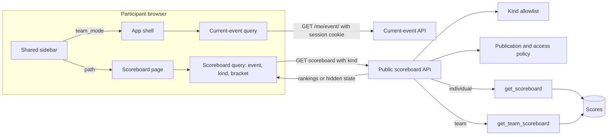

# Individual and team scoreboards (#2968)

Status: accepted design, 2026-11-18. This note applies ADR-013 and ADR-040.
[The preflight note](ctf-dual-scoreboards-preflight-2968.md) gives the boundaries.

## Decision

A team-mode event shows two participant sidebar entries: **Individual scoreboard** and **Team scoreboard**.
Each entry opens its own path and reads one board from the existing public scoreboard API.
A solo event keeps the single **Scoreboard** entry.
An optional closed `kind` query selector chooses the board.
When `kind` is absent, the API keeps its existing default.

## Existing coverage

`get_scoreboard` and `get_team_scoreboard` already rank one event both ways.
The public endpoint calls only `get_team_scoreboard` when `CTFEvent.team_mode` is true.
Thus a team-mode participant cannot read individual rankings.
The shared sidebar has one static **Scoreboard** entry and no event context.

## Architecture

| Component | Change |
| --- | --- |
| `ctf/api/views.py` `PublicScoreboardView` | Reads `kind` through `PublicScoreboardQuerySerializer`. Calls the scoring service for the selected board. |
| `ctf/api/serializers/organizer_ops.py` | New query serializer with one `ChoiceField`. The OpenAPI operation declares the parameter. |
| `ctf/enums.py` | New `ScoreboardKind` (`individual`, `team`). |
| `ctf/urls.py`, `ctf/api/operation_policy.py` | New SPA shell routes `individual_scoreboard` and `team_scoreboard`, classified as `spa_shell`. |
| `frontend/src/app/nav.ts` | Entries can declare an advisory `eventMode` (`solo` or `team`). `visibleNavGroups` takes a `NavContext`. |
| `frontend/src/components/app-shell.tsx` | Reads `team_mode` from `useCtfCurrentEvent` in participant mode only. Passes it to `visibleNavGroups`. |
| `frontend/src/api/ctf.ts` | `useCtfScoreboard` sends `kind` and adds it to the query key. `useCtfCurrentEvent` accepts `enabled`. |
| `features/ctf/ScoreboardPage.tsx`, `router.tsx` | One page with an optional `kind`. Two new routes, each keyed by its kind. |

### API contract

`GET /api/v1/ctf/events/{event_id}/scoreboard/?kind=individual|team`

| Request | Result |
| --- | --- |
| `kind` absent | Existing default: team rows for a team event, individual rows for a solo event. |
| `kind=individual` | Individual rows for any event. |
| `kind=team` on a team event | Team rows. |
| `kind=team` on a solo event | 400 `scoreboard_kind_unavailable`. |
| Unknown or repeated `kind` | 400 `invalid_scoreboard_kind`. The response does not echo the value. |

The response envelope does not change.
`team_mode` stays the event fact.
The client renders the column title from the selected kind.
Freeze, bracket, and publication rules apply to both boards in the same way.

### Navigation

| Event state | Visible entries |
| --- | --- |
| Solo event, no event, or event not loaded | Scoreboard |
| Team event | Individual scoreboard, Team scoreboard |

The shell matches the active entry by pathname.
The paths `/ctf/scoreboard/`, `/ctf/individual-scoreboard/`, and `/ctf/team-scoreboard/` share no prefix.
Thus only one entry is active at a time.
`/ctf/scoreboard/`, the event home link, the help link, and the `position_changed` toast keep the default board.

### Failure behavior

| Condition | Outcome |
| --- | --- |
| The current-event read fails or returns 404 | The sidebar shows **Scoreboard**. The page shows its existing state. |
| A deep link opens the team path for a solo event | The page shows a "No team scoreboard" notice. It sends no scoreboard request. |
| The API returns 400 for `kind` | The page shows its existing error state. |
| The board is hidden | Both boards show the existing hidden state. |

## Systems security engineering

| Asset | Threat | Control | Verification |
| --- | --- | --- | --- |
| Restricted rankings | The new selector bypasses publication | The view checks publication before it reads rankings for any kind. | API tests for hidden and participants-only events with each kind. |
| Server input | A crafted `kind` value causes an error or injection | A closed `ChoiceField` allowlist. Repeated values are rejected. The error does not echo input. | API tests for unknown and repeated values. |
| Participant cache | One board's rows appear under the other board | The query key includes the event, the kind, and the bracket. Route elements have distinct keys, so bracket state resets. | Hook, page, and route tests. |
| Navigation | A visible link is taken as permission | Entry visibility is advisory (ADR-013-R3). The API authorizes each read. | Existing API authorization tests. |

Residual risk: a team event now also serves individual reads.
A frozen or bracket individual board uses the recompute path and adds read load.

## Data flows

Trust boundaries: browser to portal, and portal to database.
The selector carries no principal, tenant, permission, or scoring input.

## Policy and architecture as code

- `openapi/v1.json` and `schema.d.ts` add the optional `kind` parameter. `npm run gen:api` generates both.
- `NON_API_ROUTE_POLICY` classifies the two new page routes as `spa_shell`.
- Import boundaries, deployment configuration, and ADR rules do not change. ADR-013 already allows advisory nav visibility.

## References

| Source | Section | Use |
| --- | --- | --- |
| <https://www.django-rest-framework.org/api-guide/fields/> | ChoiceField | Closed allowlist for `kind`. |
| <https://drf-spectacular.readthedocs.io/en/latest/customization.html> | Step 2: `@extend_schema` | Declares the query parameter in the OpenAPI operation. |
| <https://tanstack.com/query/v5/docs/framework/react/guides/query-keys> | Query keys are hashed deterministically | Each variable that changes the result goes into the key. |
| <https://reactrouter.com/start/data/routing> | Configuring routes | Two static child routes under the CTF layout. |
| <https://cheatsheetseries.owasp.org/cheatsheets/Input_Validation_Cheat_Sheet.html> | Allowlist validation | Reject any value outside the closed set. |
| <https://cheatsheetseries.owasp.org/cheatsheets/Authorization_Cheat_Sheet.html> | Enforce authorization checks on every request | Navigation stays advisory; the API authorizes. |

## Non-goals

Organizer monitoring, scoring changes, new notification kinds, per-board publication settings, and mobile navigation.
