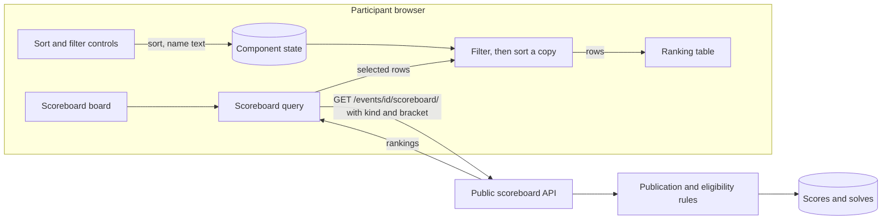

# Leaderboard sort and filter (#3001)

Status: accepted design, 2026-11-23. This note applies ADR-013 and ADR-055.
[The preflight note](ctf-leaderboard-controls-preflight-3001.md) gives the boundaries and invariants.

## Decision

The participant scoreboard sorts and filters its rows in the browser.
The scoreboard API already returns the complete permitted ranking list.
The API, the scoring services, and the server authorization do not change.
The controls apply to the default, individual, and team boards.
The server bracket selector stays. The browser controls apply to the rows of the selected bracket.

## Existing coverage

`ScoreboardPage.tsx` shows one board and filters by bracket through the API.
It has no sort control and no name filter.
The table shows `index + 1` when a row has no rank.
After a sort or a filter, that value is not a correct rank.

## Architecture

| Component | Change |
| --- | --- |
| `features/ctf/scoreboard-list.ts` | New pure module. It parses the sort value, filters by name, and sorts a copy. It does not change its input array. |
| `features/ctf/ScoreboardControls.tsx` | New component. It shows the name filter and the sort selector. |
| `features/ctf/ScoreboardPage.tsx` | A board component holds the bracket, sort, and filter state. Its key is the event and the board kind. The table shows the server rank, or a dash when the rank is missing. |
| `e2e/a11y/matrix.ts` | Adds the participant scoreboard surface to the ADR-055 browser scan. |

### State

The control state is component state.
The state stays during the 15-second refresh, because the refresh changes only the query data.
A change of event or board kind gives new state, because the board component key changes.
The page does not put the filter text in the URL, in browser storage, or in logs.
The filter text can contain participant names.

### Sort keys

| Key | Label | Order | Ties |
| --- | --- | --- | --- |
| `rank` | Rank | Server order | Not applicable |
| `name` | Name, A to Z | Name, by locale | Server order |
| `solves` | Solves, most first | Solve count, high to low | Server order |

The server returns rows in rank order. The stable sort keeps that order for ties.
A missing or non-finite solve count sorts after all valid counts.
An unknown sort value gives `rank`.

### Name filter

The filter removes leading and trailing spaces from the text.
It compares the text with the shown name, without case.
Empty text matches all rows.
The filter treats all characters as literal text.

### Failure behavior

| Condition | Outcome |
| --- | --- |
| The filter matches no row | The page shows "No entries match this filter" and keeps the controls. |
| The board has no row | The page shows "No scores yet" and keeps the controls. |
| The board is hidden | The page shows its existing hidden notice and no controls. |
| The read fails | The page shows its existing error state. |

## Systems security engineering

| Asset | Threat | Control | Verification |
| --- | --- | --- | --- |
| Hidden or excluded rankings | A control shows a row that the API did not return | The page only filters and reorders the API response. The API keeps its publication and eligibility rules. | Existing API tests. Page tests that use only the returned rows. |
| Official ranks | A sort or filter shows an incorrect rank | The table shows the server rank. A missing rank shows a dash. | Unit and page tests. |
| Browser page | Crafted filter text injects markup | The page compares the text as a string. React renders it as an input value only. | Page test with markup-like text. |
| Participant names | Filter text goes into history, logs, or storage | The text stays in component state. | Code review. |
| Page state | A crafted sort value causes an error | A closed allowlist with a default fallback. | Unit test for an unknown value. |

Residual risk: the browser does the sort and filter for each refresh.
The board is a complete list, so its size is the number of ranked entries.
If the API adds pagination, a browser sort covers only one page; that change must revisit this design.

## Data flows

Trust boundaries: browser to portal, and portal to database.
The sort and filter values do not cross the browser boundary.
They carry no principal, tenant, permission, or scoring input.

## Policy and architecture as code

- The API schema, `openapi/v1.json`, and `schema.d.ts` do not change.
- `NON_API_ROUTE_POLICY` does not change, because the page paths do not change.
- Import boundaries, deployment configuration, and ADR rules do not change.

## References

| Source | Section | Use |
| --- | --- | --- |
| <https://react.dev/learn/preserving-and-resetting-state> | Resetting state with a key (React 19) | The board key resets the state for a new event or board kind. |
| <https://developer.mozilla.org/en-US/docs/Web/JavaScript/Reference/Global_Objects/Array/sort> | Sort stability | Stable sort keeps the server order for equal keys. |
| <https://www.w3.org/WAI/ARIA/apg/patterns/table/> | Table pattern | The table keeps native semantics. A labeled selector does the sort. |
| <https://cheatsheetseries.owasp.org/cheatsheets/Input_Validation_Cheat_Sheet.html> | Allowlist validation | Closed set for the sort value. |

## Non-goals

Server-side sort or filter, URL state, saved preferences, organizer board changes, and new API fields.
