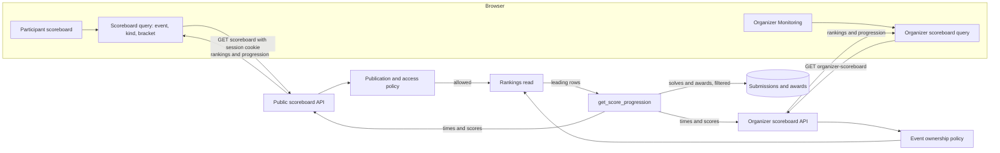

# Leaderboard score graphs (#3004)

Status: accepted design, 2026-11-23. This note applies ADR-028, ADR-036, and ADR-040.
[The preflight note](ctf-leaderboard-graphs-preflight-3004.md) gives the boundaries.

## Decision

Each portal scoreboard shows a step graph of score over time above its table.
The graph plots the first eight rows of the board that the table shows.
The user chose score over time and an ADR-028 amendment (ADR-028-R3).
Score timing is public aggregate standing.
The graph never names a challenge or an award reason.

| Surface | Board | Cutoff |
| --- | --- | --- |
| Participant **Scoreboard**, **Individual scoreboard**, **Team scoreboard** | Selected kind and bracket | Public freeze |
| Organizer **Monitoring** > **Scoreboard** | Event default board | None (live) |
| Organizer **Monitoring** > **Analytics** participant timeline | One participant | None (live) |

## Existing coverage

`get_scoreboard` and `get_team_scoreboard` rank a board with freeze, bracket, and eligibility rules.
`get_score_timeline` gives one participant's history to that participant or an organizer.
The SPA had no graph for a board.
The Analytics timeline table read `challenge_name` and `cumulative_score`.
The service sends `label` and `cumulative`, so the table showed "—" and 0.

The eligibility predicates did not exclude soft-deleted rows in joined lookups.
Thus frozen and bracket team boards counted removed members.
Participant removal did not rebuild the team score.

## Architecture

| Component | Change |
| --- | --- |
| `ctf/services/scoring/_progression.py` | New `get_score_progression` and `PROGRESSION_LIMIT = 8`. Reads correct solves and awards for the leading rows only. |
| `ctf/api/views.py` `PublicScoreboardView` | Adds `progression` for the selected rows. A hidden board sends `null`. |
| `ctf/api/organizer/scoreboard.py` `OrganizerScoreboardView` | Adds live `progression`. |
| `ctf/api/serializers/organizer_ops.py` | New `ScoreProgressionSerializer` documents the field. |
| `frontend/src/features/ctf/ScoreProgressionChart.tsx` | New native SVG step graph and the shared `ScoreboardGraph` card. |
| `ScoreboardPage.tsx`, `admin/MonitoringPage.tsx` | Render the graph above the table. The Analytics table reads the service fields. |
| `frontend/src/index.css` | Eight categorical series tokens for the light and dark themes. |
| `ctf/services/participant/queries.py` | `eligible_participant_q` and `viewing_participant_q` require `deleted_at` null, also through joins. |
| `ctf/services/participant/lifecycle.py` | `delete_participant` rebuilds the team score. |

### API contract

The public and organizer scoreboard responses add one field:

```json
"progression": {
  "starts_at": "<event start>",
  "ends_at": "<freeze, or the earlier of now and event end>",
  "series": [
    {"id": "<participant or team id>", "name": "...", "rank": 1,
     "points": [{"at": "<time>", "score": 0}, {"at": "<time>", "score": 100}]}
  ]
}
```

| Rule | Behavior |
| --- | --- |
| Rows | The first `PROGRESSION_LIMIT` rows of `bracket_rankings` when a bracket is set, else of `rankings`. |
| Origin | The first point is the event start. Points before the start fold into it. |
| Individual score | Sum of correct-solve points and awards, as `recompute_participant_score` counts them. |
| Team score | Each challenge counts once at its best member points, plus awards. Only ranked members count. A bracket counts only its members. |
| Freeze | Public frozen boards count solves and awards strictly before the freeze. |
| Last point | Equals the row's published score. |
| `ends_at` | Never earlier than `starts_at` or the last point. |

### Graph

- The graph is SVG with class-based colors and presentation attributes. It has no style attributes, so ADR-036 CSP needs no change.
- Each series has a fixed hue slot by row position. The eight hues pass the colour-vision check and have 3:1 contrast on the light and dark cards.
- The graph draws a zero gridline, so negative scores show below it.
- The graph skips a point with an invalid time or a non-finite score. It does not plot it as zero.
- Each score step has a marker with a native title: name, score, and time.
- A legend lists rank and name.
- The browser name filter and sort (#3001) change only the table. The graph keeps the official leading rows.
- A **Score history** disclosure below the graph holds a table of every plotted time and score. It is the text alternative for the graph.
- The graph refreshes with the existing 15-second scoreboard poll. It has no animation.

### Failure behavior

| Condition | Outcome |
| --- | --- |
| Board hidden or not permitted | `progression` is `null`. No graph. |
| No rows | No graph. The table shows its "No scores yet" state. |
| Event not started | `ends_at` equals `starts_at`. No graph. |
| Read fails | The page shows its existing error state. |

## Systems security engineering

| Asset | Threat | Control | Verification |
| --- | --- | --- | --- |
| Semi-private solve history (ADR-028) | The graph names solved challenges | Points carry only `at` and `score`. ADR-028-R3 forbids names and reasons. | `test_series_carry_no_challenge_names_or_award_reasons` |
| Frozen standings | The graph shows post-freeze scores | The service applies the board's freeze cutoff. | `test_freeze_cutoff_excludes_later_points_and_ends_the_axis` |
| Restricted boards | The graph bypasses publication | The view builds `progression` only after the publication check. | `test_hidden_public_scoreboard_publishes_no_progression` |
| Ranking eligibility | Hidden members or observers add team points | Team reads apply `ranked_participant_q`. | `test_team_series_count_a_shared_challenge_once_at_its_best_points` |
| Ranking eligibility | Removed members add team points or history | The predicate requires `deleted_at` null through joins. Removal rebuilds the team score. | `test_deleted_member_points_leave_team_history_and_boards` |
| Bracket isolation | Other-bracket members add team points | Team reads filter by bracket. | `test_team_bracket_series_count_only_bracket_members` |
| Portal capacity | Polls read unbounded history | Reads cover eight competitors. Each series has one point per score change. | `test_series_cover_only_the_leading_rows_in_rank_order` |
| Browser | Names inject markup or the graph breaks CSP | React text nodes. No style attributes. | Vitest axe; the e2e accessibility lane fails on any CSP violation. |

Residual risk: a score step at a known time can imply a challenge by its point value.
ADR-028-R3 accepts this risk for the leading rows.

## Data flows



Trust boundaries: browser to portal, and portal to database.
The flow from `get_score_progression` to the browser carries only ids, names, ranks, times, and scores.
The ranking rows already publish the same ids.

## Policy and architecture as code

- `docs/adr/index.yaml` amends ADR-028 and adds rule ADR-028-R3.
- `openapi/v1.json` and `schema.d.ts` add `ScoreProgression`. `npm run gen:api` generates both.
- `frontend/e2e/a11y/matrix.ts` adds the `ctf-participant-scoreboard` surface. `seed_e2e_ctf` seeds one award, so the graph renders.
- Import boundaries, routes, operation policy, and deployment configuration do not change.

## References

| Source | Section | Use |
| --- | --- | --- |
| <https://www.w3.org/TR/SVG2/paths.html> | 9.3.5 The lineto commands | `H` and `V` commands draw the score steps. |
| <https://www.w3.org/TR/CSP3/> | 6.1.15 style-src-attr | The graph uses no style attributes under the portal CSP. |
| <https://www.w3.org/WAI/tutorials/images/complex/> | Overview; Long descriptions | Short title and description on the graph; the **Score history** table gives the long description. |
| <https://www.django-rest-framework.org/api-guide/serializers/> | Dealing with nested objects | Nested `many=True` serializers document the series. |
