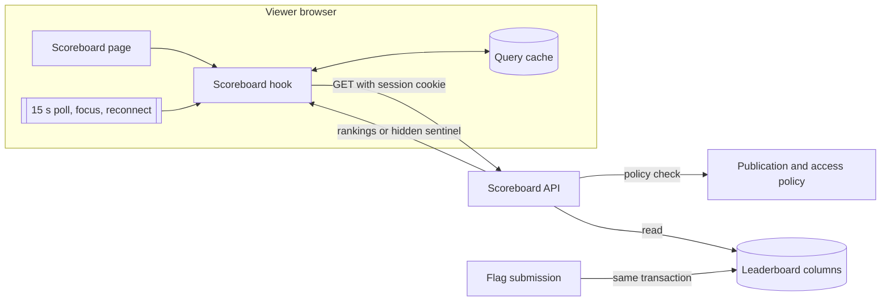

# Scoreboard refresh within 30 seconds (#576)

Status: accepted design, 2026-11-02. This note applies ADR-029-R4.
[The preflight note](ctf-scoreboard-refresh-preflight-576.md) gives the boundaries.

## Decision

The participant and organizer scoreboard hooks poll their read every 15 seconds.
They also refetch on window focus and on network reconnect.
Polling is the refresh guarantee. The ADR-072 `position_changed` hint stays an
optional accelerator.

## Existing coverage

The scoreboard API, ranking, freeze, visibility, and brackets exist. Score owners
update the materialized leaderboard columns in the solve transaction. The
`useCtfScoreboard` and `useCtfOrganizerScoreboard` hooks do not poll. The global
query defaults set `refetchOnWindowFocus: false`. The `position_changed` hint
invalidates CTF queries, but it is opt-in per event, needs the WebSocket
capability, and goes only to participants whose position changed.

## Architecture

| Component | Change |
| --- | --- |
| `frontend/src/api/ctf.ts` | New `SCOREBOARD_POLL_MS = 15_000`. Both scoreboard hooks set `refetchInterval`, `refetchOnWindowFocus`, and `refetchOnReconnect`. |
| `ScoreboardPage`, `MonitoringPage`, `ParticipantDetailPage` | No change. They render the data of the hooks. |
| Scoreboard API and scoring services | No change. |

A poll uses the same query key, path, and bracket query as the first read.
TanStack Query polls only while an enabled observer is mounted. It pauses the
poll while the tab is in the background. On return, the focus refetch reads the
board when the data is older than the 15-second stale time.

The worst-case delay from a committed solve to the display is one interval plus
one request. A 15-second interval leaves the remainder of the 30 seconds for the
request and the render.

The hooks poll a hidden, frozen, or empty board. An organizer can show or
unfreeze the board at any time, and the next poll shows that change.

### Failure behavior

| Condition | Outcome |
| --- | --- |
| A poll gets a network error or a 5xx | The global policy retries two times. Then the page shows its error state. The next poll that succeeds shows the board again. |
| A poll gets a 4xx | No retry. The page shows its error state. The next poll reads again. |
| The tab is in the background | No poll. The focus refetch reads the board on return. |
| The browser is offline | No poll. The reconnect refetch reads the board. |

## Systems security engineering

| Asset | Threat | Control | Verification |
| --- | --- | --- | --- |
| Hidden or frozen rankings | A poll discloses rankings that the policy withholds | Each poll is a new request. The server applies the publication, freeze, and access rules each time. | Existing `test_organizer_scoreboard_api.py` and `test_drf_api_token_access.py`. |
| Organizer rankings | Organizer data goes into the participant cache | Separate query keys for the two reads. No shared cache entry. | Hook test reads each path. |
| Session credentials | A poll sends a credential in the URL or in browser storage | Polls use `apiFetch` with the same-origin session cookie. GET requests send no CSRF token. | Review. |
| Portal capacity | Many viewers cause too much read load | About four requests each minute for each open scoreboard. The live board reads the indexed materialized columns. No poll in background tabs. | Review. Load measurement uses the #850 harness. |

Residual risk: a frozen or bracket board uses the recompute path, which costs
more than the live board. A large event with many open frozen boards adds read
load.

## Data flows

Trust boundaries: the browser to portal boundary and the database boundary.

## Policy and architecture as code

- No API, schema, or operation policy changes. `openapi/v1.json` does not change.
- `docs/adr/index.yaml` lists this note under ADR-029.
- Import boundaries and deployment configuration do not change.

## References

| Source | Section | Use |
| --- | --- | --- |
| <https://tanstack.com/query/v5/docs/framework/react/guides/polling> | Polling | `refetchInterval` polls while an observer is mounted and pauses in a background tab. |
| <https://tanstack.com/query/v5/docs/framework/react/reference/useQuery> | Options | `refetchOnWindowFocus` and `refetchOnReconnect` refetch only stale data. |
| <https://tanstack.com/query/v5/docs/framework/react/guides/important-defaults> | Important defaults | Polling does not depend on `staleTime`. |
| <https://tkdodo.eu/blog/using-web-sockets-with-react-query> | Consuming events | Socket events start an invalidation and carry no data. ADR-072 hints follow this pattern. The pattern relies on the socket, which is optional here, so polling stays. |

## Non-goals

Push refresh, a new socket message, a configurable interval, server caching,
and changes to scoring or authorization.
