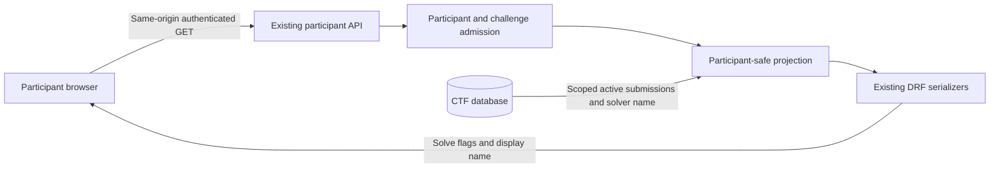

# Team solve attribution (#2997)

> Architecture preflight, 2026-11-22, at `fb15c90d5`. This is design guidance, not implementation or release evidence.
> The supplied issue #2997 is the contract. No formal requirement is attached.

## Existing behavior and decision

The challenge list and detail page already show a teammate's solve through `team_solved`.
Neither response identifies the solver.
Keep this change within the existing participant read projections, serializers, query hooks, and challenge components.
ADR-001, ADR-019, ADR-029, ADR-040, ADR-066, and ADR-072 already establish the relevant boundaries.
No new ADR, persistence model, service framework, policy grant, or workflow is needed.

Keep these concepts separate:

| Concept | Meaning and boundary |
| --- | --- |
| `solved` | The viewing participant has a current correct submission. Preserve this meaning. |
| `team_solved` | In a team event, a current member of the viewer's team has a current correct submission. Includes the viewer. |
| Solver identity | The event-scoped `CTFParticipant.id` and current display `name`; never the Django user, principal, email, or login name. |
| Ranked contribution | Scoring services decide eligible contributions and deduplicate team points. A solve marker does not establish credited points. |
| First blood | An event-wide notification/scoring fact. It does not select the team's displayed solver. |

Add `team_solved_by` to both existing challenge responses, following the local `ctf-team-solver-name-2997.md` design.
It contains the current display name of the team's earliest correct solver, including the viewer when applicable.
Use stable ordering by submission time and submission ID, not the model's default newest-first ordering.
Several members can solve independently; attribution does not make later submissions invalid.
Equal display names identify different participants. Do not use a name as a database key or infer account identity from it.

Reuse the existing nullable DRF `CharField` shape; no participant DTO or identity schema is needed.
The runtime returns `null` for unsolved, solo, or unteamed cases.
Preserve existing fields and their types.
Declare the addition compatibly under ADR-040 and check generated requiredness; read-only fields can become required in generated schemas.
Do not hand-edit generated artifacts or change global schema settings to accommodate this field.
The frontend should tolerate an absent additive field during deployment transitions.

Display names remain current, as they do in the team roster; this is not a historical identity snapshot.

Both pages show team completion and the selected solver's name.
Preserve the viewer's personal solved state; avoid claiming the viewer was the first solver when another member solved earlier.
The personal badge can retain "Solved"; team attribution remains a separate display fact.

Keep the generic team-solved label when the additive name is absent.
Keep personal submission and rating decisions dependent on `solved`.
A teammate's solve must not hide the individual flag form or grant rating access.
The solved-of-total list summary continues to count each challenge once through `solved || team_solved`.

## Data ownership and query invariants

Extend the responsibility of `ctf/api/projections.py::_team_solved_challenge_ids` rather than adding a parallel attribution lookup.
One private batch read can return challenge-to-first-solver names and derive `team_solved` from the same result.
Retain its optional challenge filter for detail reads.
That batch/detail seam keeps one attribution rule for both surfaces without introducing a new service abstraction.
If all solvers are requested later, add a separate field; do not change this scalar's type or meaning.
Projection shaping stays in the API; challenge availability and competitive behavior stay in their existing services.

Read authoritative `CTFSubmission` rows with `is_correct=True` through the active-row manager.
Constrain participant membership, participant event, challenge event, and live team to the viewer's server-resolved event and team.
For list reads, restrict attribution to the challenges admitted by `get_available_challenges`.
For detail reads, retain `assert_challenge_readable_for_participant` before projection.
Never accept a team or solver selector from the browser.

Explicitly exclude soft-deleted joined participants and teams.
`SoftDeleteManager` filters its root model; it does not automatically filter every joined relation.
Use the teammate visibility boundary already present in `participant_team`: current, non-deleted members of the viewer's team.
Retain existing solve-history semantics for hidden, banned, disqualified, and observer members whose correct submissions remain active.
Do not apply `ranked_participant_q` merely because the UI shows a team marker.
That predicate deliberately excludes some retained solve history and belongs to ranked totals.

Existing wording that says the team necessarily has points is therefore too strong for moderated members.
Use factual solve attribution without promising a ranked contribution.

Membership is current membership, not membership at submission time.
Submissions have no team snapshot; membership services can move or remove members and recompute team totals.
Do not add a submission-team foreign key, name snapshot, backfill, or historical membership ledger for this display change.
An ordinary read can race with membership changes; never claim an atomic historical view across separate HTTP requests.

Deriving each response's team marker and selected name together avoids internally contradictory results.
Derive the marker from map membership, not display-name truthiness.
Do not add write locks or move reads into the submission transaction.

Use a narrow ORM projection that retrieves identifiers, display names, and ordering fields only.
Do not load submitted flags, receipt evidence, IP addresses, user records, or validator configuration to obtain a name.
Avoid one query per challenge or solver, repeated detail requests for list cards, and requests for organizer submission history.
Do not use PostgreSQL-only `distinct(field)` for a read that also runs in the supported SQLite test lane.

Existing submission indexes and the partial correct-submission uniqueness constraint are the starting point; do not add speculative indexes.
Teams can have no configured size limit. Do not assume small membership or let long names break accessible layouts.

## Cross-cutting layers

Paths below are relative to `shifter/shifter_platform/` unless stated otherwise.

| Layer and canonical incumbents | Required treatment |
| --- | --- |
| Authentication: `config/_drf_settings.py`, `shared/api_tokens/authentication.py`, `shared/api/principals.py`, `config/middleware.py` | Preserve fail-closed bearer authentication, live credentials, session handling, isolated participant account restrictions, and request IDs. No authentication bypass. |
| Admission: `ctf/api/_base.py`, `participant_views.py`, `shared/api_tokens/scopes.py`, `ctf/api/operation_policy.py` | Reuse `CTF_PARTICIPANT_PERMISSIONS` and `CTF_PLAY_READ`. List resolution uses the active event; detail resolution uses the challenge's event. Neither an administrator nor participation elsewhere grants this team data. Operation-policy inventory alone does not prove a live policy-provider check. |
| Content policy: `ctf/services/challenge/_challenge_read.py`, `_access.py`, `_prerequisites.py` | Preserve hidden/release/prerequisite gates, locked read behavior, and ended/archived review. Team solve display does not unlock personal prerequisites, hints, files, connection data, or solutions. |
| Validation and persistence: `ctf/models/_base.py`, `team.py`, `submission.py`, `ctf/services/participant/profile.py`, `ctf/services/team.py` | Reuse model validation, event membership, active-row managers, name validation, and existing membership ownership. This read adds no write validator, constraint, migration, or second eligibility list. |
| Response contract: `ctf/api/serializers/participant.py`, `shared/api/schema.py`, `shared/api/contract.py` | Keep the explicit field allowlist in both serializers. Reuse route UUID parsing; no new request body or selector needs validation. Generate `openapi/v1.json` and `frontend/src/api/schema.d.ts` through `npm run gen:api`. `frontend/src/api/types.ts` remains an alias layer. Preserve API drift and compatibility gates. |
| Browser transport and rendering: `frontend/src/api/client.ts`, `queryClient.ts`, `features/ctf/ChallengesPage.tsx`, `ChallengeDetailPage.tsx`, `config/_browser_security.py` | Reuse same-origin fetch, cancellation, request correlation, typed errors, retry policy, Badge/Alert components, and React text escaping. Names are text, never HTML, Markdown, URLs, or authorization input. Keep textual status, keyboard access, CSP nonces, and existing browser policy headers. |
| Freshness: `frontend/src/api/ctf.ts`, `features/ctf/CtfWorkspaceLayout.tsx`, `ctf/services/notification/live.py` | Reuse TanStack Query keys and invalidation. Optional socket hints only accelerate authenticated rereads. They must not carry solver names, flags, scores, or participant records. |
| Errors and observability: `ctf/api/_base.py`, `shared/api/errors.py`, `frontend/src/api/errors.ts`, `shared/log_sanitize.py` | Preserve authored safe messages and `{error: {code, message, request_id?}}`, including existing 403/404/503 behavior. Do not return raw exception text or successful empty results on read failure. Existing request metrics/loggers suffice; no per-read audit, name-based metric labels, or new telemetry service. Sanitization does not authorize logging private data. |
| Configuration and runtime: `CTFEvent.team_mode`, `config/_product_env.py`, `_env_manifest.py`, `env-manifest.json` | Existing event mode is sufficient. No new environment field, secret, feature flag, parser, subprocess, shell command, worker, cloud permission, network endpoint, or hosting. Tokens, names, and flags never enter process argv or diagnostic artifacts. |
| Repository enforcement | Root `.ground-control.yaml` identifies `OpenRAE/bigrae`. Retain `.gc/plan-rules.md`, `.importlinter`, `scripts/check_layer_imports/layer_imports.yaml`, ADR registry/exceptions, pre-commit, and `_quality.yml`. Stay within CTF and existing shared utilities; no Engine/Mission Control internals or retired `cyberscript` imports. |

## Freshness and disclosure gotchas

`invalidatePlay` refreshes the submitting browser, not other team members' browsers.
Challenge queries currently have no polling, and the default query client disables window-focus refetch.
`CtfWorkspaceLayout` invalidates CTF reads for accepted live hints, but those hints are optional and do not accompany every teammate solve.
An open challenge page can therefore remain stale when the socket is disabled, parked, disconnected, or irrelevant.
Do not describe this as reliable live team status.

Any open-page refresh must reuse the existing hook-level polling/focus/reconnect pattern from scoreboard reads.
Keep cadence in the API hook and reuse existing timing policy where suitable; do not add component timers or a notification kind.
The issue specifies no exact latency budget. A new latency guarantee is not part of this preflight.

Team membership mutations currently invalidate only team and current-event queries.
Reads that gain membership-dependent attribution also need invalidation when membership changes.
The same dependency applies to cached names after a profile change.

Team attribution is private participant data, even when the scoreboard is public.
It belongs only on the authenticated participant challenge surface, not the public scoreboard, bootstrap, or event-wide bus.
Do not add shared HTTP, CDN, persistent browser, or cross-session caching for these projections.
Existing query keys omit event/principal identity; any future in-page event/account switch must clear or partition those reads.

Current list and detail admission are not identical for disqualified viewers.
The list uses viewing eligibility, while detail resolution and its read guard use competitive eligibility.
Preserve that existing behavior here; do not silently widen permissions to make the endpoints symmetrical.

## Data flow and evidence boundary

The browser/portal boundary authenticates and admits the reader before any attribution leaves the database boundary.
The existing submission workflow remains the sole writer of solve truth.
No new process, trust boundary, persistence owner, or external processor is introduced.

Implementation evidence belongs in `tests/ctf/test_participant_api.py`, `test_ctf_api_contract.py`, and the existing challenge page tests.
Cover teammate-only and own solves, multiple solvers, duplicate names, stable first-solver selection, and identical list/detail attribution.
Cover solo/unteamed/unsolved, other teams/events, deleted submissions/members/teams, retained moderated-member history, and renamed or moved members.
Preserve negative evidence for hidden/unreleased/prerequisite content, missing read scope, unauthorized viewers, flag leakage, rating access, and individual submission.
Use real domain services for backend behavior and patch only external boundaries under ADR-019.
Existing frontend tests mock the HTTP client; retain that transport boundary.

Targeted query-count evidence should prevent challenge-count-dependent queries.
If refresh behavior changes, test disabled sockets, timer/focus/reconnect behavior, cancellation, and membership invalidation through the existing query test patterns.
Targeted mutation evidence should detect missing event/team/correctness/deletion filters and accidental substitution of team state for personal state.
Full suites belong in CI; PostgreSQL is needed if implementation changes database-specific behavior or locking.

The required repository-wide ADR guard remains mandatory, alongside relevant targeted tests and generated-contract checks.
Changed Python retains Ruff checks, formatting, and import enforcement; changed frontend retains lint, typecheck, and build checks.
All-solver lists, Helm, Terraform, IAM, deployment, scheduler, receipt verification, score recomputation, notification authoring, and membership workflows are outside this change.
No formal requirement, requirement status, issue body, PR, or release metadata is changed by this preflight.

## Preflight verification limits

The existing baseline passed six targeted backend checks and twenty challenge-page tests.
`manage.py api_contract --check` also passed. These checks do not prove the proposed attribution behavior.
The repository-wide ADR guard failed on existing internal-mock violations and unclassified, untracked screenshots.
The explicit-path fast guard also reported those screenshots. This preflight leaves those unrelated files unchanged.

At preflight time, the documentation tools were not installed, and the pinned installer failed DNS resolution.
The implementation run installed the tools and checked this note with Vale and the STE wrapper.
