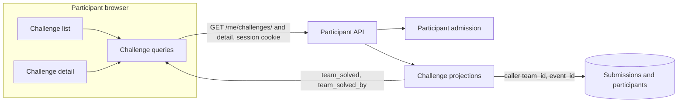

# Team solver name on participant challenges (#2997)

Status: accepted design, 2026-11-22. This note applies ADR-001 and ADR-013.
[The preflight note](ctf-team-solve-attribution-preflight-2997.md) gives the boundaries.

## Decision

In a team-mode event, the participant challenge list and the challenge detail show the name of the teammate who solved the challenge.
The API adds `team_solved_by` to both participant challenge projections.
The value is the display name of the team member with the earliest correct submission for the challenge.
The value is `null` when `team_solved` is false.

## Existing coverage

#2987 added `team_solved` to both projections.
The pages show **Solved by your team** without the member name.
`participant_team` already shows teammate display names to members of the same team.

## Architecture

| Component | Change |
| --- | --- |
| `ctf/api/projections.py` | `_team_first_solvers` replaces `_team_solved_challenge_ids`. It returns a map from challenge ID to the first solver's display name, in one query. `team_solved` and `team_solved_by` both read this map. The query excludes soft-deleted members and teams. |
| `ctf/api/serializers/participant.py` | `ParticipantChallengeListItemSerializer` and `ParticipantChallengeDetailSerializer` add an optional, nullable `team_solved_by`. ADR-040-R3 permits only optional v1 response additions. The schema generator makes each read-only field required, so the field is not read-only. |
| `openapi/v1.json`, `frontend/src/api/schema.d.ts` | `npm run gen:api` adds the field. |
| `features/ctf/ChallengeListLayouts.tsx`, `ChallengeDetailPage.tsx`, `SolvedBadge.tsx` | The card and list badges, the table status cell, the detail badge, and the team notice show **Solved by** *name*. The participant's own solve keeps **Solved**. The notice does not claim that the solve adds points to the team score. One shared badge shrinks and truncates a long name. Its title shows the full label. |
| `frontend/src/api/ctf.ts` | Team membership and profile mutations also refresh the challenge list and detail queries. Membership and display names change the attribution. |

The first correct submission is the solve that captured the flag for the team.
Later correct submissions by other members do not change the name.
The team score rule does not change: a challenge counts once for the team.

Attribution uses current membership and current display names.
It is not a historical record.
`solved` stays personal. A teammate's solve does not hide the flag form or grant rating access.

### Failure behavior

| Condition | Outcome |
| --- | --- |
| Solo event or unteamed participant | `team_solved` is false and `team_solved_by` is `null`. |
| Two members solve at the same time | The query orders by `submitted_at`, then by submission ID. The name is stable. |
| The first solver leaves the team or is deleted | The next current member who solved becomes the solver. With no such member, `team_solved` is false. |
| `team_solved_by` is absent or `null` while `team_solved` is true | The page shows **Solved by your team**. |

## Systems security engineering

| Asset | Threat | Control | Verification |
| --- | --- | --- | --- |
| Participant display names | A participant reads the name of a member of another team | The query filters on the caller's own `team_id` and `event_id`. A solo event returns no names. | API tests for a teammate solve, another team's solve, and a solo event. |
| Participant display names | A deleted member's name stays visible | The query excludes soft-deleted participants and teams. | API test for a deleted teammate. |
| Submission data | The projection discloses flags or scores of teammates | The query reads only `challenge_id` and `participant__name`. | Code review of the projection; existing flag-redaction tests. |

Residual risk: none new. Teammates already see each other's display names on the team page.

## Data flows

Trust boundaries: browser to portal, and portal to database.
The request carries no team or participant selector.
The server derives the team from the caller's participant row.

## Policy and architecture as code

- `openapi/v1.json` and `schema.d.ts` add the optional, nullable field.
- Import boundaries, operation policy, deployment configuration, and ADR rules do not change.

## References

| Source | Section | Use |
| --- | --- | --- |
| <https://docs.djangoproject.com/en/6.0/ref/models/querysets/> | `values_list()`, `order_by()` | One ordered query reads the first solver per challenge. |
| <https://www.django-rest-framework.org/api-guide/fields/> | Core arguments: `read_only`, `allow_null` | Declares the nullable output field. |
| <https://tanstack.com/query/v5/docs/framework/react/guides/query-invalidation> | Query matching with `invalidateQueries` | Membership and profile changes refresh the challenge queries. |
| <https://cheatsheetseries.owasp.org/cheatsheets/Authorization_Cheat_Sheet.html> | Enforce authorization checks on every request | The server scopes names to the caller's own team. |

## Non-goals

A list of every member who solved, organizer views, scoring changes, and notifications.
