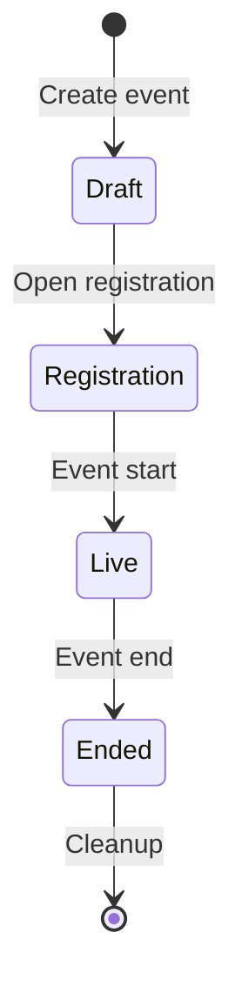

# CTF Organizer Guide

Use this guide to prepare and run a capture-the-flag event.
Open the **CTF Admin** area at `/ctf/admin/`.
You need current permission for each requested event action.
Account membership and resource ownership alone do not grant those permissions.

## Staff changes and recovery

Use **Event staff** to assign active human or service principals as moderators,
judges or co-organizers. A permitted administrator can transfer ownership with
**Make owner**. Every change checks the current administrator's permissions.

If a change is awaiting confirmation, select **Retry pending change** to finish
the recorded update. **Check status** refreshes its progress. Finish that change
before starting another staff update. A current authorized administrator can
resume it if the original caller loses access or the recipient is deactivated.
New assignments still require active recipients.

## Event Lifecycle

Text alternative: create a draft, open registration, start the event, end it, and perform configured cleanup.
The event controls also support other transitions; consult the event state before each action.

## 1. Create the Event

From **CTF Admin → Events → Create**, set the core parameters:

| Setting | Purpose |
|---------|---------|
| Name / description | Shown to participants |
| Scenario | The range scenario each participant gets |
| Event start / end | Competition window |
| Registration deadline | Latest time a participant may register |
| Max participants | Capacity limit |
| Team mode / team size | Individual vs. team competition. Team size is 1 or more; 0 or blank is unlimited |
| Range spin-up minutes | Lead time to provision ranges before start |
| Submission cooldown / attempt limit | Anti-brute-force throttles |
| Scoreboard visibility / freeze | Whether and when standings are shown |
| Live notifications | Which live notices participants get; see [Notifications](#6-notifications) |
| Auto cleanup / cleanup delay | Whether ranges are torn down after the event |
| Publish public registration page | Opt-in public event details and request form; off by default |

For workspace-scoped events, the workspace supplies the egress policy for new
participant and recovery-spare ranges. Each range belongs to its participant
principal, or to the event owner's principal while it is a spare. Selecting a shared event workspace does not give other workspace
members access to those ranges. Set the workspace policy before provisioning:
changes are audited and apply to later launches, not ranges already running.
If the policy changes after a spare is prepared, an incompatible spare cannot
replace a participant range. For large GCP events, include both participants
and spares in the [shared-VPC NAT capacity check](../dev/gcp-range-cell-deploy.md#shared-vpc-nat-capacity-and-event-egress).

### Optional public registration

Enable **Publish public registration page** only when you want an unauthenticated
signup surface for this event. The form previews the disclosure: event name,
description, start/end times, effective registration deadline, and timezone. It does
not publish the scenario, workspace, capacity, participant roster, rules, challenges,
briefing, custom pages, or logo. The privacy notice linked from the page is
operator-supplied; review it for your deployment before sharing the URL.

The share link appears on the event overview after publication is enabled. The page
is reachable only while the event is in **Registration** and the event remains
explicitly published. Turning the switch off, starting, or cancelling the event
closes the public route without changing the stored switch.

## 2. Add Challenges

Under an event, **Challenges → Create**. For each challenge set its name, category,
description, points, difficulty, and the flag. A static flag is stored as plaintext
without its wrapper, and participants may submit it as `FLAG{value}`, `{value}`, or
`value` (the `FLAG` prefix is case-insensitive).

Additional controls:

- **Release time**: schedule a challenge to appear partway through the event.
- **Prerequisite**: lock a challenge until another is solved.
- **Visibility**: hide a challenge from the participant list until you release it.
- **Target instance / port**: point participants at the right host in their range.
- **Files**: upload challenge attachments.
- **Hints**: optional, point-reducing hints.

A challenge can carry multiple flags (for multi-stage solves), each validated
independently.

### Scenario-provided challenges

Some deployments bind a scenario to an immutable native CTF content bundle.
Selecting that scenario while creating an event automatically populates its
challenges, flags, hints, and prerequisite graph. Do not manually import or
duplicate challenges for such an event.

Managed content is fail closed. An organizer edit marks the event content as
drifted, and the event cannot be activated from registration. Create a new
event to adopt a revised bundle instead of overwriting or merging the existing
graph. The selected scenario also cannot be changed after managed content has
been created.

### Images in event content

The event logo and images in Markdown (rules, challenge descriptions and
solutions, event pages, and announcements) can point to another website. The
platform copies each external image into its own storage after you save the
content. Participants then load the copy from the portal. The CTF scheduler
copies up to five images every 30 seconds.

An image shows as a link to its original address until its copy is ready. It
stays a link when the copy fails. A copy fails when the image:

- is not HTTPS
- redirects to another address
- is larger than 5 MiB
- is not a PNG, JPEG, GIF, or WebP image

The organizer image list (`GET /api/v1/ctf/events/<event_id>/content-images/`)
shows the state and failure reason of each image. To fix a failed image, change
the content to a direct HTTPS link to a supported image. Participants see an
image only while they can see the content that contains it.

## 3. Participant Briefing

Give participants event-specific orientation.
State the environment, permitted access, authorized objectives, and starting point.
For example, identify a synthetic lab workstation and the exercise tasks reached through it.
Keep scenario answers and private operational details outside shared help.

Open the event admin page and use **Participant briefing**.
The Markdown renderer supports headings, lists, code, and safe links.
It omits raw HTML, scripts, images, and unsafe link schemes such as `javascript:` and `data:`. Editing updates the published briefing in place; removing it
restores the generic help.

The platform stores and displays your briefing in its original language without translation.
Every participant can read it.
Do not include flags, passwords, invitation links, reset links, range credentials, or other secrets.

When a briefing exists, participants get a **Briefing** entry on their event home and a
dedicated briefing page. An event with no briefing shows the standard help unchanged,
so nothing regresses if you do not author one.

## 4. Manage Participants

From an event's **Participants** page you can add participants individually or bulk
import a roster. Each participant is tracked through registration, range assignment,
and scoring. Use **Brackets** to group participants into ranked cohorts, and (in team
mode) manage team membership.

To reassign a captain, open an existing team member’s participant detail page.
Select **Make team captain**. This action requires permission to manage teams.
It changes captaincy without changing membership or scores.

Requests from the optional public page appear separately at the top of this screen.
Select **Reject** to close a request without creating an account or range.
Select **Approve** to use the same admission checks as a manual add.
The service rechecks capacity and duplicate-email policy before creating the account, seat, and provisioning wake-up. A public submission itself never sends
mail, creates credentials, reserves capacity, or provisions a range.

Every new participant with a delivery email gets a registration confirmation by
email. This includes approved requests, single adds, CSV imports and generated
accounts. The confirmation gives the event name, start, end and timezone. It
never contains a password. The platform sends it only when the deployment has a
mail provider. Requests can be
reviewed only once and their PII is removed by the scheduler after the event-relative
participant-account retention window.

Participants use isolated temporary accounts on the dedicated CTF login page.
Generate accounts before an event and hand out each generated username and initial
password manually, or attach an optional delivery email for non-secret login
information. By default, every new account receives its own strong generated
password. If the event requires a shared initial password, set it on the event form.
A blank field during editing preserves the current policy.
Select **Disable the event shared participant password** to restore unique generated passwords for new accounts.

Use **Manage password** on the participant list or detail page to generate a new
password or set a policy-compliant one. The result is displayed once and cannot be
retrieved later. Resetting a participant does not change the event-wide policy for
new accounts. A reset invalidates the participant's existing web sessions and API
tokens and requires a password change on next login. Invitation resend sends only
the login URL and username; it never resets or emails a password. Generated
usernames remain globally unique and start with `range-`.

Accounts stop authenticating at event end and are anonymized after the configured
participant-account retention window.

## 5. Ranges

The **Ranges** page shows the provisioning state of every participant's range. The
platform provisions ranges automatically around the spin-up window and, when auto
cleanup is enabled, tears them down after the event. The CTF scheduler drives batch
provisioning; see the technical
[CTF documentation](../technical/shifter_platform/ctf.md) for how it runs.

### Recovering a destroyed range

An exercise can damage a participant range beyond recovery in place.
Open the event **Ranges** page to recover it through the supported controls:

- **Rebuild** provisions a fresh range for the same event and scenario.
- **Reassign spare** hands the participant a prewarmed spare range from the event's spare
  pool, when one is available.

Recovery destroys the old generation before replacement access is established.
It preserves scoreboard identity, submissions, awards, team, bracket membership, and registration. Recovery is safe
to retry after a partial failure. The current recovery phase and any failure reason are
shown on the Ranges page. A participant cannot recover their own range; recovery is
organizer-only.

### Setting the spare pool

Use **Spare pool** on the Ranges page to set the number of prepared recovery spares.
Set the target and submit the update.
The platform provisions any shortfall under managed system accounts, which are not participants.
The page shows target, available, provisioning, and failed counts. The pool only grows on request; it does not shrink automatically.
Unconsumed spares are torn down along with the rest of the event's ranges during
event cleanup.

### Recovery spares vs. the initial-launch warm pool

The event **recovery-spare** pool described here is distinct from the
deployment-level **warm pool** for faster *initial* launches (see
[Ranges](ranges.md)). Use **Reassign spare** to replace a participant range that fails during the event.
The warm pool accelerates the first launch with a prepared range.
Configure recovery spares per event and the warm pool in `bigrae.yaml`.
They use separate capacity accounting and never share generations.
A recovery spare cannot become an initial-launch warm range, or the reverse.

## 6. Notifications

Use **Notifications** to open [scoped communications](ctf-communications.md#multi-event-console).
Preview the recipients before sending an event announcement.

The event sends reminder emails before the start, at the hour offsets in
**Reminder hours before start**. New events use 24 and 1. Clear the field to turn reminders off.
A change replaces unsent reminders.

Each email shows the start time in the participant's time zone.
When a participant has not set a time zone, the email uses the event time zone.
Reminder emails need a configured mail provider.

**Live notifications** in the event form select the live notices that
participants get while the event runs:

| Kind | What the participant gets |
|------|---------------------------|
| Live message alerts | A toast when a new message arrives in the inbox |
| New challenge released | An inbox notice when a hidden challenge becomes visible |
| First blood | An inbox notice when a challenge has its first solve |
| Scoreboard position changes | A toast when the participant's scoreboard position changes |
| Range ready | A toast when the participant's range is ready |

A new event selects all kinds. Clear all kinds to turn live notifications off
for the event. Notices do not name a challenge or a participant. First blood and
position notices stop while the scoreboard is hidden or frozen.

## 7. During and After the Event

- The **Scoreboard** on the Monitoring page refreshes every 15 seconds. Freeze it
  near the end to keep final standings suspended until close.
- **Analytics** summarizes solves, attempts, and challenge difficulty in practice.
- After the event, scoring can be recomputed authoritatively if needed (see the
  technical docs for the leaderboard recompute command).

## See Also

- [CTF](ctf.md): the participant experience.
- [CTF technical documentation](../technical/shifter_platform/ctf.md): models, services,
  scheduling, and range provisioning.
- [Native CTF scenario content](../dev/ctf-scenario-content.md): publish and bind
  private, digest-pinned event content.
