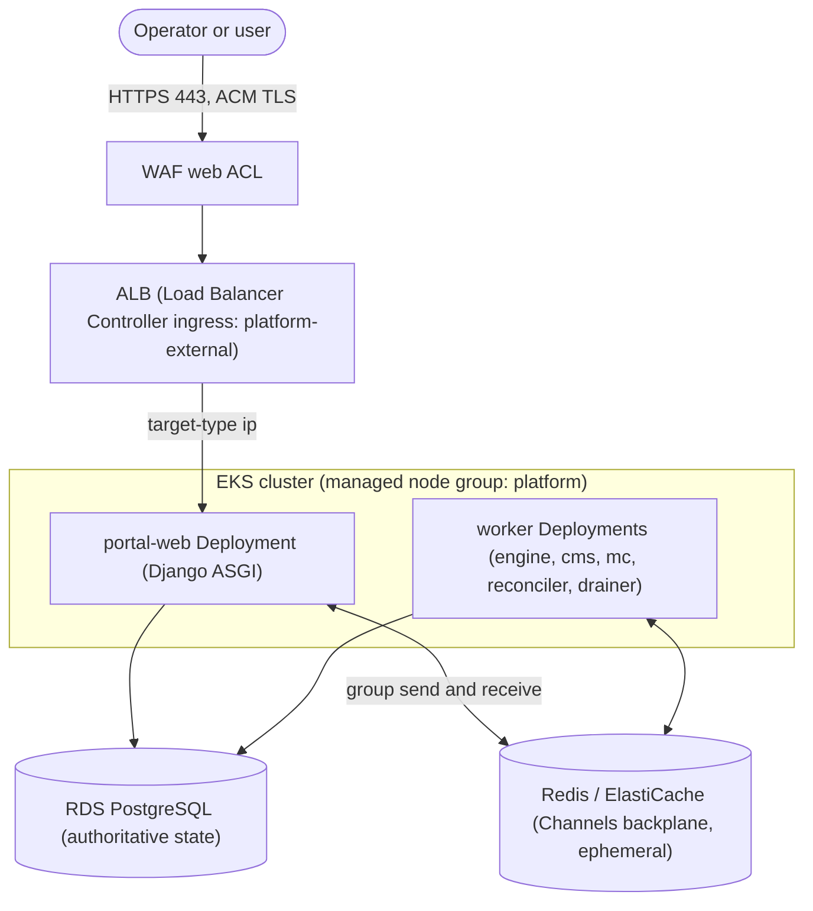

# Portal on EKS operations runbook

Tracking issue: <https://github.com/Brad-Edwards/bigrae/issues/188>
Ownership and security model: [AWS EKS backend bundle](../technical/platform_infrastructure/aws-eks-bundle.md)
Example region: `us-east-2`; use the selected deployment's actual region.

AWS release installation is planned; these procedures cover configured contributor deployments.

Use these how-to procedures to monitor, scale, deploy, troubleshoot, and recover the portal on EKS. It covers
the AWS EKS platform compute path only. Range and target delivery (the VMs
inside a range) remain ECS/VM behind the ADR-039 range adapter and are out of
scope here.

## Scope and status

Under [ADR-044](../adr/README.md), EKS plus the `platform/charts/shifter` Helm
chart is the canonical AWS platform compute path. New AWS contributor deployments use EKS. The earlier portal ASG path has separate Terraform state and requires a controlled cutover. In CI the ASG
deploy lane is disabled (`inputs.environment == '__legacy-disabled__'` in
`.github/workflows/_shifter-platform.yml`); the active AWS deploy lane is the
`eks-deploy` job in the same workflow. For an ASG-to-EKS or EKS-to-ASG
transition, follow
[Migrate an AWS deployment from ECS to EKS](../how-to/aws-ecs-to-eks-migration.md).

Prerequisites for the commands below:

- The environment's deploy role. Operators assume it as a principal named in
  `operator_principal_arns`; IAM users need MFA. Never place access keys,
  session tokens, or passwords in command arguments or in copied examples.
- `kubectl` access through the Session Manager tunnel to the private API
  endpoint. Follow [operator access to the cluster](aws-native-identity.md#operator-access-to-the-cluster).

- Terraform state is the only topology authority. Discover the cluster name,
  node group, ALB name, and resource identifiers from the environment's
  `platform/terraform/environments/<profile>/eks` outputs, never from a guessed
  resource name or a GitHub variable.

Throughout, `<profile>` is the environment (`dev` or `prod`) and the
platform workloads live in the `shifter-platform` namespace.

## 1. Architecture overview



Key relationships:

- **ALB and TLS.** A single public ingress named `platform-external` is served
  by the AWS Load Balancer Controller as an internet-facing ALB. TLS terminates
  at the ALB using an ACM certificate; a WAF web ACL is associated by the
  controller. Client access is restricted with
  `alb.ingress.kubernetes.io/inbound-cidrs`, and the ALB routes to pods with
  `target-type: ip`. These annotations are projected from Terraform outputs at
  deploy time, so they are not committed to the chart values.
- **Django Channels over Redis.** The Portal runs Django Channels (ASGI). Redis
  is the channel layer, the cross-pod backplane that lets any `portal-web`
  replica deliver a WebSocket message originated on any other replica. Redis is
  ephemeral transport, not durable state.
- **No ALB stickiness needed.** Because Redis is the backplane, a WebSocket does
  not need to return to the same pod, so no ALB session-stickiness cookie is
  configured. This differs from the legacy ASG path, which used an ALB cookie.
- **RDS is authoritative.** Application state lives in RDS PostgreSQL. Redis and
  in-cluster pod memory are never durable recovery state.
- **Node autoscaling, fixed pod counts.** Node capacity is managed by
  `cluster-autoscaler` against the managed node group. Pod counts are declarative
  replica values in the chart; there is no HorizontalPodAutoscaler for the Portal
  today.

## 2. Monitoring and health

Inspect live state rather than assuming committed defaults are active.

- **Workload health:**

  ```console
  kubectl -n shifter-platform get deploy,pods -l app.kubernetes.io/component=portal
  kubectl -n shifter-platform rollout status deploy/portal-web
  ```

- **Application readiness.** The `portal-web` liveness and readiness probes hit
  `/health/`, which exercises a Redis round trip and database reachability. From
  a shell with cluster access:

  ```console
  curl --fail --silent --show-error https://<portal-hostname>/health/
  ```

  The public response is intentionally coarse. Do not expose raw provider error
  text to clients.

- **Channel-layer posture.** On startup each Portal process logs a single
  non-secret channel-layer posture record (backend, whether `REDIS_HOST` is
  present, port, TLS, CA mode). Use it to confirm the process actually selected
  Redis:

  ```console
  kubectl -n shifter-platform logs deploy/portal-web | grep 'channel-layer posture'
  ```

- **Nodes and autoscaling.** Confirm node count and cluster-autoscaler activity:

  ```console
  kubectl get nodes -o wide
  kubectl -n kube-system logs deploy/cluster-autoscaler | tail -n 50
  ```

- **ALB target health.** Read the ingress, then inspect the target group in the
  AWS console or CLI:

  ```console
  kubectl -n shifter-platform get ingress platform-external
  ```

- **Control-plane and container logs.** EKS control-plane logs and pod logs are
  available in CloudWatch. Query only sanitized values: posture records, counts,
  states, instance and node identifiers. Never log tokens, Redis URLs with
  passwords, or environment dumps.

## 3. Scaling operations

### Pod replicas (declarative, canonical)

Portal and worker replica counts are set per profile in the chart values, for
example `portal.replicas` in
`platform/charts/shifter/values-aws-<profile>.yaml`. Change the value and apply
it through the deploy path (a Helm upgrade) so the change is durable and matches
the committed source of truth.

`kubectl scale deploy/portal-web --replicas=<n>` is a transient override for an
incident. The next Helm apply restores the values file settings. Record any approved temporary change. Update the source values if the change must persist.

### Nodes (cluster-autoscaler)

`cluster-autoscaler` owns the managed node group's desired size within
`[node_min_size, node_max_size]`. Terraform intentionally ignores changes to the
node group `desired_size` so an apply does not fight the autoscaler.

To change the capacity envelope, edit `node_min_size` and `node_max_size` for the
environment's `eks` root and apply. To temporarily pin node capacity (for
example, to freeze the fleet during an investigation), set
`node_min_size = node_max_size`; that removes headroom for the autoscaler without
removing the node group. Restore the original bounds afterward.

### Expected behavior

- **Scale-out.** When pod replicas increase past node headroom, pods stay
  `Pending` until cluster-autoscaler adds a node and the pods schedule. New
  Portal pods join the Redis backplane, so they can serve any WebSocket.
- **Scale-in.** When load drops, cluster-autoscaler drains and removes
  underused nodes. Managed node group updates use a bounded
  `max_unavailable_percentage`, so a rolling replacement keeps capacity while
  nodes cycle.

## 4. Deployment

Deployment is a Helm upgrade driven by the deploy tooling, not an SSM instance
refresh (that is the legacy ASG path).

- **Pipeline.** The `eks-deploy` job in `.github/workflows/_shifter-platform.yml`
  runs `scripts/bootstrap/deploy.py eks-deploy` with the rendered `bigrae.yaml`
  (`backend: aws`), a digest-pinned image file, the backend config, and the EKS
  Terraform inputs. Image identities are `repository@sha256:<digest>`; tags are
  rejected.
- **What happens.** Terraform applies the isolated `eks` root (cluster, private
  placement, IRSA roles, add-ons, ALB and WAF prerequisites, KMS, secret
  stores). Helm then performs an atomic upgrade of the `platform/charts/shifter`
  release. Runtime secret values are hydrated in-process from Secrets Manager by
  the entrypoint; they never enter Helm values, ConfigMaps, or process
  arguments.
- **Verify a deploy completed.** Deployment requires every managed add-on `ACTIVE` and all controller/chart rollouts complete. Admission must deny a non-launcher provisioner Job. Live Deployment and Job probes must confirm default-deny NetworkPolicy. Each workload ServiceAccount must receive its expected IRSA role and be denied sibling roles. HTTPS `/health/` must succeed. Spot-check the workload rollout directly:

  ```console
  kubectl -n shifter-platform rollout status deploy/portal-web
  kubectl -n shifter-platform get pods -o wide
  ```

## 5. Troubleshooting

### WebSocket connections fail

The channel layer is the usual cause.

1. Confirm the resolved backend from the posture log (see
   [Monitoring and health](#2-monitoring-and-health)). A Portal that logs
   `backend=in_memory` cannot fan out across replicas.
2. Confirm `/health/` is green; it exercises the Redis round trip.
3. If `CHANNEL_LAYER_BACKEND=redis` is set but `REDIS_HOST` is absent, the
   process fails closed with `ImproperlyConfigured` at startup rather than
   silently degrading. Check the pod events and logs for that error.
4. Confirm the Redis security group ingress admits the cluster. Redis ingress is
   granted by security-group reference. Do not open Redis (6379) publicly to test
   connectivity.

### Sticky sessions

There are no ALB stickiness cookies on the EKS path by design; the Redis
backplane removes the need for them. If a WebSocket only works when pinned to one
pod, the backplane is not healthy: revisit the channel-layer checks above rather
than adding stickiness.

### Instance or pod health in the target group

```console
kubectl -n shifter-platform get pods -l app.kubernetes.io/component=portal
kubectl -n shifter-platform describe pod <pod>
kubectl -n shifter-platform get ingress platform-external
```

Unhealthy ALB targets usually trace to failing `/health/` probes (database or
Redis reachability) or to the pod not being `Ready`. NetworkPolicy is default
deny; a newly added path that cannot reach a dependency is often a missing
NetworkPolicy allowance rather than an application bug.

### IRSA and admission failures

- A pod that cannot read a secret or object usually has the wrong or missing
  IRSA binding. Confirm the ServiceAccount and its role annotation match the
  expected workload subject.
- A rejected provisioner Job is expected when it is not the dedicated launcher;
  the fail-closed admission policy enforces that boundary.

### Security guardrails while troubleshooting

- Keep Portal ingress ALB-only and Redis ingress security-group referenced. Do
  not temporarily expose port 8000 or 6379 publicly.
- Redis AUTH stays in Secrets Manager and is hydrated by the entrypoint. Do not
  run `get-secret-value` to print it, do not pass a password to `redis-cli`, and
  do not dump a container environment.

## 6. Rollback

### Roll back a platform release

For a bad chart or image release, roll the Helm release back to the previous
revision through the normal `eks-deploy` lifecycle.
Use its exact verified images and compatible configuration.
Read release history in the Helm metadata namespace:

```console
helm -n shifter-system history shifter
```

Application rollback requires schema compatibility.
Atomic Helm recovery does not reverse database, policy, identity, or Terraform changes.
Obtain data-owner approval before any data or schema recovery.

Do not destroy the EKS Terraform root as a way to stop workloads.

### Recover the channel layer (Redis)

The channel layer runs on Redis, so recovery means restoring a known-good Redis
backend, not switching backends. For a release-induced Redis failure, select the previous compatible release or correct configuration through the deployment lifecycle. Then verify cross-process delivery. A message published on one `portal-web` pod must reach a client on another.

Do not switch to `CHANNEL_LAYER_BACKEND=in_memory` as a production rollback.
In-memory Channels is process-local. It cannot distribute messages across replicas or multiple ASGI workers in one pod. It remains limited to local development and tests. Keep Redis enabled even when the fleet is
reduced to one replica; a single-replica Redis posture is the safer,
event-representative configuration. With an explicit `redis` posture, a missing
`REDIS_HOST` fails closed at startup rather than silently degrading, which is the
intended behavior.

### Roll back to the legacy ASG compatibility path

An EKS-to-ASG rollback requires a controlled traffic cutover. The control planes must never run concurrently against shared queues, outboxes, schedulers, or reconciliation state. Follow [the migration rollback procedure](../how-to/aws-ecs-to-eks-migration.md). Stop EKS consumers and confirm they have stopped. Restore the previous traffic target, then start legacy consumers. Retire either platform root only after the observation window,
recovery evidence, queue and outbox reconciliation, and operator approval.
