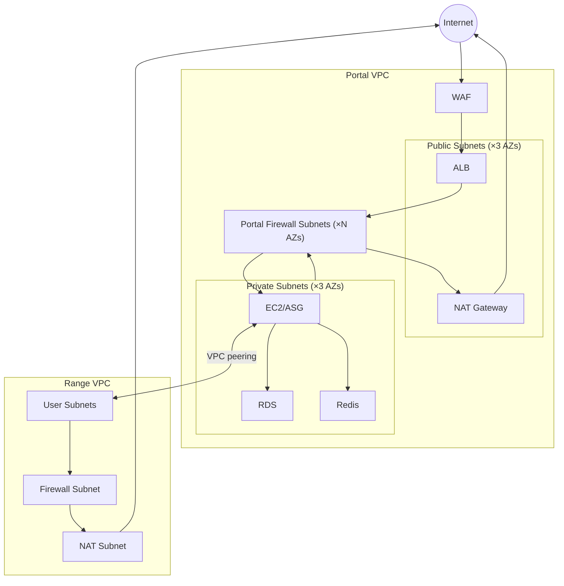

# Networking

This explanation describes application and range network boundaries.
Use the [AWS EKS reference](aws-eks-bundle.md) for current AWS control-plane networking.
Use the [GCP reference](gcp-infrastructure.md) for the current GCP layout.

## Common Pattern

Both clouds separate application services from range guests.
AWS EKS adds a separate control-plane VPC with explicit data-plane and range peering.
The retained two-VPC EC2 topology below is historical context.

1. **Platform network** - Hosts the application (web, database, cache, workers)
2. **Range network** - Hosts ephemeral guest instances, isolated per range
3. **Peering** - Bidirectional connectivity between platform and range networks for terminal access
4. **Egress filtering** - Domain-based outbound rules on the range network
5. **NAT** - Outbound internet for private resources

## AWS

Current EKS uses a separate VPC peered to portal services and range resources.
`modules/portal/eks/portal_network.tf` and `range_network.tf` own those connections.
RDS and Redis admit the configured EKS network; workload policy and identities supply additional controls.

The following diagram, portal inspection details, and EC2 security-group examples describe the retained earlier topology.
They do not describe the current EKS ingress or pod path.

The diagram shows the earlier public ALB, portal EC2 services, and separate range VPC.
Portal and range traffic used peering; guest egress traversed Network Firewall and NAT.
Current EKS placement and ingress are described in the linked EKS reference.

### Portal VPC

| Subnet Type | Components |
|-------------|------------|
| Public (×3 AZs) | ALB, NAT Gateway |
| Firewall (×N AZs) | AWS Network Firewall endpoint per AZ; east-west inspection between public and private tiers |
| Private (×3 AZs) | EC2 (single instance or ASG, configurable), RDS subnet group, Redis subnet group |

Components:
- **WAF** - Rate limiting, IP reputation, OWASP rules. Attached to ALB.
- **ALB** - Public-facing. HTTPS only (HTTP redirects).
- **NAT Gateway** - Single, in one public subnet.
- **Portal Network Firewall** - East-west inspection between the public (ALB) tier and the private services tier. Stateful pass-through with baseline ALERT rules on protocols that have no legitimate east-west use (SSH/RDP/ICMP). FLOW + ALERT logs feed the existing `log-aggregation` pipeline. Gated by `enable_portal_inspection`; requires `enable_log_aggregation = true` so logs do not silently dead-end.
- **RDS** - Subnet group spans all private subnets (Multi-AZ capable). Ingress restricted to the portal EC2 / Django security group (SG-to-SG, not VPC CIDR).
- **Redis** - Subnet group spans all private subnets. Ingress restricted to the portal EC2 / Django security group (SG-to-SG, not VPC CIDR).

Defined in `platform/terraform/modules/portal/vpc/` (including `inspection.tf`) and `platform/terraform/modules/portal/alb/`.

#### Portal east-west inspection (#122)

Defense-in-depth boundary between the portal public tier and the
private services tier:

- **Mechanism**: AWS Network Firewall, the same managed primitive the
  range VPC uses for egress filtering.
- **Path**: ALB → firewall endpoint → Django EC2 (and the return path).
  The VPC has per-AZ public, private, and firewall route tables, plus
  one Network Firewall endpoint per AZ via the firewall's
  `subnet_mapping`. Each AZ's public route table retains its IGW default. More-specific routes reach every private subnet through that AZ's firewall endpoint. Private tables route every public subnet and the 0/0 default through the same endpoint. Firewall tables send internet traffic to the shared NAT gateway. The full route
  matrix ensures cross-AZ flows (created by ALB cross-zone load
  balancing and by the single shared NAT) cannot fall back to the
  implicit local VPC route and bypass inspection.
- **Stateful trade-off**: ALB always has cross-zone load balancing on
  (the platform cannot turn it off), and the portal runs a single
  shared NAT. With per-AZ firewall endpoints, cross-AZ flows are
  inspected by different endpoints on the forward and return legs
  (asymmetric stateful). The visibility-first v1 policy evaluates packets at whichever endpoint observes them. FLOW logs from both endpoints reconstruct asymmetric flows. A stateful drop-by-default posture would require a centralized
  inspection topology (Transit Gateway with single endpoint, GWLB
  with consistent hashing, or single-AZ appliance mode); all of those
  are deferred beyond this issue.
- **Policy**: stateful default pass with a baseline rule group that
  ALERTs on protocols that should not appear east-west (SSH, RDP,
  ICMP). FLOW logs capture every inspected flow. Visibility-first;
  nothing is dropped by default.
- **Logging**: FLOW + ALERT to a CMK-encrypted CloudWatch log group,
  subscribed through `module.log_aggregation` so the existing
  CloudWatch → Firehose → S3 / SQS pipeline carries portal-firewall
  records.
- **Fail-closed**: `enable_portal_inspection = true` requires
  `enable_log_aggregation = true`; a precondition on
  `aws_networkfirewall_firewall.portal` fails the plan otherwise.
- **Microsegmentation**: portal RDS and Redis ingress are
  SG-to-SG references from the portal EC2 / Django security group,
  not a broad `vpc_cidr` allowlist.
- **Default-off baseline + post-apply assertion (#932)**: enabling
  inspection removes the direct private → NAT default route, so a stale,
  wrong-AZ, unhealthy, or missing firewall endpoint silently blackholes
  egress while `terraform apply` still reports success. The committed
  dev / prod tfvars therefore set `enable_portal_inspection = false`; a
  deploy opts in through the `TF_VARS_*_PORTAL` secret. With inspection enabled, the portal apply job runs `scripts/assert_portal_inspection/assert_portal_inspection.py`. It reads typed `portal_inspection_assertion` output and checks live AWS state. Firewall configuration must be `IN_SYNC`. Every AZ attachment must be `READY` and match the Terraform endpoint. Firewall-targeted public/private routes must use the same-AZ endpoint. Each private table must route `0.0.0.0/0` through the firewall, without direct NAT bypass; firewall tables must forward it to shared NAT. Any mismatch fails the deploy
  instead of shipping a blackhole. The check is a no-op when inspection
  is disabled.
- **Enforce vs alert (decision)**: the firewall stays visibility-first—
  stateful default pass with ALERT-only east-west rules—for this
  issue. The assertion proves the inline path is wired and healthy; it
  does **not** convert alert-only inspection into traffic enforcement. Drop-by-default enforcement remains deferred because cross-AZ flows use asymmetric firewall paths. Enabling it requires a separate architecture change and policy parameter. `enable_portal_inspection` must retain its existing meaning.

##### v1 deferrals

- **Stateful symmetric inspection for cross-AZ flows**: see the
  stateful trade-off above. Requires a centralized inspection topology
  (Transit Gateway with single endpoint, GWLB with consistent hashing,
  or single-AZ appliance mode).
- **Intra-private-tier inspection** (Django ↔ RDS, Django ↔ Redis):
  these services share the private subnets, so route-table-based
  inspection cannot apply (same-subnet traffic bypasses route
  lookup). v1 enforces SG-to-SG microsegmentation as the boundary for
  this traffic. A follow-up can split RDS / Redis into a dedicated
  data subnet tier so the firewall covers Django ↔ data as well.
- **Portal ↔ range peering traffic**: not in scope; the range-side
  Network Firewall already owns the range egress boundary.

### Range VPC

| Component | Purpose |
|-----------|---------|
| Firewall Subnet | AWS Network Firewall endpoint (single AZ) |
| NAT Subnet | NAT Gateway for egress |
| User Subnets | Range instances (allocated at runtime by provisioner) |

Traffic flow: `User Subnet → Network Firewall → NAT Gateway → IGW → Internet`

Network Firewall applies domain-based egress filtering. User subnets created at runtime, not by Terraform.

Defined in `platform/terraform/modules/range/vpc/`.

### VPC Peering

Bidirectional peering between Portal and Range VPCs. Enables SSH/RDP from the platform to range instances (terminal UI).

### Security Groups

| Location | Groups |
|----------|--------|
| Portal | ALB, EC2, RDS, Redis |
| Range | Defined per instance type (see Engine docs) |

Range security groups allow SSH ingress from Portal VPC CIDR for terminal access.

## GCP

Two VPC networks, connected via VPC peering.

### Platform Network

Hosts the GKE cluster and shared services.

| Component | Connectivity |
|-----------|-------------|
| GKE nodes | Private (no external IPs). Cloud NAT for outbound. |
| GKE control plane | Private endpoint; operator and CI access use Connect Gateway. |
| Cloud SQL | Private Services Access (internal IP only) |
| Memorystore | Private VPC connection |

GKE uses VPC-native networking with secondary IP ranges for pods and services.
The control-plane endpoint is private; `gke_master_authorized_cidrs` is normally
empty and accepts only connected RFC1918 networks when direct private access is required.

Dataplane V2 default-deny NetworkPolicy limits pod reachability. Workload Identity authenticates Google API calls. Provisioner admission constrains Jobs. Identity Platform sessions, API tokens, and Kubernetes RBAC govern application and cluster calls. Cryptographic
peer authentication on an allowed pod-to-pod connection (mTLS) is the deferred
service-mesh capability (ADR-057).

The public application edge is separate from operator access:

- portal and Guacamole are exposed through GKE Ingress on a reserved global IP
- Cloud Armor attaches to both public backends through `BackendConfig`
- managed TLS is required for the intended `gcp-dev` posture
- GDC workstation and cluster hosts are private-only and reached over IAP instead of public SSH

### Range Network

Hosts guest subnets for range instances. Cloud Router + NAT for egress.

A GCE range cell supplies live-fire containment through a per-range subnet and unique target tags.
Default-deny egress uses a denied-network inventory and explicit NAT enrollment.
Shared-VPC cells use provisioner-owned regional Router/NAT with admitted subnet lists.
VPC-per-range cells retain range-owned Router/NAT.

ADRs 030, 039, and 056 define the approved participant containment boundary. Its threat model and verification are recorded under `docs/architecture/`. GDC custom VXLAN L2 networks, per-range namespaces, and Network Attachment Definitions support development and operator validation.

They are not an approved live-fire containment boundary. See
[GDC Provisioning](gdc-provisioning.md).

### Network Peering

Bidirectional peering between platform and range networks for terminal access, same pattern as AWS.

## CIDRs

Both clouds use configurable CIDR ranges defined in environment tfvars. The specific allocations are deployment config, not architecture.

## Related Docs

- [GCP Infrastructure](gcp-infrastructure.md) - GKE cluster and platform services
- [GDC Provisioning](gdc-provisioning.md) - GDC guest networking details
- [Guacamole](guacamole.md) - Browser-based terminal access (uses the peering connection)
