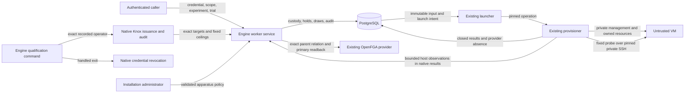

# Disposable VM workers

Reference for worker admission, management qualification, holds, and retirement.

Engine owns disposable workers through the native range lifecycle.
Each worker has one VM and one local Docker daemon.
Each worker has one immutable experiment reference and at most one trial reference.
The worker service accepts account scope and a current native credential.
Installation scope is unsupported.

The operator qualification command uses the existing recorded bootstrap administrator.
It obtains fixed, exact-target native credentials through Management, retains proof inside the process, and revokes it on each handled exit.
Application policy, personal-token eligibility, and customer membership remain mandatory.
Live qualification remains required before delivery.

## Apparatus and admission

An installation administrator publishes the worker policy through an authenticated service.
The policy contains global limits and up to 16 named host profiles.
A policy published with one unnamed `profile` loads as the profile `default`.
Each profile contains a validated outer RAES plan, exact image profile, numeric provider image ID, provenance, and resources.

It also fixes Docker version, capacity scope and partition, and approved egress.
This plan describes apparatus, separately from the experiment SDL.
The service supports the deployment-selected GCE backend.

Other backends fail before reservation or dispatch.
Policy changes affect new workers only.
Admission records the selected profile's name and digest in the batch.
Each new worker of the batch uses that exact profile.
Worker creation refuses a batch whose profile changed or no longer exists, and dispatch reports the entry as an error.
A batch admitted before this binding uses the profile `default`.
An unchanged replay recovers retained custody and the original apparatus.

Creation retains its original trial argument independently of a later trial binding.
An identical creation retry returns the current assignment; a changed original argument conflicts.
Database guards prevent bulk custody rewrites, trial reset, and deletion of the single-use worker record.

Workers retain the admitted profile for their complete lifetime.

The host plan has one Linux VM and one private network.
The existing RAES validator checks its realization contract.
Compile the outer plan with the RAES version pinned by the target release.

A serialized plan from another version is refused before worker creation.
The existing image profile validator checks its exact image and resource settings.
The immutable input carries the numeric image ID through the native image resolver.

Existing provider checks verify it before credential installation and against the actual boot disk.
Without a machine type, the worker uses the E2 custom shape derived from the host plan.
The image profile can select a predefined machine type, for example the ARM64 type `c4a-standard-2`.
That type must state the vCPU count of the host plan.

This keeps physical CPU allocation consistent with capacity demand.
The image profile accepts the NIC, disk-interface, and Secure Boot choices of [GCE guest hardware profiles](https://github.com/OpenRAE/bigrae/blob/dev/docs/architecture/gce-guest-hardware-profiles.md).
Secure Boot stays enabled by default.
Default choices do not change the profile digest or the operation input.
The operation input carries only non-default choices to the GCE renderer.

The host image supplies the pinned Docker version through standard guest bootstrap.
Capture the image after cloud-init resets machine identity and Docker stops and clears its daemon identity.

The existing [Packer procedure](https://github.com/OpenRAE/bigrae/blob/dev/shifter/packer/gcp/README.md) performs this preparation.
Retire workers from a cloned image and qualify fresh workers from a sealed image.
A documented local Packer build can supply a private candidate for approved testing.

Release publication continues to require the existing validation and signing pipeline.
The service does not use the participant-container bootstrap contract.
Optional installed software uses an explicit apparatus binding to an installed adapter.

The adapter SDK distinguishes apparatus identity from pack identity.
The networkless planning Job and the provisioner action executor remain the executable boundary.

A singleton policy row serializes global count admission.
Worker service custody operations acquire that policy mutex before native range and worker locks.
This serializes terminal capacity settlement against admission's reservation and subnet allocation.

Provisioning, failed, held, retiring, and recovery workers count until verified provider absence.
Only accepted native readiness frees a provisioning slot before retirement.
Admission draws from an existing enforcing capacity reservation for the pinned resource demand.

Missing, expired, advisory, insufficient, or wrong-partition reservations refuse admission.
The catalog partition must match the deployment project, region, backend, and selected placement.
The administrator assesses the capacity scope through the existing capacity service before admission.

Active worker draws prevent reservation expiry and remain visible in shared headroom calculations.
Creation first commits worker custody, capacity draws, deferred native range creation, and strict audit together.
The worker then publishes its exact SQL parent through the existing authorization relationship port.

Publication retains the original store and model, and requires primary readback before native dispatch.
Unknown publication outcomes retain custody without launching a VM.
An identical create request can retry publication and dispatch.

The existing native launch outbox commits operation input, launch intent, and dispatch audit together.
A range lock fences retirement against this deferred dispatch.
Deferred dispatch takes ancestry, the worker policy mutex, and then the range lock, matching admission order.

This prevents lock inversion with another creation's exclusive native subnet allocator.
Relationship publication and primary readback remain outside SQL transactions.

## Identity, access, and retirement

The worker UUID is the native public range identity.
The composition root resolves worker scope through Engine before ordinary CMS scope resolution.
SQL supplies the exact parent and ancestry.

OpenFGA receives the corresponding native parent relationship.
The parent relationship supplies ancestry to existing authorization policy; it creates no permission grant.
Create uses parent launch authority.

Inspect uses range read authority.
Probe uses range access authority.
Holds and retirement use range manage authority.

The experiment reference conveys no permission.

Qualification keeps management credentials inside the provisioner (ADR-008-R7 and ADR-066).
Management access uses the private address, provider secret reference, and pinned host key inside the existing provisioner operation.
Immutable operation input explicitly requests the management targets.

The provisioner returns bounded host observations separately from participant members, without management references or access material.
Native member parsing keeps the existing count bound and rejects duplicate guest identities.
Engine validates exact requested targets, operation, generation, membership, profile and observation freshness before qualification.

Both result producer and consumer use the same closed shared parser; historical result bytes remain immutable.
Participant state and ordinary range projections contain no management credential reference.
The fixed provisioner probe addresses the local Unix Docker socket over bounded, host-key-pinned private SSH.

It checks daemon count, daemon ID, machine identity, and the pinned runtime version.
Provider VM identity uses authenticated numeric ID readback in the admitted project and zone.
The participant `instance_id` output remains a reusable name.

The same readback records the realized machine type, Secure Boot state, NIC type, boot disk interface, and boot image ID.
Qualification stores these realized settings.
Qualification fails if a realized setting differs from the retained profile.
Empty NIC and disk-interface choices are recorded but not compared.
A worker without current qualification cannot start a trial.

Engine stores bounded qualification facts and never reads a host-management key.
Qualification expires after 15 minutes or at worker retirement, deadline, or a generation change.
The forward migration requires all existing workers to be retired before it clears old duplicate management references.

Historical operation results remain immutable.
The creation-intent migration uses the strict native binding audit to recover original trial arguments.
PostgreSQL captures inserts from an older application process during rollout and freezes the original value.

It exposes no SSH material, provider output, or guest output.

Holds begin on ready workers.
Holds retain their principal owner, reason, creation time, and review deadline.
Multiple callers can hold one worker.

A caller can release its own hold.
An installation administrator can override an exact hold with strict audit.
Hold acquisition and retirement use the same native range lock.

Acquisition fails after destructive admission.
Native destruction and cancellation cleanup refuse active holds.
An overdue hold requires operator recovery; it does not permit deletion.

Reconciliation expires workers and retries cleanup with bounded backoff and a fixed attempt limit.
Exhausted recovery retains custody, pins, capacity, and an operator-visible obligation.
The operator can resume cleanup through the same service.

Only accepted absence evidence for the exact native generation releases capacity.
The native cancellation path handles an active provisioner.
The native cleanup retry path handles unknown terminal teardown.

Database protection prevents deletion of retained ownership through a range cascade.

Inspection reports `retiring` after retirement is requested and `retired` after verified provider absence.
A worker can run one [worker trial](experiment-dispatch.md#engine-worker-trials).

## Data flow and security

The control plane, provider, and guest are separate trust boundaries.
Current credentials and SQL ancestry prevent cross-account access.
Behavior tests exercise denied access, changed custody, and revoked proof.

The range lock prevents hold and destruction races.
Content pins prevent registry edits from changing admitted hosts.
Provider ownership checks protect shared infrastructure and other workers.

Capacity and count checks prevent oversubscription before effects.
Private NICs, existing firewalls, and pinned SSH keys protect management access.
The Docker socket remains inside its VM.

Guest output cannot select executable code or provider resources.
Strict audit records configuration, admission, holds, overrides, and retirement.
Errors contain fixed text and correlation identities.

Provider failures can retain resources and cost.
Recovery deadlines bound automatic work, rather than resource ownership.
A compromised guest can falsify its probe output.
Qualification proves synthetic management behavior, rather than experiment correctness.
Live qualification requires the approved GCP operating procedure and an approved target.

## Architecture model and references

`.importlinter` and `scripts/check_layer_imports/layer_imports.yaml` define the executable dependency model.
The updated composition allowance permits the worker ancestry resolver.
The layer-import checker enforces this model.

No new application, provider, public listener, or deployment environment is added.
Existing range containment and Job policies continue to apply.
The capacity and native hold fences extend their existing owning services.

The ADR registry records these extensions.

Reference evidence:

| Source | Version and section | Application |
| --- | --- | --- |
| [Django QuerySet API](https://docs.djangoproject.com/en/6.0/ref/models/querysets/) | 6.0, select_for_update | Admission and hold locks |
| [Knox token lifecycle](https://jazzband.github.io/django-rest-knox/views/) | Installed Knox library, expiry and logout | Native proof and revocation |
| [OWASP authorization](https://cheatsheetseries.owasp.org/cheatsheets/Authorization_Cheat_Sheet.html) | Deny by default, validate every request | Checks on server-side worker operations |
| [Django transactions](https://docs.djangoproject.com/en/6.0/topics/db/transactions/) | 6.0, atomic | Custody and durable dispatch |
| [Compute custom images](https://docs.cloud.google.com/compute/docs/instances/create-vm-from-custom-image) | Compute Engine, image creation | Exact host image and independent VMs |
| [Compute custom machine types](https://docs.cloud.google.com/compute/docs/instances/creating-instance-with-custom-machine-type) | Compute Engine, E2 limits | Resource bounds and exact capacity demand |
| [Google ARM compute](https://docs.cloud.google.com/compute/docs/instances/arm-on-compute) | Compute Engine, C4A requirements | ARM64 worker machine types |
| [Docker system info](https://docs.docker.com/reference/cli/docker/system/info/) | Engine CLI, format | Local daemon identity and runtime version |
| [Cloud-init image cleanup](https://docs.cloud-init.io/en/latest/reference/cli.html#clean) | clean, machine-id | A fresh machine identity after image capture |
| [Moby daemon identity](https://github.com/moby/moby/blob/master/daemon/id.go) | LoadOrCreateID | A new daemon identity after cloning |
| [ASD-STE100](https://asd-ste100.org/) | Issue 9, sections 1, 5, and 6 | Vocabulary, sentence length, and document purpose |

The release's pinned RAES public contracts and installed source define host plan validation.
The adapter SDK defines bounded input, planning, and guest actions.
`bigrae.runtime-plugin/v2` requires apparatus identity and forbids pack identity.
The existing version 1 contracts continue to require pack identity.
The design also follows the [worker boundary](https://github.com/OpenRAE/bigrae/blob/dev/docs/architecture/disposable-trial-workers-boundary-2741.md).
